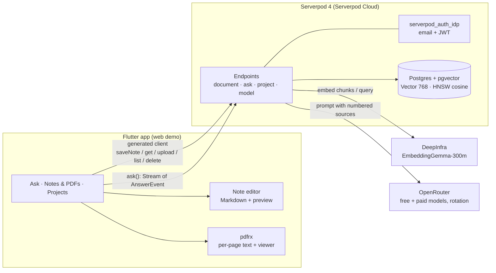

# ⚡ PageBlink

[English](README.md) · **한국어**

**내 노트에 물어보세요. 출처로 바로 이동합니다.**

모든 답변에는 출처가 붙습니다. ⚡를 탭하면 근거가 된 정확한 PDF 페이지나 노트가 바로 열립니다.

[](https://youtu.be/ENYl1pd7_eQ)

[라이브 앱](https://pageblink.serverpod.space) · [데모 영상](https://youtu.be/ENYl1pd7_eQ) · [소스 코드](https://github.com/biyott/pageblink)

**PageBlink**는 PDF도 올릴 수 있는 Google Keep 스타일의 마크다운 노트 앱입니다. 질문 하나로 **노트와 PDF를 함께** 검색하고, 답변은 `[n]` 인용과 함께 토큰 단위로 흘러나옵니다. ⚡ 칩을 탭하면 인용한 PDF 페이지, 또는 인용 구절이 표시된 노트가 열립니다.

**Build Something Real: The Serverpod Hackathon**을 위해 Flutter + Serverpod 4.0.4로 만들었습니다. UI는 기본이 영어이고, 로케일이 `ko`이면 한국어로 바뀝니다.

## 동작 방식

1. **쓰거나 올리세요.** 마크다운 노트를 가볍게 적거나 PDF를 올리면, 둘 다 한 보드에 모이고 함께 인덱싱됩니다.
2. **궁금한 점을 바로 물어보세요.** 질문 한마디로 노트와 PDF를 한 번에 찾아 줍니다.
3. **답변이 바로 흘러나옵니다.** `[n]` 표시는 ⚡ 칩이 되고, 출처는 아래에 SOURCES 칩으로 나열됩니다.
4. **⚡를 탭하면 출처로 바로 이동합니다.** 정확한 PDF 페이지, 또는 인용 구절이 표시된 노트가 열립니다.

그 밖에도 초대할 수 있는 프로젝트(접근 제어를 벡터 쿼리 안에서 처리), 자동으로 돌려 쓰는 7개 모델 카탈로그, Serverpod Cloud 스토리지에 보관한 원본 PDF가 있습니다. 전체 목록: [기능과 한계](docs/reference/001-features-and-limits.md) (영문).

## 심사 기준 매핑

아래 기준은 공식 규정이 아니라 참가자가 전한 자료에서 나왔습니다. [plan 001 §2](docs/plan/001-hackathon-topic-report.md)에도 미확인으로 표시해 두었습니다.

| 기준 (비중) | 확인할 곳 |
|---|---|
| 동작 (30%) | [라이브 앱](https://pageblink.serverpod.space) · [데모 영상](https://youtu.be/ENYl1pd7_eQ) · 서버 테스트 `app/pageblink_server/test/` · 검증 현황은 [알려진 한계](#알려진-한계) |
| Serverpod 스택 활용 (25%) | [Serverpod 활용 방식](#serverpod-활용-방식) · [`app/pageblink_server/lib/src/`](app/pageblink_server/lib/src/) · [devlog 003](docs/devlog/003-server-rag-pipeline.md) |
| 완성도 & 기술적 창의성 (25%) | 인용을 인식하는 스트리밍 프로토콜(`AnswerEvent`) · 벡터 쿼리 안의 ACL ([ADR 010](docs/adr/010-acl-in-query.md)) · 텍스트 전송 전 모델 로테이션 ([`rotating_llm_provider.dart`](app/pageblink_server/lib/src/providers/rotating_llm_provider.dart)) · 문서별 프라이버시 단계 ([ADR 009](docs/adr/009-device-tier-privacy-and-sync.md)) |
| 유용성 (20%) | 인용을 직접 확인할 수 있는 노트·PDF 기반 개인·팀 Q&A · 로드맵 [plan 005](docs/plan/005-follow-up-spec.md) · 시장 공백 [research 003](docs/research/003-competitors-and-gaps.md) |

## Serverpod 활용 방식

| Serverpod 기능 | PageBlink에서 쓰는 곳 |
|---|---|
| ORM + 마이그레이션 | `Document`, `DocChunk`, `Project`, `ProjectMember` 모델(`*.spy.yaml`), 생성된 마이그레이션 |
| `Vector(768)` + HNSW(코사인) + `distanceCosine` | `DocChunk.embedding`; 검색은 [`ask_endpoint.dart`](app/pageblink_server/lib/src/rag_endpoints/ask_endpoint.dart) |
| 스트리밍 엔드포인트(`Stream<AnswerEvent>`) | `AskEndpoint.ask`: 토큰, 인용, 답변한 모델, 오류를 하나의 채널로 전달 |
| `serverpod_auth_idp`(이메일) | 로그인; 엔드포인트는 `requireLogin`과 사용자 id로 ACL 적용 |
| 생성된 프로토콜 + 클라이언트 | `client.ask.ask(...)`, `client.document.saveNote(...)`, `client.document.upload(...)` |
| Serverpod Cloud 배포 + 비밀값 | `pageblink.serverpod.space`에서 라이브; API 키는 Cloud 비밀값 |
| 웹 서버가 Flutter 앱을 서빙 | [`server.dart`](app/pageblink_server/lib/server.dart)의 `FlutterRoute` |
| Cloud 스토리지 / 파일 업로드 | 원본 PDF는 비공개 스토리지에 저장; `pdfUrl`은 ACL 확인 후 단기 서명 URL 반환 |

모두 ✅ 사용 중입니다. 쓰지 않는 기능은 Future Calls(백그라운드 인덱싱)로, Growth 플랜이 필요한데 프로젝트는 Starter입니다.

## 아키텍처



질문 하나가 지나는 길: 쿼리 임베딩 → ACL로 거른 pgvector 검색(상위 8개) → 번호를 붙인 출처를 프롬프트에 넣기 → 토큰 스트리밍 → 각 출처의 첫 `[n]`에서 `citation` 이벤트 발생 → ⚡ 칩. 노트(`kind: 'note'`, 1페이지)와 PDF(`kind: 'pdf'`, 페이지별 청크)는 벡터 인덱스 하나를 같이 씁니다. LLM·임베딩 호출은 전부 서버를 거치므로 API 키는 앱에 내려가지 않습니다.

## 알려진 한계

- **임베딩에는 충전된 DeepInfra 계정이 필요합니다.** HTTP 402가 나오면 새 업로드와 노트 저장은 인덱싱에 실패하고, Ask는 이미 인덱싱된 청크를 키워드로 검색하는 방식으로 바뀌며 그 사실을 알려 줍니다. 잔액을 충전하면 문서마다 **Re-index**로 복구할 수 있습니다. 이 키워드 대체 검색은 Cloud 배포에서 end-to-end로 실행한 기록이 없습니다.
- **기본 답변 모델은 OpenRouter 무료 모델이며, 프롬프트를 기록할 수 있습니다** ([ADR 014](docs/adr/014-model-catalog-and-rotation.md)). 무료 쿼터는 계정 단위입니다. 데모에는 공개 문서를 사용하세요.
- **검증 현황.** [devlog 007](docs/devlog/007-cloud-deploy-and-model-rotation.md)에 기록한 재배포 뒤에 두 라이브 URL 모두 HTTP 200을 반환했습니다. 최신 배포본은 Cloud 배포에서 end-to-end(가입 → 노트/PDF → 질문 → 인용)로 실행한 기록이 아직 없습니다.

그 밖의 한계로는 단일 사용자 노트 편집, Cloak 단계 미구현, 모바일 스토어 빌드 없음 등이 있습니다. 전체 목록: [전체 알려진 한계](docs/reference/001-features-and-limits.md#known-limits) (영문).

## 로컬 실행

Flutter **3.47.7**([fvm](https://fvm.app))과 Serverpod CLI 4.0.4가 필요합니다. Docker는 필요 없습니다. `serverpod start`가 pgvector가 들어 있는 내장 Postgres를 사용합니다.

```bash
fvm use 3.47.7 && dart install serverpod_cli
export OPENROUTER_API_KEY=... DEEPINFRA_API_KEY=...   # or config/passwords.yaml
cd app && serverpod start
```

키 설정과 테스트는 [로컬 실행 상세](docs/reference/002-run-locally.md)(영문)에 있습니다.

## 더 보기

- [기능과 한계](docs/reference/001-features-and-limits.md) · [로컬 실행](docs/reference/002-run-locally.md) (영문) · [문서 레지스트리](docs/README.md) (plan·research·ADR·devlog, 한국어)
- [Claude Code](https://claude.com/claude-code) 에이전트로 기획·조사·구현했습니다. 의사결정 과정은 저장소에 남아 있습니다. 출처를 단 조사 노트 16건, ADR 15건, 기획 문서 9건, 시각을 기록한 devlog 9건(KST).
- [해커톤 페이지](https://builderbase.com/event/build-something-real-the-serverpod-hackathon) · [Serverpod 문서](https://docs.serverpod.dev/overview)
