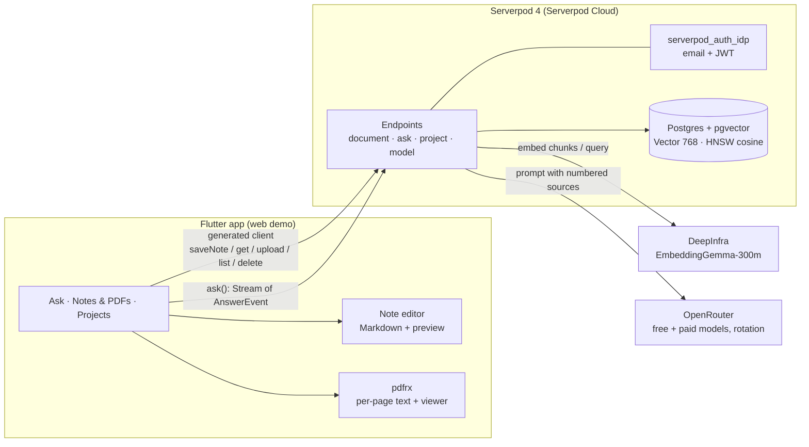

# ⚡ PageBlink

[English](README.md) · **한국어**

**내 노트에 물어보세요. 출처로 바로 이동합니다.**

모든 답변은 출처를 보여 줍니다. ⚡를 탭하면 답변의 근거가 된 정확한 PDF 페이지나 노트가 열립니다.

[라이브 앱](https://pageblink.serverpod.space) · [데모 영상](https://youtu.be/ENYl1pd7_eQ) · [소스 코드](https://github.com/biyott/pageblink)

**PageBlink**는 PDF도 올릴 수 있는 Google Keep 스타일의 마크다운 노트 앱입니다. **노트와 PDF 전체**에 질문하면, 사용한 출처를 가리키는 `[n]` 인용과 함께 답변이 토큰 단위로 스트리밍됩니다. ⚡ 인용 칩을 탭하면 앱이 출처를 열어 바로 확인할 수 있습니다. 인용된 PDF 페이지가 열리거나, 인용 구절이 표시된 노트가 열립니다. "Blink to the source"는 말 그대로 답변에서 출처까지 탭 한 번이라는 뜻입니다.

**Build Something Real: The Serverpod Hackathon**을 위해 Flutter + Serverpod 4.0.4로 만들었습니다. UI는 기본적으로 영어이며, 브라우저/기기 로케일이 `ko`이면 한국어로 전환됩니다(설정에 언어 선택기가 있습니다).

## 4단계로 보는 동작 방식

1. **쓰거나 올리기.** 마크다운 노트를 빠르게 쓰거나 PDF를 업로드합니다. 둘 다 하나의 보드에 놓이고 함께 인덱싱됩니다.
2. **질문하기.** 일상 언어로 질문합니다. 질문 하나로 노트와 PDF를 함께 검색합니다.
3. **⚡ 인용이 달린 스트리밍 답변 받기.** 답변이 토큰 단위로 스트리밍되고, `[n]` 표시는 ⚡ 칩으로, 출처는 아래에 SOURCES 칩으로 나열됩니다.
4. **⚡를 탭해 출처로 이동.** 앱이 인용 구절이 표시된 정확한 PDF 페이지, 또는 인용 구절이 표시된 노트를 엽니다.

## Serverpod 활용 방식

| Serverpod 기능 | PageBlink에서 쓰이는 곳 | 상태 |
|---|---|---|
| ORM + 마이그레이션 | `Document`(`kind` + `body` 포함), `DocChunk`, `Project`, `ProjectMember` 모델(`*.spy.yaml`), 생성된 마이그레이션 | ✅ 사용 중 |
| `Vector(768)` + HNSW 인덱스(코사인) + `distanceCosine` 정렬 | `DocChunk.embedding`; 검색은 [`ask_endpoint.dart`](app/pageblink_server/lib/src/rag_endpoints/ask_endpoint.dart) | ✅ 사용 중, 로컬 DB에서 검증했고 Cloud 마이그레이션으로 적용됨 |
| 스트리밍 엔드포인트(`Stream<AnswerEvent>`) | `AskEndpoint.ask`: 토큰, 인용, 답변한 모델, 오류를 하나의 채널로 전달 | ✅ 사용 중 |
| `serverpod_auth_idp`(이메일) | 로그인; 엔드포인트는 `requireLogin`과 인증된 사용자 id로 ACL 적용 | ✅ 사용 중 |
| 생성된 프로토콜 + 클라이언트 | `pageblink_client`는 자동 생성; 앱은 `client.ask.ask(...)`, `client.document.saveNote(...)`, `client.document.upload(...)` 호출 | ✅ 사용 중 |
| Serverpod Cloud 배포 + 비밀값 | `pageblink.serverpod.space`에서 라이브; API 키는 Cloud 비밀값으로 설정 | ✅ 사용 중 |
| 웹 서버가 Flutter 웹 앱을 서빙 | [`server.dart`](app/pageblink_server/lib/server.dart)의 `FlutterRoute` | ✅ 사용 중 |
| Cloud 스토리지 / 파일 업로드 | 원본 PDF는 업로드 디스크립션을 통해 비공개 Cloud 스토리지로 저장; `pdfUrl`은 ACL 확인 후 단기 서명 URL을 반환; 문서를 삭제하면 저장된 파일도 함께 삭제 | ✅ 사용 중 |
| Future Calls | 백그라운드 인덱싱 | ⏳ 예정 (Growth 플랜 필요, 프로젝트는 Starter) |

## 기능

각 노트나 문서는 서로 다른 프라이버시 단계에 둘 수 있습니다: **Cloak**(기기 전용, 예정) → **Cloud**(내 비공개 클라우드 문서) → **Shared Vision**(프로젝트 팀과 공유하는 문서, 벡터 쿼리 안에서 접근 제어 적용).

### 현재 구현됨

| 기능 | 동작 방식 |
|---|---|
| 랜딩 + 로그인 첫 화면 | 첫 화면은 로그인 카드가 있는 랜딩 페이지이며, 이메일 로그인은 `serverpod_auth_idp`(이메일 프로바이더, JWT 토큰)를 사용합니다 ([plan 007](docs/plan/007-landing-sign-in.md)) |
| Keep 스타일 마크다운 노트 + PDF를 한 보드에 | 노트 카드와 PDF 카드의 그리드. 노트 편집기는 제목, 마크다운 본문, 툴바(제목 / 굵게 / 기울임 / 목록 / 체크박스 / 인용 / 코드), 미리보기 전환(`gpt_markdown`)을 제공하며 뒤로 가기 시 저장됩니다. 서버: ACL이 적용된 `document.saveNote` / `document.get` ([ADR 015](docs/adr/015-product-scope-notes-and-pdfs.md)) |
| 노트와 PDF 모두 인덱싱되고 질문 가능 | 저장할 때마다 서버가 노트를 다시 청크로 나누고 재임베딩합니다(노트는 "1페이지"). PDF는 페이지별로 인덱싱됩니다. 질문 하나로 둘을 함께 검색합니다 |
| 기기 내 텍스트 추출을 쓰는 PDF 업로드 | Flutter 앱에서 `pdfrx`가 **페이지별**로 텍스트를 추출하며, 텍스트와 SHA-256 콘텐츠 해시만 전송됩니다 ([ADR 003](docs/adr/003-pdf-extract-on-client.md)) |
| 인덱싱 | 서버가 페이지를 청크로 나누고 **EmbeddingGemma-300m**(768차원, DeepInfra 경유; 키를 설정하면 Gemini 임베딩 선택 가능)으로 임베딩하여, Serverpod ORM을 통해 **pgvector**(HNSW, 코사인)가 있는 Postgres에 저장합니다 |
| ⚡ 인용 + SOURCES 칩이 있는 스트리밍 답변 | `Stream<AnswerEvent>` 엔드포인트: 노트와 PDF를 함께 놓고 코사인 거리 기준 상위 8개 청크 → LLM → 토큰 + `[n]` 표시 → `citation` 이벤트(각각 `kind`: `note` 또는 `pdf` 포함). 앱은 `[n]`을 ⚡ 칩으로 렌더링하고 답변 아래에 출처를 SOURCES 칩으로 나열합니다 |
| ⚡ 출처로 이동 | 모든 답변은 출처를 보여 줍니다. ⚡ 인용을 탭하면 인용 구절이 표시된 정확한 PDF 페이지, 또는 인용 구절이 표시된 노트가 열립니다. 모바일에서는 인용 바텀 시트가 출처를 보여 줍니다("Source n of m") |
| Serverpod Cloud 스토리지의 원본 PDF | PDF는 비공개 Cloud 스토리지에 저장됩니다. 뷰어는 로컬 사본이 있으면 그것을 쓰고, 없으면 ACL 확인 후 단기 서명 URL로 서버 사본을 사용하므로, 인용은 어떤 기기에서든 팀원에게도 해당 페이지를 엽니다. |
| 벡터 쿼리 안에서 ACL을 적용하는 프로젝트 + 초대 | 프로젝트를 만들고 가입된 사용자를 이메일로 초대합니다(소유자만 가능, UI는 editor로 초대). 역할은 owner / editor / viewer. 소유자 / 프로젝트 멤버십에 대한 `WHERE`가 유사도 정렬과 같은 쿼리에 포함되며, 클라이언트가 보낸 프로젝트 id는 실제 멤버십과 교집합을 취합니다 ([ADR 010](docs/adr/010-acl-in-query.md)) |
| 모델 선택기 + 자동 로테이션 | 백엔드가 7개 모델 카탈로그(무료 5개, OpenRouter 유료 2개)를 제공합니다. **텍스트가 스트리밍되기 전에** 402/404/408/429/5xx가 나오면 서버가 다음 모델로 전환하고, 앱은 어떤 모델이 답했는지 표시합니다 ([ADR 014](docs/adr/014-model-catalog-and-rotation.md)) |
| 인덱싱 실패 처리 | 실패에는 사유 코드가 붙고, 문서별 **Re-index**와 **Re-index all**을 제공합니다. 쿼리 임베딩을 쓸 수 없으면 `ask`가 키워드 검색으로 대체하고 답변에 그 사실을 알립니다 ([devlog 009](docs/devlog/009-indexing-failure-handling.md)) |
| AB "Glass Paper" 반응형 디자인 | 따뜻한 그라디언트, 글래스 셸, 파스텔 노트 카드. 폰: 하단 내비게이션, 태블릿: 내비게이션 레일, 데스크톱: 고정된 Ask 패널이 있는 3단 레이아웃 |
| i18n (EN / KO) | 기본은 영어, 브라우저/기기 로케일이 `ko`이면 자동으로 한국어; 설정의 언어 선택기(System / English / 한국어) |

### 알려진 한계

- **임베딩에는 충전된 DeepInfra 계정이 필요합니다.** 잔액이 소진되면(HTTP 402) 새 업로드와 노트 저장은 인덱싱에 실패하고, Ask는 이미 인덱싱된 청크에 대한 키워드 검색으로 대체되며 그 사실을 알려 줍니다 ([devlog 009](docs/devlog/009-indexing-failure-handling.md)). 문서별 **Re-index** 버튼은 잔액을 충전한 뒤 실패한 문서를 복구합니다. 키워드 대체 검색은 구현되어 있지만, Cloud 배포에서 end-to-end로 실행한 기록은 없습니다.
- **OpenRouter 무료 쿼터는 계정 단위입니다**(하루 50회, 크레딧 ≥ $10 구매 시 하루 1,000회; 분당 20회). 따라서 모델 로테이션은 혼잡에는 도움이 되지만 일일 한도에는 도움이 되지 않습니다.
- **기본 답변 모델은 OpenRouter 무료 모델이며, 프롬프트를 로깅할 수 있습니다** ([ADR 014](docs/adr/014-model-catalog-and-rotation.md)). 데모에는 공개 문서를 사용하세요.
- **검증 현황.** [devlog 007](docs/devlog/007-cloud-deploy-and-model-rotation.md)에 기록된 재배포 이후 두 라이브 URL 모두 HTTP 200을 반환했습니다. 최신 배포(노트, 랜딩 페이지, Glass Paper 디자인, i18n, 인덱싱 실패 처리)는 Cloud 배포에서 end-to-end(가입 → 노트/PDF 업로드 → 질문 → 인용) 실행 기록이 아직 없습니다. 노트 UI와 가입 비밀번호 규칙(12–50자, 소문자 + 숫자, 대문자 또는 특수문자; 클라이언트 측에서만 검사)은 자동화 테스트로 다루지 않습니다.
- **원본 PDF와 웹 업로드.** PDF는 서버 측 비공개 Cloud 스토리지에 저장됩니다(`document.pdfUploadDescription` / `confirmPdfUpload` / `pdfUrl`). 웹 업로드의 CORS는 아직 검증하지 않았습니다. 서버 사본을 쓸 수 없으면(예: 업로드 실패) 뷰어는 페이지 대신 인용 구절을 보여 줍니다. 페이지 본문 안의 인용 하이라이트는 아직 구현되지 않았습니다.
- **노트는 단일 사용자 편집이며 뒤로 가기 시 저장됩니다.** 실시간 동기화나 공동 편집, 이미지, 라벨/색상/고정/보관, 버전 기록이 없고, 미리보기에서 체크박스를 토글할 수 없습니다. 이들은 예정되어 있습니다 ([plan 005](docs/plan/005-follow-up-spec.md), [ADR 015](docs/adr/015-product-scope-notes-and-pdfs.md)).
- **Cloak 단계**(기기 전용, 오프라인)는 단계 선택기에 "coming soon"(비활성)으로 표시되며 구현되어 있지 않습니다.
- **모바일 스토어 빌드 없음.** 데모는 Serverpod Cloud 위의 Flutter 웹 앱입니다.

### 예정

Cloak 기기 전용 오프라인 단계, Notion 같은 실시간 동기화와 공동 편집(Serverpod 스트림), 더 풍부한 노트 편집기(미리보기에서 체크리스트 토글, 이미지, 라벨/색상/고정/보관), 노트 버전 기록, Cloak 오프라인 Evidence 모드(기기 내 EmbeddingGemma + sqlite-vec/FTS5), 페이지 본문 안의 인용 하이라이트, 기기↔클라우드 동기화(Recall), 직접 Gemini 프로바이더(LLM 답변; Gemini 임베딩은 현재 선택 사항), 모바일 스토어 빌드, 멤버/역할 관리 UI, Future Calls를 이용한 백그라운드 인덱싱, 한국어 하이브리드 검색 등. 인수 기준을 포함한 전체 명세: [docs/plan/005-follow-up-spec.md](docs/plan/005-follow-up-spec.md).

## 아키텍처



노트와 PDF는 하나의 파이프라인을 공유합니다. 저장된 노트는 단일 페이지(`kind: 'note'`)로, 업로드된 PDF는 페이지별 청크 묶음(`kind: 'pdf'`)으로 인덱싱되며, 둘 다 같은 벡터 인덱스의 `DocChunk` 행이 됩니다.

질문 하나의 흐름: 쿼리 임베딩 → ACL로 필터링된 pgvector 검색(상위 8개) → 번호가 매겨진 출처를 프롬프트에 포함 → 토큰 스트리밍 → 각 출처의 첫 `[n]`에서 `citation` 이벤트 발생 → 앱이 `[n]`을 ⚡ 칩으로 렌더링(PDF 인용 → 해당 페이지의 뷰어, 노트 인용 → 인용 구절이 표시된 노트 열기). 모든 LLM 및 임베딩 호출은 Serverpod 서버를 거치며, API 키는 앱에 전달되지 않습니다.

Serverpod Cloud에 배포됨: 웹 앱 `https://pageblink.serverpod.space`, API `https://pageblink.api.serverpod.space`.

## 로컬 실행

요구 사항: Flutter **3.47.7**([fvm](https://fvm.app) 사용), Serverpod CLI 4.0.4. Docker는 필요 없습니다. `serverpod start`는 내장 Postgres를 사용합니다(pgvector 사용 가능, [devlog 002](docs/devlog/002-env-setup-and-g1.md)에서 확인).

```bash
fvm use 3.47.7
dart install serverpod_cli
```

**API 키** — 환경 변수(키만) 또는 `app/pageblink_server/config/passwords.yaml`(git 제외; Serverpod Cloud에서는 `serverpod cloud password set <name> <value>` 사용)로 설정합니다.

| 설정 | 환경 변수 대체 | 비고 |
|---|---|---|
| `openrouterApiKey` | `OPENROUTER_API_KEY` | OpenRouter를 통한 LLM |
| `deepinfraApiKey` | `DEEPINFRA_API_KEY` | 임베딩 |
| `anthropicApiKey` | `ANTHROPIC_API_KEY` | OpenRouter 키가 없을 때만 사용(Claude 직접 호출) |
| `llmModel` | – | 기본 모델(기본값: `google/gemma-4-26b-a4b-it:free`) |
| `llmRotation` | – | `free`(기본) · `all`(유료 모델 포함) · `off` |

```bash
export OPENROUTER_API_KEY=...    # or put the keys in config/passwords.yaml
export DEEPINFRA_API_KEY=...
cd app && serverpod start        # generates code, starts the server and the web app
```

개발 환경에서는 가입용 이메일 인증 코드가 서버 콘솔에 출력되고, Serverpod Cloud에서는 Cloud 이메일 서비스를 통해 발송됩니다.

테스트:

```bash
cd app/pageblink_server && dart test
```

커밋 `0af55e0`에서 13개 테스트가 통과했고, 그중 11개는 단위 테스트입니다(`dart test test/unit`, 데이터베이스 불필요). 통합 테스트 2개(pgvector 스모크 테스트, greeting)는 내장 로컬 데이터베이스를 사용합니다.

## 심사 기준 매핑

아래 기준은 공식 규정이 아니라 참가자가 전한 자료에서 나온 것입니다([plan 001 §2](docs/plan/001-hackathon-topic-report.md)에서 미확인으로 표시됨).

| 기준 (비중) | 확인할 곳 |
|---|---|
| 동작 (30%) | [라이브 앱](https://pageblink.serverpod.space); 질문 → 스트리밍 답변 → ⚡ → 출처. 서버 테스트: `app/pageblink_server/test/`. 검증 현황: [알려진 한계](#알려진-한계) |
| Serverpod 스택 활용 (25%) | [Serverpod 활용 방식](#serverpod-활용-방식) · [`app/pageblink_server/lib/src/`](app/pageblink_server/lib/src/) (`rag_endpoints/`, `models/`) · [devlog 003](docs/devlog/003-server-rag-pipeline.md) |
| 완성도 & 기술적 창의성 (25%) | 인용을 인식하는 스트리밍 프로토콜(`AnswerEvent`), 벡터 쿼리 안의 ACL ([ADR 010](docs/adr/010-acl-in-query.md)), 텍스트 전송 전 모델 로테이션 ([`rotating_llm_provider.dart`](app/pageblink_server/lib/src/providers/rotating_llm_provider.dart)), 문서별 프라이버시 단계 ([ADR 009](docs/adr/009-device-tier-privacy-and-sync.md)) |
| 유용성 (20%) | 검증 가능한 인용을 갖춘 노트·PDF 기반의 개인 및 팀 Q&A; 로드맵은 [plan 005](docs/plan/005-follow-up-spec.md), 시장 공백은 [research 003](docs/research/003-competitors-and-gaps.md) |

## Claude Code로 만들었습니다

이 프로젝트는 [Claude Code](https://claude.com/claude-code) 에이전트로 기획·조사·구현했습니다. 의사결정 과정은 저장소에 남아 있습니다: 출처가 달린 조사 노트 16건, ADR 15건, 기획 문서 8건, 타임스탬프가 달린 devlog(9건)(시간은 모두 KST). [문서 레지스트리](docs/README.md)를 참고하세요.

---

## 문서

문서는 종류별 폴더로 나뉩니다 → [📂 문서 레지스트리](docs/README.md)

| 폴더 | 내용 |
|---|---|
| 📐 [docs/plan](docs/plan/README.md) | 기획·설계 8건: [주제 선정](docs/plan/001-hackathon-topic-report.md) · [RAG 비서 기획·아키텍처](docs/plan/002-rag-assistant-plan.md) · [기술 스택 & 준비](docs/plan/003-tech-stack-and-prep.md) · [이름 후보 & 기능 용어집](docs/plan/004-naming-and-feature-vocabulary.md) · [후속 기능 명세](docs/plan/005-follow-up-spec.md) · [데모 대본](docs/plan/006-demo-script.md) · [랜딩·로그인](docs/plan/007-landing-sign-in.md) · [제출 키트](docs/plan/008-submission-kit.md) |
| 🔎 [docs/research](docs/research/README.md) | 서브에이전트 조사 결과 16건 (출처 포함) |
| ⚖️ [docs/adr](docs/adr/README.md) | 결정 기록 15건 |
| 🧪 [docs/devlog](docs/devlog/README.md) | 개발 과정 기록 9건 (수행 일시 포함) |

## 개요

| 항목 | 내용 |
| ---- | ---- |
| 행사 | Build Something Real: The Serverpod Hackathon |
| 마감 | 2026-10-14 21:59 UTC (= 10/14 23:59 CEST · **10/15 06:59 KST**) |
| 팀 | 웹 + Flutter 개발자 (1인 또는 소규모 팀) |
| 스택 | Serverpod (Dart 백엔드) + Flutter |

## 참고 링크

- 행사 페이지: https://builderbase.com/event/build-something-real-the-serverpod-hackathon
- Serverpod 문서: https://docs.serverpod.dev/overview
