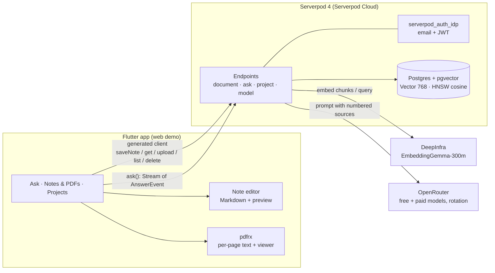

# ⚡ PageBlink

**Ask your notes. Blink to the source.**

Every answer shows its source: tap ⚡ to open the exact PDF page or note it came from.

[Live app](https://pageblink.serverpod.space) · [Demo video](<VIDEO_URL>) · [Source](https://github.com/biyott/pageblink)

**PageBlink** is a Google Keep–style Markdown notes app that also takes PDFs. Ask a question across **both your notes and your PDFs**, and the answer streams in token by token with `[n]` citations to the exact sources it used. Tap a ⚡ citation chip and the app opens the source so you can check it: the cited PDF page, or the cited note with the quoted passage shown. "Blink to the source" means exactly that: one tap from an answer to where it came from.

Built for **Build Something Real: The Serverpod Hackathon** with Flutter + Serverpod 4.0.4. The UI is English by default and switches to Korean when the browser/device locale is `ko` (Settings has a language picker).

## How it works in 4 steps

1. **Write or upload.** Write a quick Markdown note or upload a PDF. Both land on one board and are indexed together.
2. **Ask.** Ask a question in plain language. One question searches your notes and PDFs together.
3. **Get a streamed answer with ⚡ citations.** The answer streams in token by token, with `[n]` markers rendered as ⚡ chips and the sources listed as SOURCES chips below.
4. **Tap ⚡ to blink to the source.** The app opens the exact PDF page with the quoted passage, or the cited note with the quote shown.

## How we used Serverpod

| Serverpod feature | Where in PageBlink | Status |
|---|---|---|
| ORM + migrations | `Document` (with `kind` + `body`), `DocChunk`, `Project`, `ProjectMember` models (`*.spy.yaml`), generated migrations | ✅ in use |
| `Vector(768)` + HNSW index (cosine) + `distanceCosine` ordering | `DocChunk.embedding`; search in [`ask_endpoint.dart`](app/pageblink_server/lib/src/rag_endpoints/ask_endpoint.dart) | ✅ in use, verified on local DB and applied by the Cloud migration |
| Streaming endpoint (`Stream<AnswerEvent>`) | `AskEndpoint.ask`: tokens, citations, answering model, errors on one channel | ✅ in use |
| `serverpod_auth_idp` (email) | Sign-in; endpoints use `requireLogin` and the authenticated user id for ACL | ✅ in use |
| Generated protocol + client | `pageblink_client` is generated; the app calls `client.ask.ask(...)`, `client.document.saveNote(...)`, `client.document.upload(...)` | ✅ in use |
| Serverpod Cloud deploy + passwords | Live at `pageblink.serverpod.space`; API keys set as Cloud passwords | ✅ in use |
| Web server serves the Flutter web app | `FlutterRoute` in [`server.dart`](app/pageblink_server/lib/server.dart) | ✅ in use |
| Cloud storage / file upload | Original PDFs go to private cloud storage via upload descriptions; `pdfUrl` returns a short-lived signed URL after an ACL check; deleting a document removes the stored file too | ✅ in use |
| Future Calls | Background indexing | ⏳ planned (needs Growth plan; project is on Starter) |

## Features

Each note or document can live in a different privacy tier: **Cloak** (device-only, planned) → **Cloud** (your private cloud documents) → **Shared Vision** (documents shared with a project team, with access control enforced inside the vector query).

### Implemented now

| Feature | How it works |
|---|---|
| Landing + sign-in first page | The first screen is a landing page with the sign-in card; email sign-in uses `serverpod_auth_idp` (email provider, JWT tokens) ([plan 007](docs/plan/007-landing-sign-in.md)) |
| Keep-style Markdown notes + PDFs on one board | Grid of note cards and PDF cards. Note editor with title, Markdown body, toolbar (heading / bold / italic / list / checkbox / quote / code), preview toggle (`gpt_markdown`), saves when you go back. Server: `document.saveNote` / `document.get` with ACL ([ADR 015](docs/adr/015-product-scope-notes-and-pdfs.md)) |
| Notes and PDFs are both indexed and askable | On every save the server re-chunks and re-embeds the note (a note is "page 1"); PDFs are indexed per page. One question searches both together |
| PDF upload with on-device text extraction | `pdfrx` extracts text **per page** in the Flutter app; only text and a SHA-256 content hash are sent ([ADR 003](docs/adr/003-pdf-extract-on-client.md)) |
| Indexing | Server chunks pages, embeds with **EmbeddingGemma-300m** (768-d, via DeepInfra; optional Gemini embeddings when a key is configured), stores in Postgres with **pgvector** (HNSW, cosine) through the Serverpod ORM |
| Streaming answers with ⚡ citations + SOURCES chips | `Stream<AnswerEvent>` endpoint: top-8 chunks by cosine distance over notes and PDFs together → LLM → tokens + `[n]` markers → `citation` events (each carries `kind`: `note` or `pdf`). The app renders `[n]` as ⚡ chips and lists the sources as SOURCES chips under the answer |
| ⚡ Blink to the source | Every answer shows its source: tapping a ⚡ citation opens the exact PDF page with the quoted passage, or the cited note with the quote shown. On mobile, a citation bottom sheet shows the source ("Source n of m") |
| Original PDFs in Serverpod cloud storage | PDFs are stored in private cloud storage. The viewer uses the local copy if present, otherwise the server copy via a short-lived signed URL after an ACL check, so a citation opens the page on any device and for teammates.|
| Projects + invites with ACL inside the vector query | Create a project, invite a registered user by email (owner only; the UI invites as editor). Roles owner / editor / viewer. The `WHERE` on owner / project membership is part of the same query as the similarity ordering; client-sent project ids are intersected with real memberships ([ADR 010](docs/adr/010-acl-in-query.md)) |
| Model picker + automatic rotation | Backend serves a 7-model catalog (5 free, 2 paid via OpenRouter). On 402/404/408/429/5xx **before any text streams**, the server rotates to the next model; the app shows which model answered ([ADR 014](docs/adr/014-model-catalog-and-rotation.md)) |
| Indexing-failure handling | Failures carry reason codes; per-document **Re-index** and **Re-index all**; when query embedding is unavailable, `ask` falls back to keyword search and says so in the answer ([devlog 009](docs/devlog/009-indexing-failure-handling.md)) |
| AB "Glass Paper" responsive design | Warm gradient, glass shell, pastel note cards. Phone: bottom navigation; tablet: navigation rail; desktop: 3-pane layout with a persistent Ask panel |
| i18n (EN / KO) | English by default; Korean automatically when the browser/device locale is `ko`; Settings language picker (System / English / 한국어) |

### Known limits

- **Embeddings need a funded DeepInfra account.** If the balance runs out (HTTP 402), new uploads and note saves fail to index and Ask falls back to keyword search over the chunks that are already indexed, and tells you so ([devlog 009](docs/devlog/009-indexing-failure-handling.md)). The per-document **Re-index** button recovers failed documents once the balance is topped up. The keyword fallback is implemented, but it has no recorded end-to-end run on the cloud deployment.
- **OpenRouter free quota is per account** (50/day, 1,000/day after buying ≥ $10 credits; 20/min), so model rotation helps with congestion, not with the daily cap.
- **Default answer models are OpenRouter free models, which may log prompts** ([ADR 014](docs/adr/014-model-catalog-and-rotation.md)). Use public documents for the demo.
- **Verification status.** Both live URLs returned HTTP 200 after the redeploy recorded in [devlog 007](docs/devlog/007-cloud-deploy-and-model-rotation.md). The latest deploy (notes, landing page, Glass Paper design, i18n, indexing-failure handling) has no recorded end-to-end run on the cloud deployment yet (sign-up → note/PDF upload → ask → citation). The notes UI and the sign-up password rule (12–50 chars, lowercase + number, uppercase or special; client-side only) are not covered by automated tests.
- **Original PDFs and web upload.** PDFs are stored server-side in private cloud storage (`document.pdfUploadDescription` / `confirmPdfUpload` / `pdfUrl`). CORS for the web upload is not verified yet. If the server copy is unavailable (for example a failed upload), the viewer shows the cited quote instead of the page. Citation highlight inside the page body is not implemented yet.
- **Notes are single-user editing with save-on-back.** There is no realtime sync or collaborative editing, no images, no labels/colors/pin/archive, no version history, and checkboxes cannot be toggled in the preview. These are planned ([plan 005](docs/plan/005-follow-up-spec.md), [ADR 015](docs/adr/015-product-scope-notes-and-pdfs.md)).
- **The Cloak tier** (device-only, offline) appears in the tier picker as "coming soon" (disabled); it is not implemented.
- **No mobile store builds.** The demo is the Flutter web app on Serverpod Cloud.

### Planned

Cloak device-only offline tier, Notion-like realtime sync and collaborative editing (Serverpod streams), a richer note editor (checklist toggling in preview, images, labels/colors/pin/archive), note version history, Cloak offline Evidence mode (EmbeddingGemma on device + sqlite-vec/FTS5), citation highlight inside the page body, device↔cloud sync (Recall), direct Gemini provider (LLM answers; Gemini embeddings are optional today), mobile store builds, member/role management UI, background indexing with Future Calls, Korean hybrid search, and more. Full spec with acceptance criteria: [docs/plan/005-follow-up-spec.md](docs/plan/005-follow-up-spec.md).

## Architecture



Notes and PDFs share one pipeline: a saved note is indexed as a single page (`kind: 'note'`), an uploaded PDF as one chunk set per page (`kind: 'pdf'`); both end up as `DocChunk` rows in the same vector index.

Flow of one question: embed the query → ACL-filtered pgvector search (top 8) → numbered sources into the prompt → stream tokens → emit a `citation` event on the first `[n]` of each source → the app renders `[n]` as ⚡ chips (PDF citation → viewer at the page; note citation → opens the cited note with the quote shown). All LLM and embedding calls go through the Serverpod server; API keys never reach the app.

Deployed on Serverpod Cloud: web app `https://pageblink.serverpod.space`, API `https://pageblink.api.serverpod.space`.

## Run locally

Requirements: Flutter **3.47.7** (via [fvm](https://fvm.app)), Serverpod CLI 4.0.4. No Docker needed; `serverpod start` uses an embedded Postgres (pgvector available, checked in [devlog 002](docs/devlog/002-env-setup-and-g1.md)).

```bash
fvm use 3.47.7
dart install serverpod_cli
```

**API keys** — either environment variables (keys only) or `app/pageblink_server/config/passwords.yaml` (git-ignored; on Serverpod Cloud use `serverpod cloud password set <name> <value>`):

| Setting | Env var fallback | Notes |
|---|---|---|
| `openrouterApiKey` | `OPENROUTER_API_KEY` | LLM via OpenRouter |
| `deepinfraApiKey` | `DEEPINFRA_API_KEY` | Embeddings |
| `anthropicApiKey` | `ANTHROPIC_API_KEY` | Only used if no OpenRouter key (direct Claude) |
| `llmModel` | – | Default model (default: `google/gemma-4-26b-a4b-it:free`) |
| `llmRotation` | – | `free` (default) · `all` (also paid models) · `off` |

```bash
export OPENROUTER_API_KEY=...    # or put the keys in config/passwords.yaml
export DEEPINFRA_API_KEY=...
cd app && serverpod start        # generates code, starts the server and the web app
```

In development, email verification codes for sign-up are printed in the server console; on Serverpod Cloud they are sent through the Cloud email service.

Tests:

```bash
cd app/pageblink_server && dart test
```

13 tests passed at commit `0af55e0`; 11 of them are unit tests (`dart test test/unit`, no database needed). The 2 integration tests (pgvector smoke test, greeting) use the embedded local database.

## Judging criteria map

The criteria below come from participant-reported material, not the official rules ([plan 001 §2](docs/plan/001-hackathon-topic-report.md), marked unverified there).

| Criterion (weight) | Where to look |
|---|---|
| Works (30%) | [Live app](https://pageblink.serverpod.space); ask → streamed answer → ⚡ → source. Server tests: `app/pageblink_server/test/`. Verification status: [Known limits](#known-limits) |
| Serverpod stack usage (25%) | [How we used Serverpod](#how-we-used-serverpod) · [`app/pageblink_server/lib/src/`](app/pageblink_server/lib/src/) (`rag_endpoints/`, `models/`) · [devlog 003](docs/devlog/003-server-rag-pipeline.md) |
| Completeness & technical creativity (25%) | Citation-aware streaming protocol (`AnswerEvent`), ACL inside the vector query ([ADR 010](docs/adr/010-acl-in-query.md)), pre-text model rotation ([`rotating_llm_provider.dart`](app/pageblink_server/lib/src/providers/rotating_llm_provider.dart)), per-document privacy tiers ([ADR 009](docs/adr/009-device-tier-privacy-and-sync.md)) |
| Usefulness (20%) | Personal and team Q&A over notes and PDFs with verifiable citations; roadmap in [plan 005](docs/plan/005-follow-up-spec.md) and market gaps in [research 003](docs/research/003-competitors-and-gaps.md) |

## Built with Claude Code

This project was planned, researched, and built with [Claude Code](https://claude.com/claude-code) agents. The decision trail is in the repo: 16 research notes with sources, 15 ADRs, 8 plan documents, and a timestamped devlog (9 entries) (all times KST). See the [docs registry](docs/README.md).

---

## 한국어

> **한국어 요약**: Google Keep 스타일의 마크다운 노트 앱에 PDF도 올릴 수 있고, 노트와 PDF 전체에 질문하면 인용과 함께 답이 스트리밍됩니다. 인용(⚡)을 탭하면 PDF는 해당 페이지가, 노트는 인용 구절이 표시된 노트가 열려 출처를 바로 확인할 수 있습니다("Blink to the source" = 답변에서 출처까지 탭 한 번). Flutter + Serverpod, Serverpod Cloud에 배포됨.

## 문서

문서는 종류별 폴더로 나뉩니다 → [📂 문서 레지스트리](docs/README.md)

| 폴더 | 내용 |
|---|---|
| 📐 [docs/plan](docs/plan/README.md) | 기획·설계 8건: [주제 선정](docs/plan/001-hackathon-topic-report.md) · [RAG 비서 기획·아키텍처](docs/plan/002-rag-assistant-plan.md) · [기술 스택 & 준비](docs/plan/003-tech-stack-and-prep.md) · [이름 후보 & 기능 용어집](docs/plan/004-naming-and-feature-vocabulary.md) · [후속 기능 명세](docs/plan/005-follow-up-spec.md) · [데모 대본](docs/plan/006-demo-script.md) · [랜딩·로그인](docs/plan/007-landing-sign-in.md) · [제출 키트](docs/plan/008-submission-kit.md) |
| 🔎 [docs/research](docs/research/README.md) | 서브에이전트 조사 결과 16건 (출처 포함) |
| ⚖️ [docs/adr](docs/adr/README.md) | 결정 기록 15건 |
| 🧪 [docs/devlog](docs/devlog/README.md) | 개발 과정 기록 9건 (수행 일시 포함) |

## 개요

| 항목 | 내용 |
| ---- | ---- |
| 행사 | Build Something Real: The Serverpod Hackathon |
| 마감 | 2026-10-14 21:59 UTC (= 10/14 23:59 CEST · **10/15 06:59 KST**) |
| 팀 | 웹 + Flutter 개발자 (1인 또는 소규모 팀) |
| 스택 | Serverpod (Dart 백엔드) + Flutter |

## 참고 링크

- 행사 페이지: https://builderbase.com/event/build-something-real-the-serverpod-hackathon
- Serverpod 문서: https://docs.serverpod.dev/overview
