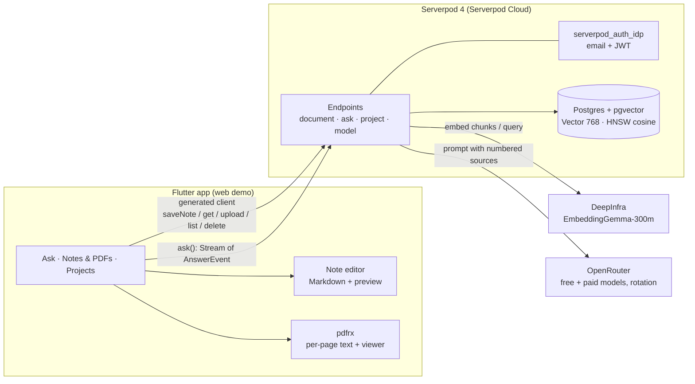

# ⚡ PageBlink

**English** · [한국어](README.ko.md)

**Ask your notes. Blink to the source.**

Every answer shows its source: tap ⚡ to open the exact PDF page or note it came from.

[](https://youtu.be/ENYl1pd7_eQ)

[Live app](https://pageblink.serverpod.space) · [Demo video](https://youtu.be/ENYl1pd7_eQ) · [Source](https://github.com/biyott/pageblink)

**PageBlink** is a Google Keep–style Markdown notes app that also takes PDFs. Ask one question across **both your notes and your PDFs**; the answer streams in token by token with `[n]` citations. Tap a ⚡ chip and the app opens the cited PDF page, or the cited note with the quoted passage shown.

Built for **Build Something Real: The Serverpod Hackathon** with Flutter + Serverpod 4.0.4. English UI by default, Korean when the locale is `ko`.

## How it works

1. **Write or upload.** A quick Markdown note or a PDF; both land on one board and are indexed together.
2. **Ask.** One plain-language question searches notes and PDFs together.
3. **Get a streamed answer with ⚡ citations.** `[n]` markers become ⚡ chips; sources are listed as SOURCES chips below.
4. **Tap ⚡ to blink to the source.** The exact PDF page, or the cited note, opens with the quote shown.

Also: projects with invites (access control inside the vector query), 7-model catalog with automatic rotation, original PDFs in Serverpod cloud storage. Full list: [features & limits](docs/reference/001-features-and-limits.md).

## Judging criteria map

The criteria come from participant-reported material, not the official rules ([plan 001 §2](docs/plan/001-hackathon-topic-report.md), marked unverified there).

| Criterion (weight) | Where to look |
|---|---|
| Works (30%) | [Live app](https://pageblink.serverpod.space) · [Demo video](https://youtu.be/ENYl1pd7_eQ) · server tests in `app/pageblink_server/test/` · verification status in [Known limits](#known-limits) |
| Serverpod stack usage (25%) | [How we used Serverpod](#how-we-used-serverpod) · [`app/pageblink_server/lib/src/`](app/pageblink_server/lib/src/) · [devlog 003](docs/devlog/003-server-rag-pipeline.md) |
| Completeness & technical creativity (25%) | Citation-aware streaming protocol (`AnswerEvent`) · ACL inside the vector query ([ADR 010](docs/adr/010-acl-in-query.md)) · pre-text model rotation ([`rotating_llm_provider.dart`](app/pageblink_server/lib/src/providers/rotating_llm_provider.dart)) · per-document privacy tiers ([ADR 009](docs/adr/009-device-tier-privacy-and-sync.md)) |
| Usefulness (20%) | Personal and team Q&A over notes and PDFs with verifiable citations · roadmap [plan 005](docs/plan/005-follow-up-spec.md) · market gaps [research 003](docs/research/003-competitors-and-gaps.md) |

## How we used Serverpod

| Serverpod feature | Where in PageBlink |
|---|---|
| ORM + migrations | `Document`, `DocChunk`, `Project`, `ProjectMember` models (`*.spy.yaml`), generated migrations |
| `Vector(768)` + HNSW (cosine) + `distanceCosine` | `DocChunk.embedding`; search in [`ask_endpoint.dart`](app/pageblink_server/lib/src/rag_endpoints/ask_endpoint.dart) |
| Streaming endpoint (`Stream<AnswerEvent>`) | `AskEndpoint.ask`: tokens, citations, answering model, errors on one channel |
| `serverpod_auth_idp` (email) | Sign-in; endpoints use `requireLogin` and the user id for ACL |
| Generated protocol + client | `client.ask.ask(...)`, `client.document.saveNote(...)`, `client.document.upload(...)` |
| Serverpod Cloud deploy + passwords | Live at `pageblink.serverpod.space`; API keys are Cloud passwords |
| Web server serves the Flutter app | `FlutterRoute` in [`server.dart`](app/pageblink_server/lib/server.dart) |
| Cloud storage / file upload | Original PDFs in private storage; `pdfUrl` returns a short-lived signed URL after an ACL check |

All ✅ in use. Not used: Future Calls (background indexing; needs the Growth plan, project is on Starter).

## Architecture



One question: embed the query → ACL-filtered pgvector search (top 8) → numbered sources into the prompt → stream tokens → `citation` event on the first `[n]` of each source → ⚡ chips. Notes (`kind: 'note'`, one page) and PDFs (`kind: 'pdf'`, one chunk set per page) share one vector index. All LLM and embedding calls go through the server; API keys never reach the app.

## Known limits

- **Embeddings need a funded DeepInfra account.** On HTTP 402, new uploads and note saves fail to index and Ask falls back to keyword search over already-indexed chunks, and says so. Per-document **Re-index** recovers once the balance is topped up. The fallback has no recorded end-to-end run on the cloud deployment.
- **Default answer models are OpenRouter free models, which may log prompts** ([ADR 014](docs/adr/014-model-catalog-and-rotation.md)); the free quota is per account. Use public documents for the demo.
- **Verification status.** Both live URLs returned HTTP 200 after the redeploy in [devlog 007](docs/devlog/007-cloud-deploy-and-model-rotation.md). The latest deploy has no recorded end-to-end run on the cloud deployment yet (sign-up → note/PDF → ask → citation).

More (single-user note editing, Cloak tier not implemented, no mobile store builds, …): [all known limits](docs/reference/001-features-and-limits.md#known-limits).

## Run locally

Flutter **3.47.7** ([fvm](https://fvm.app)), Serverpod CLI 4.0.4. No Docker; `serverpod start` uses an embedded Postgres with pgvector.

```bash
fvm use 3.47.7 && dart install serverpod_cli
export OPENROUTER_API_KEY=... DEEPINFRA_API_KEY=...   # or config/passwords.yaml
cd app && serverpod start
```

Key settings and tests: [run locally](docs/reference/002-run-locally.md).

## More

- [Features & limits](docs/reference/001-features-and-limits.md) · [Run locally](docs/reference/002-run-locally.md) · [Docs registry](docs/README.md) (plans, research, ADRs, devlog; written in Korean)
- Built with [Claude Code](https://claude.com/claude-code) agents. The decision trail is in the repo: 16 research notes with sources, 15 ADRs, 9 plan documents, a timestamped devlog (9 entries, KST).
- [Hackathon page](https://builderbase.com/event/build-something-real-the-serverpod-hackathon) · [Serverpod docs](https://docs.serverpod.dev/overview)
