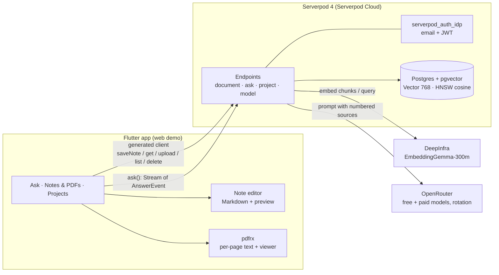

# ⚡ PageBlink

**English** · [한국어](README.ko.md)

**Ask your notes. Blink to the source.**

Every answer comes with its source. Tap ⚡ to jump to the exact PDF page or note.

[](https://youtu.be/ENYl1pd7_eQ)

[Live app](https://pageblink.serverpod.space) · [Demo video](https://youtu.be/ENYl1pd7_eQ) · [Source](https://github.com/biyott/pageblink)

**PageBlink** is a Google Keep–style Markdown notes app that also takes PDFs. Ask one question and it searches **both your notes and your PDFs**. The answer streams in token by token, with `[n]` citations. Tap a ⚡ chip to open the cited PDF page, or the cited note with the quoted passage shown.

Built with Flutter and Serverpod 4.0.4 for **Build Something Real: The Serverpod Hackathon**. The UI is in English by default and switches to Korean when the locale is `ko`.

## How it works

1. **Write or upload.** Jot down a quick Markdown note or drop in a PDF. Both land on one board and are indexed together.
2. **Just ask.** One plain-language question searches your notes and PDFs at once.
3. **Read the answer as it streams.** Each `[n]` marker becomes a ⚡ chip, and the sources are listed below as SOURCES chips.
4. **Tap ⚡ to blink to the source.** The exact PDF page, or the cited note, opens with the quote shown.

Also included: projects you can invite people to (access control runs inside the vector query), a 7-model catalog that rotates automatically, and original PDFs kept in Serverpod cloud storage. Full list: [features & limits](docs/reference/001-features-and-limits.md).

## Judging criteria map

These criteria come from material reported by participants, not from the official rules. They are marked unverified in [plan 001 §2](docs/plan/001-hackathon-topic-report.md).

| Criterion (weight) | Where to look |
|---|---|
| Works (30%) | [Live app](https://pageblink.serverpod.space) · [Demo video](https://youtu.be/ENYl1pd7_eQ) · server tests in `app/pageblink_server/test/` · verification status in [Known limits](#known-limits) |
| Serverpod stack usage (25%) | [How we used Serverpod](#how-we-used-serverpod) · [`app/pageblink_server/lib/src/`](app/pageblink_server/lib/src/) · [devlog 003](docs/devlog/003-server-rag-pipeline.md) |
| Completeness & technical creativity (25%) | Citation-aware streaming protocol (`AnswerEvent`) · ACL inside the vector query ([ADR 010](docs/adr/010-acl-in-query.md)) · pre-text model rotation ([`rotating_llm_provider.dart`](app/pageblink_server/lib/src/providers/rotating_llm_provider.dart)) · per-document privacy tiers ([ADR 009](docs/adr/009-device-tier-privacy-and-sync.md)) |
| Usefulness (20%) | Personal and team Q&A over notes and PDFs with verifiable citations · roadmap [plan 005](docs/plan/005-follow-up-spec.md) · market gaps [research 003](docs/research/003-competitors-and-gaps.md) |

## How we used Serverpod

| Serverpod feature | Where in PageBlink |
|---|---|
| ORM + migrations | `Document`, `DocChunk`, `Project`, `ProjectMember` models (`*.spy.yaml`), generated migrations |
| `Vector(768)` + HNSW (cosine) + `distanceCosine` | `DocChunk.embedding`; search in [`ask_endpoint.dart`](app/pageblink_server/lib/src/rag_endpoints/ask_endpoint.dart) |
| Streaming endpoint (`Stream<AnswerEvent>`) | `AskEndpoint.ask`: tokens, citations, answering model, errors on one channel |
| `serverpod_auth_idp` (email) | Sign-in; endpoints use `requireLogin` and the user id for ACL |
| Generated protocol + client | `client.ask.ask(...)`, `client.document.saveNote(...)`, `client.document.upload(...)` |
| Serverpod Cloud deploy + passwords | Live at `pageblink.serverpod.space`; API keys are Cloud passwords |
| Web server serves the Flutter app | `FlutterRoute` in [`server.dart`](app/pageblink_server/lib/server.dart) |
| Cloud storage / file upload | Original PDFs in private storage; `pdfUrl` returns a short-lived signed URL after an ACL check |

All of these are ✅ in use. Not used: Future Calls (background indexing), which needs the Growth plan; the project is on Starter.

## Architecture



One question takes this path: embed the query → ACL-filtered pgvector search (top 8) → put numbered sources into the prompt → stream tokens → emit a `citation` event at the first `[n]` of each source → ⚡ chips. Notes (`kind: 'note'`, one page) and PDFs (`kind: 'pdf'`, one chunk set per page) share one vector index. Every LLM and embedding call goes through the server, so API keys never reach the app.

## Known limits

- **Embeddings need a funded DeepInfra account.** On HTTP 402, new uploads and note saves fail to index. Ask then falls back to keyword search over chunks that are already indexed, and says so. Once the balance is topped up, **Re-index** recovers each document. This fallback has no recorded end-to-end run on the cloud deployment.
- **The default answer models are OpenRouter free models, which may log prompts** ([ADR 014](docs/adr/014-model-catalog-and-rotation.md)). The free quota is per account. Use public documents for the demo.
- **Verification status.** Both live URLs returned HTTP 200 after the redeploy recorded in [devlog 007](docs/devlog/007-cloud-deploy-and-model-rotation.md). The latest deploy has no recorded end-to-end run on the cloud deployment yet (sign-up → note/PDF → ask → citation).

Other limits include no real-time or collaborative note editing (notes save when you go back), no Cloak tier yet, and no mobile store builds. See [all known limits](docs/reference/001-features-and-limits.md#known-limits).

## Run locally

You need Flutter **3.47.7** ([fvm](https://fvm.app)) and Serverpod CLI 4.0.4. Docker is not needed: `serverpod start` uses an embedded Postgres with pgvector.

```bash
fvm use 3.47.7 && dart install serverpod_cli
export OPENROUTER_API_KEY=... DEEPINFRA_API_KEY=...   # or config/passwords.yaml
cd app && serverpod start
```

Key settings and tests are in [run locally](docs/reference/002-run-locally.md).

## More

- [Features & limits](docs/reference/001-features-and-limits.md) · [Run locally](docs/reference/002-run-locally.md) · [Docs registry](docs/README.md) (plans, research, ADRs, devlog; written in Korean)
- Built with [Claude Code](https://claude.com/claude-code) agents. The decision trail is in the repo: 16 research notes with sources, 15 ADRs, 9 plan documents, and a timestamped devlog (9 entries, KST).
- [Hackathon page](https://builderbase.com/event/build-something-real-the-serverpod-hackathon) · [Serverpod docs](https://docs.serverpod.dev/overview)
