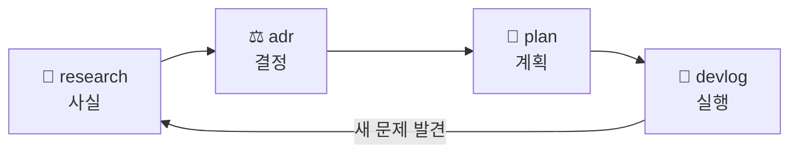

# 📂 문서 레지스트리

PageBlink의 모든 문서는 **종류별 폴더**에 두고, 각 폴더의 `README.md`가 그 폴더의 **규칙과 목차**를 관리합니다.

## 문서 종류

| 폴더 | 종류 | 무엇을 쓰나 | 누가 쓰나 | 고치나? |
|---|---|---|---|---|
| [`plan/`](plan/) | 📐 기획·설계 | 주제 선정, 제품 컨셉, 아키텍처, 기술 스택, 로드맵 | 리드 (+ writer) | ✅ 계속 갱신 |
| [`research/`](research/) | 🔎 조사 | 서브에이전트 조사 결과 요약 (✅/⚠️ 표기, 출처 필수) | 리드가 결과를 정리 | ❌ 그 시점의 스냅샷 (정정은 새 번호) |
| [`adr/`](adr/) | ⚖️ 결정 기록 | 결정 1건 = 파일 1개: 맥락 · 결정 · 대안 · 결과 | 리드 (+ writer) | 상태만 변경 (`채택` → `대체됨`) |
| [`devlog/`](devlog/) | 🧪 개발 기록 | 작업 단위별 진행 과정 (**수행 일시 포함**) | writer | 진행 중에는 갱신 |

## 공통 규칙

- **파일명**: `NNN-kebab-주제.md` · 폴더마다 3자리 일련번호를 따로 매깁니다 (`001`부터, 빈 번호 없이)
- **시간**: 모두 KST. 추측하지 않고 `TZ=Asia/Seoul date "+%Y-%m-%d %H:%M"`으로 얻습니다
- **확인 표기**: ✅ 공식 문서·pub.dev로 확인 · ⚠️ 미확인/추정
- **폴더 규칙**: 각 폴더의 `README.md`가 유일한 정본입니다. 에이전트는 루트 `AGENTS.md` 지침에 따라 쓰기 전에 이 README를 읽습니다
- **문서 흐름**: 조사(`research`) → 판단(`adr`) → 계획 반영(`plan`) → 실행 기록(`devlog`)

## 역할

| 역할 | 하는 일 |
|---|---|
| **리드 (Lead · PM/오케스트레이터)** | 조사를 맡기고, 결과를 판단하고, 사용자와 확인·소통하며, ADR을 확정 |
| **서브에이전트 (조사)** | 웹·문서·코드 조사 후 출처와 함께 보고 |
| **writer 에이전트** | 리드가 준 사실을 각 폴더 규칙대로 문서화 (`.claude/agents/writer.md`) |
