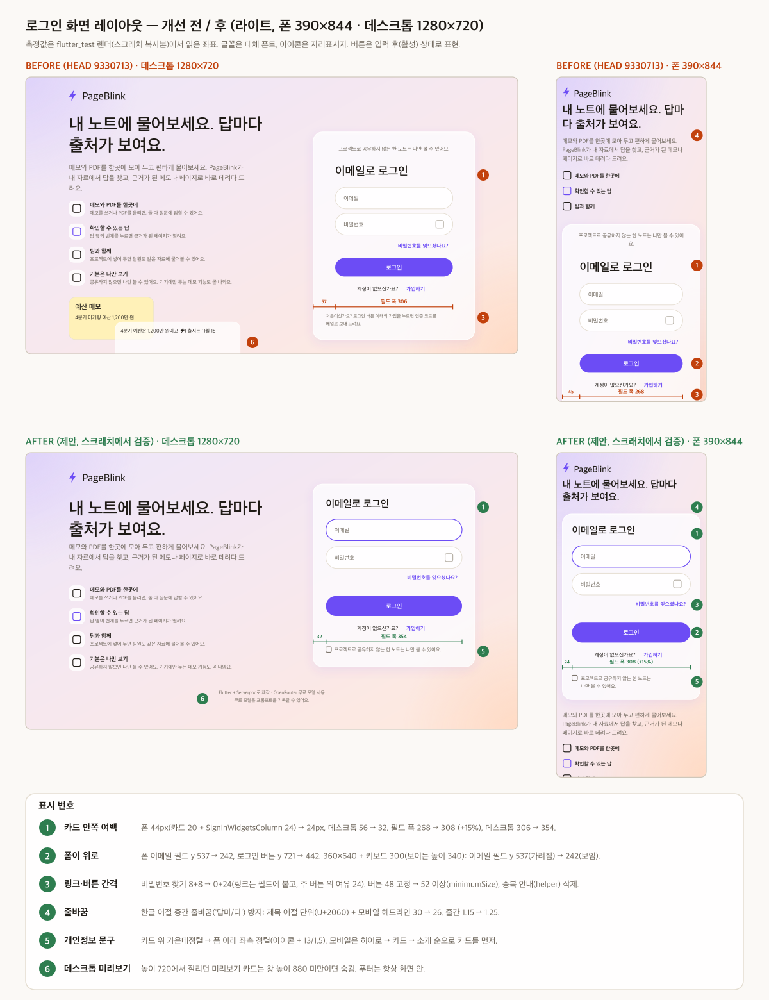

# 로그인 화면 레이아웃 — 어떤 높이·글자 크기·키보드에서도 깨지지 않는 구조 + 줄간·여백 개선

작성 2026-10-15 12:08 KST. 기준 방향은 채택된 **AB v2**(`../ab-v2/spec.md` 델타 + `../ab-glass-paper/spec.md` 토큰, 구현은 `app/pageblink_flutter/lib/app/theme.dart`의 `Pb`). 색·타이포·간격 토큰은 그 값을 그대로 쓰고 새 토큰은 만들지 않는다. **저장소 코드는 수정하지 않았다**(검증용 코드는 전부 세션 스크래치패드의 복사본에서만 돌렸다).

> 표기: ✅ 코드·소스·실행으로 확인 · ⚠️ 미확인/추정. 줄 번호는 다른 에이전트가 가입 폼을 고치는 중이라 쓰지 않고 위젯·클래스 이름으로 가리킨다. 읽은 기준 커밋은 `9330713`(가입·코드·재설정 폼을 자체 구현으로 교체한 커밋).

| 파일 | 내용 |
|---|---|
| `before-after.svg` / `before-after.png` | 개선 전/후 시안 한 장(라이트, 데스크톱 1280×720 + 폰 390×844). 좌표는 아래 스크래치 실측에서 읽음. 글꼴·아이콘은 대체 |
| 이 문서 | 원인 진단, 구조 규칙, 간격 토큰, 구현 체크리스트, 회귀 테스트 전문 |

## 0. 한 장 요약

1. **overflow의 직접 원인은 `serverpod_auth_idp_flutter 4.0.4`의 `FormStandardLayout`**이다. 높이를 `SizedBox(height: 330)`으로 고정하고 그 안에 `Expanded(content)`를 넣는다. 가입·코드 확인·비밀번호 설정·재설정 화면이 전부 이 위젯을 지나갔고, 글자가 조금만 커지면 Column 하단이 넘친다(✅ 소스, ✅ 재현). 디버그에서만 줄무늬가 보일 뿐, 릴리스에서도 내용이 같은 자리에서 넘친다(⚠️ Flutter의 일반 동작이며 릴리스 빌드를 직접 확인하지는 않았다).
2. **`9330713` 이후 HEAD는 이미 안전하다.** 자체 폼은 `Column(mainAxisSize.min)`이고 바깥은 스크롤이라 270개 조합(아래 §1.3)에서 예외가 0건이다. 그래서 "구조를 갈아엎자"가 아니라 **지금 구조를 규칙으로 못박고, 회귀 테스트로 잠그고, 남은 사각지대(조용한 클리핑·접힘 아래로 밀리는 폼)를 막는** 문서다.
3. **답답함의 1순위는 세로 간격이 아니라 가로 24px 이중 패딩**이다. 카드 패딩(20/32) 안에 패키지 `SignInWidgetsColumn`이 `SafeArea(minimum: 24)`를 또 넣어 폼이 44/56px 안쪽에 앉는다. 390 폰에서 필드 폭이 268px(화면의 69%)이다. 부제·안내문은 카드 패딩만 받아 왼쪽 선이 어긋난다.
4. **폼이 접힘 아래에 있다.** 폰에서 히어로(브랜드+헤드라인+소개+불릿)가 카드 앞에 와서 이메일 필드가 y 537, 360×640에서는 로그인 버튼이 화면 밖(y 721)이다. 키보드가 올라오면 보이는 높이가 340이라 폼 전체가 가려진다.
5. **포커스하면 필드가 알약 → 8px 사각형으로 바뀐다**(✅ 스크린샷). 테마에 `focusedBorder`가 없어서 폼이 지정한 `border`(반경 8)로 떨어진다.

## 1. 원인 진단

### 1.1 어디서 나는가 (코드 추적)

| # | 위치 | 구조 | 왜 깨지나 |
|---|---|---|---|
| A | 패키지 `FormStandardLayout` (`email/forms/widgets/form_standard_layout.dart`) | `SizedBox(height: 330)` > `Column[title(headlineMedium 30/1.2), largeGap 24, Expanded(content), ActionButton 48, tinyGap 8, bottomText]` | 높이 고정 + 안쪽 `Expanded`. 내용 높이 = 330 − 제목 36 − 24 − 48 − 8 − 아래줄 ≈ **190px 예산**. 글자 배율·제목 줄바꿈·안내문 줄 수가 늘면 예산을 넘는다 |
| B | 패키지 `PasswordRequirements` | `Row[Icon, SizedBox 8, Text]`(Text가 flex 아님) | 영어 "At least 1 uppercase letter or special character"가 좁은 카드에서 **오른쪽**으로 넘친다(×1.0에서도 재현) |
| C | 패키지 `SignInWidgetsColumn` | `SafeArea(minimum: all(24))` > `Center` > `Container(maxWidth 400)` | 위·아래·좌·우에 24 추가. 카드 안 폼이 44/56px 안쪽. 높이도 위아래 +48 |
| D | `sign_in_screen.dart` `_Bullet(compact)` | `SizedBox(height: 36)` + `maxLines 1` | ×2.0에서 14×2×1.45 ≈ 41 > 36. **예외는 안 나고** 행이 서로 맞닿는다(✅ 스크린샷 `×2.0`: 세 불릿이 줄 간격 없이 붙음. 잘림 여부는 `maxLines 1`+말줄임이라 글자 길이에 따라 다름). 같은 화면에서 히어로가 첫 화면을 다 차지해 폼이 접힘 아래(y ≈ 820)로 밀림 |
| E | `_PreviewCard` | `SizedBox(460×220)` + `Stack` | 높이 720에서 하단이 화면 밖으로 잘림(✅ 스크린샷, 스크롤은 가능) |
| F | `LayoutBuilder` 분기 | 태블릿 `w ≥ 600`부터 `Row(hero Expanded + 카드 380)` | w=600이면 hero가 600 − 48 − 32 − 380 = **140px**(✅ 계산), 700이면 240px(✅ 스크린샷)로 불릿이 한 글자씩 줄바꿈 |
| G | 바깥 스크롤 | `SingleChildScrollView` > `ConstrainedBox(minHeight: h)` > `Center` | **문제 없음**. 이 패턴은 유지한다(§2) |

### 1.2 재현 조건 (스크래치 복사본, flutter_test)

**기준선 = 패키지 폼 그대로**(`EmailSignInWidget(controller:)`, 즉 `9330713` 이전과 같은 구조). 7개 화면 × en/ko × 3 크기(360×640, 390×844, 1280×720) = 배율당 42조합. 카드 크기는 실제 카드와 같다.

| 조건 | 조합 수 | 실패 | 하단(BOTTOM) | 오른쪽(RIGHT) | 첫 하단 overflow |
|---|---|---|---|---|---|
| textScale 1.0 | 42 | 6 | 0 | 6 | 없음. 영어 비밀번호 설정 2화면이 오른쪽으로 8.7~77px |
| textScale 1.1 | 42 | 15 | 8 | 7 | 코드 확인(가입·재설정) 영어/한글, 360폭에서 10~72px |
| textScale 1.2 | 42 | 21 | 13 | 10 | 로그인·재설정 요청 360폭 13~22px, 코드 확인 22~89px |
| textScale 1.3 | 42 | 31 | 27 | 13 | 비밀번호 설정 영어 10px, 대부분의 화면 |
| textScale 1.5 | 42 | 40 | 34 | 23 | 6개 화면이 6~172px(가입 시작은 오른쪽만) |

화면별 "하단 overflow가 처음 나는 배율": 코드 확인 1.1(영·한), 로그인 1.1(영)/1.2(한), 재설정 요청 1.2, 비밀번호 설정 1.3(영·한, 가입은 한글 1.5). 가장 먼저 깨지는 건 **코드 확인 화면**이다(안내문 줄 수 + 코드 입력칸 + 재전송 버튼).

| # | 재현 조건 | 화면 | 결과 |
|---|---|---|---|
| R1 | 폰 360폭, 시스템 글자 ×1.1~1.2 (Android "큼"은 보통 ×1.15 안팎 ⚠️ 일반 지식) | 가입 코드 확인(영어) | 하단 32~46px overflow. 내용이 카드 아래로 넘침 |
| R2 | 영어, ×1.0, 폰 | 비밀번호 설정 | 체크리스트 줄이 오른쪽으로 77px 넘침(체크 아이콘+문구가 카드 밖) |
| R3 | ×1.5 | 6개 화면(가입 시작은 오른쪽만) | 하단 6~172px. 한글도 동일(코드 확인 112px) |
| R4 | 가입처럼 요소가 많은 화면(이메일 읽기전용 + 비밀번호 + 체크리스트 3줄 + 제목 2줄) | 비밀번호 설정 | 예산 190px를 넘음. 제목이 2줄이 되면(×1.3 이상 또는 긴 영어 제목) 한 줄 더 |
| R5 | 높이 500~640 + 키보드 300 | 실제 `SignInScreen` | 예외는 없지만 **폼이 접힘 아래**. 360×640: 이메일 필드 y 537 > 보이는 높이 340. 로그인 버튼은 키보드가 없어도 y 721 > 640 |

### 1.3 HEAD(`9330713`) 실측

| 대상 | 조합 | 예외 | 비고 |
|---|---|---|---|
| 실제 `SignInScreen`(로그인 단계) | {en, ko} × 5크기 × {1.0, 1.5, 2.0} × 키보드 {0, 300} = 60 | **0** | 360×480, 800×500 포함. 주 버튼 `ensureVisible` 도달성도 통과 |
| 카드 크롬 재현 + `PageBlinkEmailSignIn` 7단계 | 7단계 × {en, ko} × 5크기 × 3배율 = 210 | **0** | 예외만 확인. 도달성 단언은 제안 구조에서 처음 측정(270개 전부 통과) |

즉 지금 코드에서 "BOTTOM OVERFLOWED"는 안 난다. 클라이언트가 본 화면은 패키지 폼(가입·코드·재설정) 쪽일 가능성이 가장 높다. **그 빌드가 `9330713` 이전이었는지는 확인하지 못했다**(⚠️). 정확한 화면·픽셀을 받으면 §1.2 표로 대조할 수 있다.

### 1.4 측정의 한계 ⚠️

- flutter_test에는 Inter·Fraunces·Noto Serif KR이 없어 **번들 `NotoSansKRSubset` 400 한 가지로 모든 스타일을 대체**했다(라틴 폭이 ±5~8% 다를 수 있음). 높이는 대부분 `height`가 명시돼 폰트와 거의 무관하다. 임계 배율(1.1/1.2)은 실폰트에서 한 칸 앞뒤로 움직일 수 있다.
- 처음 시도한 Ahem(기본 테스트 폰트) 결과는 글리프가 1em 정사각이라 과대 추정이어서 **버렸다**.
- 키보드는 정적 `viewInsets`(bottom 300)다. 실기기의 키보드 애니메이션·`ensureVisible` 타이밍은 보지 못했다.

## 2. 깨지지 않는 구조

### 2.1 규칙 (이 여섯 개를 지키면 overflow는 구조적으로 불가능)

| # | 규칙 | 이유 |
|---|---|---|
| R1 | 화면 루트는 **세로 스크롤 하나**: `Scaffold(resizeToAvoidBottomInset: true)` > `SafeArea` > `LayoutBuilder` > `SingleChildScrollView` > `ConstrainedBox(minHeight: constraints.maxHeight)` > `Center` > `Column(mainAxisSize.min)` | RenderFlex의 BOTTOM overflow는 **세로 제약이 유한할 때만** 난다. 스크롤 안의 `Column`은 세로 제약이 무한이라 원리상 못 난다. `minHeight`는 "짧을 때 가운데 정렬"만 담당하고 `IntrinsicHeight`가 필요 없다 |
| R2 | 텍스트를 담은 곳에 **고정 `height`·`Expanded`·`Spacer`를 쓰지 않는다**. 높이는 `minHeight`/`minimumSize`로만 준다 | 패키지 `FormStandardLayout`(330)이 정확히 이 규칙 위반이다. 버튼은 `fixedSize` 대신 `minimumSize: Size.fromHeight(52)`라 글자가 커지면 자란다 |
| R3 | `Row` 안의 텍스트는 `Flexible`/`Expanded`, 링크 묶음은 `Wrap` | RIGHT overflow 방지(패키지 `PasswordRequirements`가 위반, HEAD의 `_PasswordChecklist`는 `Flexible` 사용) |
| R4 | 장식(히어로·미리보기·푸터)은 **창 높이/글자 배율로 숨기거나 줄인다**. 필드·주 버튼·보조 링크는 어떤 경우에도 남는다 | 우선순위: 폼 > 안내문 > 브랜드/헤드라인 > 소개 > 미리보기 |
| R5 | 키보드는 `Scaffold`가 body를 줄이는 것에만 맡긴다. `viewInsets.bottom`을 따로 패딩으로 더하지 않는다 | 이중 반영 방지. 줄어든 높이에서도 R1이 성립 |
| R6 | 접힘 판단은 `MediaQuery.size.height / textScale`(창 높이)로, `LayoutBuilder`의 `h`(키보드로 줄어듦)로 하지 않는다 | 키보드가 열리는 동안 히어로가 깜빡이며 레이아웃이 튀는 걸 막는다 |

"조용한 클리핑"(예외 없이 잘림)은 `takeException()`으로 안 잡히므로 R2·R4를 코드 리뷰 규칙으로 함께 건다. 테스트는 예외 외에 "주 버튼이 키보드 위로 스크롤돼 닿는가"를 단언한다(§6).

### 2.2 모드 규칙

`eff = MediaQuery.size.height / max(1, textScaler.scale(16) / 16)`, `w`는 `LayoutBuilder`의 최대 폭.

| 조건 | 구성 | 근거 |
|---|---|---|
| `w ≥ 840 && eff ≥ 560` | **Row**: 히어로(전체) 좌 / 카드 우. 카드 폭 420(w ≥ 1024) · 400(840~1024). 미리보기 카드는 `w ≥ 1024 && eff ≥ 880`일 때만 | 840에서 히어로 폭 = 840 − 48(패딩) − 32(간격) − 400(카드) = 360으로, 불릿 본문이 두 줄에 들어가는 최소선 ⚠️ 근사. 1280×720에서 미리보기가 잘리지 않게 880 |
| 그 외(폰·좁은 태블릿·가로 폰) | **Column**, 카드 `maxWidth 440` 가운데 | 800×500 같은 가로 폰은 카드만 |
| Column, `eff ≥ 560` | 브랜드 + 헤드라인(26, 줄간 1.25) → 카드 | 헤드라인은 한 문장이라 유지 |
| Column, `eff ≥ 760` | 카드 **아래**에 소개 문단 + 불릿 3개 | 재방문자가 많아 카드를 먼저. 첫 방문 정보는 아래 |
| `eff < 560` | 카드만(+ 푸터 없음) | 폼 우선 |
| 푸터 | `eff ≥ 560` | 시스템 안내문은 카드 아래 |

예: 360×640 → eff 640 → 헤드라인 + 카드(소개·불릿 숨김). 390×844 ×1.0 → 헤드라인 + 카드 + 소개. 390×844 ×2.0 → eff 422 → 카드만. 키보드 300이 열려도 eff는 변하지 않으므로 히어로가 깜빡이지 않는다.

### 2.3 권장 트리 (스크래치에서 270개 조합 통과한 형태)

```dart
// sign_in_screen.dart — build()
// sizeOf/textScalerOf: 키보드 inset 프레임마다 다시 빌드하지 않는다(R6).
final eff = MediaQuery.sizeOf(context).height /
    math.max(1.0, MediaQuery.textScalerOf(context).scale(16) / 16);
final row = w >= 840 && eff >= 560;                 // w = constraints.maxWidth
return SingleChildScrollView(
  keyboardDismissBehavior: ScrollViewKeyboardDismissBehavior.onDrag,
  child: ConstrainedBox(
    constraints: BoxConstraints(minHeight: constraints.maxHeight),
    child: Center(
      child: ConstrainedBox(
        constraints: const BoxConstraints(maxWidth: 1120),
        child: Padding(
          padding: EdgeInsets.symmetric(horizontal: pad, vertical: mobile ? 24 : pad),
          child: Column(mainAxisSize: MainAxisSize.min, children: [
            if (row) Row(children: [
              Expanded(child: _Hero(part: _HeroPart.all, showPreview: desktop && eff >= 880, ...)),
              SizedBox(width: desktop ? 48 : 32),
              SizedBox(width: desktop ? 420 : 400, child: card),
            ]) else ...[
              if (eff >= 560) ...[_Hero(part: _HeroPart.head, ...), const SizedBox(height: AuthSpacing.section)],
              ConstrainedBox(constraints: const BoxConstraints(maxWidth: 440), child: card),
              if (eff >= 760) ...[const SizedBox(height: AuthSpacing.section), _Hero(part: _HeroPart.pitch, ...)],
            ],
            if (eff >= 560) ...[const SizedBox(height: AuthSpacing.section), const _Footer()],
          ]),
        ),
      ),
    ),
  ),
);
```

`_HeroPart { all, head, pitch }`는 기존 `_Hero`를 둘로 나누는 enum이다(브랜드+헤드라인 / 소개+불릿+미리보기). `signIn`은 `SignInWidget`을 거치지 않고 `PageBlinkEmailSignIn(controller:)`를 직접 쓴다(§5-2).

### 2.4 키보드

- `scrollPadding`의 **아래쪽**을 키운다: 포커스된 필드가 보일 때 링크 + 주 버튼까지 키보드 위에 보이게. 값은 `AuthSpacing.scrollPadding = EdgeInsets.fromLTRB(20, 20, 20, 152)`(보조 8 + 링크 48 + 주 버튼 위 24 + 버튼 52 + 여유 16 ≈ 148 → 152). 모든 `TextField`에 같은 값.
- 로그인 첫 화면은 `autofocus`를 쓰지 않는다(현재 그대로, 키보드가 첫 화면을 가리지 않게). 가입 시작·코드·비밀번호처럼 입력이 유일한 일인 단계의 `autofocus: true`는 유지.
- `ScrollViewKeyboardDismissBehavior.onDrag`로 스크롤하면 키보드를 내린다.

### 2.5 "어떤 입력에서도 안 깨지는" 이유

1. 세로: 폼 전체가 `SingleChildScrollView`의 자식이다. 자식 `Column`의 세로 제약은 무한이므로 RenderFlex의 "BOTTOM OVERFLOWED"가 발생할 수 없다. 짧은 화면은 스크롤로, 키보드는 `Scaffold`가 body를 줄이는 것으로 흡수된다.
2. 가로: 폼 폭은 카드 폭(최대 440)으로 제한되고 모든 텍스트가 `Flexible`/`Wrap`이라 줄바꿈으로 흡수된다. 가로 스크롤은 없다.
3. 도달성: 주 버튼은 스크롤 콘텐츠 안에 있으므로 `ensureVisible`로 항상 보이는 영역까지 올릴 수 있다. 장식은 R4로 먼저 사라지므로 폼이 접힘 아래로 밀리는 비율이 줄어든다.
4. 남는 위험은 오직 **조용한 클리핑**(고정 높이 박스 안의 텍스트)과 **쓰기 전용 위젯**(패키지 폼처럼 높이를 고정하는 외부 위젯)이다. 전자는 R2, 후자는 "패키지 폼은 직접 만든 폼으로 대체"(HEAD에서 완료)로 막는다.

### 2.6 채택하지 않은 대안

| 대안 | 왜 아닌가 |
|---|---|
| `CustomScrollView` + `SliverFillRemaining(hasScrollBody: false)` | 동작은 같다. 자식이 짧을 때 채우기 위해 **intrinsic 높이**를 재는데, 자식에 `BackdropFilter`(GlassPanel)와 `PageTransitionSwitcher`가 있어 비용이 늘고 얻는 게 없다. 현재 `ConstrainedBox(minHeight)` 패턴이 더 싸다 |
| 폼 높이를 `FittedBox`로 축소 | 글자가 작아져 접근성(큰 글자) 목적에 반한다 |
| `textScaler`를 1.2로 클램프 | 시스템 설정을 무시한다. 스크롤이 이미 안전하니 불필요 |
| `FormStandardLayout`의 330을 패키지 쪽에서 늘리기 | 외부 패키지 수정 불가. 이미 자체 폼으로 대체됨 |

## 3. 줄간·여백

### 3.1 현재 값 (모바일 카드 기준, 가로·세로 실효값)

| 위치 | 현재 | 비고 |
|---|---|---|
| 화면 좌우 패딩 | 16 (모바일) / 24 (태블릿) / 32 (데스크톱) | 유지 |
| 카드 안쪽 패딩 | 20 (<600) / 32 | **+ `SignInWidgetsColumn` 24 → 실효 44 / 56** |
| 카드 부제(`signInSubtitle`) → 폼 제목 | 8 + 24(SafeArea) = 32 | 가운데 정렬 14/1.45, 폰에서 "요." 외톨이 줄 |
| 제목(`headlineMedium` 30/1.2) → 첫 필드 | 24 | 제목은 카드 폭 대비 큼 |
| 필드 ↔ 필드 | 16 | 필드 높이 52(패딩 14), 반경 8을 지정하지만 테마 `enabledBorder`가 알약이라 평소엔 알약, 포커스만 사각 |
| 비밀번호 필드 → "비밀번호를 잊으셨나요?" | 8 | 링크 TextButton 48(글자는 가운데) |
| 링크 → 주 버튼 | 8 | 주 버튼 `fixedSize` 48 |
| 주 버튼 → "계정이 없으신가요? 가입하기" | 8 | `Wrap` 안 TextButton 48 |
| 가입 행 → 카드 하단 안내문 | 24(SafeArea) + 16 = 40 | 12/1.45, 위 가입 행과 내용이 겹침 |
| 안내문 → 카드 바닥 | 20 + 24 = 44 | |
| 히어로 → 카드 (모바일) | 24 | 히어로가 앞이라 폼이 아래로 밀림 |
| 본문 줄간 | `bodyMedium` 14/1.45, `bodySmall` 12/1.45 | 한글 기준 낮음 |
| 필드 폭 (390 폰) | 268 | 화면의 69% |

### 3.2 제안 값 (8pt 그리드, 4pt 반단위는 문서 4절 "4·8·12·16·24·32" 범위)

| 위치 | 전 | 후 | 이유 |
|---|---|---|---|
| 카드 안쪽 패딩 | 44 / 56 | **24 / 32** | `SignInWidgetsColumn` 제거로 중복 24 삭제. 부제·안내문과 왼쪽 선 일치 |
| 필드 폭 (390 / 1280) | 268 / 306 | **308 / 354** (+15%) | 같은 효과 |
| 부제(개인정보 문구) | 폼 위, 가운데 | **폼 아래, 왼쪽 정렬**, 아이콘 + 13/1.5, 위 간격 24 | 제목이 카드의 첫 요소. 중복 안내(`signInHelper`)는 삭제 제안 ⚠️ 카피 결정 필요 |
| 폼 제목 | 30/1.2 | **26/1.3** (`headlineSmall`) | 폰 카드 폭에서 줄바꿈 감소, 24~28 범위 |
| 제목 → 첫 필드 | 24 | **24** (`title`) | 유지 |
| 필드 ↔ 필드, 안내문 → 필드 | 16 | **16** (`field`) | 유지 |
| 필드 → 링크 | 8 | **0** | 링크 TextButton 레이아웃 48에 글자 위 여백이 이미 14. 링크가 위 필드에 붙어 읽힌다 |
| 링크(또는 마지막 필드) → 주 버튼 | 8 | **24** (`action`) | 주 동작 위 여유 |
| 주 버튼 높이 | `fixedSize` 48 | **`minimumSize` 52** (`buttonHeight`) | 터치 타깃 ≥ 44, 글자 배율에서 자람 |
| 주 버튼 → 보조 행 | 8 | **8** (`secondary`) | 보조 행은 TextButton 48이라 시각 간격 ≈ 22 |
| 카드 → 안내문, 히어로 → 카드 | 16~40 제각각 | **24** (`section`) | 하나로 통일 |
| 본문 `bodyMedium` | 14/1.45 | 폼 안 보조 텍스트 **14/1.55** | 한글 1.5~1.6 |
| 안내문 `bodySmall` | 12/1.45 | **13/1.5** | 12는 한글에서 작음 |
| 필드 입력 | 16 | **16** 유지 | iOS 확대 방지 기준 |
| 필드 안쪽 패딩 | 12·14 | **20·16** (알약 반경에 맞춤) | 필드 높이 52 → 56 |
| 필드 반경·포커스 | 평소 알약 / 포커스 사각 | **알약 유지 + 포커스 2px `accent` 링** | 테마 `focusedBorder` 추가, 폼의 `border:` 반경 8 삭제 |
| 모바일 헤드라인 | 30(ko)/32(en), 1.15 | **26/28, 1.25**, 어절 단위 줄바꿈 | "답마/다" 방지 |
| 모바일 불릿 | 높이 36 고정 + 한 줄 말줄임 | `minHeight 44` + 줄바꿈 | ×2.0 조용한 클리핑 방지, 터치 타깃 |

효과(✅ 실측): 390×844 ×1.0에서 폼 제목 y 477 → 184, 이메일 y 537 → 242, 로그인 버튼 y 721 → 442. 1280×720에서 카드 높이 540 → 475, 미리보기 잘림 해소, 푸터 화면 안.

### 3.3 `AuthSpacing` (값 8개 + 파생 1개, 과설계 금지)

로그인·가입·코드·비밀번호 설정 **모든 폼이 같은 상수**를 쓰게 한다. 값은 "형제 사이의 레이아웃 오프셋"이고 TextButton 내부 여백은 포함하지 않는다.

```dart
// lib/screens/auth_spacing.dart (새 파일)
abstract final class AuthSpacing {
  static const double cardPad = 32;         // 카드 안쪽, 카드 폭 >= 600
  static const double cardPadCompact = 24;  // 카드 안쪽, < 600
  static const double title = 24;           // 폼 제목 -> 첫 요소
  static const double field = 16;           // 필드 <-> 필드, 안내문 -> 필드
  static const double action = 24;          // 마지막 필드/링크 -> 주 버튼
  static const double secondary = 8;        // 주 버튼 -> 보조 행
  static const double section = 24;         // 카드 -> 안내문, 히어로 -> 카드
  static const double buttonHeight = 52;    // 주 버튼 최소 높이(자람)
  static const scrollPadding = EdgeInsets.fromLTRB(20, 20, 20, 152); // 파생
}
```

적용 규칙: `SizedBox(height: …)`의 숫자 리터럴을 이 상수로 바꾼다. 화면별로 다른 값이 필요해 보이면 새 값을 만들지 말고 `section`/`field` 중 가까운 것으로 맞춘다.

### 3.4 토큰 (기존 값 재사용, 신규 없음)

`theme.dart`의 `Pb` 값 그대로. 로그인 화면에서 실제로 쓰는 것만 적는다.

| 용도 | 라이트 | 다크 |
|---|---|---|
| 배경 그라데이션 | `#EDE6FA → #F7E8EE → #FFE9DC` | `#1E1830 → #251C27 → #2A1F1C` |
| 카드(`glassStrong`) + 테두리 | `#FFFFFF` 74% + `#FFFFFF` 80% | `#FFFFFF` 12% + `#FFFFFF` 16% |
| 카드 그림자 `glassShadow` | `#6C4CF5` 10%, blur 24, y 8 | `#000000` 30%, blur 24, y 8 |
| 글자 `ink` / 보조 `inkMuted` | `#1F1B16` / `#6B6358` | `#F2EDE3` / `#A59D8F` |
| 필드 테두리 `hairline` | `#E4DDD0` | `#FFFFFF` 14% |
| 주 버튼 / 글자 | `#6C4CF5` / `#FFFFFF` | `#B7A6FF` / `#251A63` |
| 링크·포커스 링 `accent` | `#6C4CF5` | `#B7A6FF` |
| 선택·칩 배경 | `accentContainer #EAE4FD` / `#2E1F85` | `#3A2F7A` / `#E9E3FC` |

V1b 앱 아이콘 팔레트(보라 `#6C4CF5 → #8F6BFF`, 다크 `#7A5CFF → #B7A6FF`)와 `accent`가 같은 계열이라 새 색이 필요 없다. 대비(✅ 계산): `inkMuted` on 흰색 5.9:1, 주 버튼 라이트 흰 글자 5.3:1, 다크 `#251A63` on `#B7A6FF` 7.1:1. **`_PasswordChecklist`의 `Colors.grey`(#9E9E9E) 12px는 흰 카드 위 2.7:1로 4.5:1 미달**이라 `inkMuted`로 바꾼다(✅ 계산).

### 3.5 타이포 (018 위계 연장, 폼 안만)

| 요소 | 크기/줄간 | 폰트 | 비고 |
|---|---|---|---|
| 폼 제목 | 26 / 1.3, w600 | Fraunces + Noto Serif KR (`headlineSmall`) | 018 데스크톱 노트 제목 28보다 한 단계 작게(카드 폭 때문) |
| 필드 입력 / 라벨 | 16 / 12(플로팅) | Inter + Noto Sans KR | |
| 주 버튼 | 16 / w600 | 〃 | 현재 ElevatedButton 기본 14 → `textStyle` 지정 |
| 링크·보조 행 | 14 / 1.55, 링크 w600 | 〃 | TextButton 48 |
| 개인정보 안내문 | 13 / 1.5, `inkMuted` | 〃 | |
| 한글 제목 줄바꿈 | 어절 단위 | — | 아래 snippet. ✅ 테스트에서 동작, ⚠️ 웹 렌더 확인 필요 |

```dart
// 한글 어절 중간 줄바꿈 방지(U+2060 WORD JOINER). 제목·헤드라인에만 쓴다.
String keepAll(String s) => s.split(' ')
    .map((w) => w.runes.map(String.fromCharCode).join('⁠')).join(' ');
```
✅ flutter_test에서 폭 358/328/280 모두 "답마/다" 대신 어절 경계에서 끊김. ⚠️ CanvasKit/skwasm에서 U+2060 글리프가 보이지 않는 문자로 처리되는지는 확인하지 못했다. 복사·검색·스크린리더에 U+2060이 섞이므로 제목 외에는 쓰지 않는다.

## 4. 반응형 레이아웃 요약 (Material 3, Flutter)

| 구간 | 구성 | 카드 폭 | 페이지 패딩 | 카드 패딩 |
|---|---|---|---|---|
| 모바일 < 600 | Column: 헤드라인 → 카드 → 소개(eff ≥ 760) | 화면 − 32 (최대 440) | 16 | 24 |
| 태블릿 600–839 | Column 가운데, 위와 같음 | 최대 440 | 24 | 32 |
| 태블릿 840–1023 | Row(히어로 + 카드 400), 미리보기 없음 | 400 | 24 | 32 |
| 데스크톱 ≥ 1024 | Row(히어로 + 카드 420), 미리보기는 eff ≥ 880 | 420 | 32 | 32 |
| 가로 폰(예: 800×500) | 카드만 | 최대 440 | 24 | 32 |

Flutter 구현 메모: `ThemeData`/`ColorScheme`은 바꾸지 않는다. 바꾸는 테마는 `InputDecorationTheme.focusedBorder` 하나뿐이다(§5-4). `ElevatedButton`을 `FilledButton`으로 바꾸는 것은 선택(현재는 전경/배경을 수동 지정). 카드는 기존 `GlassPanel(strong: true)` 그대로.

## 5. 구현 체크리스트 (파일별)

다른 에이전트가 가입 폼을 만지고 있으므로 **2번(구조)을 먼저, 3번(간격)은 그쪽이 머지된 뒤** 같은 상수로 적용하는 것을 권한다.

1. **`lib/screens/auth_spacing.dart` (신규)**: §3.3 그대로.
2. **`lib/screens/sign_in_screen.dart`** (구조, 위젯 이름 기준)
   - [ ] `signIn`: `SignInWidget(...)` 제거 → `PageBlinkEmailSignIn(controller: ...)`을 `_localized`로 감싼다. 이메일 외 제공자가 없어서 `SignInWidget`이 하는 일은 `SignInWidgetsColumn`(24 패딩 + 폭 400)과 소셜 잠금 코디네이터뿐이다. ✅ 소스에서 `email/` 폴더가 `SignInFlowCoordinator`를 참조하지 않음을 확인. **소셜 로그인을 추가하면 `SignInWidget`을 다시 쓰거나 코디네이터로 감싼다.** `onAuthenticated`/`onError`는 컨트롤러가 이미 처리.
   - [ ] `build()`: §2.3의 `eff` 기반 모드. `LayoutBuilder`·`SingleChildScrollView`·`ConstrainedBox(minHeight)`는 그대로 둔다.
   - [ ] `_Hero`: `part`(all/head/pitch) 추가, 모바일 헤드라인 26/28 + 1.25, 한글이면 `keepAll`.
   - [ ] `_Bullet(compact)`: `SizedBox(height: 36)` → `ConstrainedBox(minHeight: 44)`, `maxLines/ellipsis` 제거.
   - [ ] `_PreviewCard`: `showPreview` 조건에 `eff ≥ 880` 추가(데스크톱만).
   - [ ] `_SignInCard`: `Padding(AuthSpacing.cardPad/cardPadCompact)`, 폼 → `section` → 개인정보 안내문(아이콘 + 13/1.5, 왼쪽 정렬), `signInHelper` 문단 삭제, `crossAxisAlignment.stretch`. 테스트용으로 `SignInCard`(`@visibleForTesting`) 공개.
3. **간격**(`lib/screens/email_sign_in.dart`의 `EmailLoginForm`, `lib/screens/email_register_forms.dart`의 `_FormFrame`·`_decoration`·각 필드)
   - [ ] 숫자 `SizedBox`를 `AuthSpacing`으로. 로그인 폼도 `_FormFrame`을 쓰게 합치면 가입·코드·재설정과 간격이 자동으로 같아진다(현재 로그인만 별도 Column).
   - [ ] 제목: `headlineMedium` → `headlineSmall.copyWith(height: 1.3)`. 한글이면 `keepAll(title)`을 `EmailLoginForm`과 `_FormFrame`의 제목에도 적용(×2.0 스크린샷에서 "이메일로 로그/인"으로 끊김). 테스트 하네스와 다르게 `texts.title`이 패키지 텍스트(`_koEmail`)에서 오므로 `l.isKorean`일 때만 감싼다.
   - [ ] 필드: `border: OutlineInputBorder(radius 8)` 삭제(평소 알약인 채 포커스만 사각이 되는 원인), `contentPadding: symmetric(horizontal 20, vertical 16)`, `scrollPadding: AuthSpacing.scrollPadding`.
   - [ ] 비밀번호 필드 → 링크 사이 `SizedBox(8)` 삭제, 링크 → 버튼은 `AuthSpacing.action`.
   - [ ] 주 버튼: `fixedSize: Size(double.infinity, 48)` → `minimumSize: Size.fromHeight(AuthSpacing.buttonHeight)`, `textStyle` 16/w600.
   - [ ] `_PasswordChecklist`: `Colors.grey` → `pb.inkMuted`, 통과 색은 `pb.success`.
4. **`lib/app/theme.dart`**: `inputDecorationTheme`에 `focusedBorder: OutlineInputBorder(borderRadius: BorderRadius.circular(999), borderSide: BorderSide(color: accent, width: 2))` 추가. ✅ 스크래치에서 알약 + 보라 링 확인.
5. **`lib/app/l10n.dart`**(선택): `keepAll` 헬퍼, `signInHelper` 삭제 시 영/한 문자열 제거.
6. **`test/sign_in_layout_test.dart` (신규)**: §6 전문.

검증:
```bash
cd app/pageblink_flutter
fvm flutter test test/sign_in_layout_test.dart test/email_sign_in_test.dart
```
스크래치에서 제안 구조 기준 **275개 전부 통과**했다(신규 270 + 기존 `email_sign_in_test.dart`).

## 6. 회귀 테스트 (스크래치에서 그대로 통과한 파일)

설계 요점:
- `late final Client client`(전역)는 `setUpAll`에서 한 번만 만든다. `Client(...)`를 `main()` 본문에서 만들면 테스트 zone 밖이라 실패한다.
- 폰트: `GoogleFonts.config.allowRuntimeFetching = false`, `NotoSansKRSubset`을 `FontLoader`로 올리고 `textTheme.apply(fontFamily:)`로 대체. 기본 폰트(Ahem)는 1em 정사각이라 쓰지 않는다.
- 글자 배율은 `MaterialApp.builder`에서 `MediaQuery.copyWith(textScaler:)`로 준다. 키보드는 `tester.view.viewInsets = FakeViewPadding(bottom: 300)`.
- 로케일 경고("not supported by all delegates")가 예외로 잡히지 않게 `GlobalCupertinoLocalizations.delegate`까지 넣는다(`main.dart`와 동일).
- 실제 `SignInScreen`은 로그인 단계만 보이고 컨트롤러가 private이라, **같은 카드(`SignInCard`)에 7단계를 `navigateTo`로 올리는 하네스**를 따로 둔다.
- 단언은 둘: `takeException()`이 null, 그리고 주 버튼이 `ensureVisible` 뒤 **키보드가 비운 영역** 안에 있다.
- **돌연변이 확인(✅ 스크래치)**: 하네스의 `PageBlinkEmailSignIn`을 패키지 `EmailSignInWidget(controller:)`로 바꿔 `SignInCard x every email-flow step` 그룹만 돌리면 **210개 중 130개 실패**(×1.0: 10, ×1.5: 54, ×2.0: 66; 7개 단계 전부 어딘가에서 실패). 즉 이 테스트는 클라이언트가 본 종류의 `FormStandardLayout` overflow를 잡는다. HEAD·제안 구조에서는 통과.
- 고정 높이 박스 안의 **조용한 클리핑**은 못 잡으므로 R2는 리뷰 규칙으로 병행.

```dart
import 'package:flutter/material.dart';
import 'package:flutter/services.dart';
import 'package:flutter_localizations/flutter_localizations.dart';
import 'package:flutter_test/flutter_test.dart';
import 'package:google_fonts/google_fonts.dart';
import 'package:pageblink_client/pageblink_client.dart';
import 'package:pageblink_flutter/app/l10n.dart';
import 'package:pageblink_flutter/app/theme.dart';
import 'package:pageblink_flutter/client.dart' as app;
import 'package:pageblink_flutter/screens/email_sign_in.dart';
import 'package:pageblink_flutter/screens/sign_in_screen.dart';
import 'package:serverpod_auth_idp_flutter/serverpod_auth_idp_flutter.dart';
import 'package:serverpod_flutter/serverpod_flutter.dart';

const _sizes = [
  Size(360, 480), Size(360, 640), Size(390, 844), Size(800, 500), Size(1280, 720),
];
const _scales = [1.0, 1.5, 2.0];
const _keyboards = [0.0, 300.0]; // bottom viewInsets, logical px

Widget _app(Widget home, {required double scale, required String lang}) {
  final base = buildPbTheme(Brightness.light);
  return MaterialApp(
    debugShowCheckedModeBanner: false,
    locale: Locale(lang),
    // flutter_test has no Inter/Fraunces; the bundled Hangul subset also
    // covers Latin, so use it for every style (close to real widths).
    theme: base.copyWith(textTheme: base.textTheme.apply(fontFamily: pbHangulFamily)),
    supportedLocales: supportedLocales,
    localizationsDelegates: const [
      GlobalMaterialLocalizations.delegate,
      GlobalWidgetsLocalizations.delegate,
      GlobalCupertinoLocalizations.delegate,
    ],
    builder: (c, child) => MediaQuery(
      data: MediaQuery.of(c).copyWith(textScaler: TextScaler.linear(scale)),
      child: PbBackground(child: child!),
    ),
    home: home,
  );
}

/// The real card around any step of the email flow, in the same scroll shell
/// as SignInScreen (the controller of SignInScreen itself is private).
class _CardHarness extends StatelessWidget {
  const _CardHarness(this.controller);
  final EmailAuthController controller;

  @override
  Widget build(BuildContext context) => Scaffold(
    body: SafeArea(
      child: SingleChildScrollView(
        padding: const EdgeInsets.all(16),
        child: SignInCard(
          compact: MediaQuery.sizeOf(context).width < 600,
          signIn: PageBlinkEmailSignIn(controller: controller),
        ),
      ),
    ),
  );
}

void main() {
  setUpAll(() async {
    GoogleFonts.config.allowRuntimeFetching = false;
    app.client = Client('http://localhost:8080/')
      ..authSessionManager = FlutterAuthSessionManager();
    await (FontLoader(pbHangulFamily)
          ..addFont(rootBundle.load('assets/fonts/NotoSansKR-400-subset.ttf')))
        .load();
  });

  /// Primary button must be scrollable into the part of the window that the
  /// keyboard leaves free, and nothing may have thrown (overflow included).
  Future<void> expectUsable(WidgetTester tester, Size size, double kb) async {
    expect(tester.takeException(), isNull);
    final button = find.byType(ElevatedButton).first;
    await tester.ensureVisible(button);
    await tester.pump();
    expect(tester.getRect(button).bottom, lessThanOrEqualTo(size.height - kb));
    expect(tester.takeException(), isNull);
  }

  void setView(WidgetTester tester, Size size, double kb) {
    tester.view
      ..physicalSize = size
      ..devicePixelRatio = 1
      ..viewInsets = FakeViewPadding(bottom: kb);
    addTearDown(tester.view.reset);
  }

  group('SignInScreen (real screen, login step)', () {
    for (final lang in ['en', 'ko']) {
      for (final size in _sizes) {
        for (final scale in _scales) {
          for (final kb in _keyboards) {
            testWidgets(
              '$lang ${size.width.toInt()}x${size.height.toInt()} x$scale kb${kb.toInt()}',
              (tester) async {
                setView(tester, size, kb);
                await tester.pumpWidget(
                  _app(const SignInScreen(child: SizedBox()), scale: scale, lang: lang),
                );
                await tester.pump(const Duration(milliseconds: 700));
                await expectUsable(tester, size, kb);
              },
            );
          }
        }
      }
    }
  });

  group('SignInCard x every email-flow step', () {
    for (final step in EmailFlowScreen.values) {
      for (final lang in ['en', 'ko']) {
        for (final size in _sizes) {
          for (final scale in _scales) {
            testWidgets(
              '${step.name} $lang ${size.width.toInt()}x${size.height.toInt()} x$scale',
              (tester) async {
                setView(tester, size, 0);
                final c = EmailAuthController(
                  client: app.client,
                  startScreen: EmailFlowScreen.login,
                  passwordRequirements:
                      pageBlinkPasswordRequirements(lang == 'ko' ? L.ko : L.en),
                )..navigateTo(step);
                addTearDown(c.dispose);
                await tester.pumpWidget(_app(_CardHarness(c), scale: scale, lang: lang));
                await tester.pump(const Duration(milliseconds: 700));
                await expectUsable(tester, size, 0);
              },
            );
          }
        }
      }
    }
  });
}
```

주의: 포커스·애니메이션 확인용 스크린샷 테스트는 `tap` 뒤 `pump(50ms)` + `pump(1s)` 두 번이 필요하다(한 번의 `pump(1s)`는 애니메이션의 첫 틱이 시작 시각만 잡고 끝나서 라벨이 안 올라가고 링이 안 그려진 것처럼 보인다).

## 7. 시안



- 위: 개선 전(HEAD `9330713`), 아래: 개선 후. 번호 ①~⑥은 이 문서 §3.2와 시안 하단 범례가 같다.
- 좌표(제목·필드·버튼 위치, 필드 폭, 카드 높이)는 스크래치 복사본을 `flutter_test`로 렌더해 `getRect`로 읽은 값이다. 글꼴은 대체(Apple SD Gothic Neo), 아이콘은 사각 자리표시자, 로그인 버튼은 입력 후 상태로 그렸다. **다크 시안은 만들지 않았다**(요청 범위 라이트).

## 8. 확인 못 한 것 ⚠️

- 클라이언트가 본 빌드와 정확한 화면·픽셀. §1.2는 패키지 폼 기준선 재현이지 클라이언트 화면의 증명이 아니다.
- Inter·Fraunces·Noto Serif KR 실폰트 폭(대체 폰트 사용). 임계 배율은 실기기에서 한 칸 달라질 수 있다.
- Flutter web(CanvasKit/skwasm)에서의 U+2060 렌더·줄바꿈, 웹 브라우저 오토필·키보드 동작.
- 실기기 키보드 애니메이션과 `ensureVisible` 타이밍, 스크린리더가 "카드 → 소개" 순서로 바뀐 읽기 순서를 어떻게 읽는지.
- `signInHelper`(가입 안내문) 삭제는 카피 결정이다. 삭제하지 않아도 구조·간격은 성립한다.
- `_Bullet`이 ×2.0에서 서로 맞닿는 것은 스크린샷으로 봤지만, 글자가 실제로 잘리는지(긴 문구)는 보지 못했다.
- 소셜 로그인(Google/Apple 등)을 켜면 `SignInWidget`의 코디네이터 잠금이 다시 필요하다.
