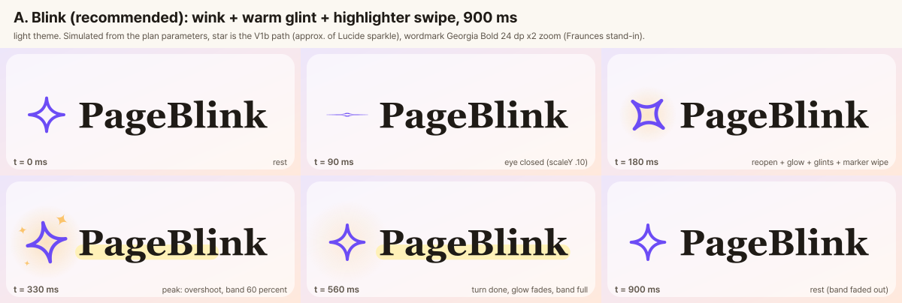
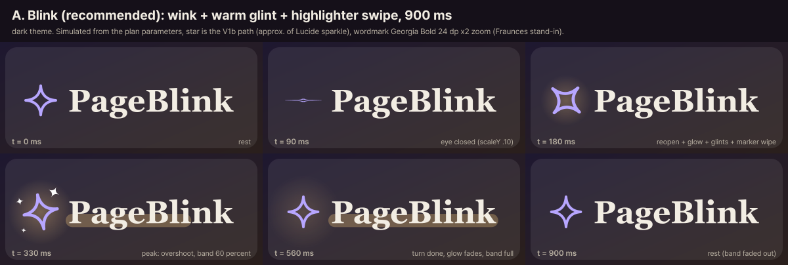
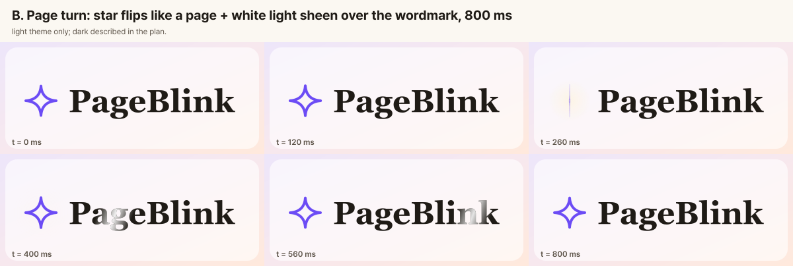
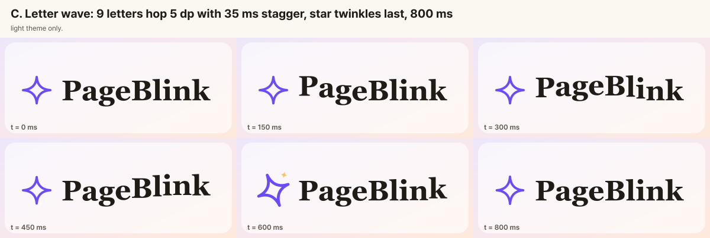
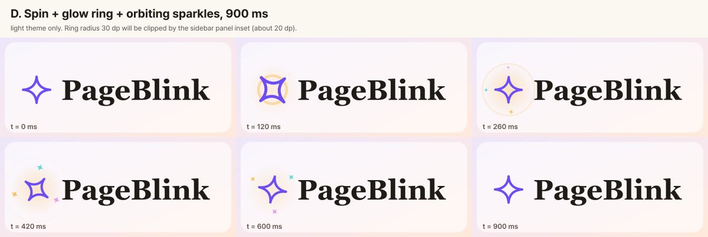
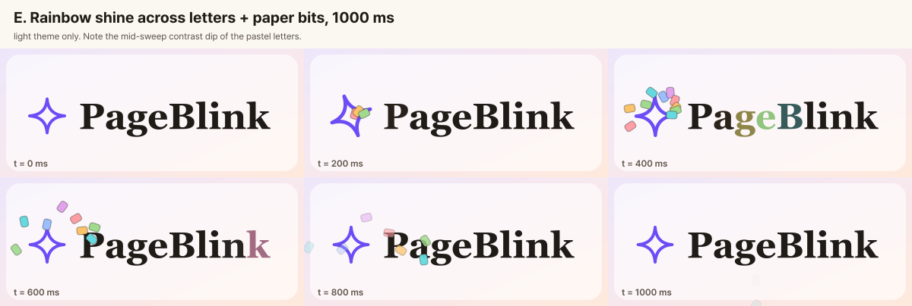
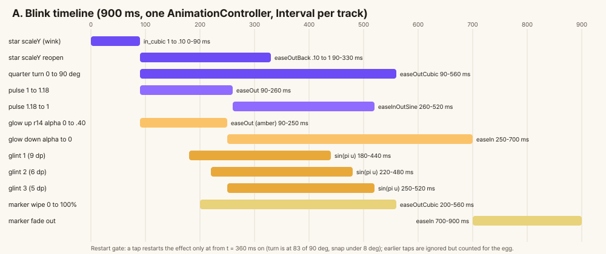
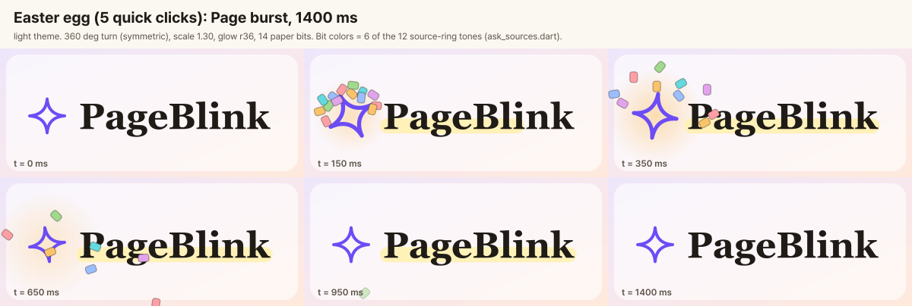
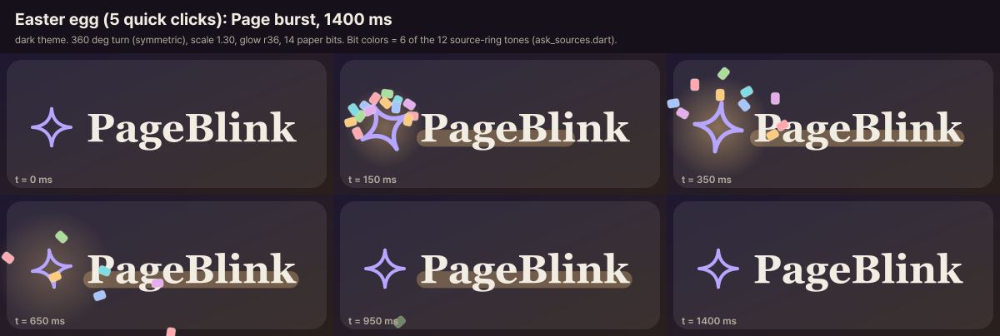
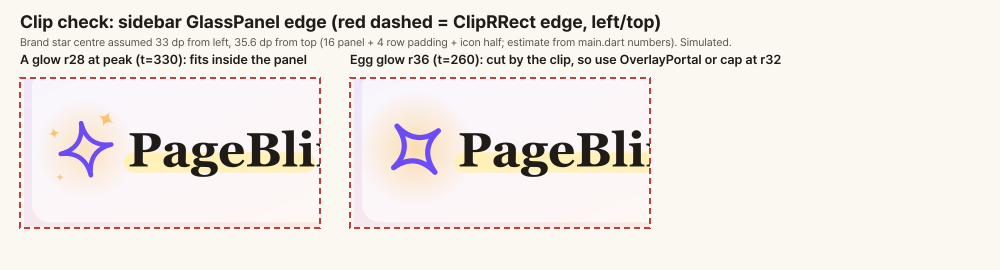

# PageBlink 브랜드 마크 클릭 이펙트 기획

| 항목 | 값 |
|---|---|
| 작성일 | 2026-10-16 17:29 KST (문서화 시각) |
| 상태 | 제안 — 소유자 선택 대기 (기본 추천: A "Blink" + 5연타 에그 "Page burst") |
| 범위 | 브랜드 마크(별 + `PageBlink`) 클릭/탭 시 재생되는 일회성 이펙트 |
| 관련 문서 | 조사: [research 035](../../research/035-logo-click-effect-references.md) · 모션 규칙: [interaction-states/spec.md](../interaction-states/spec.md) · UI 금지·토큰: [ui-polish/spec.md](../ui-polish/spec.md) |

**리드가 정한 기본 결정** (소유자가 바꾸지 않는 한 이대로 진행)

1. 탭은 **이펙트만** 재생하고 화면 이동은 하지 않는다.
2. 호박색(amber)은 `Pb` 토큰으로 승격한다.
3. 범위는 **AppBar + 사이드바** 두 곳이다.
4. interaction-states 규칙 6에 "브랜드 일회성 이펙트 예외" 한 줄을 추가한다.

> 표기: ⚠️ 미확인/추정. 폴더 규칙: `docs/design/`에는 README(인덱스)가 없고 "방향별 폴더 + `spec.md`" 관례([note-color/spec.md](../note-color/spec.md) 등)를 따랐다. 그래서 인덱스는 갱신하지 않았다. 모든 시안은 같은 파라미터에서 샘플링한 **시뮬레이션**이며 Flutter 캡처가 아니다. 이미지는 `images/` 아래 파일명으로만 참조한다.

---

## 1. 현재 브랜드 마크 (읽은 사실)

| 위치 | 구성 | 근거 |
|---|---|---|
| 폰·태블릿 AppBar (폭 < 1024) | `Icon(AppIcons.brand, size 24, accent)` + `'PageBlink'` (`titleLarge` 22, 자간 -0.2) | `lib/main.dart` 286–297 |
| 데스크톱 사이드바 (폭 ≥ 1024) | 아이콘 26 + `Flexible(Text 24, maxLines 1, ellipsis)`, 패딩 `fromLTRB(4,4,4,0)` | `lib/main.dart` 570–588 |
| 로그인 화면 머리말 | `'⚡ PageBlink'` 이모지 문자열(`headlineMedium` 24/28). 별이 아니라 **다른 마크** | `sign_in_screen.dart` 534 |
| 태블릿 `NavigationRail` (600–1023), Ask 헤더 | 브랜드 없음 | `main.dart` 491, grep |

- **누를 수 없다.** 위 Row들은 제스처가 없다. "탭하면 원래 동작"이라는 것이 아예 없다.
- **별 아이콘:** `AppIcons.brand = LucideIcons.sparkle`(font glyph, 선 스타일). 앱 아이콘 V1b의 별과 같은 계열([ADR 016](../../adr/016-app-icon-and-ui-icon-direction.md)).
- **글꼴:** 제목은 Fraunces w600(`assets/google_fonts/Fraunces-SemiBold.ttf` 번들) → Noto Serif KR 서브셋 → Pretendard 폴백(`theme.dart` 344–360).
- **색 토큰 (라이트 / 다크)**
  - `accent`: `#6C4CF5` / `#B7A6FF`
  - `ink`: `#1F1B16` / `#F2EDE3`
  - 배경: `#EDE6FA→#F7E8EE→#FFE9DC` / `#1E1830→#251C27→#2A1F1C`
  - 유리면: `0x9EFFFFFF` / `0x14FFFFFF`
- **사이드바는 `GlassPanel`** 안에 있다(`ClipRRect`(24) + `BackdropFilter` blur 18, `theme.dart` 669–709). 마크 밖으로 번지는 효과는 잘린다.

## 2. 기존 모션 규칙과의 충돌 (명시)

1. **[interaction-states](../interaction-states/spec.md) §2 원칙 6 "모션은 120ms 이하, `disableAnimations`면 즉시"** (spec.md 73행). 600–1000ms 이펙트는 이 규칙의 **명시적 예외**다. 선례는 있다: [ask-sources v2](../ask-sources-v2/spec.md) 출처 깜빡임 1440ms(spec 181행), chevron 160ms, 노트 색 전환 200ms. 규칙에 맞는다고 쓰지 않고, 일회성 브랜드 모션은 별도 예산을 갖는다고 적는다 → 규칙 6에 한 줄 예외를 추가한다(기본 결정 4).
2. **[ui-polish](../ui-polish/spec.md) §11 "하지 말 것"**
   - 별을 마스코트·일러스트로 키우지 않는다.
   - 보라를 더 쓰지 않는다.
   - 큰 스프링·슬라이드를 넣지 않는다.
   - 블러를 늘리지 않는다.
   - → 글로우와 입자는 **보라가 아닌 따뜻한 호박색**으로 하고, `elasticOut`과 큰 스프링은 추천안에서 뺀다. 별 크기는 최대 약 1.3배, 눈·얼굴 같은 요소는 넣지 않는다.
3. **무지개:** `ask_sources.dart`의 12색 링(출처 깜빡임)과 노트 무지개(`noteRainbow`)가 이미 있다. 브랜드에서 또 쓰면 "근거에 불이 들어온다"는 출처 효과의 의미가 흐려진다. E안을 주력으로 하지 않는 이유.

## 3. 5가지 콘셉트

시안은 별(V1b 별 경로, Lucide sparkle과 근사)과 글자(Georgia Bold, Fraunces 대용)로 그렸다(§12 참고). 별은 90° 대칭이라 +90°, +360° 회전의 끝이 정지 자세와 같아 튀지 않는다.

### A. Blink (추천): 별이 윙크하고, 따뜻한 반짝임 뒤에 형광펜이 글자 밑을 지나감 (900ms)

- **프레임** (`A-blink-light.png`, `A-blink-dark.png`): 0 정지 → 90 눈 감김(scaleY .10) → 180 다시 뜨며 회전·글로우 → 330 정점(오버슈트, 반짝 3개, 형광펜 60%) → 560 회전 종료·글로우 소멸·형광펜 전체 → 900 정지.
- **타임라인**: §4 표와 `A-timeline.png`.
- **색**: 글로우·반짝임 호박색(라이트 `#FBC369`, 다크 `#FCCB7E`), 형광펜 라이트 `#FFF1B8` / 다크 호박색 30%.
- **반복 클릭**: 5연타 시 "Page burst"(§5).
- **글자 안 건드림**: 글자 자체는 움직이지도 색이 바뀌지도 않아 가독성이 유지된다.

### B. Page turn: 별이 책장처럼 뒤집히고 글자 위로 흰 빛이 쓸고 감 (800ms)

- 별 `scaleX = |cos(π·u)|`, 0–520ms `easeInOutCubic`. 빛 띠는 160–760ms `easeInOutSine`, 기울기 -20°, 폭은 글자 폭의 22%.
- 색은 흰색, 글로우 `notes[0]` `#FFF1B8`.
- 5연타 시 빛이 두 번 지나간다.
- **약점**: 글자를 하얗게 덮어서 빛이 지나가는 동안 글자가 흐려진다. `ShaderMask`가 필요하고 saveLayer 1회/프레임이 든다.
- **다크**: 글자가 이미 밝아서 효과가 약하다(별도 안 필요).

### C. Letter wave: 9글자가 5dp씩 통통 튐 (800ms)

- 글자별 `hop = -5·sin(πu)`, 300ms, 지연 `60 + 35·i` ms. 마지막에 별이 480–800ms 동안 1.22배 펄스와 90° 회전, 반짝 1개.
- 5연타 시 파동이 한 번 더 지나간다.
- **약점**: 글자 9개를 따로 위젯으로 쪼개야 해서 Fraunces 커닝이 깨지고, 사이드바의 `Flexible`+`ellipsis`와 2배 글자 크기에서 줄 넘침 위험이 있다. 대안은 두 단어 분리(Page / Blink), 또는 `ExcludeSemantics`로 감싼 오버레이 글자 레이어. 가장 아이 같은 인상이기도 하다.

### D. Spin + ring + orbit: 별이 한 바퀴 돌며 고리가 퍼지고 반짝 3개가 공전 (900ms)

- 회전 360° 0–700ms `easeOutBack`, 펄스 1→1.3(0–220ms) →1(`elasticOut` 220–700ms), 고리 반경 10→30dp 100–700ms, 공전 반짝 3개 반경 19dp.
- **약점**: 고리 반경 30dp가 사이드바 패널 안쪽 여백(약 20dp)에서 잘린다. `elasticOut`은 ui-polish §11과 충돌한다. 반짝 색이 여러 가지라 가장 장난감 같다.

### E. Rainbow shine + paper bits: 글자에 무지개빛이 쓸고 가며 종이 조각이 튐 (1000ms)

- 글자별 ink→12색 링 색 혼합, 80–780ms. 종이 조각 10개(5×7dp), 시작 `120+30i` ms.
- **약점**: 글자가 파스텔로 변하는 중간에 대비가 크게 떨어진다(시안 400ms 프레임). 무지개는 출처 깜빡임과 겹친다. 입자 10개가 상시 반복 효과로는 과하다.

### 비교 요약

| | 예쁨 | 재미 | 차분한 종이·잉크 톤 | 글자 가독 | 사이드바 클리핑 | 비용(⚠️ 추정) |
|---|---|---|---|---|---|---|
| A | 높음 | 중 | 높음 | 유지 | 반경 28dp로 안에서 해결 | 가장 낮음 |
| B | 중 | 중 | 높음 | 순간 저하 | 안전 | saveLayer 1개 |
| C | 중 | 높음 | 낮음 | 유지 | 줄 넘침 위험 | 위젯 9개 |
| D | 중 | 높음 | 낮음 | 유지 | 잘림 | 중간 |
| E | 높음 | 높음 | 낮음 | 중간에 저하 | 입자 탈출 필요 | saveLayer + 입자 |

## 4. 추천: A "Blink" 단일 효과

**이유**

- "Page + **Blink**"를 직접 쓴다. 별이 눈처럼 깜빡이는 동작이 제품 약속("근거를 찾아 깜빡 보여 줌", [ADR 016](../../adr/016-app-icon-and-ui-icon-direction.md)의 "반짝 = 근거를 찾아 줌")과 같은 어휘다.
- 형광펜 띠는 문서 앱의 은유다. 글자는 건드리지 않고 별 하나와 띠 하나만 움직여 차분하다.
- 보라를 늘리지 않는다. 호박색 글로우는 따뜻한 빛이고, 별만 보라다.
- 별 크기는 최대 약 1.3배라 마스코트가 되지 않는다.
- 가장 가볍다(ShaderMask·saveLayer 없음).

### 파라미터 (총 900ms, `AnimationController` 1개 + `Interval`별 `CurveTween`)

| 트랙 | 구간(ms) | 곡선 | 값 |
|---|---|---|---|
| 눈 감김 (별 scaleY / scaleX) | 0–90 | `easeInCubic` | scaleY 1→0.10, scaleX 1→1.12 |
| 눈 뜸 | 90–330 | scaleY `easeOutBack`, scaleX `easeOutQuad` | scaleY 0.10→1(overshoot 약 1.09), scaleX 1.12→1 |
| 1/4 회전 | 90–560 | `easeOutCubic` | 0→90° (π/2) |
| 펄스(균일 배율) | 90–260 / 260–520 | `easeOutQuad` / `easeInOutSine` | 1→1.18 / 1.18→1 |
| 글로우 | 90–250 상승 / 250–700 하강 | `easeOutQuad` / `easeInQuad` | 반경 14→28dp(90–700 `easeOutCubic`), 알파 0→0.40→0 (라이트 0.40, 다크 0.34) |
| 반짝 3개 (4꼭지 별) | (180–440) / (220–480) / (250–520) | `sin(πu)`로 크기·알파 | 크기 9 / 6 / 5dp, 별 중심 기준 (+10,-15) / (-16,-8) / (-13,+14), 회전 +45° / -30° / +20° |
| 형광펜 | 200–560 와이프 / 700–900 페이드 | `easeOutCubic` / `easeInQuad` | 글자 폭+4dp를 왼→오른쪽으로 채움, 높이 `0.42×fontSize`(x-height 하단부), 모서리 5dp |

- **색:** 호박색은 라이트 `#FBC369` / 다크 `#FCCB7E`. 모두 `ask_sources.dart`의 링 팔레트 `[2]` 값으로 현재 **private 상수**다. 기본 결정 2에 따라 `Pb` 토큰으로 승격한다.
- **형광펜 색:** 라이트 `#FFF1B8`(`pb.notes[0]`), 다크 호박색 30% 알파.
- **반짝 색:** 라이트 호박색, 다크는 시안에서 `#FFFFFF`로 그렸지만 구현은 `pb.ink`(`#F2EDE3`)를 권한다.
- **글로우 렌더링:** `RadialGradient`, 정지점 `[0, .55, 1]`, 알파 `a / a·0.45 / 0`. `MaskFilter.blur`는 쓰지 않는다(ui-polish §11 블러 금지, 웹 비용).
- **대비 계산:** 라이트 ink on `#FFF1B8`은 15.1:1. 다크는 형광펜을 유리면 약 `#362E38` 위에 얹은 값 `#715D4D`로 추정해 `#F2EDE3` 글자가 5.3:1(≥4.5). 호박색 반짝은 유리면 위 1.35:1이지만 장식 요소다.
- **정지 자세 복귀:** 별 90° 대칭이라 끝 프레임이 처음과 같아 팝이 없다.

## 5. 히든 에그 (5연타, 연속 간격 ≤ 700ms): "Page burst" 1400ms

- 별 360° 회전(0–900ms `easeOutCubic`)과 펄스 1→1.30(0–260ms `easeOutBack`) → 1(260–700ms `easeInOutSine`). 글로우 반경 16→36dp, 알파는 기본의 1.25배.
- **종이 조각 14개**: 5×7dp 둥근 사각형(반경 1.5dp), 얇은 ink 윤곽 알파 35%.
  - 발사 각도: `-170° + i·(140°/13) + ((i·7)%5 - 2)·3°`
  - 초기 속력: `110 + (i·37)%60` dp/s
  - 중력: 420 dp/s²
  - 회전 속도: `(i 짝수 ? -1 : +1)·(3 + i%3)` rad/s
  - 수명: 1100ms, 마지막 300ms 페이드
  - 난수 없이 인덱스로만 계산한다(테스트 결정성).
- 색은 12색 링의 6개. 라이트 `#FE9FA6 #FBC369 #A0DA8D #65D9DF #9BBEFE #E2A3EC` / 다크 `#FFA9AF #FCCB7E #ACDE9B #7EDDE2 #A5C5FE #E4ADED`.
- 파스텔 노트 토큰(`noteRainbow`)을 쓰지 않은 이유: 다크 값이 `#472737…`로 탁한 카드 면 색이라 `#1E1830` 위에서 안 보인다.
- 에그 도중 재발동은 막는다(1400ms 잠금, 카운터 리셋).
- **클리핑:** 에그의 글로우 반경 36dp는 사이드바 패널에서 잘린다(`A-context-clip-check.png`). 에그는 `OverlayPortal` + `CompositedTransformFollower`로 오버레이에 그리고(`IgnorePointer`), 기본 A는 반경 28dp로 패널 안에서 끝낸다. 별 중심이 패널 왼쪽에서 약 33dp, 위에서 약 35.6dp라는 값은 main.dart의 숫자(16+4 패딩, 아이콘 절반)로 계산한 **추정**이다 ⚠️. AppBar 제목이 클립되는지는 **확인하지 못했다** ⚠️. 실기기에서 보고 필요하면 AppBar도 오버레이를 쓴다.

## 6. 반복 클릭 규칙

- 효과가 도는 중 탭은 **t < 360ms면 무시**한다. 이때 회전이 83°/90°라 재시작해도 어긋남이 8° 미만이라 보이지 않는다. t ≥ 360ms면 `forward(from: 0)`으로 재시작한다.
- 컨트롤러는 마크마다 **1개**만 둔다(스택·중복 생성 없음).
- 모든 탭은 타임스탬프를 기록한다. 연속 탭 간격이 700ms 이하면 카운트가 이어지고, 넘으면 1로 리셋된다.
- 5연타는 §5의 에그를 발동한다.

## 7. 모션 축소 (`MediaQuery.disableAnimationsOf`)

- 컨트롤러를 돌리지 않는다. 회전·배율·글로우·반짝·입자는 없다.
- 형광펜 띠 알파만 0→0.6→0으로 **150ms 이하 한 번** 보여 준다. 색 변화이고 움직임이 아니다. 완전 무반응도 허용 가능한 대안이다.
- 에그도 같은 처리.
- 웹의 `prefers-reduced-motion`이 이 플래그로 매핑되는지는 기존 문서([interaction-states](../interaction-states/spec.md) 221행)도 ⚠️ 미확인으로 적고 있어, 같은 한계를 유지한다.

## 8. 접근성

- **지금은 버튼이 아니다.** 장식 이펙트를 위해 스크린 리더에 "버튼"을 추가하면 소음이라, 시맨틱은 그대로 두는 것을 권한다.
- 구현: `GestureDetector(behavior: HitTestBehavior.opaque, excludeFromSemantics: true)`, 포커스 정지 없음(탭 순서 변화 없음), 이펙트 레이어는 `IgnorePointer` + `ExcludeSemantics`.
- 포인터 커서: 데스크톱에서 `click`으로 할지는 소유자 결정 사항이다. 발견성에는 도움이 되지만 눌러도 이동은 없다.
- **히트 영역:** 폰 AppBar에서는 `ConstrainedBox(minHeight: pbTarget(context))`(44)를 권한다(툴바 56 안이라 레이아웃 영향 없음). 사이드바는 Row 높이가 약 31dp(24×1.3, 계산값 ⚠️)다. 36을 강제하면 아래 태그라인이 약 5dp 밀리므로 그대로 둔다.
- **포커스:** 탭해도 `FocusManager.primaryFocus`는 변하지 않는다.
- **눌림 피드백:** 기존 `PbPressScale`(0.97, 80ms)로 감싼다. 새로 만들지 않는다.

## 9. 구현 구조 (제안, 아직 없는 파일) 와 성능

### 구조 `PbBrandMark`

- **새 위젯 `PbBrandMark`** (예: `lib/app/brand_mark.dart`)를 하나 만들어 AppBar와 사이드바가 같이 쓴다. 이미 두 곳이 같은 마크를 복제해 쓰고 있다([ui-polish](../ui-polish/spec.md) UP-06). 아이콘 크기와 글자 스타일은 호출부에서 넘긴다.
- `RepaintBoundary` > `GestureDetector` > `Stack(clipBehavior: Clip.none)`
  - 뒤: 글로우·반짝 `CustomPainter`(`repaint: controller`, 리빌드 없음)
  - 별: 기존 `Icon(AppIcons.brand)`를 `Transform`으로 감쌈 (scale 먼저, 회전은 그 안쪽. 윙크 축이 화면 세로로 유지됨)
  - 글자: `Text` 뒤에 형광펜 `CustomPainter`. **`Flexible` 안에 넣어** 말줄임이 걸린 폭에 맞고, 2배 글자 크기에서도 글자 상자를 따라간다.
- 아이콘은 폰트 glyph 그대로 쓰고, 효과 중 칠한 별로 바꾸지 않는다(전환 팝 방지).
- 에그는 두 번째 컨트롤러(1400ms)를 필요할 때만 만들고 dispose한다.

### 성능 노트 (Flutter web, CanvasKit)

- **기술 선택:** `AnimationController` + `Transform`/`CustomPainter`. FragmentProgram 셰이더는 쓰지 않는다. 이 규모에는 과하고 웹 호환 부담만 늘기 때문.
- **(⚠️ 추정, 측정 안 함)**
  - A 프레임당 드로우: 방사형 셰이더 원 1 + 4꼭지 경로 최대 3 + RRect 1 + 별 Transform. saveLayer 없음(`canvas.save`만).
  - 사이드바의 기존 `BackdropFilter`(blur 18)는 마크 위쪽 레이어의 변화에는 다시 계산되지 않을 것으로 보이나, 이 역시 실측으로 확인해야 한다.
  - 입자는 에그에서만 최대 14개, A 자체는 장식 입자가 없다.
  - B·E의 `ShaderMask`는 saveLayer를 1회/프레임 만든다. C는 글자 위젯 9개가 매 프레임 갱신된다.
- `RepaintBoundary`로 마크를 감싸 유리 패널·페이지 레이어를 더럽히지 않는다. 루프 안 saveLayer 금지.

## 10. 테스트 계획 (기존 테스트에 브랜드 참조 없음, 전부 신규)

1. **완료:** 탭 후 `pump(900ms)`이면 `tester.hasRunningAnimations`가 false이고 예외가 없다.
2. **2배 글자 크기:** `MediaQuery(textScaler: TextScaler.linear(2))`에서 AppBar·사이드바(폭 240) 모두 `tester.takeException()`이 null이고, 형광펜이 글자 상자 안에 있다.
3. **모션 축소:** `disableAnimations: true`면 별 `Transform`이 항등이고 입자가 없다. 150ms 후 `hasRunningAnimations`가 false.
4. **원래 동작 불변:** 탭해도 선택 탭(`_tab`)이 바뀌지 않고 `FocusManager.primaryFocus`가 같으며, 시맨틱 트리에 탭 액션이 새로 생기지 않는다. (원래 동작이 없다는 점 자체를 고정하는 테스트.)
5. **컨트롤러 비중첩:** 1초 안에 20번 탭해도 컨트롤러 1개(`transientCallbackCount` ≤ 1)이고, t < 360ms 탭은 `value`를 되돌리지 않으며, 360ms 이후 탭은 0부터 재시작한다.
6. **에그:** 간격 ≤ 700ms로 5번 탭하면 오버레이 입자 14개가 생기고, 한 번이라도 700ms를 넘기면 생기지 않는다. 1400ms 중 재발동이 없다.
7. **dispose:** 애니메이션 도중 위젯을 제거해도 "Ticker was not disposed" 오류가 없고, 오버레이 엔트리가 제거된다.
8. **다크 대비:** 형광펜 블렌드 위 `pb.ink`가 4.5:1 이상인지 값으로 검사한다.

## 11. 소유자 결정 목록

리드의 기본 결정을 함께 적는다.

| # | 결정 | 리드 기본값 |
|---|---|---|
| 1 | 탭의 동작 | 이펙트만, 화면 이동 없음(시맨틱 변경 없음) |
| 2 | 호박색 토큰 | `Pb` 토큰으로 승격(`ask_sources.dart` private 상수 `[2]` 값) |
| 3 | 범위 | AppBar + 사이드바 두 곳. 로그인의 `⚡ PageBlink` 이모지 마크는 별도 마크라 범위 밖 |
| 4 | 모션 예외 명문화 | interaction-states 규칙 6에 "브랜드 일회성 이펙트 예외" 한 줄 추가 |
| 5 | 포인터 커서 | 미정(데스크톱 `click` 여부, §8) |

## 12. 생성 산출물과 한계

- **생성한 것:** SVG 프레임을 `rsvg-convert`로 PNG 렌더한 시트 10장(아래 목록). SVG 원본과 렌더 스크립트는 저장소에 두지 않았다(세션 스크래치패드에만 있음). OpenRouter 호출은 하지 않았고 실패한 호출도 없다.
  - `A-blink-light.png`, `A-blink-dark.png` (추천안, 프레임 6장씩)
  - `A-egg-5-clicks-light.png`, `A-egg-5-clicks-dark.png` (5연타 에그)
  - `A-timeline.png` (추천안 트랙별 타임라인)
  - `A-context-clip-check.png` (사이드바 클리핑 확인)
  - `B-page-sheen-light.png`, `C-letter-wave-light.png`, `D-spin-orbit-light.png`, `E-rainbow-shine-light.png`
- **글꼴:** Fraunces를 `rsvg-convert`에 직접 먹이려 했지만 폰트 설정 파일을 무시하고 산세리프로 폴백됐다. 그래서 저장소가 ui-polish에서 이미 Fraunces 대용으로 썼던 **Georgia Bold**로 렌더했다. 글자 폭·모양이 실제와 다르다. 글자별 위치는 TTF의 advance 폭 합이라 커닝이 빠져 있다.
- **별:** 앱 안의 Lucide sparkle 원본 SVG를 찾지 못해 V1b 앱 아이콘 별 경로를 선 스타일로 그렸다. 근사다.
- **모든 프레임은 시뮬레이션**이다. Flutter 렌더가 아니라서, 실제 느낌(특히 윙크 속도, 글로우 세기)은 구현 후 눈으로 튜닝해야 한다. 성능 수치는 측정하지 않았다 ⚠️.
- 클립 확인 시트는 셀 자체의 둥근 유리 사각형이 같이 보여 조금 헷갈린다. 붉은 점선이 패널 가장자리다.
- 별 중심 위치(33dp / 35.6dp)와 사이드바 Row 높이(약 31dp)는 main.dart의 숫자로 계산한 추정이다 ⚠️.
