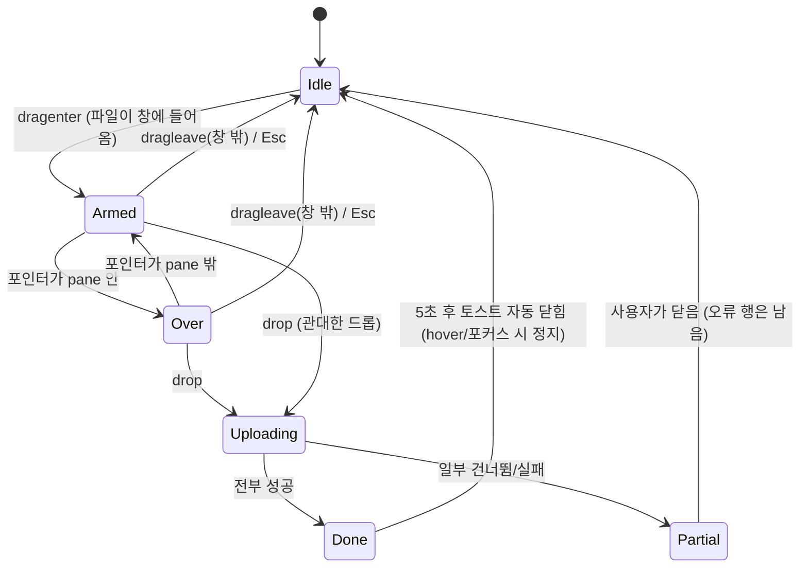

# 다시 색인 표시 + PDF 드래그 앤 드롭 드롭 존 — 디자인 스펙

작성 2026-10-15 14:25 KST. 기준 방향은 채택된 **AB v2**(`../ab-v2/spec.md` + `../ab-glass-paper/spec.md` 토큰, 구현은 `app/pageblink_flutter/lib/app/theme.dart`의 `Pb`). 새 방향이 아니라 클라이언트 피드백 두 건에 대한 **부분 설계**다: (1) "다시 색인 표시와 전체 다시 색인 큰 버튼이 부자연스럽다" (2) "PDF를 노트 가운데 아무 데나 드래그하면 업로드, 드래그 중에는 요즘 쓰는 추가 표시". **저장소 코드는 수정하지 않았다**(시안은 SVG를 직접 작성해 `rsvg-convert`로 PNG 변환, 이미지 생성 모델 미사용).

> 표기: ✅ 코드·렌더·계산으로 확인 · ⚠️ 미확인/추정. 줄 번호 대신 위젯·함수 이름으로 가리킨다. `docs/design/`에는 README가 없고 방향별 폴더 + `spec.md` 관례를 따른다.
> 읽은 기준: 작업 트리의 `documents_screen.dart`/`l10n.dart`/`main.dart`/`theme.dart`(미커밋 Pretendard 작업 포함), `ui-polish/spec.md`(문서 작성 14:13, 파일 수정 14:18 KST판).

## 0. 파일

모든 PNG는 라이트(`-light`)/다크(`-dark`) 2벌이고 같은 이름의 `.svg` 원본이 `svg/` 폴더에 있다(생성 스크립트는 저장소 밖 세션 스크래치패드). 데스크톱은 1280×800(중앙 pane 564px, 카드 2열 274×250).

| 파일 | 내용 |
|---|---|
| `reindex-1-board-{light,dark}.png` | **전→후 보드 전체**. 배너 + 실패 카드 4겹 → 상태 한 줄 + "최근" 줄 링크 |
| `reindex-2-card-states-{light,dark}.png` | 카드 상태표: 전 4장, 후 색인 중 2 / 실패 2 / 중단·읽기불가·서버설정 / 완료(반짝) |
| `reindex-3-bulk-line-{light,dark}.png` | 일괄 안내 줄 6컷: 배너, 평상시, 실패 2, 시도 중, 결과+스낵바, 폰 폭 |
| `reindex-4-timeline-{light,dark}.png` | 색인 중 시간 흐름 5컷(0초 → 20초 → 3분 → 10분 중단 → 완료) |
| `dnd-1-idle-*` | ① 대기: 안내 없음, 업로드 버튼 유지 |
| `dnd-2-drag-enter-*` | ② 드래그 진입(포인터가 pane 밖): 양옆 패널 스크림 + 점선 존 |
| `dnd-3-drop-ready-*` | ③ 드롭 가능 강조(포인터가 pane 위): 굵은 테두리·채움·아이콘 들림 |
| `dnd-4-uploading-*` | ④ 업로드 중 트레이(완료 1 / 색인 중 1 / 대기 1, 총 3개) |
| `dnd-5-done-highlight-*` | ⑤ 완료: 같은 3개의 새 카드 하이라이트 + 완료 토스트(헤더 개수도 11/PDF 5로 갱신) |
| `dnd-6-error-*` | ⑥ 오류: 비 PDF 건너뜀 + 색인 실패 재시도 |
| `dnd-7-phone-*` | 폰(드래그 없음): FAB → 대상 시트 → 진행 트레이 |
| `dnd-8-variants-*` | 편집기 열림 A(비활성) / B(새 문서로 추가) / 프로젝트 탭 C |

**시안의 한계**: 글꼴은 Pretendard, 세리프 제목은 Georgia/AppleMyungjo 대체(Fraunces 미설치), 아이콘은 Lucide 윤곽선을 손으로 옮김. 위치·위계·치수를 보는 용도다. 시안은 **현재 `theme.dart` 값**(`inkMuted #6B6358`, 다크 노트 `#4A3F16…`)으로 그렸다. ui-polish UP-02/UP-16이 머지되면 보조색 대비는 더 좋아진다(§2.7).

## 1. 진단

### 1.1 다시 색인 (증거는 `ui-polish/current-desktop-board-light.png` 실제 캡처와 코드)

1. **한 건의 실패에 알림이 4겹이다.** 필터 칩 "확인 필요 1"(경고 채움) + 전폭 노란 `MaterialBanner` + 카드 전체 `warnTint`/1.5 주황 테두리 + 카드 안 `warnContainer` 박스와 외곽선 버튼. 사용자는 "색인은 잘 동작한다"고 했는데 화면은 계속 오류처럼 소리친다.
2. **배너가 레이아웃을 밀고 원문을 샌다.** 배너는 `최근` 라벨 바로 아래에서 카드 목록을 약 76px 밀어 내린다(✅ 캡처). 둘째 줄은 `indexingError(firstWhere(failed).lastError)`라서 **첫 번째 실패의 원문**(`embedding timeout`)이 그대로 나온다(`indexingError`의 `_ => code` 폴백, ✅ 코드). 실패가 여러 개여도 첫 번째 사유만 보인다.
3. **이름이 거짓말한다.** 버튼은 `모두 다시 색인`인데 호출은 `reindexFailed()`(실패 항목만)다(✅ 코드). 같은 낱말 "다시 색인"이 메뉴·카드 버튼·배너에 세 번 나온다.
4. **실패 카드가 카드 높이에 안 맞는다.** `_FailedBlock`이 `mainAxisExtent: 250` 안에서 넘쳐 디버그 줄무늬가 보인다(✅ 캡처). 원인은 ⚠️ 추정이며 ui-polish UP-07과 같다: `OutlinedButton`의 `minimumSize 32`가 기본 `tapTargetSize: padded`로 48px 레이아웃이 되어 가용 높이를 넘는다. (이 스펙의 구조는 박스·버튼 자체를 없애므로 원인과 무관하게 사라진다.)
5. **"색인 중"이 경고색이다.** 진행 중 상태 텍스트를 `pb.warn`(주황)으로 칠하고 애니메이션도 없다(✅ 코드). 정상 진행이 경고로 읽힌다.
6. **재시도해도 소용없는 실패에도 같은 버튼이 있다.** `no_source`(스캔 PDF), `auth`(서버 API 키)는 몇 번을 눌러도 다시 실패한다. 버튼이 약속을 지키지 못한다.
7. **재색인 한 번이 전체를 잠근다.** `_reindex`가 전역 `_busy`를 켜서 모든 카드의 `⋯ → 다시 색인`이 비활성이 되고(`onReindex: _busy == null ? … : null`), 보드 위에 `LinearProgressIndicator` + 텍스트 줄이 끼어든다(✅ 코드).
8. **대비.** 작은 상태 텍스트에 `warn #B45309`를 쓰면 노트 파스텔 5면에서 3.9~4.4:1이다(AA 4.5 미달, §2.7). `accent #6C4CF5` 링크도 파스텔 4면에서 4.1~4.4:1이다.

### 1.2 드래그 앤 드롭 (현재 상태)

- ✅ 드롭 경로가 없다. `pubspec.yaml`에는 `file_picker`만 있고 DnD 패키지는 없다. 업로드는 `_upload()` → `FilePicker.pickFiles` → **`picked.first` 한 개만** → 매번 `_chooseTier()` 모달 → 진행은 전역 `_busy` 문자열 한 줄이다.
- ✅ 업로드 동작 단위는 **단계**다: `extractPages`(클라이언트) → `client.document.upload`(서버가 임베딩·색인을 동기로 끝냄) → `LocalPdfs.save` → `pdfUploadDescription`/`FileUploader`(원본 저장, 비치명). 바이트 단위 진행률은 없다.
- ✅ 중앙 pane은 `main.dart`의 `_withPane`이 만든다: 탭 내용(`Offstage`) 위에 열린 항목(`OpenItemPane`)을 `Stack`으로 얹는다. 데스크톱(≥1024)은 `ConstrainedBox(maxWidth: 1100)` 안, 태블릿(600–1023)은 레일 옆 `Expanded`다. **보드와 편집기를 모두 덮는 지점은 `_withPane`뿐이다.**
- ⚠️ 웹에서 창 안 어디에도 드롭 처리가 없으면 브라우저가 PDF를 **현재 탭에서 열어 앱을 떠나게** 한다(브라우저 기본 동작). 드롭 존을 pane에만 그려도 `dragover`/`drop`은 창 전체에서 막아야 한다(§3.1).

## 2. (1) 다시 색인 표시 설계

### 2.1 원칙 4줄

1. **평소에는 보이지 않는다.** `ready`인 카드와 실패 0인 보드에는 색인 관련 요소가 하나도 없다.
2. **카드 색은 건드리지 않는다.** 노트 파스텔/PDF 흰 종이 체계(ask-sources가 출처 행에서도 같은 규칙을 쓴다)를 유지한다. 바뀌는 것은 카드 **하단 상태 한 줄**과 PDF 본문 영역뿐이다.
3. **키는 `(status, lastError)`다.** `interrupted`/`timeout`은 status가 아니라 `failed` + `lastError` 코드다(✅ `l10n.indexingError`, 최근 커밋 `a9aa21d`의 "10분 → failed/interrupted"). 상태 표현과 재시도 가능 여부는 이 쌍에서만 결정한다.
4. **알림은 한 곳, 한 줄, 레이아웃 이동 0.** 일괄 안내는 이미 있는 `최근` 줄의 오른쪽 끝에 들어간다.

### 2.2 상태표 (카드)

| # | status | lastError | 상태 줄 (ko / en) | 아이콘·톤 | 본문 영역 | 재시도 | 일괄 대상 |
|---|---|---|---|---|---|---|---|
| 1 | `ready` | – | (없음) | – | 노트 미리보기 / PDF 빈 칸 | ⋯ 메뉴만 | – |
| 2 | `indexing` (0~20초) | – | `색인 중` / Indexing | 보라 점(8) + 맥박, 글자 `inkMuted` | PDF: 스켈레톤 3줄 | 없음(⋯로 구제) | – |
| 3 | `indexing` (20초~3분) | – | `색인 중 · 큰 문서는 시간이 걸려요` / Indexing · large files take a while | 동일 | 동일 | 없음 | – |
| 4 | `indexing` (3분~) | – | `색인이 오래 걸리고 있어요` / Taking longer than usual | 동일 | 동일 | 없음(⋯ "다시 색인"으로 구제, 기존 동작) | – |
| 5 | `failed` | `timeout` `quota` `rate` `outage` `unknown`, **매핑 안 된 값** | `색인 실패 · 다시 시도` / Index failed · Retry | `circleAlert` 14 `warn` + 글자 `warnText` | PDF: 사유 문장 2줄 / 노트: 미리보기 유지 | **텍스트 링크** | ✅ |
| 6 | `failed` | `interrupted` | `색인이 끊겼어요 · 다시 시도` / Indexing interrupted · Retry | `circleAlert` 14 `inkMuted`, 글자 `ink` (**중립 톤**: 사용자 탓도 오류 취급도 아님) | 동일 | 링크 | ✅ |
| 7 | `failed` | `no_source` | `텍스트를 읽지 못했어요` / Couldn't read any text | `info` 14 `inkMuted`, 글자 `ink` | PDF: "원본에서 텍스트를 추출하지 못했어요 (스캔한 PDF 등)." | **숨김** | ❌ |
| 8 | `failed` | `auth` | `색인 실패 · 서버 설정 확인` / Index failed · Check server setup | `circleAlert` `warn` | PDF: 사유 문장 | **숨김**(⋯ 메뉴는 유지) | ❌ ⚠️ |
| 9 | (로컬) 다시 시도 직후 | – | `다시 색인 중` / Re-indexing | 2번과 동일 | 동일 | 해당 카드만 비활성 | – |
| 10 | `failed → ready` | – | 상태 줄이 사라짐 + **1.54초 반짝**(ask-sources 플래시와 같은 계열) | – | – | – | – |

- 5~8의 문장 사유(`l10n.indexingError`)는 **PDF는 본문 2줄, 노트는 상태 줄의 툴팁**(`Tooltip(triggerMode: tap)`, 데스크톱 hover 500ms)과 시맨틱 라벨에 둔다. **툴팁은 아이콘 + 라벨에만 건다.** `다시 시도` 링크는 같은 줄에 있으므로 툴팁 영역 밖에 두어 탭이 서로 경쟁하지 않게 한다. 노트는 미리보기가 정보 가치가 있고 색인 실패가 읽기를 막지 않기 때문이다.
- **원문 비노출 규칙**: `indexingError`의 `_ => code` 폴백(원문 그대로 통과)은 화면에서 쓰지 않는다. 매핑 안 된 값은 `unknown` 문구로 보이고 원문은 `debugPrint`만 한다. (현재 `document_card_menu_test`의 `lastError: 'boom'`이 이 경로다.)
- 정확히 말하면 `no_source`/`auth`를 "재시도 숨김"으로 두는 판단은 디자인 제안이다. 서버가 `reindexFailed()`에서 이들을 건너뛰는지는 ⚠️ 미확인(§8-8).

### 2.3 카드 상태 줄 치수

| 항목 | 값 |
|---|---|
| 위치 | 카드 하단, 푸터 칩(프로젝트 문서의 티어 칩, ui-polish UP-03) **바로 위** 8px. 칩이 없으면 카드 안쪽 아래 14 |
| 높이 | 한 줄이면 **32**(링크 버튼 높이와 같게), 폭이 모자라 접히면 라벨 줄 18 + 링크 줄 32 = 최대 50. 카드 높이 250은 그대로 |
| 점 | 지름 8, 색 `accent`, 바깥 후광 지름 16 `accent` 22% (맥박) |
| 아이콘 | Lucide 14 / stroke 2, 글자와 6 간격 |
| 라벨 | 12 / w600(실패) · w500(색인 중), 자간 0, 색 §2.7 |
| 링크 `다시 시도` | 12 / w600 / 색 `linkInk`, 구분자 ` · ` `inkMuted`. `TextButton`은 **`tapTargetSize: MaterialTapTargetSize.shrinkWrap`, `minimumSize: Size(0, 32)`, `visualDensity: compact`, 가로 패딩 4**(기본 `padded`는 32px 버튼을 48px로 배치해 §1.1-4의 overflow를 재현한다). 밑줄 없음, 키보드 포커스 시 2px `accent` 링(UP-04) |
| 스켈레톤(PDF) | 막대 3줄: 폭 78/90/55%, 높이 8, 반경 4, 간격 8. 색 `skeletonBase`(ui-polish §8, 시안은 `ink` 10%), 시머 `skeletonHighlight` |
| 카드 배경·테두리 | **변경 없음**(`warnTint` 배경, 1.5 `warnBorder`, `_FailedBlock` 삭제) |

높이 예산(✅ 계산, 카드 250 · 안쪽 14): 타일 32 + 4 + 제목 2줄(18 × 1.2~1.3 ≈ 43~47) + 6이면 본문은 y ≈ 99에서 시작하고 상태 줄(32)은 y = 204에서 시작해 **본문 가용 약 93~97px**. 프로젝트 문서의 티어 칩(26 + 8)이 더해져도 약 59px라 PDF 사유 2줄(12.5 × 1.4 × 2 ≈ 35)이 들어간다. 줄이 접혀 50이 되면 사유는 1줄 말줄임으로 줄인다.

폭 점검(✅ 계산): 1280에서 카드 274(2열), 1440에서 230.7(3열). 안쪽 폭 202~246. 가장 긴 줄 `색인 중 · 큰 문서는 시간이 걸려요`는 약 193px라 **간신히 한 줄**, 영어판과 폰 2열(안쪽 147)은 두 줄로 접힌다. 그래서 `Wrap`/최대 2줄이다.

### 2.4 일괄 안내 줄

배너(`MaterialBanner`, `failedBanner`, `reindexAll`)를 **삭제**하고 `_header`의 `최근` 줄을 `Row`로 바꾼다.

| 상태 | 표시 | 비고 |
|---|---|---|
| 재시도 가능 실패 0 | 아무것도 없음 | 줄 높이는 원래 있던 `최근` 줄이라 변화 없음 |
| ≥ 1 | 오른쪽 끝 `⟳ 실패 {n}개 다시 시도` / `Retry {n} failed` 텍스트 링크 (12/w600, `linkInk`, 아이콘 14) | n = **재시도 가능한** 실패 수(행 5~6). 칩은 전체 실패 수(행 5~8)를 세므로 숫자가 다를 수 있음 |
| 실행 중 | 링크가 `스피너 12 + 다시 시도 중…`(`inkMuted`, 비활성) | `reindexFailed()`는 최종 개수만 돌려주므로 i/n 진행은 만들지 않는다(⚠️ 서버 응답 기준). 카드들은 각자 "다시 색인 중"(행 9) |
| 결과 | 링크가 남은 수로 갱신되거나 사라짐 + 스낵바(`snackBarTheme` floating r14, UP-04) `1개 색인 완료 · 1개는 계속 실패했어요` | 전부 성공이면 기존 `reindexedCount`("N개 색인 완료") |

- **접기/닫기 버튼은 두지 않는다.** 줄이 이미 존재하고 높이가 같아서 사라질 필요가 없다(YAGNI). 눈에 거슬린다는 피드백이 다시 나오면 세션 한정 `×`를 추가한다(§8-12).
- 필터 칩 `확인 필요 N`은 유지하되 **경고 채움을 빼고** 중립 칩(`chipBg` + `hairline`) 앞에 `warn` 점(7)만 둔다. 한 건의 실패에 알림이 4겹 → 칩 점 1 + 카드 상태 줄 1 + `최근` 줄 링크 1(총 3, 모두 작음)이 된다. 칩을 완전히 없애지 않는 이유는 실패 카드만 모아 보는 **필터**의 기능 때문이다.
- 폰(<600): 같은 줄에 그대로 들어간다(`실패 2개 다시 시도` 약 130px, `reindex-3-bulk-line` 6컷). 칩은 UP-05대로 한 줄 가로 스크롤.

### 2.5 색인 중 표현과 시간 규칙

- 점 맥박: 불투명도 1.0 ↔ 0.35, 1200ms `easeInOut` 반복. 스켈레톤 시머: 1200ms `linear`(ui-polish §6과 동일).
- 문구 단계(§2.2 행 2~4)는 카드가 화면에 있는 동안 **클라이언트 시계**로 바꾼다(`Ticker` 없이 `Timer` 15초 간격으로 충분). 기준 시각은 `Document.updatedAt`이다(✅ 필드 존재). 색인 시작 시각 전용 필드는 없다 ⚠️ — 서버가 `indexing`으로 바꿀 때 `updatedAt`을 갱신하는지 확인이 필요하다(§8-9). 아니면 3분 단계는 오표시되므로 그 경우 2~3단계 문구만 쓴다.
- 10분이 넘으면 서버가 이미 `failed/interrupted`로 바꾼다(✅ 커밋 `a9aa21d`) → 행 6으로 자연스럽게 이동. 클라이언트가 임의로 "실패"를 선언하지 않는다.
- 기기 재진입: 같은 문서가 다른 기기에서 색인 중이면 새로고침(`boardRefresh`/당겨서 새로고침)으로 상태가 바뀐다. 자동 폴링은 이 스펙의 범위가 아니다.

### 2.6 사유 표기 위치 (e)

| 위치 | 대상 | 이유 |
|---|---|---|
| 카드 본문 2줄 | 실패한 **PDF** | PDF 본문 영역은 원래 비어 있다 |
| 상태 줄 툴팁 + 시맨틱 라벨 | 실패한 **노트** | 미리보기를 지우지 않는다. 탭/롱프레스/호버 모두 열림 |
| 일괄 줄 | **표시하지 않음** | 배너가 첫 실패 원문만 보여 주던 문제를 없앤다. 사유는 카드에서만 |
| 스낵바 | 직전 동작 결과만(`reindexFailed` 문구 유지) | 원문 금지 |

### 2.7 토큰과 대비

새 토큰(§4 표에 전체 정리): `warnText`(라이트 `#92400E`, 다크는 `warn`과 같은 `#FBBF24`), `linkInk`(라이트 `#2E1F85` = `onAccentContainer`, 다크 `#B7A6FF` = `accent`). 그 밖에는 기존 토큰만 쓴다.

**라이트, 글자색 / 카드 6면 (✅ 계산)**

| 글자색 | 버터 `FFF1B8` | 민트 `D9F0E1` | 피치 `FFDCCB` | 블루 `D6E8F8` | 라일락 `E9E3FC` | PDF 흰 |
|---|---|---|---|---|---|---|
| `warn #B45309` (현재 상태 글자) | 4.43 ✗ | 4.19 ✗ | 3.91 ✗ | 4.01 ✗ | 4.03 ✗ | 5.02 |
| **`warnText #92400E`** | 6.25 | 5.91 | 5.52 | 5.66 | 5.69 | 7.09 |
| `accent #6C4CF5` (링크로 쓸 때) | 4.64 | 4.39 ✗ | 4.10 ✗ | 4.20 ✗ | 4.23 ✗ | 5.26 |
| **`linkInk #2E1F85`** | 11.2 | 10.6 | 9.9 | 10.2 | 10.2 | 12.7 |
| `inkMuted #6B6358` (현재) | 5.22 | 4.93 | 4.61 | 4.72 | 4.75 | 5.91 |
| `inkMuted #5C5348` (UP-02) | 6.65 | 6.28 | 5.87 | 6.01 | 6.05 | 7.54 |

**다크, 현재 면(`#4A3F16 #1F3D2C #4D2E21 #1F3548 #35295E #2A2620`)**

| 글자색 | 버터 | 민트 | 피치 | 블루 | 라일락 | PDF |
|---|---|---|---|---|---|---|
| `warn #FBBF24` | 6.25 | 7.14 | 7.28 | 7.57 | 7.72 | 9.01 |
| `accent #B7A6FF` | 4.92 | 5.62 | 5.74 | 5.97 | 6.08 | 7.10 |
| `inkMuted #A59D8F` (현재) | **3.88 ✗** | 4.44 ✗ | 4.52 | 4.71 | 4.80 | 5.60 |
| `ink` 75% (출처 행의 `subInk`) | 5.86 | 6.50 | 6.60 | 6.83 | 6.93 | 7.87 |

결론: 상태 줄 라벨은 **실패 = `warnText`, 그 밖에는 `ink`/`inkMuted`**, 링크는 `linkInk`, 점·아이콘은 비텍스트 3:1이라 `warn`/`accent` 그대로. 다크에서 `inkMuted`가 버터 노트 위 3.88이므로 **UP-02가 머지되기 전까지 상태 줄 글자는 `subInk`(ink 75%)** 를 쓴다(시안도 그렇게 그렸다). UP-16 다크 새 노트 면(`#463E22…`)에서는 `warn` 6.4~7.6, `accent` 5.0~6.0, UP-02 `inkMuted #B5AD9F` 4.79~5.73으로 모두 통과(✅ 계산).

### 2.8 문구 표 (신규/변경만, `l10n.dart`)

| 키(제안) | ko | en | 비고 |
|---|---|---|---|
| `indexing` | 색인 중 | Indexing | 기존 |
| `indexingLong` | 색인 중 · 큰 문서는 시간이 걸려요 | Indexing · large files take a while | 신규 |
| `indexingVeryLong` | 색인이 오래 걸리고 있어요 | Taking longer than usual | 신규 |
| `reindexingShort` | 다시 색인 중 | Re-indexing | 신규 |
| `indexingFailed` | 색인 실패 | Index failed | 기존(en "Indexing failed" → "Index failed" 로 짧게 제안) |
| `indexingInterrupted` | 색인이 끊겼어요 | Indexing interrupted | 신규 |
| `indexingNoText` | 텍스트를 읽지 못했어요 | Couldn't read any text | 신규 |
| `indexingServerSetup` | 서버 설정 확인 | Check server setup | 신규 |
| `retry` | 다시 시도 | Retry | 신규(메뉴의 `reindex` "다시 색인"은 그대로: 명시적 동작이라 구분) |
| `retryFailed(n)` | 실패 {n}개 다시 시도 | Retry {n} failed | **`reindexAll`/`failedBanner` 대체** |
| `retrying` | 다시 시도 중… | Retrying… | 신규 |
| `retryResult(ok, left)` | {ok}개 색인 완료 · {left}개는 계속 실패했어요 | {ok} indexed · {left} still failing | 신규 |

`failedBanner`, `reindexAll`, `reindexingFailedItems`("실패한 항목 다시 색인 중…")는 더 쓰이지 않는다(삭제 후보).

### 2.9 전 → 후 (요약)

| 항목 | 전 | 후 |
|---|---|---|
| 실패 카드 | 배경 `warnTint` + 1.5 테두리 + 안쪽 박스 + 외곽선 버튼, 높이 초과 | 카드 색 유지, 하단 한 줄 + 텍스트 링크 |
| 일괄 | 전폭 노란 배너 2줄(원문 노출), 목록 76px 밀림, `모두 다시 색인` | `최근` 줄 오른쪽 링크 한 줄, 이동 0 |
| 색인 중 | 주황 "색인 중" 글자, 정지 | 보라 점 맥박 + 스켈레톤 + 시간 단계 문구 |
| 칩 | 경고 채움 | 중립 + 경고 점 |
| 재시도 단위 | 전역 `_busy`로 전부 잠금 | 해당 카드만 "다시 색인 중", 나머지 활성 |
| 못 고치는 실패 | 같은 재시도 버튼 | 링크 숨김 + 이유 문구 |

## 3. (2) 드래그 앤 드롭 설계

### 3.1 결정 요약

| 주제 | 결정 | 근거 |
|---|---|---|
| 드롭 존 위치 | **중앙 pane**(데스크톱은 `maxWidth 1100` pane + 바깥 12px, 태블릿은 레일 옆 `Expanded`) | 요구 "노트 가운데 중 아무 데나". 사이드바·Ask 패널은 그대로 두고 스크림만 씌워 물러나게 한다 |
| 드롭 수용 범위 | **창 어디에 놓아도 처리**(관대한 드롭) | 웹은 창 안 드롭을 처리하지 않으면 브라우저가 PDF를 열어 앱을 떠난다(⚠️ 브라우저 기본 동작). Ask 패널 위 드롭은 "질문에 첨부"로 오해될 수 있으나 결과는 보드로 추가이므로 안전. §8-3 |
| 아이콘 | Lucide **`fileUp`**(문서 + 위 화살표). `lucide_icons_flutter 3.1.25`에 있음 ✅ | `upload`는 "PDF 올리기" 버튼과 같아 일관되지만 일반적이고, `cloudUpload`는 Cloak(기기 전용) 티어 의미와 충돌한다. `filePlus`는 "새 노트 +"와 겹친다 |
| 존 모양 | 반경 24, **점선 외곽 + 연한 보라 채움 + 가운데 안내 한 덩어리** | Notion·Drive·Linear·Dropbox·Slack이 공통으로 쓰는 "점선 사각 + 가운데 아이콘·한 줄" 패턴(⚠️ 각 제품 현행 UI 직접 확인은 안 함, 일반적 관행) |
| 대상(티어) | **모달 없이 컨텍스트로 결정**, 존 안 칩으로 바꿀 수 있음 | 현재 `_chooseTier()`가 매번 시트를 띄워 DnD 흐름을 끊는다. 칩 위에 놓으면 그 대상으로 |
| 진행 표시 | **하단 트레이**(pane 우하단, 폰은 내비 위) + 완료 시 새 카드 하이라이트 | 전역 `LinearProgressIndicator`+텍스트 줄(레이아웃 이동)을 대체. 편집기 위에서도 같은 위치 |
| 비 PDF | 드래그 중에는 거르지 않고 **드롭 후** 트레이에 "PDF만 올릴 수 있어요" | 드래그 중 파일 종류 접근은 브라우저·패키지마다 제약 ⚠️(기술 조사 진행 중) |
| 접근성 | 업로드 버튼이 **정식 대체 경로**, 존은 시맨틱 라벨 + 완료 라이브 안내 | §3.9 |

### 3.2 상태 기계

| 상태 | 시안 | 화면 | 대상 영역 |
|---|---|---|---|
| Idle | `dnd-1` | 변화 없음. 안내 문구·힌트 없음. 업로드 버튼 유지 | – |
| Armed | `dnd-2` | 양옆 패널(사이드바·Ask)에 스크림, pane 위에 **점선 존(대기 강조)**: 테두리 1.5 `dropBorder`, 채움 `dropFill`, 아이콘 타일 72, 안내 한 줄 + 보조 한 줄 + 대상 칩 | pane |
| Over | `dnd-3` | 테두리 2.5 `accent` 100%, 채움 `dropFillOver`, 아이콘 타일 80 + 후광 + 6px 들림, 점선 간격 확대(12/8) | pane. 칩 hover 시 해당 칩이 2px `accent` 테두리 |
| Uploading | `dnd-4` | 존 사라짐(140ms), 트레이 슬라이드 업. 행마다 3분할 진행 바 | – |
| Done | `dnd-5` | 트레이가 한 줄 토스트로 접힘(체크 + `PDF 3개를 추가했어요` + `보기`), 새 카드 반짝 | 카드 |
| Partial | `dnd-6` | 오류 행(경고 아이콘 + 사유 + `다시 시도`/`닫기`)이 남음 | – |

### 3.3 존 시각 값

| 항목 | 값 |
|---|---|
| 영역 | 데스크톱: pane 사각형을 **상하좌우 12px 확장**(윈도 패딩 24 안쪽). 보드 모서리 글자("노트" 제목)가 둥근 모서리에 잘리지 않게 |
| 반경 | 24(패널 규칙) |
| 덮개(veil) | `paneVeil` = 배경 중간색 93% — 뒤 카드 글자가 비쳐 산만해지는 것을 막는다(80%는 글자가 읽혀 실패, ✅ 시안 확인) |
| 채움 | Armed `dropFill`, Over `dropFillOver`(§4) |
| 테두리 | Armed: 1.5, 점 8/8, `dropBorder`(55%). Over: 2.5, 점 12/8, `accent` |
| 아이콘 타일 | 원 72 → Over 80, 채움 `accentContainer`, 테두리 1.5 `accent`(Armed 50%), 글리프 `fileUp` 34 → 38, stroke 1.8 |
| 후광(Over만) | 지름 124 `accent` 16%, 블러 8 (⚠️ 웹 비용: 블러 필터는 이 한 요소뿐. 부담이면 알파 원 한 겹으로 대체) |
| 제목 | 20 / w700 / `ink`, 아이콘 아래 28 |
| 보조 | 13.5 / w400 / `dropSub`(ink 80%, 다크 75%), 제목 아래 6. `inkMuted`는 존 채움 위에서 4.16 / 3.92로 미달이라 쓰지 않음 |
| 대상 칩 | 높이 34, 반경 999, 12.5/w600, 선택=`accentContainer` + `accent` 55% 테두리, 기본=`glassStrong` + `hairline`, hover=2px `accent`. 개수 ≤ 3(프로젝트가 많으면 기본 대상만 + "프로젝트로 보내려면 프로젝트 탭에서 놓아 주세요") |
| 양옆 스크림 | `dropScrim`(§4). 기존 `scrim`(40%)은 너무 무거워 별도 토큰 |
| 최소 pane 폭 | 폭이 360 미만이면 칩 줄을 숨기고 아이콘 + 제목 + 대상 한 줄만 |

존 안의 글자 대비(✅ 계산): 제목 `ink` / 존 채움 라이트 12.0, 다크 9.0. 존 테두리 `accent`/채움은 라이트 3.7(비텍스트 3:1 통과), 다크 5.0.

### 3.4 모션 표 (모두 `MediaQuery.disableAnimationsOf` 존중)

| 전이 | 속성 | 지속 | 곡선 | 모션 줄이기 |
|---|---|---|---|---|
| Idle → Armed | 존 opacity 0→1, scale 0.985→1, 스크림 fade | 200ms (스크림 160ms) | `easeOutCubic` / `easeOut` | opacity 120ms만, scale 없음 |
| Armed ↔ Over | 테두리 두께, 채움 알파, 아이콘 타일 크기·들림, 후광 알파 | 140ms | `easeOut` (들림은 `easeOutBack` 최대 8% 오버슈트) | 두께·알파만 즉시 |
| Over 유지 | 아이콘 상하 0→-4→0 반복 | 1100ms | `easeInOut` | **없음** |
| 칩 hover | 테두리·채움 | 100ms | `easeOut` | 즉시 |
| 떠남(Over → Armed, → Idle) | 위 역방향 | 120ms | `easeIn` | 즉시 |
| Drop → 업로드 | 존 opacity 1→0, scale 1→0.985 / 트레이 위로 16px 이동 + fade | 140ms / 220ms | `easeIn` / `easeOutCubic` | fade만 |
| 진행 | 분할 바 채움 | 240ms | `easeOut` | 즉시 |
| 행 완료 | 체크 scale 0.6→1 | 220ms | `easeOutBack` | 즉시 |
| 새 카드 등장 | fade + scale 0.96→1 | 200ms | `easeOutCubic` (ui-polish UP-08과 동일) | fade만 |
| 새 카드 반짝 | 링 알파 0→0.9→0→0.9→0, 글로우 동반 | 1540ms | `easeInOut` (ask-sources 플래시와 같은 계열·길이) | 링을 1.5초 유지 후 페이드 |
| 완료 → 자동 닫힘 | 트레이 fade + 아래 8px | 5000ms 후 180ms | `easeIn` | fade만 |
| 첫 새 카드로 스크롤 | `Scrollable.ensureVisible` | 300ms | `easeOutCubic` | 점프 |

### 3.5 업로드 트레이

| 항목 | 값 |
|---|---|
| 위치 | 데스크톱·태블릿: pane 우하단 안쪽 16 (편집기가 열려 있어도 같은 자리). 폰: 하단 내비 바 위 12, 좌우 12 |
| 크기 | 폭 340(폰은 `W-24`), 반경 20, 면 `sheet`(기존 토큰, 블러 없음) + `hairline` + 그림자(y 6, blur 12, `ink` 18%) |
| 헤더 | 44 높이: `PDF 3개 추가 중 · 1/3` 13.5/w700 + 접기 `chevronDown` + 닫기 `x`(진행 중 닫기 = 트레이만 숨김, 작업은 계속) |
| 행 | 높이 60: 파일 타일 34(`tile`) + 이름 13/w600 1줄 말줄임 + 상태 12/400 + 오른쪽 동작(대기·읽는 중 = `x`로 **취소**, 색인 중 = 스피너, 완료 = 체크, 실패 = `다시 시도` + `x`) |
| 진행 바 | 3분할(읽기 · 색인 · 원본 저장) 각 높이 3.5, 채움 `accent`, 완료 `success`. **바이트 진행률이 없으므로 단계 바**다(✅ 업로드 구조) |
| 단계 문구 | `대기 중` → `읽는 중…` → `색인 중 · 48쪽` → `원본 저장 중` → `추가됨 · 48쪽` |
| 큐 | 파일은 **한 개씩 순차 처리**(임베딩 호출 한도·쿼터 보호, ⚠️ 권장이며 서버 한도는 미확인), 한 번에 최대 10개(초과분은 "10개까지 한 번에 올릴 수 있어요" 행 하나) |
| 취소 범위 | 대기·읽는 중까지. `document.upload` 호출이 나간 뒤에는 취소 API가 없어(⚠️ 추정) `x`를 숨기고 스피너만 둔다 |
| 완료 토스트 | 높이 52, 체크 `success` + `PDF {n}개를 추가했어요` + `보기`(첫 새 카드로 스크롤) + `x`. 5초 후 자동 닫힘 |
| 실패 행 | 아이콘 타일 `warnContainer` + `fileWarning` `warn`, 사유 12/`warnText`. 자동 닫힘 없음 |
| 색 대비(✅) | `sheet` 위: ink 16.9 / inkMuted 5.8 / warnText 7.0 / accent 5.2 / success 5.0 (라이트), inkMuted 5.8 / warn 9.3 / accent 7.3 / success 8.2 (다크) |

### 3.6 비 PDF / 오류 (시안 `dnd-6`)

| 경우 | 행 문구 (ko / en) | 동작 |
|---|---|---|
| PDF 아님(`.docx`, `.png` …) | `PDF만 올릴 수 있어요 (.docx)` / `Only PDFs are supported (.docx)` | `x`로 닫기. 같은 드롭의 PDF는 계속 진행(`1개 추가 중 · 2개 확인 필요`) |
| 폴더/파일 읽기 실패 | `파일을 읽지 못했어요` / `Couldn't read this file` | `다시 시도`(재시도해도 같으면 닫기) |
| 서버 색인 실패(문서는 만들어짐) | `색인 실패 · 응답 시간 초과` + `다시 시도` | 보드에는 카드가 실패 상태로 생기므로 §2 규칙이 이어 받는다. 트레이 행의 `다시 시도`는 `_reindex(id)` |
| 업로드 호출 실패 | `업로드 실패 · {사유}` | 원문 금지, `uploadFailed(e)`는 사용자 문구로 매핑 |
| 같은 내용 파일 | ⚠️ 서버 동작(`contentHash`) 확인 필요 | §8-7 |

### 3.7 노트 편집기가 열려 있을 때 (시안 `dnd-8` A/B)

| | A. 비활성 | **B. 새 문서로 추가 (권장)** |
|---|---|---|
| 존 | 표시 안 함 | 편집기 위에 같은 존. 제목 `PDF를 놓아 새 문서로 추가`, 보조 `지금 쓰는 노트는 그대로예요 · 대상: 내 클라우드` |
| 드롭 결과 | 스낵 `편집 중에는 PDF를 놓을 수 없어요. 보드에서 놓거나 "PDF 올리기"를 눌러 주세요.` (파일은 버려짐) | 백그라운드 업로드. 편집 상태·커서 유지, 트레이만 표시 |
| 장점 | 실수 드롭이 문서를 만들지 않음 | "아무 데나" 요구와 일관, 규칙이 하나, 안 쓴 경우 학습 비용 없음 |
| 단점 | 편집 중이면 규칙이 달라져 혼란, 잃어버리는 드롭 | 편집기 텍스트 영역에 PDF를 끌었을 때의 의도(본문 첨부?)와 다를 수 있음 → 제목에 "새 문서로"를 명시해 완화 |

권장은 **B**. 단, 편집기 `TextField`가 웹에서 파일 드롭을 자체 처리하는지(⚠️ 미확인)에 따라 A로 후퇴할 수 있다. 어느 쪽이든 `OpenItemController.flush()`는 건드리지 않는다(드롭은 노트 저장 경로와 독립).

### 3.8 프로젝트 탭 (시안 `dnd-8` C)

`ProjectsScreen`은 현재 프로젝트 **목록**뿐이고 상세 화면이 없다(✅ `main.dart`/`projects_screen.dart`). 따라서:

- **칩 hover 감지**: OS 파일 드래그 중에는 일반 `MouseRegion`/hover 이벤트가 칩에 오지 않는다. 칩의 강조와 드롭 대상 판정은 패키지가 주는 **드래그 위치**(drag-update 좌표)를 각 칩의 `GlobalKey` 경계와 비교해 직접 한다(⚠️ 패키지가 위치를 노출하는지에 달림, §8-1).
- 프로젝트 1개: 그 프로젝트가 기본 대상, 보조 문구 `대상: Shared Vision · {이름}`.
- 2개 이상: 존 제목 `PDF를 놓아 추가`, 보조 `대상 프로젝트를 골라 놓으세요`, **프로젝트 칩이 드롭 대상**(hover 시 2px `accent`). 칩 밖에 놓으면 기존 `_chooseTier()` 시트를 **그때만** 띄운다(모호할 때만 모달).
- 노트 탭: 기본 `내 클라우드`, 프로젝트가 있으면 칩으로 바꿀 수 있다.
- Cloak(기기 전용)은 현재 비활성이라 칩에 넣지 않는다.
- 사이드바 `계층` 행(`내 클라우드`, `Shared Vision`)을 드롭 대상으로 삼는 확장은 가능하나 이번 범위에서 제외(태블릿 레일에는 해당 행이 없어 일관되지 않음).

### 3.9 폰·태블릿·접근성

- **폰(<600)**: 드래그가 없으므로 존·스크림은 만들지 않는다. 표시만 정리한다(`dnd-7`): 기존 FAB → 파일 선택 → 기존 대상 시트(`_chooseTier`) → **진행 트레이**(내비 위). `LinearProgressIndicator` + 텍스트 줄을 제거하는 것이 유일한 변화다. FAB 구조 변경은 ui-polish UP-17 소관이다.
- **태블릿(600–1023)**: 데스크톱과 같은 존/트레이(좁은 브라우저 창에서도 드래그는 가능). pane이 520 미만이면 칩 숨김.
- **키보드·스크린리더**: 드래그는 대체할 수 없으므로 **`PDF 올리기` 버튼이 항상 정식 경로**다(탭 포커스 가능, `_busy` 대신 큐에 추가되므로 업로드 중에도 비활성화하지 않는다). 존은 `Semantics(container: true, liveRegion: true, label: '파일 놓기 영역. PDF를 놓으면 {대상}에 추가돼요')`로 켜질 때 한 번 읽힌다. 완료·실패는 `SemanticsService`로 `PDF 3개를 추가했어요` / `추가하지 못한 파일이 2개 있어요`를 안내한다(⚠️ Flutter 3.47.7에서 `announce` 계열 API 이름·상태 확인 필요). 트레이 행의 `다시 시도`·`x`는 포커스 이동 순서에 포함하고 2px `accent` 링을 쓴다.
- **색 의존 없음**: 모든 상태는 아이콘 + 글자가 함께 말한다(경고/성공을 색으로만 구분하지 않음).

### 3.10 문구 표 (ko / en)

| 키(제안) | ko | en |
|---|---|---|
| `dropTitle` | PDF를 여기에 놓아 추가 | Drop PDFs here to add |
| `dropSub(target)` | 여러 파일을 한 번에 놓을 수 있어요 · 대상: {target} | Drop several at once · Goes to {target} |
| `dropTitleEditor` | PDF를 놓아 새 문서로 추가 | Drop PDFs to add as new documents |
| `dropSubEditor` | 지금 쓰는 노트는 그대로예요 · 대상: {target} | Your open note stays as it is · Goes to {target} |
| `dropPickProject` | 대상 프로젝트를 골라 놓으세요 | Drop onto a project |
| `dropDisabledInEditor` (A안) | 편집 중에는 PDF를 놓을 수 없어요. 보드에서 놓거나 "PDF 올리기"를 눌러 주세요. | PDFs can't be dropped while editing. Drop on the board or use "Upload PDF". |
| `trayAdding(n, i)` | PDF {n}개 추가 중 · {i}/{n} | Adding {n} PDFs · {i}/{n} |
| `trayAddingIssues(n, bad)` | {n}개 추가 중 · {bad}개 확인 필요 | Adding {n} · {bad} need attention |
| `trayPartial(ok, bad)` (모두 끝난 뒤) | {ok}개 추가됨 · {bad}개 확인 필요 | {ok} added · {bad} need attention |
| `trayDone(n)` | PDF {n}개를 추가했어요 | Added {n} PDFs |
| `stageWaiting` / `stageReading` / `stageIndexing(p)` / `stageStoring` / `stageDone(p)` | 대기 중 / 읽는 중… / 색인 중 · {p}쪽 / 원본 저장 중 / 추가됨 · {p}쪽 | Waiting / Reading… / Indexing · {p} pages / Saving original / Added · {p} pages |
| `notPdf(ext)` | PDF만 올릴 수 있어요 ({ext}) | Only PDFs are supported ({ext}) |
| `show` / `dismiss` / `cancel` | 보기 / 닫기 / 취소 | Show / Dismiss / Cancel |
| `a11yDropZone(target)` | 파일 놓기 영역. PDF를 놓으면 {target}에 추가돼요 | Drop area. Dropped PDFs are added to {target} |

기존 문자열 `reading(file)`, `indexingFile`, `storingOriginal` 같은 파일명 문장은 트레이 행의 이름 + 단계로 분해되므로 트레이에서는 쓰지 않는다(폰의 스낵바 경로에서는 유지 가능).

## 4. 새 토큰·변경 토큰

`Pb`에 필드로 넣을지 파생(`withValues`)으로 둘지는 구현자 선택이다. 표의 16진수는 `AARRGGBB`이고 시안이 쓴 값이다.

| 이름 | 라이트 | 다크 | 용도 |
|---|---|---|---|
| `warnText` | `#92400E` | `#FBBF24` (= `warn`) | 실패 상태 줄 라벨(카드 6면에서 AA) |
| `linkInk` | `#2E1F85` (= `onAccentContainer`) | `#B7A6FF` (= `accent`) | 카드·보드 위 텍스트 링크(`다시 시도`, `실패 N개 다시 시도`) |
| `dropFill` | `0x146C4CF5` (8%) | `0x24B7A6FF` (14%) | 드롭 존 채움(Armed) |
| `dropFillOver` | `0x246C4CF5` (14%) | `0x38B7A6FF` (22%) | 드롭 존 채움(Over) |
| `dropBorder` | `0x8C6C4CF5` (55%) | `0x8CB7A6FF` (55%) | Armed 점선 |
| `dropScrim` | `0x291E160C` (16%) | `0x4D000000` (30%) | 양옆 패널 스크림 |
| `paneVeil` | `0xEDF7E8EE` (93% `bgMid`) | `0xED251C27` (93% `bgMid`) | 존 뒤 보드 가림 |
| `dropSub` | `0xCC1F1B16` (`ink` 80%) | `0xBFF2EDE3` (`ink` 75%) | 존 보조 문구 |

재사용(신규 아님): `accent`, `accentContainer`, `onAccentContainer`, `sheet`(트레이), `success`, `warn`, `warnContainer`(실패 행 타일), `hairline`, `glassStrong`, `tile`, ui-polish의 `skeletonBase`/`skeletonHighlight`(스켈레톤). 삭제 후보: 카드 배경으로 쓰이던 `warnTint`(다른 용도 없으면), `warnBorder`(칩 테두리만 남음).

## 5. 반응형 요약

| 폭 | 레이아웃 | 색인 표시 | 드롭 |
|---|---|---|---|
| <600 폰 | 카드 2열 약 175, 칩 가로 스크롤 | 상태 줄 최대 2줄, `최근` 줄 링크 같은 줄 | 존 없음. FAB → 시트 → 트레이(내비 위) |
| 600–1023 태블릿 | 레일 + pane(`Expanded`), 카드 2~3열 | 데스크톱과 동일 | pane 전체 존. 520 미만이면 칩 숨김 |
| >1024 데스크톱 | 사이드바 240 + pane(≤1100) + Ask 380. **1280에서 pane 564 → 카드 274 2열**, 1440에서 724 → 3열(230.7) | 동일 | pane + 12px 확장 존, 양옆 스크림 |

ui-polish UP-09가 1024~1279에서 사이드바를 레일 72, Ask를 320으로 줄이면 pane이 536~731로 바뀐다. 이 스펙의 값은 pane 폭에 비례하지 않으므로 영향이 없다(존은 pane을 채움, 트레이 폭 340 고정).

## 6. ui-polish와의 관계 (2026-10-15 14:28 KST 기준 `ui-polish/spec.md`, 파일 수정 14:18 확인)

- **대체**: UP-07(경고 배너 → 둥근 `warnTint` 타일 + `모두 다시 색인` 알약 + `자세히`). 이 스펙은 배너를 **줄 링크로 대체**하고 `_FailedBlock`을 삭제한다. 타일 안의 `자세히`(원문) 개념은 쓰지 않는다. UP-07이 가정한 "배너 유지"와 충돌하므로 UP-07은 이 스펙으로 갈음하는 것을 제안한다. (`ui-polish-2-board.png`의 ③번 배너 타일과 카드 안 `색인 실패` 박스가 해당.)
- **채택(전제)**: UP-03(티어 칩은 프로젝트 문서만 → 상태 줄의 위치가 이 전제), UP-05(칩 한 줄 스크롤·섹션 라벨 간격 12), UP-04(`snackBarTheme`, 포커스 링, 버튼 r14), UP-08(카드 등장 모션), §3 규칙 4줄(보조 글자 12 이상·자간 0), §6 시머 1200ms.
- **의존**: UP-02(`inkMuted`)와 UP-16(다크 면)이 머지되면 §2.7의 `subInk` 우회를 지울 수 있다. `warnText`/`linkInk`는 그와 무관하게 필요하다.
- **충돌 가능**: UP-17(폰 FAB 단일화)과 이 스펙의 폰 트레이 위치(FAB 위 12)는 FAB 구조가 확정되면 맞춘다. UP-14 `ErrorState`는 목록 오류용이라 겹치지 않는다. 카드 높이 3단계(UP-21)를 채택하면 상태 줄은 카드 하단 고정이라 그대로 호환된다.

## 7. 구현자용 체크리스트

변경 예상 파일(코드는 수정하지 않았다).

| # | 파일 | 변경 |
|---|---|---|
| 1 | `lib/app/upload_controller.dart` (신규) | `ChangeNotifier`(`boardRefresh`/`OpenItemController`와 같은 방식의 전역 또는 `InheritedNotifier`). `UploadItem{name, bytes?, stage, error, documentId}` 목록, `enqueue(files, {int? projectId})`, 순차 워커. `_DocumentsScreenState`의 `_upload`/`_storeOriginal` 안쪽(`extractPages` → `document.upload` → `LocalPdfs.save` → `FileUploader`)을 옮긴다. 완료마다 `boardRefresh.value++`, `recentlyAdded` id 집합 노출 |
| 2 | `lib/features/documents/drop_overlay.dart` (신규) | `UploadDropTarget`: DnD 패키지의 드롭 타깃 위젯(⚠️ 패키지는 기술 조사 문서 결과로 결정; 후보 `desktop_drop`, `super_drag_and_drop`, `flutter_dropzone` 미검증)을 **`_layout` 전체(창)** 에 걸어 `dragenter/leave/drop`을 받고, 존은 아래 3에서 그린다. `Armed/Over`는 `ValueNotifier<DropPhase>` |
| 3 | `lib/main.dart` `_withPane` | 반환하는 `Stack`에 `Positioned.fill(IgnorePointer(child: DropZone(...)))`와 `Positioned(right:16, bottom:16, child: UploadTray())`를 **같은 Stack의 최상단**에 추가. 보드·편집기 모두 덮이는 유일한 지점. 데스크톱은 `ConstrainedBox(1100)` 안쪽이라 존이 pane에 맞음. 양옆 스크림은 `_layout`의 `Row`를 `Stack`으로 감싸 `Positioned`로 얹는다 |
| 4 | `lib/main.dart` 폰 분기 | `Scaffold.body`의 `IndexedStack`을 `Stack`으로 감싸 트레이를 하단 내비 위에 배치(키보드가 열리면 내비와 함께 숨김) |
| 5 | `documents_screen.dart` `_upload` | `FilePicker.pickFiles(allowMultiple: true)` → `UploadController.enqueue`. `_busy` 업로드 용도 제거(재색인 `_busy`도 제거: 카드별 `Set<int> _reindexingIds`). `PDF 올리기` 버튼·FAB의 `_busy == null ? … : null` 비활성 제거 |
| 6 | `documents_screen.dart` `build` | `MaterialBanner`·`LinearProgressIndicator`+`Text(_busy)` 삭제. `_header`의 `최근` `Text`를 `Row([Text, Spacer, _RetryAllLink])`로 |
| 7 | `documents_screen.dart` `DocumentCard` | 카드 `color`/`shape.side`에서 `failed` 분기 삭제, `_FailedBlock` 삭제, `status` 문자열 푸터 삭제 → `_StatusLine`(§2.3) 추가. 생성자 `onRetry`·`onReindex`·`onDelete`는 유지. 새 파라미터 `highlight`, `reindexing`. 색인 중 PDF 본문은 스켈레톤 |
| 8 | `lib/app/theme.dart` `Pb` | §4 토큰 추가(라이트/다크 `static const` 둘 다). `copyWith`/`lerp`는 현재 `this` 반환이라 변경 없음 |
| 9 | `lib/app/l10n.dart` | §2.8, §3.10 문구. `indexingError`는 화면용 래퍼에서 `_ => code` 폴백을 `unknown`으로 |
| 10 | 테스트 | `document_card_menu_test.dart`의 `failed: retry button and menu both work`가 `OutlinedButton 'Re-index'`를 찾는다 → `TextButton 'Retry'`로 수정. `DocumentCard` 골든 8상태(§2.2) × 라이트/다크, `UploadController` 큐 단위 테스트(비 PDF 건너뜀, 순차, 실패 후 계속). 드롭 위젯 테스트는 패키지의 테스트 훅에 의존 ⚠️ |

구현 시 주의:

- **`_withPane`의 `Offstage`**: 편집기가 열려 있어도 보드(`DocumentsScreen`)는 살아 있어 `boardRefresh` 리스너가 동작한다. 업로드 상태를 `DocumentsScreen`의 `State`에 두면 탭을 바꿀 때(태블릿 `IndexedStack`은 유지, 폰은 탭별 `Navigator`) 끊길 수 있으니 컨트롤러는 셸 수준에 둔다.
- **`IgnorePointer`**: 존은 `AnimatedOpacity`로만 나타나고 평소 포인터를 가로채면 안 된다. 상태가 `Idle`이면 위젯 트리에서 제거해 비용을 0으로 한다. 드래그 중 칩 강조는 포인터 이벤트가 아니라 **드래그 위치 + `GlobalKey` 경계 비교**로 한다(§3.8).
- **웹 기본 동작**: 패키지가 `preventDefault`를 해 주는지 확인하고, 아니면 `package:web`으로 창 `dragover`/`drop`을 막는다(⚠️ 조사 결과에 따름).
- **새 카드 하이라이트**: 필터가 `노트`/`확인 필요`이면 새 PDF가 안 보인다. `보기`를 누르면 필터를 `전체`로 되돌리고 스크롤(§8-10).
- **재색인 중 `⋯` 메뉴**: 해당 카드만 비활성. 나머지 카드는 계속 `다시 색인`을 쓸 수 있다(현재 전역 잠금 제거).
- **`reindexFailed()` 호출 전**에 재시도 가능한 id만 클라이언트가 알고 있다. 서버가 이들만 처리하도록 파라미터가 없으면(⚠️) 서버 엔드포인트 확인이 먼저다.

## 8. 열린 질문

| # | 질문 | 영향 | 기본 가정 |
|---|---|---|---|
| 1 | DnD 패키지와 웹 제약: 드래그 중 파일 개수·MIME 접근 가능 여부(브라우저별), 다중 파일, 폴더, Safari/Firefox | 비 PDF를 드래그 중에 걸러낼 수 있는지, 칩 hover 가능 여부 | 드래그 중에는 종류를 모른다고 가정. 이 스펙은 그 가정에서도 성립 |
| 2 | 편집기 열림: A(비활성) vs B(새 문서로 추가) | §3.7 | B. 편집기 `TextField`의 웹 파일 드롭 동작 확인 후 확정 |
| 3 | 창 어디에 놓아도 처리 vs pane 한정 | Ask 패널 위 드롭 오해, 브라우저 파일 열림 | 관대한 드롭 |
| 4 | 대상 기억: 마지막으로 고른 칩을 다음 드롭 기본값으로 쓸지 | 프로젝트 사용자의 클릭 수 | 기억 안 함(기본 `내 클라우드`) |
| 5 | 동시 업로드 수·최대 파일 수·파일 크기·쿼터 | 큐 정책 | 순차, 10개, 크기 제한 미설정 ⚠️ |
| 6 | 업로드 취소 가능 범위 | 취소 버튼 노출 시점 | 읽기 전까지 |
| 7 | 같은 내용 PDF(`contentHash` 동일) 드롭 시 서버 동작(기존 문서 반환? 중복 생성?) | 트레이 행 문구(`이미 있는 문서예요`) | 미정 ⚠️ |
| 8 | `reindexFailed()`가 `no_source`/`auth`도 다시 시도하는지, 개수만 돌려주는지 | 일괄 링크의 n, 결과 스낵바 | 클라이언트가 재시도 가능 id만 세고 서버는 전부 처리해도 무해하다고 가정 |
| 9 | 서버가 `indexing` 진입 시 `updatedAt`을 갱신하는지(색인 시작 시각) | §2.5 시간 단계 정확도 | 갱신한다고 가정, 아니면 2~3단계 문구만 |
| 10 | 새 카드가 필터로 가려졌을 때 필터를 자동으로 `전체`로 바꿀지 | 하이라이트 도달 | `보기` 클릭 시 되돌림 |
| 11 | Cloak(기기 전용) 활성화 시 드롭 대상 칩 추가 | 향후 | 지금은 비표시 |
| 12 | 일괄 링크를 세션 한정으로 닫는 `×`가 필요한지 | 눈에 거슬림 피드백 | 두지 않음 |
| 13 | `.md`/`.txt` 드롭을 노트로 가져오기 | 범위 | 이번엔 PDF만 |

## 9. 확인하지 못한 것 (⚠️)

- DnD 패키지가 웹·데스크톱에서 어떤 이벤트(진입/이동/이탈/드롭)와 파일 메타를 주는지는 **기술 조사 문서가 나오기 전이라 미확인**. 패키지 이름은 후보일 뿐이다. `pubspec.yaml`에 DnD 패키지가 없다는 것만 ✅.
- 실제 앱에서 새 상태 줄·존·트레이를 렌더해 보지 않았다. 시안은 SVG 직접 작성이며 글꼴·세리프·아이콘 굵기가 실제와 다르다. 특히 한글 줄바꿈(`ui-polish` UP-01 keep-all)은 시안에 반영하지 않았다.
- 드롭 존의 `Over` 후광(블러)·아이콘 바운스가 웹(CanvasKit)에서 부드러운지, `BackdropFilter` 없이 원 한 겹으로 충분한지는 실기 확인 전이다.
- 색인 시작 시각 필드, `reindexFailed()`의 처리 범위, 중복 콘텐츠 처리, 서버 크기·쿼터 한도는 서버 코드를 읽지 않았다.
- `SemanticsService` 안내 API 이름은 Flutter 3.47.7에서 확인하지 않았다.
- 다크 팔레트 값은 계산상 대비만 확인했고 색감은 눈으로 확인하지 않았다(ui-polish UP-16과 같은 한계).
- 태블릿(600–1023)은 시안을 만들지 않았다(규칙만 서술).
- 업로드 중 `_chooseTier()`를 없앨 때 "내 클라우드로 간 줄 몰랐다"는 오해 가능성은 사용자 테스트를 하지 않았다(대상을 존 보조 문구와 완료 토스트에 명시해 완화).
