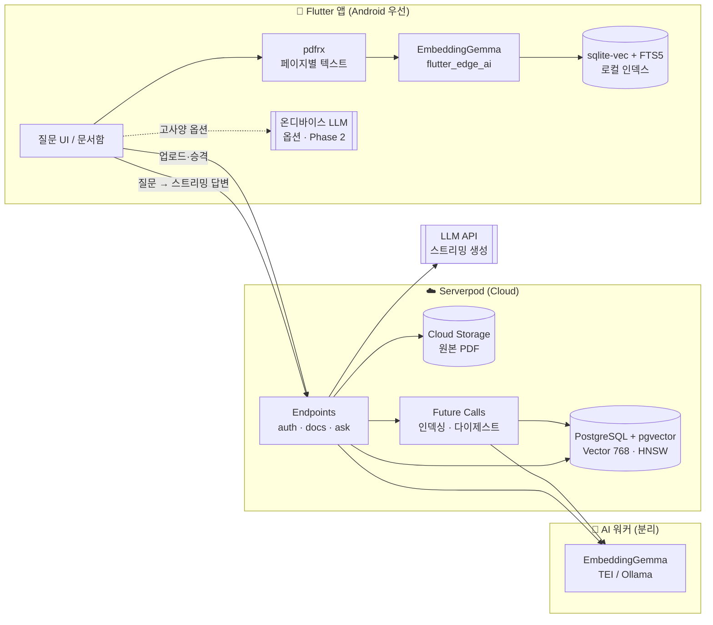
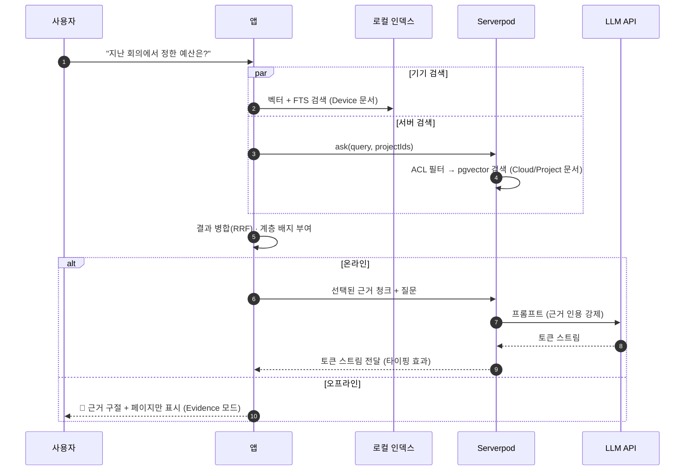
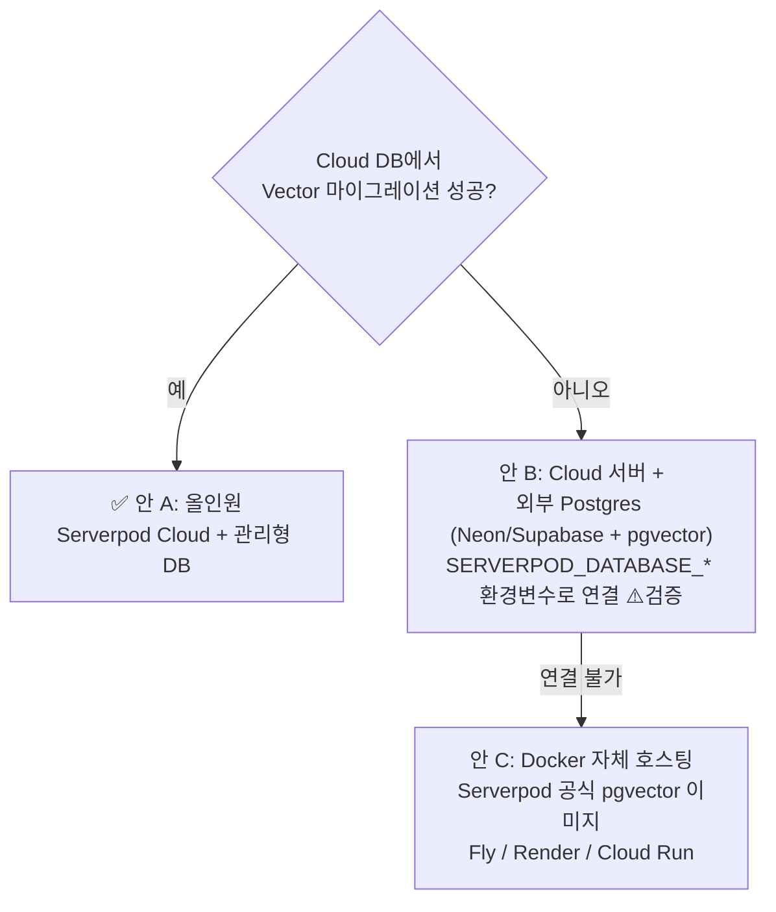
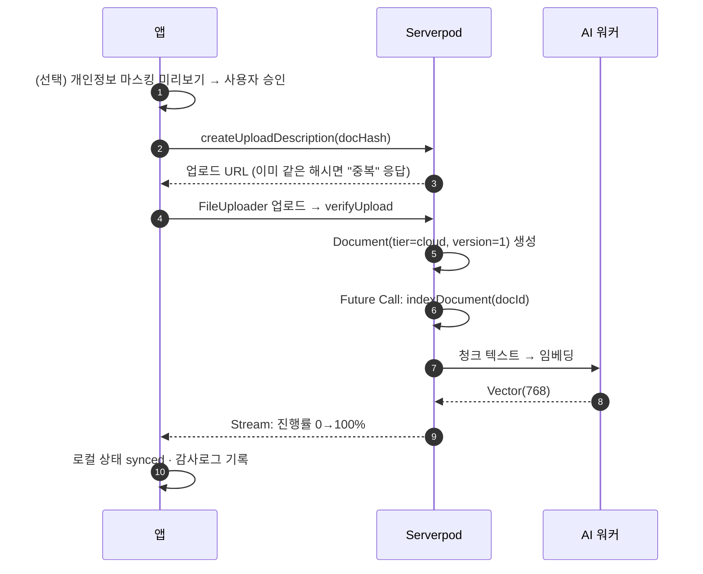
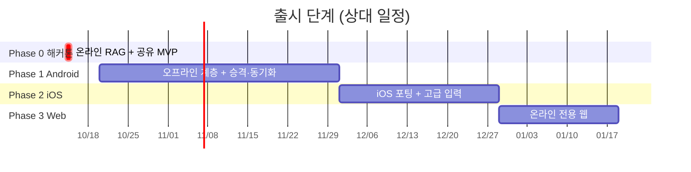

# 📚 하이브리드 문서 RAG 비서: 기획·아키텍처 설계서

> **작성일**: 2026-10-14 · **기반 주제**: 해커톤 보고서 #8 "개인 문서 RAG 비서 (내 노트에게 질문하기)"
> **조사 방식**: 서브에이전트 3개(Serverpod/Cloud · Flutter 온디바이스 스택 · 경쟁 제품)가 병렬 조사했고, PM이 결과를 종합해 판단했습니다.
> **후속 문서**: [기술 스택 결정 & 개발 전 준비](003-tech-stack-and-prep.md)
> **표기**: ✅ 공식 문서·pub.dev로 확인 · ⚠️ 미확인 또는 추정(착수 전 검증 필요)

---

## 목차

0. [한 장 요약 (TL;DR)](#0-한-장-요약-tldr)
1. [제품 컨셉: 무엇이 평범한 RAG와 다른가](#1-제품-컨셉-무엇이-평범한-rag와-다른가)
2. [전체 아키텍처](#2-전체-아키텍처)
3. [기능 분리: 온디바이스와 온라인 (플랫폼별)](#3-기능-분리-온디바이스와-온라인-플랫폼별)
4. [Serverpod Cloud 활용과 백엔드 분리](#4-serverpod-cloud-활용과-백엔드-분리)
5. [핵심 설계: 문서 계층 · 동기화 · 프로젝트 공유](#5-핵심-설계-문서-계층--동기화--프로젝트-공유)
6. [차별화 기능 후보 15선](#6-차별화-기능-후보-15선)
7. [출시 로드맵 (해커톤 → Android → iOS → Web)](#7-출시-로드맵)
8. [리스크와 Day-1 검증 체크리스트](#8-리스크와-day-1-검증-체크리스트)
9. [출처](#9-출처)

---

## 0. 한 장 요약 (TL;DR)

| 결정 사항 | 결론 |
|---|---|
| 🎯 **포지셔닝** | "**내 기기에만 두는 문서**와 **팀과 공유하는 문서**를 하나의 질문창에서 다루는 하이브리드 RAG". 경쟁 제품은 로컬 전용(GPT4All 등)이거나 클라우드 전용(NotebookLM 등)으로 갈립니다. **문서 단위로 계층을 오가는 제품은 찾지 못했습니다.** |
| 📱 **온디바이스 범위 (v1)** | **오프라인 검색 + 온라인 생성**. 답변 생성까지 오프라인으로 하는 기능은 고사양 기기용 옵션(Phase 2)으로 미룹니다. |
| 🧠 **임베딩 모델** | **EmbeddingGemma-300m (768차원)을 기기와 서버에서 똑같이** 사용합니다. 그래야 벡터 공간이 하나로 맞습니다. |
| 🗄️ **벡터 DB** | 서버는 **Serverpod ORM 내장 pgvector**(`Vector(768)` + HNSW, 2.8.0부터 지원 ✅), 기기는 **sqlite-vec + FTS5**를 씁니다. |
| ☁️ **Serverpod Cloud** | API·인증·파일·스트리밍·Future Calls를 맡깁니다. 다만 **Cloud의 관리형 Postgres가 pgvector를 지원하는지는 문서에 없습니다 ⚠️**. 지원하지 않으면 Neon/Supabase를 외부 DB로 씁니다. |
| 🔀 **백엔드 분리** | Serverpod 본체와 **AI 워커**(임베딩 서비스)를 나눕니다. LLM은 외부 API를 쓰되, 호출은 반드시 Serverpod 엔드포인트를 거쳐 스트리밍합니다. |
| 🚀 **출시 순서** | 해커톤 MVP(온라인 + 공유) → **Android**(오프라인 계층) → **iOS** → **Web**(온라인 전용) |

> ⏰ **마감 주의**: 공식 페이지 메타데이터 기준 마감은 `2026-10-14T21:59Z`, 즉 **한국시간 10/15(목) 06:59**입니다 (유럽 CEST 10/14 23:59로 추정). 오늘 밤 범위는 [7장의 Phase 0](#phase-0--해커톤-mvp-오늘-밤)만 보면 됩니다.

---

## 1. 제품 컨셉: 무엇이 평범한 RAG와 다른가

### 한 줄 정의

> **"민감한 건 폰에, 같이 볼 건 프로젝트에. 질문은 한 곳에서."**

### 3대 핵심 축 (사용자 아이디어를 구체화)

```
 ┌────────────────────┐   ┌────────────────────┐   ┌────────────────────┐
 │ ① 문서 계층        │   │ ② 승격·동기화      │   │ ③ 프로젝트 공유    │
 │ 🔒 Device-only     │──▶│ 오프라인 → 서버    │──▶│ 사람·프로젝트 단위 │
 │ ☁️ Cloud(개인)     │   │ 원탭 승격 + 감사로그│   │ 역할 기반 접근     │
 │ 👥 Project(공유)   │   │ 해시 기반 증분 동기화│   │ 검색 단계에서 ACL  │
 └────────────────────┘   └────────────────────┘   └────────────────────┘
```

### 경쟁 지형에서 비어 있는 자리

| 제품 | 오프라인 RAG | 공유·협업 | 모바일 | 문서 단위 계층 이동 |
|---|:---:|:---:|:---:|:---:|
| NotebookLM | ❌ | 🟡 (웹만) | ✅ | ❌ |
| AnythingLLM Mobile | ✅ | 🟡 (인스턴스 동기화) | 🟡 (Android) | ❌ |
| Notion AI | ❌ | ✅ | ✅ | ❌ |
| GPT4All / PrivateGPT | ✅ | ❌ | ❌ | ❌ |
| Apple Intelligence | ✅ | ❌ | 🟡 (Apple 기기만) | 🟡 (OS 내부 전용) |
| Liner / Lilys (국내) | ❌ | 🟡 | ✅ | ❌ |
| **우리 앱** | ✅ | ✅ | ✅ | ✅ |

**관찰된 빈틈** (경쟁 조사 결과)
- 어느 계층(기기/서버)이 답했는지 보여 주는 제품이 없습니다.
- "공유 프로젝트 문서 + 내 비공개 문서"를 겹쳐서 검색하는 제품이 없습니다.
- 기기 사본과 서버 사본이 갈라졌을 때(충돌) 어떻게 처리하는지 문서화한 제품이 없습니다.
- 한국어 형태소 기반 하이브리드 검색(키워드 + 벡터)을 내세운 제품이 없습니다.
- 2025~26 해커톤 수상작(Gemma 3n Impact Challenge 등)은 **오프라인 우선 + 실사용자 + 카메라/음성 입력**이 강세였습니다.

---

## 2. 전체 아키텍처



### 질문 하나가 처리되는 흐름 (Phase 1 목표 흐름)

> 해커톤(Phase 0)에서는 기기 검색 없이 서버가 **검색 + 생성을 한 번의 스트리밍 `ask` 호출**로 처리합니다. 아래 그림은 Device 계층이 들어간 Phase 1 흐름입니다.



> 🔐 **프라이버시 규칙**: Device 문서의 청크가 답변 생성에 쓰이면 서버로 보내기 전에 **사용자 확인**을 받습니다. 확인하지 않으면 온디바이스 LLM이나 Evidence 모드로 처리합니다. 이 내용은 [차별화 #2](#6-차별화-기능-후보-15선)와 연결됩니다.

---

## 3. 기능 분리: 온디바이스와 온라인 (플랫폼별)

**범례**: 🟢 오프라인 가능 · 🔵 온라인 필요 · 🟡 옵션(고사양/제약 있음) · ⚪ 미지원/추후

### 3-1. 파이프라인 단계별

| 단계 | 권장 기술 | Android | iOS | Web | 비고 |
|---|---|:---:|:---:|:---:|---|
| PDF 텍스트 추출 | `pdfrx` 2.6.5 ✅ (서버는 `pdfrx_engine`) | 🟢 | 🟢 | 🟢 (WASM) | 페이지 단위 추출이라 **인용 페이지를 자연스럽게 얻습니다**. 한국어 PDF는 직접 시험해야 합니다 ⚠️ |
| 스캔 PDF / 사진 OCR | Google ML Kit Text Recognition (한국어) | 🟢 | 🟢 | ⚪ | Phase 2 |
| 청킹 | 직접 구현 (페이지 → 문단, 300~500토큰, overlap) | 🟢 | 🟢 | 🟢 | 임베딩 입력이 길면 예외가 나므로 길이 제한이 필수입니다 ✅ |
| 임베딩 | **EmbeddingGemma-300m** via `flutter_edge_ai` ✅ (~180MB) | 🟢 | 🟢 | 🟡 | 첫 실행 때 모델을 다운로드합니다 |
| 벡터 저장/검색 | `flutter_edge_ai_sqlite` (sqlite-vec) + FTS5 | 🟢 | 🟢 | 🟡 | Web은 COOP/COEP 헤더가 필요하고 탭 하나만 쓸 수 있습니다 ✅ |
| 답변 생성 | LLM API (서버 경유) | 🔵 | 🔵 | 🔵 | 기본 경로 |
| 답변 생성 (오프라인) | Gemma 4 / 3n E2B (2.4~3.1GB) · Gemini Nano · Apple Foundation Models | 🟡 | 🟡 (iOS 26+) | ⚪ | 기기 RAM 6~8GB 이상 권장 ⚠️ · 한국어 품질은 검증이 필요합니다 |
| 스트리밍 응답 | Serverpod `Stream<T>` 엔드포인트 ✅ | 🔵 | 🔵 | 🔵 | WebSocket 기반 |
| 원본 파일 보관 | Serverpod Cloud Storage (서명 URL) ✅ | 🔵 | 🔵 | 🔵 | |
| 인증 | `serverpod_auth_idp` (Email/Google/Apple) ✅ | 🔵 | 🔵 | 🔵 | 로그인 후에는 오프라인 세션 유지 |
| 공유·동기화 | Serverpod ORM + 멤버십 테이블 | 🔵 | 🔵 | 🔵 | |

### 3-2. 사용자 기능 관점

| 기능 | 오프라인 | 온라인 | 첫 출시 |
|---|:---:|:---:|---|
| PDF 가져오기 → 기기에 인덱싱 (Device 문서) | 🟢 | – | Android v1 |
| Device 문서 의미 검색 + 근거 구절/페이지 표시 | 🟢 | – | Android v1 |
| Device 문서로 AI 답변 (오프라인 LLM) | 🟡 | – | Android v1.x (옵션) |
| PDF 업로드 → 서버 인덱싱 (Cloud 문서) | – | 🔵 | **해커톤** |
| 서버 문서 질문 + 스트리밍 답변 + 페이지 인용 | – | 🔵 | **해커톤** |
| 프로젝트 생성·초대·역할 | – | 🔵 | **해커톤** |
| Device → Cloud 승격(동기화) | 대기열 | 🔵 | Android v1 |
| 혼합 검색 (Device + Project) | 🟢 일부 | 🔵 | Android v1 |
| 오프라인 질문 큐 → 재연결 시 답변 | 🟢 저장 | 🔵 처리 | Android v1.x |

### 3-3. 판단 근거

- **"오프라인 검색 + 온라인 생성"이 v1의 정답입니다.** 임베딩 모델은 약 180MB라 받아들일 만합니다. 반면 생성 모델은 2~6GB이고, 저사양 기기에서 크래시가 나고, 한국어 품질도 불확실합니다. 이 세 가지 리스크를 v1 기본값으로 떠안을 이유가 없습니다.
- **오프라인일 때도 "쓸모 있는" 폴백**이 필요합니다. LLM이 없어도 근거 구절과 페이지를 바로 보여 주면 검색 앱으로서 가치가 남습니다(Evidence 모드).
- **Web은 온라인 전용**으로 갑니다. 기술적으로는 WASM으로 검색이 가능하지만 수백 MB 모델 다운로드, 헤더 제약, 탭 하나 제한을 감수할 만큼의 가치가 v1에는 없습니다.

---

## 4. Serverpod Cloud 활용과 백엔드 분리

### 4-1. Serverpod 기능 매핑 (심사 25% "스택 활용"용)

| Serverpod 기능 | 이 앱에서의 쓰임 | 상태 |
|---|---|:---:|
| 🗄️ ORM + **pgvector** (`Vector`, HNSW, `distanceCosine`) | 청크 임베딩 저장·유사도 검색. **"Serverpod DB를 벡터 스토어로"** | ✅ 2.8.0+ |
| 📁 File Upload (`createUploadDescription` → `FileUploader` → `verifyUpload`) | 원본 PDF 업로드. 기본 최대 10MiB | ✅ |
| 🔐 Storage 서명 URL (`temporaryDownloadUrl`) | 인용 탭 시 **권한 확인 후** 원본 페이지 열기 | ✅ |
| ⚡ Streaming (`Stream<T>` 반환 메서드) | 토큰 단위 답변, 인덱싱 진행률, 프로젝트 룸 실시간 이벤트 | ✅ |
| ⏰ Future Calls (지연·cron) | 업로드 후 백그라운드 인덱싱, 주간 다이제스트, 신선도 점검 | ✅ (중복 실행 가능 → 멱등하게 설계) |
| 🔑 Auth (`serverpod_auth_idp`) | Email / Google / Apple 로그인 | ✅ |
| 💾 Caching (local / global) | 질문 임베딩·자주 묻는 질문 캐시 | ✅ |
| ☁️ Serverpod Cloud 배포 | 원클릭 배포, 시크릿 관리(API 키) | ✅ |

### 4-2. Serverpod Cloud 요금제 체크 (✅ 공식 가격표)

| 플랜 | 가격 | 핵심 제약 |
|---|---|---|
| Starter | $5/월 | ❗ **Future Calls 비활성화** · small podlet(256MB) |
| Growth | $20/월 + 사용량 | Future Calls · 오토스케일 · 커스텀 도메인 1개 |
| 무료 체험 | 첫 프로젝트 1개월 | 신용카드 불필요 |

> 💡 **판단**: 인덱싱을 Future Call로 하려면 **Growth가 필요**합니다. Podlet S(256MB)에서 PDF 파싱과 임베딩을 하면 메모리가 부족할 수 있으므로 **PDF 파싱·임베딩은 AI 워커로 넘기거나 M 이상 podlet**을 씁니다.

### 4-3. 🚨 가장 큰 미확인 사항: Cloud Postgres의 pgvector 지원

Cloud DB 문서에는 "PostgreSQL 17, TLS, 커넥션 풀링, 오토스케일"만 적혀 있고 **확장 모듈 목록이 없습니다 ⚠️**. 아키텍처 전체가 이 한 가지에 달려 있으므로, **`Vector` 필드 하나짜리 더미 모델로 배포 테스트**를 해서 가장 먼저 확인합니다.



### 4-4. 권장 백엔드 구성 (분리안)

| 구성 요소 | 호스팅 | 역할 | 분리 이유 |
|---|---|---|---|
| **Serverpod 서버** | Serverpod Cloud | API·인증·파일·스트리밍·Future Calls·ACL | 해커톤 심사·크레딧 상금과 맞물립니다 |
| **PostgreSQL + pgvector** | Cloud 관리형 (불가 시 Neon/Supabase) | 메타데이터 + 벡터 | ORM 벡터 쿼리를 그대로 유지하려면 **DB는 하나로** 둡니다 |
| **AI 워커 (임베딩)** | Cloud Run / Fly 등 (CPU로 충분) | EmbeddingGemma 서빙 (TEI 또는 Ollama `embeddinggemma:300m`) | 순수 Dart 서버 런타임으로 검증된 방법이 없고 ✅, podlet 메모리가 작습니다 |
| **LLM** | 외부 API | 스트리밍 생성 | Serverpod가 프록시합니다. **앱에서 직접 호출하지 않습니다** (키 보호, 스택 활용 점수) |

> ❌ **피할 것**: 벡터만 별도 DB(Pinecone 등)에 두는 구성. ORM 벡터 쿼리를 잃고, ACL을 두 군데서 맞춰야 합니다.

---

## 5. 핵심 설계: 문서 계층 · 동기화 · 프로젝트 공유

### 5-1. 문서 계층 (Tier)

| 계층 | 저장 위치 | 검색 위치 | 누가 보나 | 서버 전송 |
|---|---|---|---|---|
| 🔒 **Device** | 기기 (원본 + 청크 + 벡터) | 기기 | 나 | **서버에 저장하지 않음**. 답변 생성에 근거 청크가 필요하면 **질문마다 동의를 받고 일시 전송**하며 원장(#3)에 기록합니다 |
| ☁️ **Cloud** | 서버 | 서버 | 나 (모든 기기) | 원본 업로드 |
| 👥 **Project** | 서버 | 서버 | 프로젝트 멤버 | 원본 업로드 |

- 문서마다 **🔐 "업로드 금지" 잠금**을 걸 수 있습니다. 잠긴 문서는 승격 UI 자체가 비활성화됩니다.
- **Device 문서는 서버에 저장되지 않습니다.** 승격 전까지 서버로 가는 것은 사용자가 동의한 근거 청크(일시 전송, 저장 안 함)뿐입니다. 이 약속이 제품의 핵심 셀링포인트이므로 UI 곳곳에서 계층을 보여 줍니다.

### 5-2. 승격(Device → Cloud/Project) 흐름



### 5-3. 동기화 설계 원칙

| 주제 | 결정 | 이유 |
|---|---|---|
| **임베딩 일관성** | 기기와 서버 모두 **EmbeddingGemma-300m, 768차원, 같은 프리픽스와 정규화**. 각 청크에 `embeddingModel` 버전을 저장합니다 | pgvector 컬럼은 차원이 고정입니다. 모델이 섞이면 검색이 조용히 망가집니다 |
| **벡터를 올릴지** | **서버가 텍스트로 재임베딩**합니다 (기기 벡터는 로컬 전용) | 양자화 차이 ⚠️와 모델 버전 불일치를 원천 차단합니다. 구현도 단순합니다 |
| **식별·중복 제거** | 문서와 청크마다 `contentHash`(SHA-256)를 둡니다 | 같은 파일을 재업로드하지 않고, 바뀐 청크만 재임베딩합니다 |
| **버전·충돌** | 문서 단위 `version` + `updatedAt`. v1은 **문서 단위 last-writer-wins**, 충돌 시 이전 버전을 보관합니다 | 단순함이 우선입니다. 충돌 diff UI는 차별화 후보 #14 |
| **오프라인 작업** | 로컬 `syncState`: `localOnly / pending / synced / conflict` | 재연결 시 대기열을 처리합니다 |

### 5-4. 프로젝트 공유와 ACL

- 역할: `owner / editor / viewer`. 초대는 링크나 이메일로 합니다.
- **클라이언트가 보낸 projectIds를 믿지 않습니다.** 서버가 인증된 세션의 사용자로 `ProjectMember`를 조회해 `myProjectIds`를 만들고, 클라이언트 요청과의 **교집합**만 검색합니다.
- **ACL은 검색 쿼리 안에서 적용합니다 (가장 중요)**
  - 반드시 `WHERE projectId IN (내 프로젝트)` 필터를 **유사도 정렬과 같은 쿼리 안에** 넣습니다.
  - 상위 K개를 먼저 뽑고 나중에 걸러내면 **남의 문서가 프롬프트에 섞이는 사고**가 납니다.
  - 필터가 강할 때 HNSW 재현율이 떨어질 수 있으니 pgvector 0.8의 iterative scan 옵션을 확인합니다 ⚠️.
- **원본 열람**: `temporaryDownloadUrl`은 서버가 멤버십을 확인한 뒤에만 발급합니다.
- **스트림 권한**: Serverpod 스트림은 시작할 때 인증을 확인하고, 권한이 회수되면 종료됩니다 ✅. 프로젝트에서 내보낸 멤버는 실시간 이벤트도 즉시 끊깁니다.

### 5-5. 서버 데이터 모델 (Serverpod YAML 초안)

```yaml
# ⚠️ serverpod_auth_idp의 사용자 ID는 UuidValue일 가능성이 높습니다 → 실제 버전에서 타입 확인
# project.spy.yaml
class: Project
table: project
fields:
  name: String
  ownerId: UuidValue

# project_member.spy.yaml
class: ProjectMember
table: project_member
fields:
  projectId: int
  userId: UuidValue
  role: String          # owner | editor | viewer
indexes:
  member_unique_idx:
    fields: projectId, userId
    unique: true

# document.spy.yaml
class: Document
table: document
fields:
  ownerId: UuidValue
  projectId: int?       # null → 개인 Cloud 문서
  title: String
  contentHash: String
  version: int
  storagePath: String
  status: String        # uploaded | indexing | ready | failed
  embeddingModel: String
  updatedAt: DateTime

# doc_chunk.spy.yaml
class: DocChunk
table: doc_chunk
fields:
  documentId: int
  projectId: int?       # 비정규화: ACL 필터를 한 쿼리로
  ownerId: UuidValue
  page: int
  ordinal: int
  text: String
  contentHash: String
  embedding: Vector(768)
indexes:
  chunk_emb_idx:
    fields: embedding
    type: hnsw
    distanceFunction: cosine
```

```dart
// ACL을 포함한 검색 (개념 코드)
// myProjectIds = ProjectMember에서 조회한 값 ∩ 클라이언트가 요청한 projectIds
final hits = await DocChunk.db.find(session,
  where: (t) => t.projectId.inSet(myProjectIds) | t.ownerId.equals(userId),
  orderBy: (t) => t.embedding.distanceCosine(queryVec),
  limit: 8);
```

---

## 6. 차별화 기능 후보 15선

> 모든 후보는 **① 하이브리드 계층**, **② Serverpod 고유 기능**, **③ 경쟁 조사에서 찾은 빈틈** 중 하나 이상과 연결되도록 골랐습니다.
> 점수: 데모 임팩트 / 구현 난이도(★이 많을수록 어려움) / 차별화 정도

### 🅰️ 프라이버시·계층 (우리만의 축)

| # | 기능 | 설명 | 데모 | 난이도 | 차별화 | SP 기능 | 단계 |
|---|---|---|:---:|:---:|:---:|---|---|
| 1 | **🏷️ 답변 출처 계층 배지** | 답변과 인용마다 "🔒기기 / ☁️클라우드 / 👥프로젝트"와 사용한 모델을 표시합니다 | ★★★★ | ★ | ★★★★ | – | **해커톤** |
| 2 | **🧩 Split-brain 질의** | 프로젝트 문서(서버)와 내 비공개 문서(기기)를 동시에 검색하고 병합은 기기에서 합니다. 비공개 청크를 생성에 쓸 때는 사용자 확인을 받습니다 | ★★★★★ | ★★★★ | ★★★★★ | Stream | Android v1 |
| 3 | **📜 "기기를 떠난 것" 원장** | 서버로 나간 데이터(문서·청크·질문)를 시간순 로그로 보여 줍니다. 신뢰를 시각화하는 기능입니다 | ★★★ | ★★ | ★★★★★ | ORM | Android v1 |
| 4 | **🕶️ 승격 전 개인정보 마스킹** | 주민번호·전화번호·계좌번호를 로컬에서 탐지하고 마스킹 diff를 승인받은 뒤 업로드합니다 | ★★★★ | ★★ | ★★★★ | File Upload | Android v1 |

### 🅱️ 근거·신뢰

| # | 기능 | 설명 | 데모 | 난이도 | 차별화 | SP 기능 | 단계 |
|---|---|---|:---:|:---:|:---:|---|---|
| 5 | **📍 페이지 점프 인용** | 인용을 탭하면 PDF 해당 페이지가 하이라이트와 함께 열립니다(오프라인 포함) | ★★★★★ | ★★ | ★★★ | 서명 URL | **해커톤** |
| 6 | **📎 Evidence 모드 (오프라인 폴백)** | LLM을 쓸 수 없으면 근거 구절과 페이지만 즉시 보여 줍니다. 비행기 모드 데모용 | ★★★★ | ★ | ★★★ | – | Android v1 |
| 7 | **⏳ 신선도 경고** | 오래된 문서나 새 버전으로 대체된 문서를 답변에 표시합니다. Future Call이 주간 재검증 큐를 만듭니다 | ★★★ | ★★ | ★★★★ | Future Calls | Phase 2 |
| 8 | **❓ 지식 공백 탐지** | 프로젝트에서 "답하지 못한 질문"을 모아 어떤 문서를 추가해야 할지 제안합니다 | ★★★ | ★★ | ★★★★ | ORM · Future Calls | Phase 2 |

### 🅲 협업 (Serverpod 실시간 활용)

| # | 기능 | 설명 | 데모 | 난이도 | 차별화 | SP 기능 | 단계 |
|---|---|---|:---:|:---:|:---:|---|---|
| 9 | **👥 프로젝트 룸 실시간 Q&A** | 멤버의 질문·답변·문서 추가가 실시간 피드로 흐르고, 답변 스트림을 함께 봅니다 | ★★★★★ | ★★★ | ★★★★ | **Stream** | **해커톤(스트레치)** |
| 10 | **🃏 권한 인지형 답변 카드 공유** | 답변을 팀원에게 공유하면 **받는 사람이 볼 수 있는 인용만** 남깁니다 | ★★★ | ★★ | ★★★★ | Auth · ORM | Android v1 |
| 11 | **📰 프로젝트 주간 다이제스트** | Future Call이 매주 새 문서를 요약해 멤버에게 푸시합니다 | ★★★ | ★★ | ★★★ | **Future Calls** | Android v1 |

### 🅳 입력·동기화·한국어

| # | 기능 | 설명 | 데모 | 난이도 | 차별화 | SP 기능 | 단계 |
|---|---|---|:---:|:---:|:---:|---|---|
| 12 | **📸 카메라 → 즉시 인덱스** | 화이트보드나 책을 찍으면 ML Kit 한국어 OCR을 거쳐 수 초 안에 오프라인 검색이 됩니다 | ★★★★★ | ★★★ | ★★★★ | (승격 시) File Upload | Phase 2 |
| 13 | **🎙️ 음성 메모 → 타임스탬프 인용** | 온디바이스 STT로 받아쓰고, 인용을 탭하면 녹음의 그 시점을 재생합니다 | ★★★★ | ★★★★ | ★★★★ | – | Phase 2 |
| 14 | **🔀 동기화 충돌 diff + 증분 재임베딩** | 기기 사본과 서버 사본이 갈라지면 나란히 diff를 보여 주고, 바뀐 청크만 재임베딩하며 진행률을 스트리밍합니다 | ★★★ | ★★★★ | ★★★★★ | Stream · Future Calls | Android v1.x |
| 15 | **🇰🇷 한국어 하이브리드 검색** | 형태소 기반 키워드 검색(FTS/BM25)과 벡터 검색을 RRF로 합칩니다. 한·영 혼합 질의를 지원하고, 질문한 언어로 답합니다 | ★★ | ★★★ | ★★★★ | ORM (raw SQL) | Android v1 |

### 🏆 PM 추천 조합

| 시점 | 채택 | 이유 |
|---|---|---|
| **오늘 밤 해커톤** | **#5 페이지 인용**, **#1 계층 배지**, (여유가 있으면) **#9 프로젝트 룸** | 구현 비용이 낮고 데모 효과가 큽니다. #9는 Serverpod 스트리밍을 직접 보여 줍니다 |
| **Android v1 간판** | **#2 Split-brain**, **#3 원장**, **#6 Evidence 모드**, **#15 한국어 검색** | 우리 컨셉("민감한 건 폰에")을 완성하는 묶음입니다 |
| **장기 해자(moat)** | **#12 카메라**, **#14 충돌 diff**, **#7 신선도** | 경쟁 제품이 거의 다루지 않는 영역입니다 |

---

## 7. 출시 로드맵



### Phase 0 · 해커톤 MVP (오늘 밤)

> 목표: "작동하는 완성품". **온디바이스 기능은 넣지 않고** 온라인 RAG와 공유를 단단하게 만듭니다.

- [ ] **Day-1 검증**: Cloud에서 `Vector` 마이그레이션이 되는지 확인합니다. 안 되면 외부 Neon DB로 갑니다 ([4-3](#4-3--가장-큰-미확인-사항-cloud-postgres의-pgvector-지원))
- [ ] 로그인 (Email 또는 Google)
- [ ] PDF 업로드 → 청킹 → 임베딩 → pgvector 저장
  - 시간이 부족하면 Future Call 대신 업로드 직후 동기 처리 + 진행률 스트림

> ⚡ **오늘 밤 지름길** (저장소에 아직 코드가 없으므로 범위를 최소화합니다)
> - **텍스트 추출은 앱에서**: pdfrx로 페이지별 텍스트를 뽑아 PDF와 함께 업로드합니다. 서버는 청킹과 임베딩만 하므로 Cloud에서 PDFium을 돌릴 위험(R4)이 사라집니다.
> - **서버 호출은 하나로**: 서버가 검색과 생성을 한 번의 스트리밍 `ask`로 처리합니다. 클라이언트 병합은 Phase 1에서 합니다.
> - **임베딩은 호스팅 API도 허용**: 별도 AI 워커를 오늘 띄우기 어렵다면 호스팅 임베딩 API를 씁니다. `embeddingModel` 컬럼이 있으니 나중에 EmbeddingGemma로 안전하게 재임베딩할 수 있습니다. 단, pgvector 컬럼 차원은 그 모델에 맞춰야 합니다.
- [ ] 질문 → ACL 필터 검색 → LLM **스트리밍 답변** + **페이지 인용(#5)**
- [ ] 프로젝트 생성·초대(멤버십) → 프로젝트 문서 공유
- [ ] 계층 배지 UI(#1). 기기 계층은 "Coming soon" 배지로 **비전을 보여 주는 장치**로 씁니다
- [ ] README 아키텍처 다이어그램(이 문서의 2장) + 2분 데모 영상

### Phase 1 · Android v1

- 🔒 Device 계층: pdfrx → EmbeddingGemma → sqlite-vec + FTS5
- ⬆️ 승격·동기화(5장), 업로드 금지 잠금, 개인정보 마스킹(#4)
- 🧩 Split-brain 질의(#2), 📎 Evidence 모드(#6), 📜 원장(#3), 🇰🇷 하이브리드 검색(#15)
- 🃏 답변 카드 공유(#10), 📰 주간 다이제스트(#11), 오프라인 질문 큐
- 🟡 옵션: 고사양 기기용 오프라인 생성(Gemma E2B 다운로드 / Gemini Nano)

### Phase 2 · iOS (+ Android 고급 입력 동시 제공)

- 같은 Flutter 코드로 포팅합니다. 온디바이스 생성은 **Apple Foundation Models(iOS 26+)**를 우선 검토합니다
- 📸 카메라 인덱스(#12), 🎙️ 음성 메모(#13), ⏳ 신선도(#7), ❓ 지식 공백(#8)
- Apple 로그인 (소셜 로그인을 제공하면 App Store 정책상 **조건부 필수**)

### Phase 3 · Web

- **온라인 전용**: Cloud·Project 문서 + 스트리밍 답변 + 프로젝트 룸
- Device 계층은 제공하지 않습니다(브라우저 저장소의 신뢰성과 모델 크기 문제). 웹에서는 "모바일 앱에서만 가능" 안내를 띄웁니다
- 🔀 충돌 diff 뷰(#14)는 넓은 화면이 유리하므로 웹에 먼저 제공하는 것도 검토합니다

### 플랫폼별 기능 요약

| 기능 묶음 | 해커톤 | Android v1 | iOS | Web |
|---|:---:|:---:|:---:|:---:|
| 온라인 RAG + 스트리밍 + 인용 | ✅ | ✅ | ✅ | ✅ |
| 프로젝트 공유·ACL | ✅ | ✅ | ✅ | ✅ |
| Device 계층 (오프라인 검색) | – | ✅ | ✅ | ❌ |
| 승격·동기화 | – | ✅ | ✅ | 조회만 |
| 오프라인 생성 | – | 🟡 옵션 | 🟡 옵션 | ❌ |
| 카메라/음성 입력 (Phase 2, Android 동시 제공) | – | Phase 2 | ✅ | ❌ |

---

## 8. 리스크와 Day-1 검증 체크리스트

| # | 리스크 | 영향 | 대응 | 검증 방법 |
|---|---|:---:|---|---|
| R1 | Cloud Postgres에 pgvector가 없음 ⚠️ | 🔴 높음 | 외부 Neon/Supabase, 그래도 안 되면 자체 호스팅 | 더미 `Vector` 모델로 배포 테스트, Discord 문의 |
| R2 | 외부 DB 환경변수를 Cloud가 덮어씀 ⚠️ | 🟠 | 자체 호스팅(안 C) | `SERVERPOD_DATABASE_*` 설정 후 연결 로그 확인 |
| R3 | Starter 플랜에서 Future Calls 비활성 ✅ | 🟠 | Growth 플랜 또는 동기 처리 | 플랜 확인 |
| R4 | Podlet 메모리(256MB)에서 PDF 처리 OOM | 🟠 | 파싱·임베딩을 AI 워커로 이전, M 이상 podlet | 10MB PDF 업로드 테스트 |
| R5 | `flutter_edge_ai`가 막 개명·출시됨(flutter_gemma 후속) ✅ | 🟡 | 버전을 고정하고, 문제가 생기면 flutter_gemma 1.11.4나 ONNX 경로 | Android 실기기 PoC |
| R6 | EmbeddingGemma 한국어 검색 품질 미공개 ⚠️ | 🟡 | 한국어 질의 30개 미니 평가셋 / 대안 multilingual-e5-small | Recall@5 측정 |
| R7 | 한국어 PDF 텍스트가 깨짐 (글리프 매핑) ⚠️ | 🟡 | OCR 폴백 | 실제 보유 PDF 10종 추출 테스트 |
| R8 | 양자화 모델(기기)과 원본 모델(서버)의 벡터 차이 ⚠️ | 🟢 낮음 | 서버 재임베딩 원칙으로 회피 | 코사인 유사도 비교 샘플 |
| R9 | ACL 필터 + HNSW 재현율 저하 | 🟡 | iterative scan / 프로젝트별 부분 인덱스 | 멤버십 다른 계정으로 누출 테스트 |

---

## 9. 출처

<details>
<summary>Serverpod / Serverpod Cloud</summary>

- Serverpod changelog (Vector 2.8.0, HalfVector/SparseVector 2.9.0, 4.0 pgvector 번들): https://pub.dev/packages/serverpod/changelog
- 벡터 필터링·거리 함수: https://docs.serverpod.dev/concepts/data-and-the-database/database/filtering.md
- 벡터 인덱스(HNSW/IVFFLAT): https://docs.serverpod.dev/next/concepts/data-and-the-database/database/indexing.md
- Vector & Geography 필드: https://docs.serverpod.dev/next/concepts/data-and-the-database/database/vector-and-geography-fields.md
- Serverpod AI & RAG 튜토리얼: https://docs.serverpod.dev/next/tutorials/ai-and-rag
- Cloud 개요 / DB / 시크릿: https://docs.serverpod.dev/cloud.md · https://docs.serverpod.dev/cloud/concepts/database.md · https://docs.serverpod.dev/cloud/concepts/passwords-secrets-env-vars.md
- Cloud 가격: https://serverpod.dev/cloud
- 파일 업로드: https://docs.serverpod.dev/next/concepts/endpoints-and-apis/file-uploads.md
- Cloud Storage: https://docs.serverpod.dev/cloud/concepts/storage.md
- 스트리밍: https://docs.serverpod.dev/next/concepts/endpoints-and-apis/streaming.md
- Future Calls: https://docs.serverpod.dev/next/concepts/scheduling/overview
- 인증: https://docs.serverpod.dev/next/concepts/authentication/setup.md
- 설정 레퍼런스(DB 환경변수): https://docs.serverpod.dev/concepts/lookups/configuration-reference.md
- 배포 전략(자체 호스팅): https://docs.serverpod.dev/deployments/deployment-strategy
</details>

<details>
<summary>Flutter 온디바이스 스택</summary>

- pdfrx: https://pub.dev/packages/pdfrx · pdfrx_engine: https://pub.dev/packages/pdfrx_engine
- flutter_edge_ai: https://pub.dev/packages/flutter_edge_ai · 모델 목록: https://flutteredge.ai/docs/models
- flutter_edge_ai_sqlite: https://pub.dev/packages/flutter_edge_ai_sqlite · flutter_edge_ai_rag: https://pub.dev/packages/flutter_edge_ai_rag
- EmbeddingGemma-300m: https://huggingface.co/google/embeddinggemma-300m · Ollama: https://ollama.com/library/embeddinggemma
- ObjectBox 벡터 검색: https://docs.objectbox.io/on-device-vector-search
- flutter_onnxruntime: https://pub.dev/packages/flutter_onnxruntime
- flutter_native_ai (Gemini Nano / Apple FM): https://pub.dev/packages/flutter_native_ai
- mobile_rag_engine: https://pub.dev/packages/mobile_rag_engine
</details>

<details>
<summary>경쟁 제품 · 해커톤 사례</summary>

- NotebookLM 앱: https://blog.google/technology/ai/notebooklm-app/
- AnythingLLM Mobile: https://docs.anythingllm.com/mobile/overview
- Google AI Edge RAG (Android): https://ai.google.dev/edge/mediapipe/solutions/genai/rag/android
- Gemma 3n Impact Challenge 수상작: https://blog.google/innovation-and-ai/technology/developers-tools/developers-changing-lives-with-gemma-3n/
- LlamaIndex RAG-a-thon 2: https://llamaindex.ai/blog/agentic-rag-a-thon-2-winners-and-recap
- Khoj: https://github.com/ai-khoj/khoj
</details>

> ⚠️ 경쟁 제품 정보 중 일부(AnythingLLM의 Android 전용 여부, Smart Connections의 모바일 지원 등)는 2차 출처끼리 엇갈립니다. 피치에 인용하기 전에 재확인하세요.
