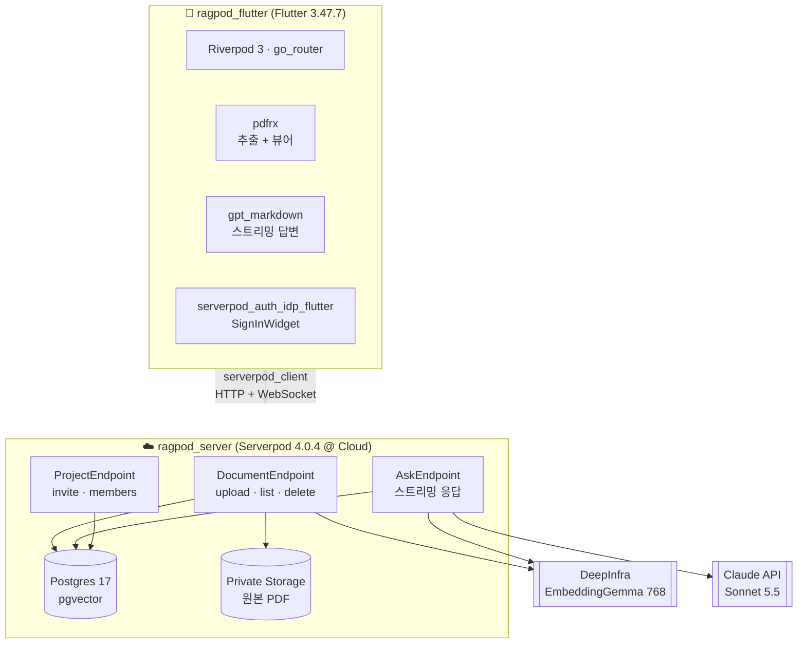
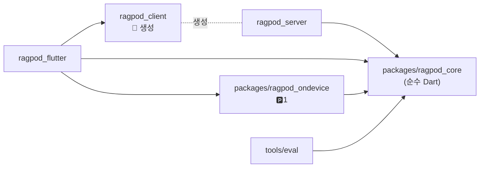
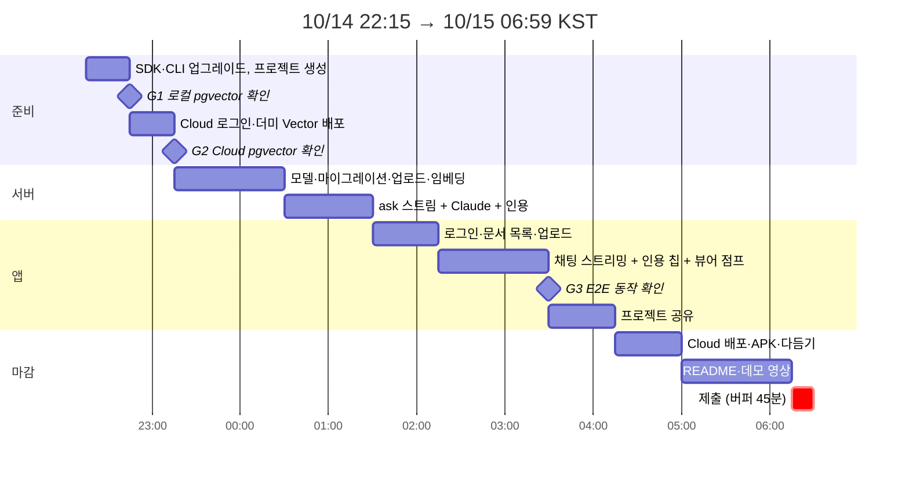

# 🛠️ 기술 스택 결정 & 개발 전 준비 사항

> **작성일**: 2026-10-14 22:10 KST · **상위 문서**: [하이브리드 문서 RAG 비서 기획·아키텍처](002-rag-assistant-plan.md)
> **마감**: **2026-10-15 06:59 KST** (= 10/14 21:59 UTC) · 작성 시점 기준 **약 8시간 45분** 남음
> **표기**: ✅ pub.dev·공식 문서로 확인 · ⚠️ 미확인/추정 → 착수 직후 검증

---

## 목차

0. [결정 요약 (ADR 한 장)](#0-결정-요약-adr-한-장)
1. [🚨 로컬 환경 진단: 지금 바로 고쳐야 할 것](#1--로컬-환경-진단-지금-바로-고쳐야-할-것)
2. [기술 스택 상세](#2-기술-스택-상세)
3. [저장소·프로젝트 구조 (모노레포)](#3-저장소프로젝트-구조-모노레포)
4. [오늘 밤 실행 타임라인 (Go/No-Go 게이트)](#4-오늘-밤-실행-타임라인-gono-go-게이트)
5. [개발 전에 정해 둘 규약](#5-개발-전에-정해-둘-규약)
6. [보안·비용·키 관리](#6-보안비용키-관리)
7. [출시 전(해커톤 이후)에 다시 정할 것](#7-출시-전해커톤-이후에-다시-정할-것)
8. [출처](#8-출처)

---

## 0. 결정 요약 (ADR 한 장)

| # | 영역 | 결정 | 대안 (폴백) | 근거 |
|---|---|---|---|---|
| D1 | **SDK** | **Flutter 3.47.7 / Dart 3.13.5** (fvm으로 고정) | – | Serverpod 4.0.4는 Dart ^3.12.2·Flutter ^3.44.4, pdfrx 2.6.5는 Flutter ≥3.47 필요 ✅ |
| D2 | **백엔드** | **Serverpod 4.0.4** (모든 `serverpod*` 패키지를 같은 버전으로 고정) | – | 해커톤 필수 · pgvector ORM 내장 ✅ |
| D3 | **DB** | Serverpod Cloud Postgres 17 + **pgvector** `Vector(768)` + HNSW(cosine) | Neon/Supabase(pgvector) → 그것도 안 되면 `List<double>` + Dart 코사인 계산 | Cloud의 pgvector 지원 여부 ⚠️ → 게이트 G2에서 확인 |
| D4 | **임베딩** | **EmbeddingGemma-300m (768차원) 호스팅: DeepInfra** | ① Voyage `voyage-4-lite` (1024차원, 무료 200M 토큰) ② `gemini-embedding-2` (768차원) | **온디바이스 모델과 같은 모델이라 나중에 재임베딩이 필요 없음.** DeepInfra 제공 여부는 ⚠️(페이지만 확인) |
| D5 | **LLM** | **Claude Sonnet 5.5** (`claude-sonnet-5-5`) · 스트리밍 | Claude Haiku 5.5 (`claude-haiku-5-5`): 속도·비용 우선 시 | 한국어 품질, 네이티브 citations ✅ |
| D6 | **LLM SDK** | `anthropic_sdk_dart` 9.0.0 (커뮤니티, Dart ≥3.12) | `package:http`로 SSE 직접 파싱 | 공식 Dart SDK 없음 ✅ |
| D7 | **PDF 처리** | **앱(클라이언트)에서 `pdfrx`로 페이지별 텍스트 추출**한 뒤 텍스트와 원본을 업로드 | 서버에서 `pdfrx_engine` | Cloud podlet(256MB)에서 PDFium을 돌리는 위험 회피 · 페이지 번호 확보 |
| D8 | **상태관리·라우팅** | `flutter_riverpod` 3.4.3 · `go_router` 18.0.2 | – | Serverpod 스트림을 `StreamProvider`로 받기 쉬움 |
| D9 | **채팅 렌더링** | `gpt_markdown` 1.3.4 + 직접 만든 `ListView` 말풍선 | `flutter_markdown_plus` | `flutter_markdown`은 개발 중단 ✅ |
| D10 | **PDF 뷰어** | `pdfrx` 2.6.5 (페이지 점프 + `PdfTextSearcher` 하이라이트) | Syncfusion (라이선스 부담) | 오픈소스, 16KB 정렬 대응 ✅ |
| D11 | **인증** | `serverpod_auth_idp` **Email** (Google은 시간이 남으면) | – | Google OAuth 콘솔 설정에 시간이 듭니다 |
| D12 | **개발 루프** | 서버는 **WSL**, 앱은 **Windows 쪽 Flutter + Android 에뮬레이터** (또는 Chrome) | WSL 안에 Android SDK 설치 | 아래 1장 참고 |

---

## 1. 🚨 로컬 환경 진단: 지금 바로 고쳐야 할 것

진단 시각 22:05 KST, WSL2 Ubuntu 기준입니다.

| 항목 | 현재 | 필요 | 조치 | 소요 |
|---|---|---|---|---|
| Flutter / Dart | ❌ **3.24.5 / 3.5.4** (fvm default) | 3.47.7 / 3.13.5 | `fvm install 3.47.7 && fvm global 3.47.7` | 5~10분 |
| Serverpod CLI | ❌ 없음 | 4.0.4 | `dart install serverpod_cli` (구버전 방식은 `dart pub global activate serverpod_cli`) | 2분 |
| Docker | ❌ 없음 | 조건부 | `serverpod start`는 Docker 없이 내장 Postgres로 동작 ✅. **단, 내장 DB에 pgvector가 있는지는 문서끼리 엇갈림 ⚠️** → 없으면 Docker Desktop(WSL 통합) + `ghcr.io/serverpod/postgres` | 0~20분 |
| Android SDK / Java 17 | ❌ WSL 안에 없음 | Android 빌드 시 필요 | **Windows 쪽 Android Studio + Flutter 사용 권장**. 서버는 WSL의 `localhost:8080`으로 접속 (에뮬레이터에서는 `10.0.2.2`) | Windows 상태에 따라 다름 |
| gh / git | ✅ | – | – | – |

```bash
# ① SDK 업그레이드 (WSL)
fvm install 3.47.7 && fvm global 3.47.7
flutter --version            # 3.47.7 / Dart 3.13.5 확인

# ② Serverpod CLI
dart install serverpod_cli   # 실패 시: dart pub global activate serverpod_cli
serverpod version            # 4.0.4 확인

# ③ 프로젝트 생성 (저장소 루트에서)
serverpod create ragpod      # ragpod/{ragpod_server, ragpod_client, ragpod_flutter}
mv ragpod app                # 바깥 폴더만 app/으로 (패키지명은 ragpod 유지)
cd app && serverpod start    # 생성 + 서버 기동 + 웹 앱 실행 (R: 핫리스타트, M: 마이그레이션)
```

> 💡 Serverpod 문서 중 일부(4.0 업그레이드 가이드)는 Dart `^3.10.3`이라고 적혀 있지만, **pub.dev의 4.0.4 실제 제약은 `^3.12.2`** ✅입니다. 더 엄격한 쪽을 따릅니다.

---

## 2. 기술 스택 상세

### 2-1. 전체 그림



### 2-2. 서버 (`ragpod_server`)

| 구분 | 선택 | 버전 | 비고 |
|---|---|---|---|
| 프레임워크 | `serverpod` | 4.0.4 ✅ | 모든 `serverpod_*` 패키지를 **같은 정확한 버전**으로 고정 |
| 인증 | `serverpod_auth_idp_server` | 4.0.4 ✅ | `pod.initializeAuthServices(...)` · 사용자 ID 타입은 **`UuidValue`** ✅ |
| LLM | `anthropic_sdk_dart` | 9.0.0 ✅ | 커뮤니티 패키지. 문제가 생기면 `package:http`로 SSE 처리 |
| 임베딩 | `package:http` → DeepInfra REST | – | OpenAI 호환 형식 ⚠️ |
| 비밀값 | `session.passwords['anthropicApiKey']` | – | Cloud에서는 `serverpod cloud password set` ✅ |
| 파일 | `ServerpodCloudProvider.private` | ✅ | 원본 열람은 `temporaryDownloadUrl` (서버에서 권한 확인 후 발급) |

### 2-3. AI 레이어

| 역할 | 1순위 | 차원·가격 | 폴백 |
|---|---|---|---|
| 문서/질의 임베딩 | **EmbeddingGemma-300m @ DeepInfra** ⚠️ | 768차원 · 약 $0.002/1M 토큰 | `voyage-4-lite` (1024차원, 무료 200M) → 이 경우 `Vector(1024)` |
| 답변 생성 | **`claude-sonnet-5-5`** | 입력 $2 / 출력 $10 (1M 토큰당) ✅ | `claude-haiku-5-5` ($0.10 / $0.50) ✅ |

**EmbeddingGemma 사용 규칙** (기기와 서버가 반드시 같아야 함)
- 질의 프리픽스: `task: search result | query: {질문}`
- 문서 프리픽스: `title: {문서명} | text: {청크}`
- 768차원 그대로 사용하고 L2 정규화합니다. 모델명과 버전은 `DocChunk.embeddingModel`에 기록합니다.

**Claude 호출 규칙**
- 근거 청크는 **`search_result` / `document` 블록 + `citations: {enabled: true}`**로 전달합니다. 그러면 응답에 `cited_text`와 위치가 담겨 오고 → 페이지 점프와 하이라이트에 그대로 씁니다 ✅. 시간이 부족하면 `[1]` 같은 마커를 프롬프트로 요구하는 방식으로 대체합니다.
- 5.5 세대는 thinking이 기본으로 켜져 있습니다. 채팅 RAG는 지연이 중요하므로 `thinking: {type: "adaptive"}` + 낮은 effort로 설정합니다. **`budget_tokens`를 쓰면 400 에러가 납니다** ✅.
- 시스템 프롬프트는 고정해 두고 prompt caching을 적용합니다. 매번 바뀌는 top-k 청크는 캐시 효과가 없습니다.

### 2-4. 클라이언트 (`ragpod_flutter`)

| 용도 | 패키지 | 버전 | 메모 |
|---|---|---|---|
| Serverpod 연결 | `serverpod_flutter` | 4.0.4 ✅ | |
| 인증 UI | `serverpod_auth_idp_flutter` | 4.0.4 ✅ | `SignInWidget` · **pub.dev상 Android/iOS/macOS만 표기** (Web은 ⚠️) |
| 상태관리 | `flutter_riverpod` | 3.4.3 ✅ | |
| 라우팅 | `go_router` | 18.0.2 ✅ | `redirect` + `refreshListenable(authInfoListenable)` |
| PDF 추출/뷰어 | `pdfrx` | 2.6.5 ✅ | `PdfPage.loadText` · `PdfViewerController.goToPage` · `PdfTextSearcher` |
| 마크다운 | `gpt_markdown` | 1.3.4 ✅ | 토큰마다 다시 그리되 30~50ms 스로틀 |
| 파일 선택 | `file_picker` | 13.1.0 ✅ | |
| 공유 인텐트 | `receive_sharing_intent` | 1.9.0 ✅ | Phase 1 (다른 앱에서 PDF 공유 받기) |
| 설정 저장 | `shared_preferences` | 2.5.6 ✅ | |
| 다국어 | `flutter_localizations` + `intl` 0.20.3 (ARB) | ✅ | 한국어 / 영어 |
| 머티리얼 | `material_ui` | 1.0.0 ✅ | Flutter 3.47부터 Material이 별도 패키지로 분리됨. pdfrx가 이미 사용 중 |

> ⚠️ **Flutter 3.47 주의**: Material과 Cupertino가 `material_ui` / `cupertino_ui` 패키지로 분리되는 중입니다. 새 프로젝트는 처음부터 `material_ui`를 쓰거나 `dart fix --apply --code=migrate_design_widgets`를 적용합니다.

### 2-5. Phase 1 이후 (Android 오프라인 계층용, 오늘은 설치하지 않음)

`flutter_edge_ai` 2.3.2 (EmbeddingGemma) · `flutter_edge_ai_sqlite` 2.1.0 (sqlite-vec) · `drift` 2.35.2 · ML Kit OCR · `flutter_native_ai` (Gemini Nano / Apple FM)

---

## 3. 저장소·프로젝트 구조 (모노레포)

### 3-1. 설계 원칙

| # | 원칙 | 이유 |
|---|---|---|
| P1 | **`serverpod create` 결과물(server/client/flutter 3종)은 한 폴더에 그대로 둡니다** | `serverpod start`·`generate`는 이 형제 구조를 전제로 합니다(`config/generator.yaml`의 상대 경로). 옮기면 툴링이 깨질 위험이 있습니다 |
| P2 | **기기와 서버가 "반드시 똑같아야 하는" 로직은 순수 Dart 패키지 하나로 모읍니다** | 청킹, 텍스트 정규화, `contentHash`, 임베딩 프리픽스가 기기와 서버에서 어긋나면 벡터 공간과 중복 제거가 **조용히** 깨집니다 (5-3 임베딩 일관성) |
| P3 | 공유 패키지는 **Flutter·Serverpod에 의존하지 않습니다** | 서버, 앱, 평가 스크립트 어디서나 import할 수 있어야 합니다 |
| P4 | 생성 코드(`ragpod_client`, `*.g.dart`)는 **손대지 않는 영역**으로 구분합니다 | 재생성할 때 덮어씌워집니다 |
| P5 | 오늘 밤에 필요 없는 폴더는 **만들지 않습니다** (Phase 표시) | 빈 폴더는 심사위원에게 미완성처럼 보입니다 |

### 3-2. 디렉터리 트리

```
serverpod-hack-2026/                  # 저장소 루트 (= 모노레포)
├── .fvmrc                            # Flutter 3.47.7 고정
├── .gitignore                        # .fvm/, passwords.yaml, build/ …
├── pubspec.yaml                      # Dart pub workspace 루트 ⚠️ (3-4 참고)
├── README.md                         # 제출용: 소개 · 아키텍처 · 실행법 · 심사 기준 매핑
│
├── AGENTS.md · CLAUDE.md             # 에이전트 공통 지침 (CLAUDE.md는 @AGENTS.md 임포트)
├── docs/                             # 문서 루트: README.md = 문서 종류 레지스트리
│   ├── README.md
│   ├── plan/        001-…            # 기획·설계 (주제 선정, 아키텍처, 스택)
│   ├── research/    001-…            # 서브에이전트 조사 결과 원본 요약 (출처 포함)
│   ├── adr/         001-…            # 결정 기록 (1결정 1파일)
│   └── devlog/      001-…            # 개발 과정 기록 (수행 일시 포함)
│       (각 폴더: README.md = 규칙·템플릿·목차의 유일한 정본)
│
├── app/                              # ── Serverpod 프로젝트 (create 결과, 바깥 폴더명만 변경) ──
│   ├── ragpod_server/
│   │   ├── bin/main.dart
│   │   ├── config/
│   │   │   ├── development.yaml · production.yaml
│   │   │   ├── generator.yaml
│   │   │   └── passwords.yaml        # ⛔ git 제외
│   │   ├── migrations/               # 자동 생성 마이그레이션 (커밋 O)
│   │   ├── lib/
│   │   │   ├── server.dart           # pod 초기화 · auth · storage 등록
│   │   │   └── src/
│   │   │       ├── models/           # *.spy.yaml
│   │   │       │   ├── project.spy.yaml · project_member.spy.yaml
│   │   │       │   ├── document.spy.yaml · doc_chunk.spy.yaml
│   │   │       │   └── answer_event.spy.yaml · page_text.spy.yaml
│   │   │       ├── endpoints/        # 얇게: 인증 · 입력 검증 · 서비스 호출만
│   │   │       │   ├── document_endpoint.dart
│   │   │       │   ├── ask_endpoint.dart
│   │   │       │   └── project_endpoint.dart
│   │   │       ├── services/         # 비즈니스 로직
│   │   │       │   ├── ingest_service.dart     # 청킹 → 임베딩 → 저장
│   │   │       │   ├── retrieval_service.dart  # ACL 필터 + pgvector 검색
│   │   │       │   ├── answer_service.dart     # 프롬프트 · Claude 스트림 → AnswerEvent
│   │   │       │   └── acl.dart                # myProjectIds 계산 (클라이언트 값 불신)
│   │   │       ├── providers/        # 외부 API 어댑터 (교체 가능)
│   │   │       │   ├── embedding_provider.dart # interface + DeepInfra / Voyage 구현
│   │   │       │   └── llm_provider.dart       # interface + Claude 구현
│   │   │       └── generated/        # 🤖 자동 생성 (수정 금지)
│   │   └── test/                     # integration test (serverpod test tools)
│   ├── ragpod_client/                # 🤖 자동 생성 (수정 금지)
│   └── ragpod_flutter/
│       ├── android/ · ios/ · web/
│       ├── assets/                   # 아이콘, 데모용 샘플 PDF 1~2개
│       ├── l10n/                     # app_ko.arb · app_en.arb
│       └── lib/
│           ├── main.dart
│           ├── app/                  # router.dart · theme.dart · client_provider.dart
│           ├── core/                 # 공통 위젯 · 에러/로딩/빈 상태 · 유틸
│           └── features/             # 기능별 수직 분할 (data / state / ui)
│               ├── auth/
│               ├── documents/        # 목록 · 업로드 · pdfrx 텍스트 추출 · 진행률
│               ├── chat/             # 스트리밍 답변 · 인용 칩
│               ├── viewer/           # pdfrx 페이지 점프 · 하이라이트
│               ├── projects/         # 생성 · 초대 · 멤버
│               └── tiers/            # 🅿️1 Device 계층 · 승격 · 원장
│
├── packages/                         # ── 공유 Dart/Flutter 패키지 ──
│   ├── ragpod_core/                  # 🅿️0.5 순수 Dart (서버 + 앱 공용)
│   │   └── lib/src/
│   │       ├── chunker.dart          # 페이지 → 문단 → ~400토큰, overlap 15%
│   │       ├── normalize.dart        # 유니코드 NFC, 공백 정리 (한글 자모 분리 방지)
│   │       ├── hashing.dart          # contentHash (SHA-256)
│   │       ├── embedding_spec.dart   # 모델명 · 차원 768 · 프리픽스 · 정규화 규칙
│   │       └── citation.dart         # 인용 마커 파싱 (서버/앱 동일 해석)
│   └── ragpod_ondevice/              # 🅿️1 Flutter 패키지: flutter_edge_ai + sqlite-vec 래퍼
│
├── services/                         # 🅿️1 Serverpod 밖에서 도는 보조 서비스
│   └── embedder/                     # EmbeddingGemma 자체 호스팅 (TEI/Ollama Dockerfile)
│
├── tools/
│   ├── eval/                         # 🅿️0.5 한국어 검색 평가: 질문 30개 + Recall@5 스크립트
│   └── scripts/                      # setup.sh · check_16kb.sh · seed_demo.dart
│
└── .github/workflows/                # 🅿️0.5 CI: analyze · test · 16KB 정렬 검사
```

> 🅿️ 표시: **🅿️1**은 Android Phase 1에서 만들고, **🅿️0.5**는 해커톤 제출 직후(시간이 남으면 오늘)에 만듭니다. 표시가 없으면 **오늘 밤** 만듭니다.

### 3-3. 의존 방향 (단방향만 허용)



- `ragpod_core`는 **아무것에도 의존하지 않습니다** (`crypto` 정도만 허용).
- `ragpod_server`는 `ragpod_flutter`를 모르고, 앱은 서버 코드를 직접 import하지 않습니다 (반드시 `ragpod_client` 경유).
- 앱 내부에서도 `features/*` 사이 import는 금지하고, 공통은 `core/`로 올립니다.

### 3-4. 워크스페이스 도구 & ⚠️ 오늘 밤 주의점

| 항목 | 결정 |
|---|---|
| 워크스페이스 | **Dart pub workspace** (Dart 3.6+ 기본 기능). 루트 `pubspec.yaml`의 `workspace:`에 패키지 경로를 나열하고, 각 패키지에는 `resolution: workspace`. 의존성 해석이 하나로 모여 버전 충돌을 막습니다 |
| 스크립트 실행 | 처음에는 `tools/scripts/*.sh`로 충분합니다. 패키지가 4개를 넘으면 `melos` 도입을 검토 |
| ⚠️ Serverpod 템플릿 | `serverpod create`가 이미 자체 workspace를 쓰는지 확인 전입니다. **생성 후 `app/pubspec.yaml` 존재 여부를 보고** 루트 workspace에 합칠지, `app/`을 workspace 루트로 쓸지 정합니다 |
| ⚠️ **Cloud 배포와 경로 의존성** | `ragpod_server`가 `../../packages/ragpod_core`를 경로 의존성으로 쓰면 **`serverpod cloud deploy`가 서버 폴더 밖 파일을 함께 올리는지 확인되지 않았습니다** |

> 🧭 **PM 판단 (오늘 밤)**: `ragpod_core`를 **아직 분리하지 않습니다.** 대신 같은 코드를 `ragpod_server/lib/src/rag/`에 두되, **Serverpod import 없이 순수 Dart로만** 작성합니다. 그러면 Phase 1에서 폴더만 옮겨도 패키지가 됩니다.
> 게이트 **G2**(Cloud 더미 배포) 때 경로 의존성 하나를 함께 넣어 시험하고, 통과하면 내일 바로 분리합니다.

### 3-5. 이름과 명명 규칙

| 대상 | 규칙 | 예 |
|---|---|---|
| 프로젝트명 | **`ragpod`로 확정** (패키지명·DB명에 박힘). 바깥 폴더는 `app/` | `app/ragpod_server` |
| Serverpod 모델 | 파일 `snake_case.spy.yaml`, 클래스 `PascalCase`, 테이블 `snake_case` | `doc_chunk.spy.yaml` → `DocChunk` / `doc_chunk` |
| 엔드포인트 | `<도메인>_endpoint.dart` → 클라이언트에서 `client.<도메인>.<메서드>` | `client.ask.ask(...)` |
| Flutter 기능 폴더 | `features/<기능>/{data,state,ui}` | `features/chat/state/chat_controller.dart` |
| 문서 (plan/research/adr/devlog 공통) | `docs/<종류>/NNN-kebab-주제.md` (3자리 일련번호) | `docs/adr/003-pgvector-fallback.md` |
| 브랜치·태그 | `main` 단일 + 게이트 태그 | `g1`, `g2`, `g3`, `submit` |

### 3-6. 핵심 엔드포인트 시그니처 (초안)


```dart
// DocumentEndpoint
Future<Document> uploadDocument(Session s, String title, List<PageText> pages,
    String contentHash, int? projectId);      // 원본은 FileUploader로 별도 업로드
Future<List<Document>> listDocuments(Session s, int? projectId);

// AskEndpoint: 검색 + 생성을 한 번에 (Phase 0)
Stream<AnswerEvent> ask(Session s, String question, List<int> projectIds);
// AnswerEvent = { type: token | citation | done | error, text?, citation? }

// ProjectEndpoint
Future<Project> createProject(Session s, String name);
Future<void> addMember(Session s, int projectId, String email, String role);
```

> `ask`는 `String`이 아니라 **`AnswerEvent` 모델을 스트리밍**합니다. 토큰과 인용 정보를 같은 채널로 보내야 클라이언트가 인용 칩을 정확한 위치에 붙일 수 있습니다.

---

## 4. 오늘 밤 실행 타임라인 (Go/No-Go 게이트)



| 게이트 | 시각 | 통과 조건 | 실패 시 |
|---|---|---|---|
| **G1** | 22:45 | 로컬에서 `Vector(768)` 마이그레이션 성공 | Docker의 `ghcr.io/serverpod/postgres` 사용 (+20분) |
| **G2** | 23:15 | **Cloud 배포에서 `Vector` 마이그레이션 성공** | Neon(pgvector) 외부 DB를 `SERVERPOD_DATABASE_*`로 연결 → 그것도 안 되면 `List<double>` + Dart 코사인 계산 (개인 규모라 충분) |
| **G3** | 03:30 | 업로드 → 질문 → 스트리밍 답변 → 인용 탭 → 페이지 열림 | **프로젝트 공유 UI를 버립니다** (서버 ACL은 유지). 남은 시간은 마감 품질에 씁니다 |

**우선순위 컷라인** (뒤에서부터 버립니다)
1. ✂️ Google 로그인 → Email만
2. ✂️ 프로젝트 공유 UI → 서버 ACL + 시드 데이터로 데모
3. ✂️ Claude 네이티브 citations → `[n]` 마커 방식
4. ✂️ 원본 PDF 뷰어 점프 → 인용 구절 텍스트 팝업
5. ⛔ **절대 버리지 않음**: 업로드 → pgvector → 스트리밍 답변, Cloud 배포, README, 영상

---

## 5. 개발 전에 정해 둘 규약

| 주제 | 규약 |
|---|---|
| **청킹** | 페이지 단위 → 문단 병합. **약 400토큰(한글 기준 약 800~1,000자)**, overlap 15%. 청크마다 `page`, `ordinal`, `contentHash` |
| **검색** | top-k=8, 코사인 거리 < 0.6 필터 (튜닝 필요). 같은 문서가 독식하지 않도록 문서당 최대 3개 |
| **ACL** | 서버가 `ProjectMember`에서 `myProjectIds`를 조회하고, 클라이언트가 보낸 값과의 **교집합**만 사용합니다. 클라이언트 값은 믿지 않습니다 |
| **프롬프트** | "제공된 근거만 사용하고, 근거가 없으면 '문서에서 찾지 못했습니다'라고 답할 것. 질문 언어로 답할 것" |
| **스트림 이벤트** | `token` → `citation` → `done` / `error`. 클라이언트는 `error`를 받으면 재시도 버튼 표시 |
| **업로드 제한** | PDF 10MB · 300페이지 이하 (해커톤) |
| **ID** | 사용자는 `UuidValue`, 도메인 엔티티는 `int` (Serverpod 기본) |
| **브랜치** | `main` 하나에 작은 커밋을 자주. 게이트를 통과할 때마다 태그 (`g1`, `g2`, `g3`) |

---

## 6. 보안·비용·키 관리

| 항목 | 규칙 |
|---|---|
| API 키 | `config/passwords.yaml`(로컬)과 `serverpod cloud password set`(Cloud)에만 둡니다. **`.gitignore` 확인 후 첫 커밋** |
| 앱에 키 금지 | Claude와 임베딩 호출은 반드시 서버를 거칩니다 (스택 활용 점수에도 반영) |
| 비용 상한 | Anthropic 콘솔에 월 지출 한도를 걸어 둡니다. 데모 규모는 Sonnet 5.5 기준 수 달러 이하 예상 ⚠️ |
| Cloud 플랜 | 무료 체험 1개월 ✅. Future Calls는 Starter에서 비활성 ✅ → **오늘은 Future Calls 없이 요청 안에서 동기 처리 + 진행률 스트림** |
| 데이터 | 데모용 PDF는 공개 문서(Serverpod 문서 PDF 등)만 사용합니다. 개인정보 문서 금지 |

---

## 7. 출시 전(해커톤 이후)에 다시 정할 것

| 영역 | 확인 사항 | 상태 |
|---|---|---|
| Google Play | 신규 앱과 업데이트는 **targetSdk 36** 필수 (2026-08-31부터, 연장 신청 시 11-01) | ✅ |
| 16KB 페이지 | API 35 이상을 타깃하면 필수이고, **2027-02-01부터는 미지원 업데이트를 출시할 수 없습니다**. pdfrx는 대응 ✅, LiteRT 등 다른 네이티브 라이브러리는 `zipalign -c -P 16`으로 점검 | ⚠️ |
| 모델 라이선스 | EmbeddingGemma와 Gemma 모델은 **Gemma 라이선스**를 따릅니다. 앱 배포 시 고지가 필요합니다 | ⚠️ 검토 |
| PDFium | BSD 계열이며, 오픈소스 고지 화면에 포함합니다 | ⚠️ |
| 개인정보 | 처리방침과 **데이터 삭제 요청 경로**(Play 정책) · Device 계층 "서버 미저장" 문구의 법적 표현 검토 | 필요 |
| iOS | Apple 로그인 (소셜 로그인을 제공하면 조건부 필수) · 백그라운드 인덱싱 제약 | 필요 |
| Web | `serverpod_auth_idp_flutter`의 웹 지원 · `auth.html` 콜백 · CORS · pdfrx WASM | ⚠️ |
| 비용 구조 | Cloud Growth($20/월) + 임베딩 + LLM의 사용자당 원가 → 요금제 설계 | 필요 |
| 임베딩 전환 | 오늘 Voyage로 갔다면: `embedding_gemma vector(768)` 컬럼 추가 → 백필 → 전환 → 기존 컬럼 삭제 | 조건부 |

---

## 8. 출처

<details>
<summary>펼치기</summary>

- Flutter 릴리스: https://storage.googleapis.com/flutter_infra_release/releases/releases_linux.json
- Material/Cupertino 분리: https://docs.flutter.dev/release/breaking-changes/material-ui-and-cupertino-ui
- Serverpod CLI: https://docs.serverpod.dev/next/concepts/cli/introduction · 4.0 업그레이드: https://docs.serverpod.dev/next/upgrading/upgrade-to-four.md
- 프로젝트 생성/엔드포인트 튜토리얼: https://docs.serverpod.dev/get-started/creating-endpoints.md
- 벡터 필드: https://docs.serverpod.dev/next/concepts/data-and-the-database/database/vector-and-geography-fields.md
- 스트리밍: https://docs.serverpod.dev/concepts/endpoints-and-apis/streaming.md
- 인증: https://docs.serverpod.dev/concepts/authentication/setup.md · https://docs.serverpod.dev/concepts/authentication/basics.md
- Cloud DB / Storage: https://docs.serverpod.dev/cloud/concepts/database.md · https://docs.serverpod.dev/cloud/concepts/storage.md
- Claude 가격·모델: https://platform.claude.com/docs/en/about-claude/pricing · 임베딩 가이드: https://platform.claude.com/docs/en/build-with-claude/embeddings
- anthropic_sdk_dart: https://pub.dev/documentation/anthropic_sdk_dart/9.0.0/
- DeepInfra EmbeddingGemma: https://deepinfra.com/google/embeddinggemma-300m
- pdfrx 텍스트 검색: https://github.com/espresso3389/pdfrx/blob/master/doc/Text-Search.md
- Android 16KB 페이지: https://developer.android.com/guide/practices/page-sizes · Play 타깃 SDK: https://developer.android.com/google/play/requirements/target-sdk
</details>
