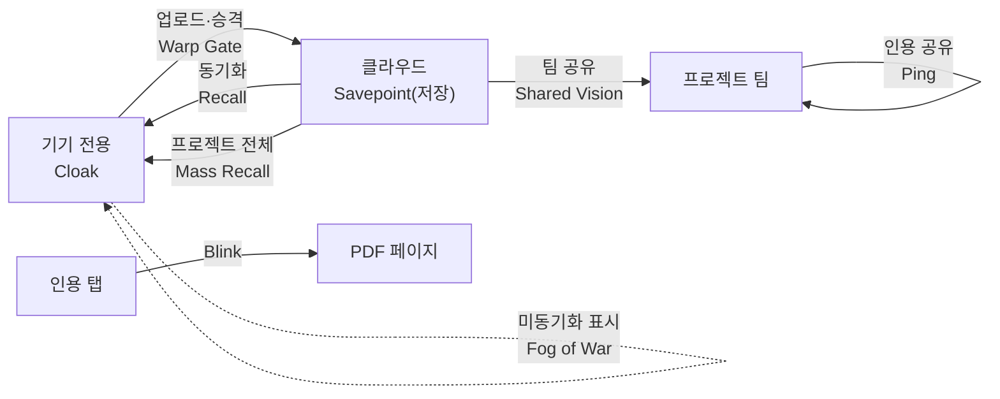

# 🏷️ 제품 이름 후보 & 기능 이름 용어집

| 항목 | 값 |
|---|---|
| 작성일 | 2026-10-14 (KST) |
| 최종 수정 | 2026-10-14 23:44 KST |
| 근거 | [research 010](../research/010-product-naming.md) · [011](../research/011-product-naming-global.md) · [012](../research/012-product-naming-burrow-game-terms.md) · [013](../research/013-product-naming-warp-game-skills.md) |
| 관련 문서 | [002 기획·아키텍처](002-rag-assistant-plan.md) (프라이버시 3계층) · [003 기술 스택](003-tech-stack-and-prep.md) |
| 상태 | **✅ PageBlink 확정 (ADR 012)** (이름 미확정 → 확정 시 ADR 작성 후 이 문서에 반영) |

> 이 문서는 4차례 조사한 이름 후보를 **한곳에서 훑어보기 위한 목록**입니다. 평가·위험은 research에서 그대로 가져왔고, 새로 확인한 충돌 사실은 없습니다.
> 표기: ✅ 확인 · ⚠️ 미확인 · `—` research에 정보 없음

---

## 1. 결정 기준

제품: **"내 문서에 물어보는" 앱.** 문서별 프라이버시 3계층(기기 전용 → 클라우드 동기화 → 프로젝트 공유) + 인용 탭 → PDF 페이지 점프.

| # | 기준 | 보는 점 |
|---|---|---|
| 1 | 영어권 직관성 | 영어 데모·개발자 심사위원이 이름만 보고 뜻을 짐작하는가 |
| 2 | 한국어 친화성 | 한글 발음·표기가 쉽고 어색한 뜻이 없는가 |
| 3 | 3계층 스토리 | 기기 → 클라우드 → 프로젝트 흐름을 이름·마스코트로 설명할 수 있는가 |
| 4 | 인용 점프 | 핵심 UX(탭 → 페이지 이동)가 이름에서 보이는가 |
| 5 | 충돌 위험 | pub.dev, 동명 앱·서비스, 상표, 부정적 뉘앙스 |
| 6 | 마스코트 가능성 | 캐릭터·로고로 풀기 쉬운가 (승급 애니메이션 등 데모 장면) |

### 조사 한계 (공통)
- pub.dev: 정확 일치 조회 ✅ — 각 research에서 `stash`, `magpie`, `pouch`, `stow`, `codex`, `lore` 등은 사용 중, 숏리스트 이름은 모두 404
- "충돌 낮음" = 웹 검색에 안 잡힘일 뿐 ⚠️. **App Store · Play Store · KIPRIS · USPTO · 도메인 · Cloud ID는 전부 미확인**
- 1차(010)는 국내 전용 로마자 이름이라 해외에서 안 통한다는 사용자 피드백 → 2~4차(011~013)가 국내외 공용으로 재조사

### 라운드별 조사자 Top 5 (참고)

| 라운드 | Top 5 |
|---|---|
| [010](../research/010-product-naming.md) | Dotori · Mureobwa · Jumeoni · Hamzzi · Pagepin |
| [011](../research/011-product-naming-global.md) | Hutch · Burrow · Dogear · Hamstor · Pinpage (차선 Snug, Hoot) |
| [012](../research/012-product-naming-burrow-game-terms.md) | Pinpage · Burrowpin · Savepoint · Questpage · Pagewarp |
| [013](../research/013-product-naming-warp-game-skills.md) | Pagewarp · Docparty · Savepoint · Pinpage · Blinkpage |

---

## 2. ⭐ 현재 숏리스트

사용자가 유지 중: **Pinpage · Burrow** / 검토 중: **Docparty · Pagewarp** / 호감이지만 저장만 연상됨: **Savepoint**

| 이름 | 장점 | 약점 | 충돌 | 태그라인 아이디어 | 출처 |
|---|---|---|---|---|---|
| **Pinpage** (핀페이지) | 인용 핀 → 페이지 이동이 한 번에 이해됨. 영/한 상/상. 마스코트: 핀 든 토끼 | 스토리 약함, 3계층(동기화·공유) 미반영 | 하 ⚠️ (스토어·상표 미확인) | — (research에 없음) | [011](../research/011-product-naming-global.md) #11, [012](../research/012-product-naming-burrow-game-terms.md), [013](../research/013-product-naming-warp-game-skills.md) |
| **Burrow** (버로우) | 굴(기기) → 터널(동기화) → 굴 마을 warren(프로젝트)으로 **3계층 스토리가 가장 강함**. 마스코트: 두더지·토끼. 영/한 상/중 | r/l 발음이 약간 어려움 | 중 (011: 동명 가구 브랜드) + ⚠️ 012: Chrome 확장 "Burrow"(노트 캡처, app.burrow.world)와 노트 카테고리 겹침 / iOS "Burrow CRM", "Bunny Burrow" 존재 | — | [011](../research/011-product-naming-global.md) #19, [012](../research/012-product-naming-burrow-game-terms.md) |
| ↳ **Burrowpin** | 굴(기기) + 핀(인용)으로 계층 스토리와 인용 기능을 한 이름에 | 발음 무거움, Pinterest 연상 | 낮음 | — | [012](../research/012-product-naming-burrow-game-terms.md) A-7 |
| ↳ **BurrowBook** | 한 단어로 기억 쉬움 | Facebook 말장난 느낌 | 낮음 | — | [012](../research/012-product-naming-burrow-game-terms.md) A-3 |
| ↳ **Burrow Ask** | "Ask your documents"와 직결 | 브랜드 느낌 약함 | 낮음 | — | [012](../research/012-product-naming-burrow-game-terms.md) A-8 |
| **Docparty** (독파티) | 팀 공유가 직관적, 동명 앱 미발견. 영/한 상/상 | 오프라인·점프 미반영, 가벼운 인상 | 낮음 | — | [012](../research/012-product-naming-burrow-game-terms.md), [013](../research/013-product-naming-warp-game-skills.md) |
| **Pagewarp** (페이지워프) | 인용 탭 → 페이지 순간이동 장면을 그대로 설명. 한영 발음 쉬움. `page`가 앞이라 warp.dev 연상 완화. 기능 어휘(아래 §4)로 동기화·공유 보완 | 프라이버시·동기화·공유 메시지 없음 | 낮음(012) → **013에서 재평가**: ⚠️ warp.dev(개발자에게 유명, Warp Drive Notebooks = 팀 동기화 Markdown 문서), PDFwarp(PDF AI 채팅), Docuwarp(PyPI) 유사 | **"Ask. Warp to the page."** | [012](../research/012-product-naming-burrow-game-terms.md), [013](../research/013-product-naming-warp-game-skills.md) |
| **Savepoint** (세이브포인트) | 친숙·신뢰감. 기기 세이브 → 클라우드 세이브 → 파티 공유 서사가 자연스러움. 한영 쉬움 | **저장만 연상**(동기화·공유 부족), 일반어라 구별력 약함 | 중 — 일반어, SQL `SAVEPOINT` / 일반어 상표 확인 필요 ⚠️ | **"Save. Sync. Share. Jump."** | [012](../research/012-product-naming-burrow-game-terms.md), [013](../research/013-product-naming-warp-game-skills.md) |

### 추가 숏리스트 후보: PageBlink ([research 014](../research/014-blink-name-conflicts.md))

| 이름 | 한글 | 장점 | 약점 | 충돌 |
|---|---|---|---|---|
| **PageBlink** | 페이지블링크 | LoL 점멸(Blink)로 "인용 탭 → 페이지 순간이동"을 그대로 표현. 한영 발음 쉬움. 앱 이름과 기능 용어 Blink가 한 세계관으로 이어짐 | 동기화·공유는 이름에 없음. Blinkist(PDF 요약 기능 보유)와 "Blink~" 소리 근접 | 낮음 (동명 미발견, pub 404) |
| Blinkpage | 블링크페이지 | 의미 동일 | 앞소리가 Blinkist와 더 가까움 | 낮음 |
| ~~Blink it / Blinkit~~ | 블링크잇 | — | Zomato 인도 퀵커머스 앱 | **제외** |
| ~~BlinkNote~~ | 블링크노트 | — | iOS 노트 앱 동명 | **제외** |

### Burrow를 쓴다면 (012 정리)
- 단독 Burrow 충돌 2건: ① Chrome 확장 Burrow ② 한국어 슬랭 "버로우 타다"(잠수·잠적 은어, 존버 어원설) — 약한 부정이고 유머로 읽힘
- 위 표의 변형(Burrowpin · BurrowBook · Burrow Ask)은 research상 웹 충돌 **낮음**
- **Burrow Note는 제외**: Chrome 확장과 정면 충돌(충돌 높음)

---

## 3. 전체 후보 마스터 표 (50개)

- 라운드 간 중복 제거. **숏리스트 → 후보(분류순) → 국내 전용·보류 → 제외** 순
- 영어권/한국어: research의 상·중·하 평가. 011은 "영/한", **012·013의 게임 용어는 "한(KR)/영(EN)" 순서라 이 표에서 영어권/한국어 열로 맞춰 옮김**. `*` = 이름 자체의 평가는 research에 없어 구성 용어 평가를 인용 (Burrow 변형 → Burrow, Blinkpage·Recall Docs·Rallydoc → Blink·Recall·Rally Point)
- 한글 표기는 research에 없는 경우 작성자가 음차한 것 (공식 표기 아님)
- 국내 전용·보류 6개의 영어권 "하"는 research 평가가 아니라 **사용자 피드백**("해외에서 쓰기엔 너무 한국적"). 010은 영/한 평가를 하지 않았으므로 한국어 열은 `—`
- 분류: 캐릭터 / 기능 / 은유 / 조어 / 게임

| # | 이름 | 한글 | 분류 | 영어권 | 한국어 | 제품 연결 | 충돌 위험 | 상태 | 출처 |
|---|---|---|---|---|---|---|---|---|---|
| 1 | Pinpage | 핀페이지 | 기능 | 상 | 상 | 인용 핀 → 페이지 | 하 | ⭐ 숏리스트 | [011](../research/011-product-naming-global.md) |
| 2 | Burrow | 버로우 | 캐릭터 | 상 | 중 | 굴 → 터널 → 굴 마을 (3계층) | 중 (011: 동명 가구 브랜드) + ⚠️ 012: Chrome 확장·Burrow CRM·Bunny Burrow·"버로우 타다" 슬랭 | ⭐ 숏리스트 | [011](../research/011-product-naming-global.md), [012](../research/012-product-naming-burrow-game-terms.md) |
| 3 | Burrowpin | 버로우핀 | 조어 | 상* | 중* | 굴(기기) + 핀(인용) | 낮음 | ⭐ 숏리스트(Burrow 변형) | [012](../research/012-product-naming-burrow-game-terms.md) |
| 4 | BurrowBook | 버로우북 | 조어 | 상* | 중* | 한 단어로 기억 쉬움 | 낮음 | ⭐ 숏리스트(Burrow 변형) | [012](../research/012-product-naming-burrow-game-terms.md) |
| 5 | Burrow Ask | 버로우 애스크 | 기능 | 상* | 중* | "Ask your documents" 직결 | 낮음 | ⭐ 숏리스트(Burrow 변형) | [012](../research/012-product-naming-burrow-game-terms.md) |
| 6 | Docparty | 독파티 | 게임 | 상 | 상 | 파티 = 팀과 문서를 함께 | 낮음 (가벼운 인상) | ⭐ 숏리스트 | [012](../research/012-product-naming-burrow-game-terms.md), [013](../research/013-product-naming-warp-game-skills.md) |
| 7 | Pagewarp | 페이지워프 | 게임 | 상 | 상 | 인용 탭 → 페이지 순간이동 | 낮음 → 013: warp.dev·PDFwarp 연상 주의 | ⭐ 숏리스트 | [012](../research/012-product-naming-burrow-game-terms.md), [013](../research/013-product-naming-warp-game-skills.md) |
| 8 | Savepoint | 세이브포인트 | 게임 | 상 | 상 | 기기 세이브 → 클라우드 → 파티 공유 | 중 (일반어, SQL SAVEPOINT) | ⭐ 숏리스트 | [012](../research/012-product-naming-burrow-game-terms.md), [013](../research/013-product-naming-warp-game-skills.md) |
| 9 | Questpage | 퀘스트페이지 | 게임 | 상 | 상 | 질문 = 퀘스트, 답 = 보상. 데모 "퀘스트 시작, 보상은 인용" | 낮음 | 후보 | [012](../research/012-product-naming-burrow-game-terms.md) |
| 10 | Blinkpage | 블링크페이지 | 게임 | 상* | 상* | Pagewarp의 점프 메타포, Warp 충돌 없음 | Blink(Chromium·카메라) 혼잡 | 후보 | [013](../research/013-product-naming-warp-game-skills.md) |
| 11 | Guildpage | 길드페이지 | 게임 | 상 | 상 | 팀 공유 페이지 | 낮음~중 | 후보 | [012](../research/012-product-naming-burrow-game-terms.md) |
| 12 | Guildoc | 길독 | 게임 | 중 | 상 | 프로젝트 공유 | 낮음 (읽기 모호) | 후보 | [012](../research/012-product-naming-burrow-game-terms.md) |
| 13 | Rallydoc | 랠리독 | 게임 | 중* | 중* | 팀 집결지 (Rally Point) | — (조합명, pub 404) | 후보 | [013](../research/013-product-naming-warp-game-skills.md) |
| 14 | Recall Docs | 리콜 독스 | 게임 | 상* | 상* | 클라우드 → 기기 동기화 (Recall) | Microsoft Recall(프라이버시 논란), Recall.ai | 후보 | [013](../research/013-product-naming-warp-game-skills.md) |
| 15 | Quickslot | 퀵슬롯 | 게임 | 하 | 상 | 자주 쓰는 문서 | 낮음 | 후보 | [012](../research/012-product-naming-burrow-game-terms.md) |
| 16 | Fogpage | 포그페이지 | 게임 | 중 | 상 | 비공개 문서는 안개에 가려짐 (Fog of War) | 낮음 ("흐릿한 답" 연상) | 후보 | [012](../research/012-product-naming-burrow-game-terms.md) |
| 17 | Portapage | 포타페이지 | 게임 | 중 | 상 | portable + portal | 낮음 | 후보 | [012](../research/012-product-naming-burrow-game-terms.md) |
| 18 | Pagedex | 페이지덱스 | 게임 | 중 | 상 | 내 문서 도감 | 중 (Pokédex 연상) | 후보 | [012](../research/012-product-naming-burrow-game-terms.md) |
| 19 | Lorepage | 로어페이지 | 게임 | 중 | 중 | 페이지 단위 설정집 | 낮음 | 후보 | [012](../research/012-product-naming-burrow-game-terms.md) |
| 20 | Dogear | 도그이어 | 기능 | 상 | 상 | 책 모서리 접기 = 인용 → 페이지 점프 | 중상 (독서 앱·Obsidian·Acrobat 플러그인) | 후보 | [011](../research/011-product-naming-global.md) |
| 21 | Pagemark | 페이지마크 | 기능 | 상 | 상 | 페이지 표시 = 페이지 인용 | 하 | 후보 | [011](../research/011-product-naming-global.md) |
| 22 | Peekpage | 픽페이지 | 기능 | 상 | 중 | 인용 미리보기 | 하 | 후보 | [011](../research/011-product-naming-global.md) |
| 23 | Pagepin | 페이지핀 | 기능 | — | — | 인용 탭 → 페이지 점프 (Pinpage의 어순 반전) | 낮음 | 후보 | [010](../research/010-product-naming.md) #12 |
| 24 | Hutch | 허치 | 캐릭터 | 상 | 상 | 내 문서의 작은 집 → 이웃과 연결되는 확장 스토리 | 중 (Hutch Games 등 동명 회사, 문서 앱 없음) | 후보 | [011](../research/011-product-naming-global.md) |
| 25 | Hamstor | 햄스토어 | 캐릭터 | 중 | 상 | 볼주머니 → 굴 → 무리 | 하 (오타처럼 보일 수 있음) | 후보 | [011](../research/011-product-naming-global.md) |
| 26 | Hoot | 후트 | 캐릭터 | 상 | 상 | 물으면 답하는 부엉이 | 중 (흔한 단어) | 후보 | [011](../research/011-product-naming-global.md) |
| 27 | Snug | 스너그 | 캐릭터 | 상 | 중 | 포근한 = 안전한 기기 전용 | 중 | 후보 | [011](../research/011-product-naming-global.md) |
| 28 | Hammy | 해미 | 캐릭터 | 상 | 중 | 햄스터 볼주머니 저장 | 중 | 후보 | [011](../research/011-product-naming-global.md) |
| 29 | Tiernest | 티어네스트 | 은유 | 중 | 중 | Tier + Nest, 3단계 둥지 | 하 | 후보 | [011](../research/011-product-naming-global.md) |
| 30 | Burrow Docs | 버로우 독스 | 조어 | 상* | 중* | 문서 포지션 명확 | 중 (Google Docs 연상, 밋밋) | 후보 | [012](../research/012-product-naming-burrow-game-terms.md) |
| 31 | Dotori | 도토리 | 캐릭터 | 하 | — | 다람쥐가 도토리를 모으듯 폰에 저장 → 클라우드 → 함께 봄 | 중 (한국 App Store "도토리" 일기·RSS 앱) | 국내 전용·보류 | [010](../research/010-product-naming.md) #1 |
| 32 | Hamzzi | 햄찌 | 캐릭터 | 하 | — | 볼주머니 = 오프라인 저장, 승급 애니메이션 | 낮음 | 국내 전용·보류 | [010](../research/010-product-naming.md) #3 |
| 33 | Jumeoni | 주머니 | 은유 | 하 | — | 폰 주머니·복주머니 (소중한 것은 폰에) | 낮음 | 국내 전용·보류 | [010](../research/010-product-naming.md) #17 |
| 34 | Mureobwa | 물어봐 | 기능 | 하 | — | 이름이 곧 사용법 ("Ask your documents" 부제 필요) | 낮음 | 국내 전용·보류 | [010](../research/010-product-naming.md) #11 |
| 35 | Kkachi | 까치 | 캐릭터 | 하 | — | 반짝이는 것(문서)을 물어다 줌 | 낮음 | 국내 전용·보류 | [010](../research/010-product-naming.md) #4 |
| 36 | Galpi | 갈피 | 기능 | 하 | — | 책갈피 → 페이지 점프, "갈피를 잡다" | 낮음 | 국내 전용·보류 | [010](../research/010-product-naming.md) #15 |
| 37 | Burrow Note | 버로우 노트 | 조어 | 상* | 중* | 직관적이나 노트 앱 인상 | **높음** — Chrome 확장 Burrow와 정면 충돌 | 제외 | [012](../research/012-product-naming-burrow-game-terms.md) A-1 |
| 38 | Warpnote | 워프노트 | 조어 | — | — | — | Warp Notes(iOS)와 사실상 동일 | 제외 | [013](../research/013-product-naming-warp-game-skills.md) |
| 39 | Warpdoc(s) | 워프독스 | 조어 | — | — | — | Warp Drive 문서 기능과 혼동 | 제외 | [013](../research/013-product-naming-warp-game-skills.md) |
| 40 | Warpgate | 워프게이트 | 게임 | 중 | 상 | 업로드 관문 | SSH 도구 Warpgate와 직접 충돌 (기능명으로만 검토) | 제외 | [013](../research/013-product-naming-warp-game-skills.md) |
| 41 | Docwarp | 독워프 | 조어 | — | — | — | "독(毒)/dog" 발음, 점프 의미 약함, Docuwarp 유사 | 제외 | [013](../research/013-product-naming-warp-game-skills.md) |
| 42 | Magpie | 매그파이 | 캐릭터 | 상 | 중 | 문서를 모으는 새 | pub.dev 사용 중 | 제외 | [011](../research/011-product-naming-global.md) |
| 43 | Pouch | 파우치 | 은유 | 상 | 상 | 기기 안 주머니 | pub.dev 사용 중 | 제외 | [011](../research/011-product-naming-global.md) |
| 44 | Stash | 스태시 | 은유 | 상 | 중 | 비밀 저장 | pub.dev 사용 중, 투자 앱 | 제외 | [011](../research/011-product-naming-global.md) |
| 45 | Stow | 스토우 | 은유 | 상 | 중 | 보관 | pub.dev 사용 중, GNU stow | 제외 | [011](../research/011-product-naming-global.md) |
| 46 | Jaybird | 제이버드 | 캐릭터 | 상 | 상 | 도토리 숨기는 새 | Logitech 이어폰 브랜드 (유사 브랜드) | 제외 | [011](../research/011-product-naming-global.md) |
| 47 | Nook | 눅 | 은유 | 상 | 중 | 문서 아지트 | B&N Nook (유사 브랜드) | 제외 | [011](../research/011-product-naming-global.md) |
| 48 | Pagepal | 페이지팔 | 기능 | 상 | 중 | PDF 대화 친구 | PagePal AI, PdfPal (유사 서비스) | 제외 | [011](../research/011-product-naming-global.md) |
| 49 | Stashy | 스태시 | 캐릭터 | 중 | 중 | 귀여운 저장 | Stashly AI 등 (중상) | 제외 | [011](../research/011-product-naming-global.md), [010](../research/010-product-naming.md) |
| 50 | Codex | 코덱스 | 게임 | — | — | — | pub.dev 사용 중, OpenAI Codex | 제외 | [012](../research/012-product-naming-burrow-game-terms.md) |

### 표에 싣지 않은 이름 (지면상 생략, 원문 참조)

| 구분 | 이름 | 비고 | 출처 |
|---|---|---|---|
| 국내 전용·보류 (010) | Acornote, Kokkiri, Buong, Pouchy, Pagemole, Daramzzi, Peekapage, Eodiya, Jjokji, Dungji, Saseo, Seorap, Bomul, Cubby, Gieok, Memoo, Rememo, Pagi, Tucky, Mungchi, Ttokttok, Moaboa | 한국어 로마자 중심. Acornote·Cubby(높음), Tucky(중~높음)는 동명 앱 충돌 | [010](../research/010-product-naming.md) |
| 후보 (011) | Owlie, Chippy, Nutpage, Pawpage | 충돌 하~중, 마스코트형 | [011](../research/011-product-naming-global.md) |
| 후보 (012 게임) | Stashpage, Checkpage, Waypage, Lootbook, Squadoc, Docdex, Lorebook, Lorekeeper, Grimoire | 일반어·Stash*계열·확률형 아이템 연상 등 약점 있음 | [012](../research/012-product-naming-burrow-game-terms.md) |
| 후보 (012 Burrow 변형) | Burrow Pages, Burrow Den | 충돌 낮음~중 / 낮음 | [012](../research/012-product-naming-burrow-game-terms.md) |
| 후보 (013) | Wardbook | 조합명, pub 404 | [013](../research/013-product-naming-warp-game-skills.md) |
| 후보·약점 있음 (011) | Nutty, Asknook, Docnest, Nestdoc, Pinnest, Hoardy, Pocketnest | "미친" 속어 / 발음 어려움 / "독(毒)" 연상 / Pinterest 혼동 / Note Hoard·후디 혼동 / 금융 가능성 ⚠️ | [011](../research/011-product-naming-global.md) |
| 후보·약점 있음 (012 Burrow 변형) | Burrowly, Burrowse, My Burrow | "-ly" 흔함·어색 / 철자 오인 / 일반어 검색 약함 | [012](../research/012-product-naming-burrow-game-terms.md) |
| 제외 (012·013) | Waypoint, Respawn, Warpage, Warpin, Warpzone, Warp Pages, Warpparty, Doc Party, Partydoc | Halo Waypoint · Respawn Entertainment · "뒤틀림" 뜻 · 의미 불명확 · 일반 명사 · Pagewarp 하위 호환 · 길고 흐림 · 식별력 약함 · 발음 불리 | [012](../research/012-product-naming-burrow-game-terms.md), [013](../research/013-product-naming-warp-game-skills.md) |

**집계**: 마스터 표 50개 (숏리스트 8 · 후보 22 · 국내 전용·보류 6 · 제외 14) + 생략 목록 57개 = research 010–013 중복 제거 후 총 107개 이름. 생략 목록의 상태 구분은 '후보 / 국내 전용·보류 / 제외'로 표기.

---

## 4. 🎮 기능 이름 용어집 (게임 용어)

[research 013](../research/013-product-naming-warp-game-skills.md) 결론: **게임 용어는 앱 이름보다 기능 이름에 적합**하다. 어떤 앱 이름을 고르든 앱 내부 어휘로 쓸 수 있다.
KR = 한국 게이머 친숙도, EN = 영어 직관성 (013 평가).

### 4-1. 핵심 기능 매핑

| 기능 | 1순위 용어 | 대안 용어 | 출처 게임·한국 게이머 용어 | 이유 | 주의 (상표·혼동) |
|---|---|---|---|---|---|
| 기기 전용 (비공개·오프라인) | **Cloak** | Savepoint(기기 오프라인 저장, 012), Fog of War(비공개 안개, 012) | 스타크래프트 클로킹 (KR 상 / EN 중) | 013: 기능명 적합. 안 보이게 숨김 = 기기 밖으로 안 나감 | Cloak VPN 존재 |
| 클라우드 업로드·승격 | **Warp Gate** | Portal(기기 ↔ 클라우드), Savepoint(클라우드 세이브, 012) | 스타크래프트2 워프 게이트 (KR 상 / EN 중) | 013: 업로드 관문. 문서가 관문을 통과해 클라우드로 | **Warpgate(SSH 도구) 충돌** — 기능명 한정. Portal은 Valve Portal·포털 사이트와 혼동 |
| 클라우드 → 기기 동기화 | **Recall** (귀환) | Portal | 리그 오브 레전드 귀환, 스타크래프트 아비터 리콜 (KR 상 / EN 상) | 013: 클라우드에서 기기로 불러옴 | Microsoft Recall(프라이버시 논란), Recall.ai. **Hearthstone은 금지(아래)** |
| 프로젝트 전체 동기화 | **Mass Recall** | Recall(프로젝트 범위로 사용) | 스타크래프트 매스 리콜 (KR 중 / EN 중) | 013: 기능명 적합. Recall의 확장형 | Recall과 같음 |
| 프로젝트 팀 공유 | **Shared Vision** (공유 시야) | Rally Point(팀 집결지), Guild Bank(팀 공용 저장소), Pylon(주변에 공유), Nexus(중심 허브) | 스타크래프트 공유 시야 (KR 상 / EN 상) | 013: 팀이 같은 문서를 봄. 기능명 최적 | Guild Bank는 금융 앱 오해, Pylon은 영어 직관성 낮음(EN 하), Nexus는 소프트웨어 상표 매우 많음 |
| 팀원에게 인용 공유 | **Ping** (핑) | Mailbox(공유 받은 문서함), Rally Point | 리그 오브 레전드·오버워치 핑 (KR 상 / EN 상) | 013: "이 페이지 봐" 알림. 기능명 적합 | Mailbox는 기존 Mailbox 앱 |
| 인용 탭 → 페이지 점프 | **Blink** (점멸) | Teleport(구분력 약함), Warp(Pagewarp 채택 시 이름과 일치) | 리그 오브 레전드 점멸, Blink Dagger (KR 상 / EN 상) | 013: 탭 즉시 이동 | 단독은 Chromium Blink·Blink 카메라와 혼잡, 복합어는 양호 |
| 미동기화 상태 표시 | **Fog of War** (전장의 안개) | Detector(미인덱싱 문서 발견, 의미 약함) | 스타크래프트·RTS 전장의 안개 (KR 상 / EN 중) | 013: 아직 안 내려받은 문서는 안개로 가려짐 | 기능명으로 무난 |
| 페이지 썸네일 탐색 | **Minimap** | — | RTS·MOBA 미니맵 (KR 상 / EN 상) | 013: 기능명 | 기능명으로 무난 |

### 4-2. 추가 기능 후보 (013 목록 중 위 표에 안 쓴 용어)

| 기능 | 용어 | 출처 | KR/EN | 주의 |
|---|---|---|---|---|
| 북마크·시야 표시 | Ward (와드) | 리그 오브 레전드 | 상/하 | 영어 "병동" 의미 |
| 검색·탐색 | Scout | 스타크래프트 | 상/상 | 일반어 |
| 허브·홈 | Nexus | 스타크래프트·LoL | 상/상 | 소프트웨어 상표 매우 많음 |
| 자주 쓰는 문서 | Quickslot | MMO·소울류 (012) | 상/하 | 낮음 |
| 인용 페이지 확인 | Checkpoint | 체크포인트 (012 Checkpage) | 상/중 | 평범 |
| 공유 받은 문서함 | Mailbox | WoW | 중/상 | 기존 Mailbox 앱 |

### 4-3. 🚫 사용 금지

| 용어 | 사유 |
|---|---|
| **Hearthstone** (WoW 귀환석) | **Blizzard 등록상표 — 사용 금지** (013). 귀환 기능은 Recall로 대체 |

⚠️ Hearthstone 외 용어의 상표 여부는 research에서 개별 확인하지 않음 → 확인 필요 (§5)

### 4-4. 3계층 흐름과 용어

- 위 흐름은 013의 "기능 이름 어휘집(앱 내부용 제안)"을 3계층에 맞춰 그린 것. Savepoint는 012의 매핑("클라우드 세이브")이며 013의 1순위 용어는 아님
- 이름이 Pagewarp이면 "Warp Gate" 같은 `Warp` 계열 용어와 겹쳐 보일 수 있음 — 확인 필요 (research에 평가 없음)

---

## 5. 다음 단계

| # | 할 일 | 비고 |
|---|---|---|
| 1 | 숏리스트 5계열(Pinpage · Burrow(+변형) · Docparty · Pagewarp · Savepoint)에서 1~2개로 압축 | 사용자 결정 |
| 2 | **App Store · Play Store** 직접 검색 | research는 웹 검색까지만 ⚠️ |
| 3 | **KIPRIS**(국내 상표) · USPTO 확인 | Savepoint(일반어), Burrow(동명 브랜드), Pagewarp(warp.dev 계열) 우선 |
| 4 | **도메인** (.app / .dev) 확인 | 미확인 ⚠️ |
| 5 | **Serverpod Cloud ID** 사용 가능 여부 | `serverpod cloud project create <id>` 로 확인 (010) |
| 6 | 결정 후 **ADR 작성** → 이 문서·README 반영 | [`../adr/`](../adr/) |
| 7 | ~~코드 패키지명 `ragpod_*` 유지~~ → **PageBlink 확정, 패키지까지 `pageblink_*`로 변경 (ADR 012)** | 사용자 결정 2026-10-14 |
| 8 | 선택한 이름과 §4 용어의 조합 확정 (예: Pagewarp + "Ask. Warp to the page.") | 태그라인은 research에 있는 2개만 존재 |

## 변경 이력

| 일시 (KST) | 변경 |
|---|---|
| 2026-10-14 23:30 | 최초 작성 (research 010–013 통합, 후보 50개, 기능 용어집) |
- `2026-10-14 23:39` PageBlink·Blink 계열 추가 (research 014)
- `2026-10-14 23:44` 이름 PageBlink 확정, 패키지명까지 변경 (ADR 012)
