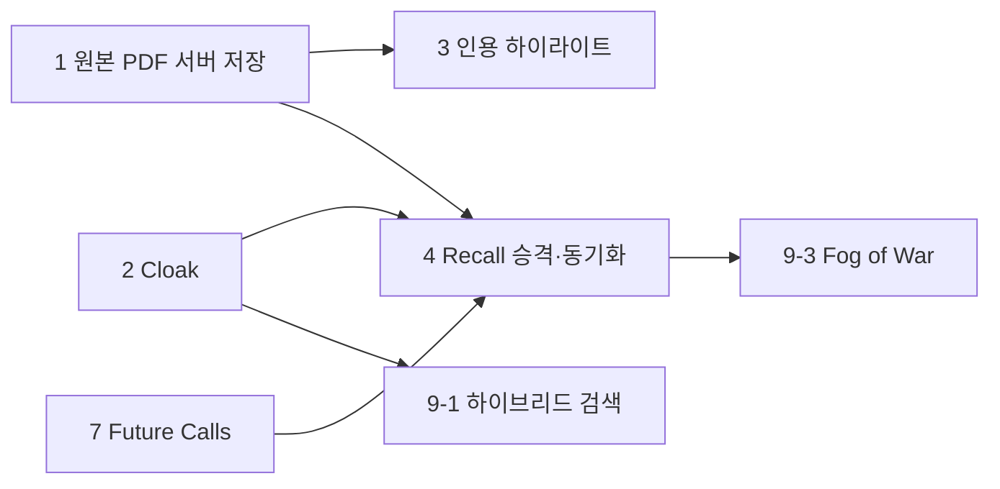

# 🧭 후속 기능 명세 (해커톤 이후)

> **작성일**: 2026-10-15 00:15 KST · **최종 수정**: 2026-10-15 00:18 KST
> **관련 문서**: [기획·아키텍처 (002)](002-rag-assistant-plan.md) · [기술 스택 (003)](003-tech-stack-and-prep.md) · [용어집 (004)](004-naming-and-feature-vocabulary.md) · [devlog 006](../devlog/006-flutter-app-v1.md) · [devlog 007](../devlog/007-cloud-deploy-and-model-rotation.md)
> **표기**: ✅ 코드·문서로 확인 · ⚠️ 미확인/추정 · "002 §6 #n" = [차별화 후보 15선](002-rag-assistant-plan.md#6-차별화-기능-후보-15선)의 번호

해커톤 제출본에 **들어가지 않은 것**과 그 다음 단계를 정리합니다. 각 항목은 목적 · 사용자 스토리 · 구현 메모 · 수용 기준 · 우선순위를 가집니다.

---

## 현재 상태 한눈에 (제출본 기준)

| 영역 | 상태 |
|---|---|
| 구현됨 ✅ | 이메일 로그인 · 앱에서 PDF 페이지별 텍스트 추출(pdfrx) → 서버 청킹·임베딩(EmbeddingGemma, DeepInfra)·pgvector HNSW · 스트리밍 답변 + `[n]` 인용 → ⚡ 칩 → PDF 뷰어 페이지 점프 · 프로젝트 + 이메일 초대 + 검색 쿼리 안 ACL · 모델 선택기 + 자동 로테이션 |
| 제한 ✅ | 인용 페이지 점프는 **업로드한 기기(웹은 같은 브라우저 세션)** 에서만 원본을 연다. 그 외에는 인용 구절만 표시 (`LocalPdfs`) |
| 스텁 ✅ | `GeminiLlmProvider` ("not implemented yet") · 계층 선택 시트의 Cloak("곧 지원", 비활성) |
| 미검증 ⚠️ | Cloud 환경 E2E ([devlog 007](../devlog/007-cloud-deploy-and-model-rotation.md)) |

## 우선순위 요약

| P | # | 항목 | 002 §6 | 한 줄 |
|---|---|---|---|---|
| P1 | 1 | [원본 PDF 서버 저장](#1-원본-pdf-서버-저장) | #5 | 어느 기기·팀원에서도 인용 탭 → 페이지 점프 |
| P1 | 2 | [Cloak 기기 전용 계층](#2-cloak-기기-전용-계층) | #6 (#2, #3 연관) | 서버에 안 올리는 문서 + 오프라인 Evidence 모드 |
| P1 | 3 | [인용 하이라이트](#3-인용-하이라이트) | #5 | 점프한 페이지에서 인용 구절 강조 |
| P2 | 4 | [Recall 승격·동기화](#4-recall-승격동기화) | #14 | contentHash · syncState로 기기↔클라우드 |
| P2 | 5 | [GeminiLlmProvider 직접 구현](#5-geminillmprovider-직접-구현) | – | Gemini free tier 쿼터 추가 |
| P2 | 6 | [프로젝트 멤버·역할 관리 UI, 문서 삭제 UI](#6-프로젝트-멤버역할-관리-ui-문서-삭제-ui) | – | 이미 있는 API 위에 화면 |
| P2 | 7 | [Future Calls 백그라운드 인덱싱](#7-future-calls-백그라운드-인덱싱) | #7, #11 | Growth 플랜 필요 |
| P2 | 8 | [모델 카탈로그 설정화 · 사용량/한도 표시](#8-모델-카탈로그-설정화--사용량한도-표시) | – | 코드 수정 없이 모델 교체 |
| P3 | 9 | [기타 (한국어 하이브리드 검색, Ping, Fog of War, OCR, 음성, 리팩터, 스토어, 상표)](#9-p3-항목) | #15 #10 #12 #13 | 아래 표 |

---

## 1. 원본 PDF 서버 저장

| 항목 | 내용 |
|---|---|
| 우선순위 | **P1** |
| 목적 | 인용 ⚡를 탭하면 **어떤 기기, 어떤 팀원이든** 원본 PDF의 해당 페이지가 열리게 한다. 지금은 업로드한 기기(웹은 같은 브라우저 세션)에서만 열리고 그 외에는 인용 구절만 보인다 |
| 사용자 스토리 | 팀원으로서, 동료가 올린 계약서를 인용 칩으로 열어 정확한 페이지를 보고 싶다. 폰을 바꾸거나 웹을 새로고침해도 마찬가지다 |

**구현 메모**
- 서버: `Document.storagePath`(이미 모델에 있음, 현재 미사용)와 `pod.addCloudStorage(...private...)`(`server.dart`에 이미 설정, 미사용)를 사용
- 업로드: `createUploadDescription` → `FileUploader` → `verifyUpload` (Serverpod File Upload, [002 §4-1](002-rag-assistant-plan.md#4-1-serverpod-기능-매핑-심사-25-스택-활용용)). 기존 `DocumentEndpoint.upload`(텍스트·청크)와 같은 `contentHash`로 묶는다
- 열람: 신규 엔드포인트가 **ACL 확인 후에만** `temporaryDownloadUrl`을 발급 (개인 문서: 소유자, 프로젝트 문서: `Acl.requireRole`/멤버십). 영구 URL은 만들지 않는다
- 앱: `PageViewerScreen`이 `LocalPdfs`가 비었을 때 URL로 내려받아 `PdfViewer`에 전달. 받은 파일은 `LocalPdfs`에 캐시
- 제약: 기본 업로드 한도 **10MiB**(002 §4-1), Starter 플랜 podlet 256MB(002 §4-2) → 큰 PDF는 한도 상향 또는 거절 메시지 필요 ⚠️
- 프라이버시: Cloak 문서는 이 경로를 **타지 않는다** (항목 2)

**수용 기준**
- [ ] 기기 A에서 올린 PDF가 기기 B(같은 계정)와 프로젝트 팀원 C에서 인용 탭으로 해당 페이지에서 열린다
- [ ] 프로젝트에 속하지 않은 사용자가 URL 발급을 요청하면 `AccessDeniedException`
- [ ] 웹 새로고침 후에도 페이지 점프가 동작한다
- [ ] 10MiB 초과 파일은 이유를 알려 주고 실패한다
- [ ] 문서 삭제 시 저장소 파일도 삭제된다

---

## 2. Cloak 기기 전용 계층

| 항목 | 내용 |
|---|---|
| 우선순위 | **P1** |
| 목적 | "민감한 건 폰에" 약속을 구현한다. 문서가 서버로 나가지 않고, **오프라인에서도 검색해 근거 구절·페이지를 보여 준다** (Evidence 모드). 002 §6 #6, [ADR 001](../adr/001-offline-retrieval-online-generation.md) · [002](../adr/002-embedding-embeddinggemma-768.md) · [009](../adr/009-device-tier-privacy-and-sync.md) |
| 사용자 스토리 | 개인 문서 사용자로서, 의료·계약 PDF를 서버에 올리지 않고도 비행기 모드에서 "그 조항 몇 페이지?"를 찾고 싶다 |

**구현 메모**
- 임베딩: `flutter_edge_ai`의 EmbeddingGemma-300m (~180MB, 첫 실행 시 다운로드). **서버와 같은 모델 · 768차원 · 같은 프리픽스** — `EmbeddingSpec`(`app/pageblink_server/lib/src/rag/embedding_spec.dart`)이 이미 순수 Dart라 `packages/`로 옮겨 공유 ([ADR 002](../adr/002-embedding-embeddinggemma-768.md))
- 저장·검색: `flutter_edge_ai_sqlite`(sqlite-vec) + FTS5, 앱 로컬 DB
- 계층 선택 시트의 Cloak 항목(현재 비활성)을 활성화. 문서별 "업로드 금지" 잠금 (ADR 009)
- 질문 시: 기기 문서는 서버로 보내지 않는다. 오프라인이면 Evidence 모드(근거 구절 + 페이지 + ⚡ 점프). 온라인에서 답변 생성에 청크가 필요하면 **질문마다 동의 후 일시 전송** (002 §5-1, §6 #2). 동의 내역 원장은 002 §6 #3
- 범위: 002 §3-3 기준 **Android 우선**, Web 미지원. iOS는 후속
- 검색 쿼리 병합은 기기에서 RRF (항목 9의 하이브리드 검색과 공유)

**수용 기준**
- [ ] Cloak로 추가한 문서의 텍스트·벡터가 서버 DB와 서버 로그에 남지 않는다 (네트워크 캡처로 확인)
- [ ] 비행기 모드에서 질문하면 근거 구절과 페이지가 나오고, ⚡ 탭 시 로컬 PDF가 해당 페이지에서 열린다
- [ ] 청크를 생성에 쓰기 전 사용자 확인 대화상자가 뜨고, 거절하면 서버 호출이 없다
- [ ] 임베딩 모델 id · 차원을 청크마다 저장 (모델 혼용 방지, ADR 002)
- [ ] 모델 다운로드 실패·저사양 기기에서 앱이 죽지 않는다 ⚠️ 실기기 검증 필요

---

## 3. 인용 하이라이트

| 항목 | 내용 |
|---|---|
| 우선순위 | **P1** |
| 목적 | 점프한 페이지에서 **인용 구절이 어디인지** 바로 보이게 한다 (002 §6 #5 "하이라이트와 함께 열림") |
| 사용자 스토리 | 답변을 검증하는 사용자로서, 페이지가 열렸을 때 모델이 인용한 문장이 강조되어 있으면 빠르게 확인할 수 있다 |

**구현 메모**
- `pdfrx`의 `PdfTextSearcher`로 `Citation.quote`(또는 앞 N자)를 검색해 페이지 위에 표시 ([plan 003 D10](003-tech-stack-and-prep.md))
- 대상: `app/pageblink_flutter/lib/features/viewer/page_viewer_screen.dart` (현재는 상단 배너에 구절만 표시)
- 한국어·공백·줄바꿈 차이로 정확 일치가 안 될 수 있음 → 정규화 + 부분 일치 폴백 ⚠️ 한국어 PDF 직접 시험 필요 (002 §3-1)

**수용 기준**
- [ ] 인용 탭 후 해당 페이지에서 인용 구절(또는 가장 가까운 일치)이 강조된다
- [ ] 일치 실패 시 지금처럼 배너로 폴백하고 오류가 나지 않는다

---

## 4. Recall 승격·동기화

| 항목 | 내용 |
|---|---|
| 우선순위 | **P2** |
| 목적 | 기기 문서를 클라우드/프로젝트로 **승격**하고, 변경분만 동기화한다. 002 §6 #14, [ADR 009](../adr/009-device-tier-privacy-and-sync.md), 용어: Recall ([004](004-naming-and-feature-vocabulary.md)) |
| 사용자 스토리 | 사용자로서, 혼자 보던 문서를 버튼 한 번으로 팀 프로젝트에 올리고, 수정본을 다시 올릴 때는 바뀐 부분만 처리되길 원한다 |

**구현 메모**
- 문서 · 청크 `contentHash`(SHA-256)로 중복 제거·증분 재임베딩. `DocumentEndpoint.upload`가 이미 문서 해시로 중복을 걸러 준다 (청크 해시 비교는 미구현)
- 로컬 `syncState`: `localOnly / pending / synced / conflict` (ADR 009). 서버가 **텍스트로 재임베딩** (기기 벡터 업로드 안 함)
- 충돌: v1은 문서 단위 last-writer-wins + 이전 버전 보관 (`Document.version` 필드 있음)
- 승격 전 개인정보 마스킹(002 §6 #4)은 별도 후속

**수용 기준**
- [ ] Cloak 문서를 승격하면 서버에서 재임베딩되어 클라우드 검색에 나온다
- [ ] 같은 해시 재업로드는 중복 처리, 일부 페이지만 바뀐 문서는 바뀐 청크만 재임베딩
- [ ] 오프라인 중 승격 요청은 `pending`으로 남았다가 재연결 시 처리

---

## 5. GeminiLlmProvider 직접 구현

| 항목 | 내용 |
|---|---|
| 우선순위 | **P2** |
| 목적 | OpenRouter 계정 단위 무료 한도(분당 20회, 일 50회 / 크레딧 후 1,000회)와 **별개의** Gemini free tier 쿼터를 로테이션에 추가한다 |
| 사용자 스토리 | 사용자로서, OpenRouter 일일 한도가 소진되어도 답변을 계속 받고 싶다 |

**구현 메모**
- 스텁: `app/pageblink_server/lib/src/providers/gemini_llm_provider.dart` (현재 retryable 오류를 던져 로테이션이 넘어감)
- [ADR 013](../adr/013-llm-via-openrouter.md)이 "Gemini 직접: Dart 서버 SDK deprecated"로 기각 → **REST 직접 호출**로 구현하며, 구현 전에 이 결정을 갱신하는 **ADR(신규 또는 014 갱신)이 필요**하다
- `LlmModel.provider`는 이미 `gemini` 값을 허용(`llm_model.spy.yaml`). `RagServices.llm`에서 provider별로 분기, 비밀값 `geminiApiKey`(이름 ⚠️ 미정) 추가
- `[n]` 인용 마커 파싱은 `OpenRouterLlmProvider`와 같은 방식으로 맞춘다

**수용 기준**
- [ ] provider=gemini 모델을 선택하면 스트리밍 답변과 `[n]` 인용이 OpenRouter 경로와 같은 `AnswerEvent`로 나온다
- [ ] 429/5xx는 `retryable`로 분류되어 다음 모델로 로테이션된다
- [ ] 단위 테스트 추가 (`test/unit/`의 기존 provider 테스트 형식)

---

## 6. 프로젝트 멤버·역할 관리 UI, 문서 삭제 UI

| 항목 | 내용 |
|---|---|
| 우선순위 | **P2** |
| 목적 | 서버에 이미 있는 기능을 화면에서 쓰게 한다. 지금 앱은 이메일 초대(editor 고정)만 있다 |
| 사용자 스토리 | 프로젝트 소유자로서, 멤버 목록을 보고 역할을 viewer/editor로 바꾸거나 내보내고 싶다. 사용자로서 내 문서를 지우고 싶다 |

**구현 메모**
- 있음 ✅: `ProjectEndpoint.members`, `addMember`(이미 멤버면 역할 변경 = upsert, 소유자만, 가입한 사용자만), `DocumentEndpoint.delete`(청크와 함께 삭제, 권한 확인 포함)
- **없음**: 멤버 제거 엔드포인트 (`removeMember`) — 소유자만, 마지막 소유자 제거 금지, 프로젝트 삭제도 필요하면 추가
- UI: `projects_screen.dart`에 멤버 목록 · 역할 선택(owner/editor/viewer 중 서버는 editor/viewer만 허용), `documents_screen.dart`에 삭제(확인 대화상자)
- 이메일이 가입되지 않은 경우의 안내 메시지 (현재 서버는 `ArgumentError`)

**수용 기준**
- [ ] 소유자는 멤버 목록·역할 변경·제거를 할 수 있고, editor/viewer는 못 한다
- [ ] 제거된 멤버는 다음 질문부터 그 프로젝트 문서가 검색되지 않는다 (ACL이 쿼리 안에 있음, [ADR 010](../adr/010-acl-in-query.md))
- [ ] 문서 삭제 후 목록과 검색 결과에서 사라진다

---

## 7. Future Calls 백그라운드 인덱싱

| 항목 | 내용 |
|---|---|
| 우선순위 | **P2** |
| 목적 | 업로드 요청을 기다리게 하지 않고 서버가 인덱싱을 백그라운드로 처리한다. 002 §6 #7(신선도 경고), #11(주간 다이제스트)의 기반 |
| 사용자 스토리 | 사용자로서, 큰 PDF를 올리고 앱을 닫아도 인덱싱이 끝나 있길 원한다 |

**구현 메모**
- 지금은 `DocumentEndpoint.upload`가 요청 안에서 청킹·임베딩·저장을 끝까지 한다 (`status`: indexing → ready/failed)
- 전환: `upload`는 `status='uploaded'`로 저장 후 Future Call `indexDocument(docId)` 예약, 진행률은 스트림 또는 폴링. 중복 실행 가능 → **멱등**하게 (청크 `deleteWhere` 후 삽입은 이미 그렇다)
- ⚠️ **Growth 플랜 필요**: Starter는 Future Calls 비활성 ([002 §4-2](002-rag-assistant-plan.md#4-2-serverpod-cloud-요금제-체크--공식-가격표)). 현재 Cloud 프로젝트는 Starter ([devlog 007](../devlog/007-cloud-deploy-and-model-rotation.md))
- 메모리: Podlet S(256MB)에서 큰 PDF 처리는 부족할 수 있음 (002 §4-2)

**수용 기준**
- [ ] 업로드 응답이 인덱싱 완료를 기다리지 않고 즉시 반환된다
- [ ] 서버 재시작 후에도 예약된 인덱싱이 실행된다
- [ ] 같은 문서에 대해 두 번 실행돼도 청크가 중복되지 않는다

---

## 8. 모델 카탈로그 설정화 · 사용량/한도 표시

| 항목 | 내용 |
|---|---|
| 우선순위 | **P2** |
| 목적 | 모델이 바뀔 때마다 코드를 고쳐 배포하지 않게 하고, OpenRouter 한도를 사용자가 알 수 있게 한다 |
| 사용자 스토리 | 운영자로서, 새 무료 모델을 설정만으로 추가·제거하고 싶다. 사용자로서, 오늘 남은 무료 요청 수를 보고 싶다 |

**구현 메모**
- 현재 `LlmCatalog.models`(`app/pageblink_server/lib/src/services/llm_catalog.dart`)는 하드코딩된 7개
- 이동: 설정 파일 또는 DB 테이블(예: `llm_model` 테이블) + 관리용 엔드포인트. `ModelEndpoint.list`는 그대로 사용
- 사용량: `AnswerEvent`의 `model` 이벤트를 기록해 계정/모델별 호출 수를 집계. OpenRouter의 한도 조회 API 사용 가능 여부는 ⚠️ 확인 필요 ([research 016](../research/016-openrouter.md) 재확인)
- 한도 상수(분당 20, 일 50/1,000)는 코드 주석 기준이며 변동 가능 ⚠️

**수용 기준**
- [ ] 모델 목록 변경이 재배포 없이 앱 선택기에 반영된다
- [ ] 한도 초과(429) 시 사용자에게 "한도 소진, 다른 모델/내일" 안내가 보인다
- [ ] 모델별 호출 수를 조회할 수 있다

---

## 9. P3 항목

각 항목의 우선순위는 모두 **P3**입니다.

| # | 항목 (002 §6) | 목적 | 사용자 스토리 | 구현 메모 | 수용 기준 |
|---|---|---|---|---|---|
| 9-1 | 한국어 하이브리드 검색 (#15) | 키워드(FTS/BM25)와 벡터를 RRF로 합쳐 한국어·한영 혼합 질의 품질을 올린다 | 한국어 사용자로서, 고유명사·조항 번호로 물어도 정확한 페이지를 찾고 싶다 | 서버: ORM raw SQL, 기기: FTS5. 평가셋(질문 30개, Recall@5)은 [plan 003](003-tech-stack-and-prep.md) 트리의 `eval/` 계획 참고 | 평가셋에서 벡터 단독 대비 Recall@5가 같거나 높다 (수치는 측정 후 기록) |
| 9-2 | **Ping** 인용 공유 (#10) | 답변 카드를 팀원에게 공유하되 받는 사람이 볼 수 있는 인용만 남긴다 | 팀원으로서, 동료가 보낸 "이 페이지 봐" 카드를 눌러 바로 그 페이지를 열고 싶다 | 권한 인지: 수신자의 멤버십으로 인용을 필터 (항목 1의 URL 발급 경로 재사용) | 수신자가 접근 못 하는 문서의 인용은 카드에 나타나지 않는다 |
| 9-3 | **Fog of War** 미동기화 표시 | 아직 동기화되지 않았거나 내려받지 않은 문서를 구분해 보여 준다 | 사용자로서, 어느 문서가 이 기기에서 아직 검색되지 않는지 알고 싶다 | 항목 4의 `syncState`에 의존. 문서 목록에 흐림/배지 | `localOnly/pending/conflict` 문서가 목록에서 시각적으로 구분된다 |
| 9-4 | 카메라 OCR (#12) | 화이트보드·책 사진을 즉시 검색 가능하게 한다 | 학생으로서, 책 페이지를 찍어 바로 질문하고 싶다 | ML Kit 한국어 텍스트 인식 → 페이지 텍스트 → 기존 업로드/Cloak 경로 (Android/iOS) | 촬영 후 수 초 안에 해당 텍스트가 검색된다 ⚠️ 속도는 실기기 측정 필요 |
| 9-5 | 음성 메모 → 타임스탬프 인용 (#13) | 녹음을 문서처럼 검색하고 인용으로 해당 시점을 재생한다 | 회의 참석자로서, 답변의 인용을 탭해 녹음의 그 시점을 듣고 싶다 | 온디바이스 STT, `page` 대신 시간 오프셋 필드 필요 | 인용 탭 시 녹음이 인용 시점부터 재생된다 |
| 9-6 | Riverpod / go_router 리팩터 | 상태·라우팅을 계획(plan 003)대로 정리해 기능 추가를 쉽게 한다 | 개발자로서, 화면 간 상태 공유와 딥링크를 일관되게 다루고 싶다 | 1차 앱은 `StatefulWidget` ([devlog 006](../devlog/006-flutter-app-v1.md)). 동작 변경 없이 이전 | `flutter analyze` 이슈 0, 기존 화면 동작 동일 |
| 9-7 | Android/iOS 빌드·스토어 준비 | 스토어 요건을 충족하는 릴리스 빌드를 만든다 | 사용자로서, 앱 스토어에서 설치하고 싶다 | Play **targetSdk 36** 필수 ✅ ([plan 003 §7](003-tech-stack-and-prep.md)), **16KB 페이지** 정렬 점검(`zipalign -c -P 16`, 네이티브 라이브러리별 ⚠️), iOS Apple 로그인·백그라운드 제약, 개인정보 처리방침·삭제 경로, Gemma 라이선스 고지 | 릴리스 빌드가 16KB 정렬 검사를 통과하고 Play 사전 검토를 통과한다 |
| 9-8 | 상표 확인 (Blinkist) | 이름 충돌로 인한 출시 리스크를 제거한다 | 운영자로서, 스토어 출시 후 상표 분쟁을 피하고 싶다 | Blinkist가 PDF 요약·후속 질문 기능을 가져 "Blink~"와 혼동 가능. 상표(Class 9, 42) 확인 ([research 014](../research/014-blink-name-conflicts.md)) | 확인 결과를 ADR 또는 research로 기록, 필요 시 개명 결정 |

---

## 10. 의존 관계

- 3(하이라이트)은 로컬 PDF만 있어도 되므로 1 없이도 시작할 수 있다.
- 4(Recall)는 1의 업로드 경로와 2의 로컬 DB가 모두 필요하다.

## 변경 이력

- `2026-10-15 00:15` 최초 작성
- `2026-10-15 00:18` 9장(P3)을 항목별 목적·사용자 스토리·구현 메모·수용 기준 표로 확장
