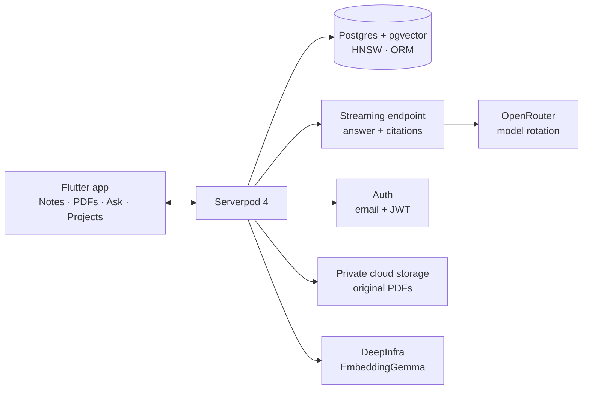

# 🎬 데모 영상 대본 (2분)

> **작성일**: 2026-10-15 00:35 KST · **최종 수정**: 2026-10-15 00:35 KST
> **관련 문서**: [README](../../README.md) · [devlog 007](../devlog/007-cloud-deploy-and-model-rotation.md) · [devlog 008](../devlog/008-notes-feature.md) · [ADR 010](../adr/010-acl-in-query.md) · [ADR 014](../adr/014-model-catalog-and-rotation.md) · [ADR 015](../adr/015-product-scope-notes-and-pdfs.md) · [후속 기능 명세 (005)](005-follow-up-spec.md)
> **표기**: ✅ 코드·문서로 확인 · ⚠️ 미확인/촬영 전 점검 필요
> **언어**: 문서는 한국어, **내레이션은 영어** (해외 심사위원용). 앱 UI 문구는 한국어이므로 화면에 보이는 한글은 내레이션에서 영어로 풀어 말한다.

해커톤 제출용 **2분 데모 영상** 대본입니다. 데모 대상은 Serverpod Cloud 배포본 <https://pageblink.serverpod.space> 입니다.

## 1. 한눈에

| 항목 | 값 |
|---|---|
| 길이 | 2:00 이내 (목표 1:55 내외) |
| 한 줄 메시지 | **Ask your notes & documents. Blink to the source.** |
| 보여줄 흐름 | 문제 제기 → 로그인 → 노트 작성 → PDF 업로드(계층 선택) → 질문 → ⚡ 인용으로 출처 점프 → 프로젝트 공유 → 아키텍처 → 마무리 |
| 영상 언어 | 내레이션 영어, 화면 UI는 한국어 (자막으로 영어 보조 권장) |
| 데모 환경 | 웹 앱 (Cloud). 기본 모델은 OpenRouter **무료** 모델이라 프롬프트가 기록될 수 있음 → **공개 PDF만 사용** ([ADR 014](../adr/014-model-catalog-and-rotation.md)) |

## 2. 대본 (타임라인)

내레이션은 초당 약 2.3단어 기준으로 길이를 맞췄습니다. ⚠️ 실제 녹음 후 길이를 재서 조정하세요.

| 시간 | 화면 | 내레이션 (EN) | 보여줄 포인트 |
|---|---|---|---|
| 0:00–0:12 | 흩어진 노트 앱·PDF 폴더 컷 → 빠르게 PageBlink 로고/타이틀 | "Our notes live in one app, our PDFs in another. And when we ask an AI, the answer comes with no source we can check. PageBlink fixes that." | 문제: 노트와 PDF가 흩어짐 + 출처 없는 AI 답변. 마지막에 제품명 등장 |
| 0:12–0:20 | 로그인 화면 → 이메일 로그인 → 메인 화면 진입 | "Sign in with email, and you land on a Keep-style board." | 이메일 로그인(`serverpod_auth_idp`). 계정은 **미리 생성**해 두고 로그인만 보여줌 |
| 0:20–0:38 | "노트" 탭 카드 그리드 → "새 노트" FAB → 마크다운 노트 작성(제목, 체크박스 `- [ ]` 한두 줄) → 미리보기 토글 → 뒤로 가기(저장) | "Write a quick Markdown note — a title, a checklist. Preview it, go back, and it's saved. Behind the scenes, the note is chunked and embedded, so it is searchable like any document." | Keep 스타일 카드 그리드, 툴바(체크박스), 미리보기, **뒤로 가면 저장** ✅. 저장 시 재인덱싱 ✅. ⚠️ 미리보기에서 체크박스 토글은 불가(알려진 제한)이므로 토글은 시도하지 않음 |
| 0:38–0:55 | PDF FAB → 파일 선택(공개 PDF) → **계층 선택 시트**(Cloak · My cloud · Shared Vision project) → "My cloud" 선택 → 업로드 완료 → PDF 카드가 그리드에 추가 | "Now upload a public PDF. Pick a privacy tier: Cloak, device-only, is coming soon. My cloud keeps it private to you. Shared Vision shares it with a project team. Text is extracted on-device; only text goes to the server." | 계층 시트 3종: Cloak은 "곧 지원"(비활성) ✅, 나머지 두 개 선택 가능. 앱에서 페이지별 텍스트 추출(`pdfrx`) ✅. 원본 PDF는 비공개 스토리지에 저장 ✅ ([devlog 008](../devlog/008-notes-feature.md)). ⚠️ 웹에서 스토리지 업로드 CORS는 확인 필요 → 촬영 전 리허설 필수 |
| 0:55–1:15 | "질문" 탭 ⚠️(실제 탭 이름 확인) → **모델 선택기** 열기(무료 모델 목록, 자동 선택) → 노트와 PDF 모두에 걸치는 질문 입력 → 답변이 토큰 단위로 스트리밍 + `[n]` 마커 + ⚡ 칩 등장 | "In the Ask tab, choose a model — free OpenRouter models are the default, and the server rotates to the next one automatically if a model is congested. Ask a question that spans my note and the PDF. The answer streams in, with a lightning-bolt citation for every source." | 모델 선택기(7개 카탈로그 중 무료 5개) ✅, 장애 시 **스트리밍 전** 자동 로테이션 ✅ ([ADR 014](../adr/014-model-catalog-and-rotation.md)). 답변 하단에 어떤 모델이 답했는지 표시 ✅. 질문 하나가 노트 인용과 PDF 인용을 **둘 다** 만들도록 리허설로 질문 확정 |
| 1:15–1:30 | ⚡ PDF 칩 탭 → PDF 뷰어가 인용 페이지로 점프(인용 구절 표시) → 뒤로 → ⚡ 노트 칩 탭 → 노트 편집 화면 상단에 인용 구절 | "Tap a bolt, and the app blinks to the exact page of the PDF. Tap the note's bolt, and it opens the note with the quote shown on top. Every claim is one tap from its source." | **핵심 장면**. PDF는 해당 페이지로, 노트는 편집 화면(인용 구절이 상단 배너) ✅. ⚠️ 본문 안 하이라이트는 아님. 서버에 저장된 원본을 뷰어가 가져옴 ✅(다른 기기 시나리오 검증은 확인 필요) |
| 1:30–1:42 | "프로젝트" 탭 → 프로젝트 생성 → 이메일로 멤버 초대 → 문서를 Shared Vision(프로젝트)으로 올린 카드 | "Create a project and invite a teammate by email. Shared Vision documents are searchable by the whole team, and access control is enforced on the server, inside the vector query itself." | 프로젝트 생성 + 이메일 초대(소유자만, UI는 editor로 초대) ✅. ACL이 벡터 검색 쿼리 `WHERE` 안에 있음 ✅ ([ADR 010](../adr/010-acl-in-query.md)). 초대받은 계정 화면 전환은 시간상 생략 가능 |
| 1:42–1:53 | **아키텍처 슬라이드** (아래 §3 다이어그램을 정적 이미지로) | "Under the hood it's Flutter talking to Serverpod: the ORM with pgvector and an HNSW index, a streaming endpoint for answers, built-in auth, cloud storage for the original PDFs — all deployed on Serverpod Cloud." | Flutter ↔ Serverpod: ORM + pgvector HNSW ✅, 스트리밍 엔드포인트 ✅, 인증 ✅, 비공개 클라우드 스토리지 ✅, Serverpod Cloud 배포 ✅ |
| 1:53–2:00 | 타이틀 카드: 로고 + 태그라인 + URL | "PageBlink. Ask your notes and documents. Blink to the source." | 태그라인 + <https://pageblink.serverpod.space> 를 2초 이상 노출. 2:00 넘기지 않기 |

### 구간별 길이 요약

| 구간 | 길이 |
|---|---|
| 훅 | 12초 |
| 로그인 | 8초 |
| 노트 | 18초 |
| PDF 업로드 + 계층 | 17초 |
| 질문 + 모델 | 20초 |
| 인용 점프 | 15초 |
| 프로젝트 | 12초 |
| 아키텍처 | 11초 |
| 마무리 | 7초 |
| **합계** | **120초 (2:00)** ⚠️ 여유가 없음. 내레이션이 길면 프로젝트/로그인 구간부터 줄인다 |

## 3. 아키텍처 슬라이드 (1:42–1:53)

README의 아키텍처 그림을 단순화해 정적 이미지로 사용합니다. 내레이션과 같은 순서로 위에서 아래로 짚습니다.

- ✅ 위 구성요소는 모두 README·devlog에 기록된 것이다.
- ⚠️ 슬라이드에 숫자(지연 시간, 정확도 등)를 넣지 않는다. 측정 기록이 없다.

## 4. 시연 준비 (촬영 전 데이터)

| 준비물 | 내용 |
|---|---|
| 계정 | 데모 계정 + 초대 대상 계정 **미리 생성** (가입 비밀번호 규칙: 12–50자, 소문자 + 숫자, 대문자 또는 특수문자) |
| PDF | 공개 문서 한 개, 짧게(약 10쪽). 질문 답이 PDF의 특정 페이지에 있어야 점프가 눈에 띔 |
| 노트 | PDF 주제와 연결되는 짧은 노트(체크박스 포함). 노트 내용 + PDF 내용을 함께 써야 답이 나오는 질문을 미리 정함 |
| 질문 | 노트 인용과 PDF 인용이 **둘 다** 나오는 질문 1개 (리허설로 확정, 문구는 확인 필요) |
| 프로젝트 | 미리 만들지 말고 영상 중 생성하거나, 시간이 부족하면 미리 만든 프로젝트를 보여줌 |

## 5. 촬영 체크리스트

- [ ] **공개 PDF만** 사용 (무료 모델이 프롬프트를 기록할 수 있음, [ADR 014](../adr/014-model-catalog-and-rotation.md))
- [ ] 계정 **미리 생성**, 영상에서는 로그인만
- [ ] PDF는 **짧게(약 10쪽)**: 업로드·인덱싱 대기 시간을 줄임
- [ ] 브라우저 **줌 조정** (글자가 작아 보이지 않게, 예: 125% ⚠️ 실제 값은 리허설에서 결정), 불필요한 탭·북마크 바·알림 숨김
- [ ] **1080p** 로 녹화 (1920×1080)
- [ ] 총 길이 **2:00 미만** 유지, 편집으로 업로드·로딩 대기 구간 컷
- [ ] 리허설 1회 이상: 웹에서 PDF 업로드가 실제로 성공하는지(스토리지 CORS 확인 필요), 질문 한 개로 노트 + PDF 인용이 모두 나오는지, 무료 모델 쿼터(계정당 일 50회, 분당 20회 ⚠️ README 기록값) 소진 여부
- [ ] 모델 선택기에서 무료 모델이 보이는지 확인 (로테이션은 실패 상황을 연출하지 않고 설명만)
- [ ] 마이크 테스트, 내레이션은 별도 녹음 후 합성해도 됨
- [ ] 마지막 컷에 태그라인과 URL 표시

## 6. 업로드/제출 체크리스트

- [ ] YouTube에 **일부 공개(unlisted)** 로 업로드
- [ ] 링크를 [README](../../README.md) `Live demo` 표의 **Demo video** 행에 넣음 (현재 "link to be added (확인 필요)")
- [ ] README의 Live demo 문단 갱신: 노트 기능 Cloud 배포 완료([devlog 008](../devlog/008-notes-feature.md))와 Cloud E2E 결과를 반영 ⚠️ E2E는 사용자 확인 후에만 ✅ 로 표기
- [ ] README의 "원본 PDF는 업로드한 기기에만" 제한 문구가 최신 구현(서버 저장)과 맞는지 확인 (확인 필요)
- [ ] 저장소 **public** 확인
- [ ] <https://pageblink.serverpod.space> 와 API가 영상 공개 시점에 응답하는지 확인
- [ ] 제출 양식 필드: **확인 필요** (필드 이름·필수 여부·마감 시각은 [research 004](../research/004-hackathon-deadline.md) 및 공식 안내 확인)
- [ ] 제출 완료 후 [devlog](../devlog/README.md)에 새 번호로 기록 (영상 링크, 제출 시각 KST)

## 7. 변경 이력

- `2026-10-15 00:35` 최초 작성 (README·devlog 008·ADR 기록 기준. 실제 UI 탭 이름과 녹음 길이는 확인 필요)
