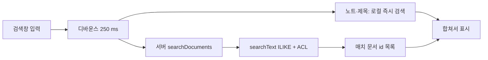

# 🔍 PDF·노트 검색용 컬럼(`searchText`) 수정 계획

> **작성일**: 2026-10-15 16:00 KST · **최종 수정**: 2026-10-15 16:00 KST
> **관련 문서**: [후속 기능 명세 (005)](005-follow-up-spec.md) · [기술 스택 (003)](003-tech-stack-and-prep.md) · [인수인계 (012)](012-session-handoff.md) · [폼 입력란 폴백 (011)](011-pdf-form-field-fallback.md) · [ADR 003 (PDF 텍스트는 클라이언트 추출)](../adr/003-pdf-extract-on-client.md) · [ADR 010 (ACL은 쿼리 안에서)](../adr/010-acl-in-query.md) · [research 025 (PDF 업로드)](../research/025-pdf-drag-drop-upload.md) · [UI polish 명세](../design/ui-polish/spec.md)
> **표기**: ✅ 확인(저장소·세션에서 확인한 사실) · ⚠️ 미확인/미정
> **상태**: 계획 (구현 전). 코드·DB·서버는 이 문서 작성 중 수정하지 않았습니다.

문서 목록 검색창에서 **PDF 본문을 검색할 수 없는 문제**를, 전문 저장 없이 "주요 텍스트만 추출한 검색용 컬럼"으로 푸는 계획입니다. 세션을 닫고 다시 열어도 이 문서만으로 이어서 작업할 수 있게 썼습니다.

---

## 1. 배경 (✅ 확인된 사실)

### 1-1. 본문 검색이 안 되는 이유

| 대상 | 클라이언트가 가진 것 | 검색 결과 |
|---|---|---|
| 노트 | `Document.body` (마크다운 전문) | 제목·본문 모두 `contains` 가능 |
| PDF | `Document.body == null`. 쪽별 텍스트는 서버 `DocPage` 테이블에만 있음 (`document_endpoint.dart`의 `_index`가 저장) | **제목만** 검색 가능, 본문 검색 불가 |

- 검색창 로직은 `app/pageblink_flutter/lib/features/documents/documents_screen.dart`의 `_visible()`이며, `title`과 `body`만 `contains`로 비교합니다 ✅.
- `DocPage`는 "실패·오래된 문서를 재업로드 없이 재색인하려고" 쪽별 원문을 보관하는 테이블입니다 (`doc_page.spy.yaml` ✅).

### 1-2. 같이 발견된 제목 검색 버그 (NFD/NFC)

- **원인**: macOS 파일명은 NFD(자모 분리)로 저장됩니다. 예: `부산 여행 계획.pdf`는 코드 유닛 21개(NFD) vs 12개(NFC). IME 입력은 NFC라서 `contains`가 불일치했습니다. 노트는 직접 타이핑한 제목이라 NFC입니다 ✅.
- **수정**: 별도 에이전트가 진행했고 **작업 트리에 미커밋** 상태입니다 ✅ (`git status` 확인).

| 구분 | 파일 |
|---|---|
| 신규 (클라이언트) | `app/pageblink_flutter/lib/app/text_norm.dart` |
| 신규 (서버) | `app/pageblink_server/lib/src/rag/text_norm.dart` (클라이언트와 쌍둥이, 동기화 유지) |
| 신규 (테스트) | `app/pageblink_flutter/test/text_norm_test.dart`, `app/pageblink_flutter/test/documents_search_nfc_test.dart`, `app/pageblink_server/test/unit/text_norm_test.dart` |
| 수정 | `documents_screen.dart`, `upload_service.dart`, `app/pageblink_server/lib/src/rag_endpoints/document_endpoint.dart` |

- 현재 `nfc()`의 범위는 **한글 conjoining jamo → 완성형 음절** 조합입니다 (호환 자모·라틴 결합 문자는 그대로) ✅ (`text_norm.dart` 주석).
- 이 수정의 **검증·커밋·배포 상태: 확인 필요 ⚠️** → [012 체크리스트 ①](012-session-handoff.md#3-이어서-할-일-체크리스트-우선순위-순)에서 추적합니다.
- **이 계획은 위 NFC 수정 위에 올라갑니다.** `searchText`를 만들 때 서버 `nfc()`를 재사용합니다.

---

## 2. 설계

사용자 방향: **"전문을 과하게 하지 말고 주요 텍스트만 추출해 검색용 컬럼으로 보관"**.

### 2-1. 컬럼

| 항목 | 값 |
|---|---|
| 이름 | `Document.searchText` (`String?`) |
| 계산 시점 | 색인·재색인 때 서버가 계산 (`_index` 안, `DocPage` 저장과 같은 트랜잭션 흐름 ⚠️ 구현 시 확인) |
| 내용 | **제목 + 첫 쪽 앞 약 1,500자 + 이후 쪽마다 앞 150자** (합계 약 3 KB 상한) |
| 정규화 | 전부 NFC + 소문자 |
| 노트 | 본문 앞부분에 같은 규칙 (쪽이 1개뿐이므로 "제목 + 본문 앞 약 1,500자") |
| 선정 방식 | 위치 기반 휴리스틱. NLP·요약 없음 |

- 산술: 제목을 제외하고 1,500 + 150 × (쪽수 − 1)이 3,000자를 넘지 않는 범위는 **약 11쪽까지**입니다. 이후 쪽은 상한에서 잘립니다 (계산값, 구현 시 상한 처리 규칙 확정 필요).
- ⚠️ **상한 단위 미정**: "약 3 KB"를 글자 수로 볼지 바이트로 볼지 정해야 합니다. UTF-8에서 한글은 글자당 3바이트라 3,000자 ≈ 9 KB입니다. 기본 제안: **3,000자(글자 수) 상한**, 바이트는 부수적 결과로 둠.

### 2-2. 검색 흐름

| 항목 | 설계 |
|---|---|
| 서버 API | `searchDocuments(query)` — `searchText`를 `ILIKE '%…%'`로 조회 |
| 접근 제어 | 기존 `list()`와 **동일 규칙**: 본인 소유 개인 문서 + `Acl.memberProjectIds` 프로젝트 문서 (조건을 쿼리 안에 넣음, [ADR 010](../adr/010-acl-in-query.md)). 쓰기/읽기 권한 규칙은 `list`·`_requireWrite`와 같음 |
| 입력 처리 | 쿼리를 서버에서도 `nfc()` + 소문자화. `%`·`_`·`\` 이스케이프 필수 |
| 반환 | 매치 문서 `id` 목록(+ 필요 시 상한 N건) — 클라이언트가 이미 가진 목록과 병합 |
| 클라이언트 | 디바운스 250 ms. 노트는 지금처럼 **로컬 즉시 검색**, PDF 매치는 서버 결과를 합쳐 표시. 빈 쿼리는 서버 호출 안 함 |
| 응답 크기 | `searchText`는 **목록 응답에 싣지 않음** |

### 2-3. "목록 응답에 싣지 않기" 구현 후보 (⚠️ 구현 전 확인)

| 후보 | 방법 | 장단점 |
|---|---|---|
| A (우선) | `document.spy.yaml`에서 필드를 서버 전용 스코프로 선언 (Serverpod 필드 `scope=serverOnly`) | 컬럼 1개, 마이그레이션 단순. ⚠️ 4.0.4에서 table 모델 + serverOnly 조합 동작·생성 클라이언트에서 빠지는지 확인 필요 |
| B | 별도 테이블 `document_search(documentId, text)` | 목록 응답 영향 0, 인덱스 분리 쉬움. 모델·조인이 늘어남 |

### 2-4. 인덱스

- 초기: **인덱스 없이 `ILIKE`** (문서 수가 적은 해커톤 규모).
- 문서가 많아지면 `pg_trgm` GIN 인덱스(한글 부분 일치 대응). ⚠️ Serverpod 마이그레이션에서 확장(`CREATE EXTENSION pg_trgm`)·GIN 인덱스를 어떻게 표현할지 미확인 — 필요해지면 수동 편집 가능한 `migration.sql` 예외 규칙(`app/AGENTS.md`)을 따를 것.

### 2-5. 마이그레이션·백필

- Serverpod 모델 변경 → `serverpod generate` + 마이그레이션 (`create_migration`). Cloud는 배포마다 적용됩니다 ✅ (배포 파이프라인 pre_deploy가 `serverpod generate` 수행, [012](012-session-handoff.md) 참조).
- 새 컬럼은 `String?`(널 허용) 추가 → 비파괴 변경으로 기대 ⚠️ (생성된 SQL 확인 필요).
- 기존 행은 `searchText`가 null입니다 → **백필 단계 필요**.

| 백필 방식 | 설명 | 상태 |
|---|---|---|
| 점진 백필 | 앱 기동·목록 조회 시 null인 문서만 서버가 계산해 채움 | ⚠️ 미정 |
| 일회성 엔드포인트 | 관리용 엔드포인트 1회 호출로 전체 계산 | ⚠️ 미정 |

- 백필 입력은 **이미 서버에 있는 `DocPage` 원문(PDF)과 `Document.body`(노트)** 로 충분하므로, 재업로드·재임베딩이 필요 없습니다 (`DocPage`가 재색인용 원문을 보관하는 구조 ✅ 로 추론).

### 2-6. 후속 확장 (이번 범위 아님)

| 항목 | 내용 |
|---|---|
| LLM 요약 합치기 | 요약문을 `searchText`에 덧붙여 의미 단위 검색 보강 |
| 쪽 이동 스니펫 UI | 카드에 `p.3 · …매치 문장…`, 클릭 시 뷰어의 해당 쪽으로 이동. 뷰어 `PdfPageView`는 쪽 지정을 지원 ✅ |
| 뷰어 내 검색(선택) | pdfrx `PdfTextSearcher` 사용. ⚠️ API 도입 전 pdfrx 2.6.5 기준으로 확인 |

---

## 3. 작업 분해

| # | 작업 | 위치 | 선행 |
|---|---|---|---|
| S-0 | NFC 수정 검증·커밋·배포 (이 계획의 선행 조건) | 작업 트리 → [012 ①](012-session-handoff.md) | – |
| S-1 | `searchText` 순수 함수: (제목, 쪽 목록 or 노트 본문) → 문자열 (NFC·소문자·상한) | `app/pageblink_server/lib/src/rag/` | S-0 |
| S-2 | 모델 필드 추가 + `serverpod generate` + 마이그레이션 | `document.spy.yaml` | S-1 |
| S-3 | `_index`에서 `searchText` 계산·저장 (업로드·노트 저장·재색인 경로 모두) | `document_endpoint.dart` | S-2 |
| S-4 | `searchDocuments(query)` 엔드포인트 (ACL·이스케이프·상한) | `document_endpoint.dart` | S-2 |
| S-5 | 백필 (방식 결정 후) | 서버 | S-3 |
| S-6 | 클라이언트: 디바운스 250 ms, 서버 결과 병합, 매치 문서 표시 | `documents_screen.dart` | S-4 |
| S-7 | 테스트 (§5) | 서버·클라이언트 | S-1~S-6 |
| S-8 | 배포·라이브 확인 (§6) | – | S-7 |

> 생성 코드(`lib/src/generated/`, `pageblink_client`)는 직접 수정하지 않습니다. 모델·엔드포인트만 고치고 생성기를 돌립니다 ([`app/AGENTS.md`](../../app/AGENTS.md)).

---

## 4. 수용 기준

| # | 기준 | 확인 방법 |
|---|---|---|
| A-1 | 본문에만 있는 단어(예: 첫 쪽 앞부분의 단어)로 검색하면 해당 PDF 카드가 나타남 | 위젯·서버 테스트 + 라이브 수동 |
| A-2 | NFD 파일명 PDF가 NFC(IME) 입력으로 제목·본문 모두 매치됨 | 단위 테스트 (`부산 여행 계획`) |
| A-3 | 다른 사용자의 개인 문서·비멤버 프로젝트 문서는 결과에 나오지 않음 | 서버 ACL 테스트 |
| A-4 | 목록 응답 크기가 `searchText` 추가 전과 같음 (필드가 응답에 없음) | 응답 직렬화 확인 |
| A-5 | 입력 중 요청은 디바운스 250 ms로 묶임, 빈 쿼리는 서버 호출 없음 | 위젯 테스트 |
| A-6 | `%`·`_` 포함 쿼리가 와일드카드로 동작하지 않음 | 서버 테스트 |
| A-7 | 백필 후 기존 PDF도 검색됨 | 라이브 수동 |
| A-8 | 노트는 지금처럼 로컬 즉시 검색됨 (회귀 없음) | 기존 위젯 테스트 |

---

## 5. 테스트 계획

| 층 | 대상 | 내용 |
|---|---|---|
| 서버 단위 (순수 함수, DB 불필요) | S-1 `searchText` 빌더 | 제목 포함, 첫 쪽 1,500자·이후 150자 경계, 상한 잘림, NFD→NFC·소문자, 빈 쪽 건너뜀, 노트 규칙, 이모지·서로게이트 쌍 중간 절단 방지 |
| 서버 통합 (`dart test`, 내장 PostgreSQL) | S-4 `searchDocuments` | ILIKE 매치, ACL(개인·프로젝트·비멤버), 이스케이프, 상한, `searchText` null 문서 |
| 클라이언트 위젯 (`flutter test`) | `documents_screen.dart` | 디바운스, 로컬+서버 병합, 매치 없음 메시지, 필터와의 조합 |
| 기존 회귀 | 기존 클라이언트 테스트 전체 | 마지막 보고 기준 전체 1,102개 통과 ✅ (NFC 테스트 추가분 포함 여부 ⚠️ 확인 필요) |

검증은 **깨끗한 워크트리**에서 합니다 (절차: [012 §2](012-session-handoff.md#2-작업-방식-하네스)).

---

## 6. 위험과 롤아웃

### 6-1. 위험

| 위험 | 영향 | 완화 |
|---|---|---|
| 응답 크기 증가 | `searchText`가 목록에 실리면 카드 수 × 3 KB 이상 | 서버 전용 필드 또는 별도 테이블 (§2-3), 검색은 id 목록만 반환 |
| 한글 `ILIKE` 성능 | 선행 와일드카드는 B-tree 불가 → 전체 스캔 | 초기 규모에선 허용, 커지면 `pg_trgm` GIN (§2-4) ⚠️ 규모 측정 안 함 |
| 백필 누락 | 기존 PDF가 검색에 안 잡힘 | S-5 + A-7. 누락 문서는 재색인으로도 채워짐 |
| "주요 텍스트" 휴리스틱의 한계 | 6쪽 이후 중간부 단어는 못 찾음 | 사용자 방향에 따른 의도된 트레이드오프. 확장 여지: 요약 합치기 (§2-6) |
| 상한 단위 모호 | 바이트로 해석하면 한글 1,000자만 저장 | §2-1에서 글자 수로 확정 |
| NFC 범위 | 현재 `nfc()`는 한글 자모 조합만 처리 | 라틴 결합 문자(예: é 분해형)는 비매치 가능 — 필요 시 별도 결정 |
| 스캔본·폼 전용 PDF | `no_text`로 색인 거절되어 컬럼도 비어 있음 | 별개 문제 → [011](011-pdf-form-field-fallback.md) |

### 6-2. 롤아웃 (마이그레이션 주의)

| 단계 | 내용 |
|---|---|
| 1 | NFC 수정 먼저 배포 완료 (S-0) |
| 2 | 모델 필드 추가는 **널 허용 컬럼 추가만**: 생성된 `migration.sql`을 읽어 비파괴인지 확인 |
| 3 | 서버(마이그레이션 + 색인 계산 + 엔드포인트) 배포 → 이전 클라이언트는 새 엔드포인트를 모르므로 영향 없음, 새 클라이언트는 새 서버가 필요 ⚠️ 배포는 서버·웹이 한 번에 나가므로 사실상 동시 (확인 필요) |
| 4 | 백필 실행 → 라이브에서 PDF 본문 검색 확인 |
| 5 | 문제 시: 클라이언트는 서버 검색 실패를 무시하고 로컬 결과만 표시하도록 설계 (오류가 목록 표시를 막지 않게) |

배포·라이브 확인 절차는 [012 §2](012-session-handoff.md#2-작업-방식-하네스)를 따릅니다.

---

## 7. 열린 질문

| # | 질문 | 기본 제안 |
|---|---|---|
| Q1 | 상한을 글자 수/바이트 중 무엇으로? | 3,000자 |
| Q2 | 컬럼 숨김: serverOnly 필드 vs 별도 테이블 | serverOnly (확인 후) |
| Q3 | 백필: 점진 vs 일회성 엔드포인트 | ⚠️ 미정 |
| Q4 | 서버 결과에 매치 위치(쪽 번호)를 같이 줄지 | 이번 범위 밖 (스니펫 UI 때) |
| Q5 | 공유 프로젝트 문서의 검색 결과를 viewer 역할도 보나 | 기존 `list()`와 동일(멤버면 열람) |
