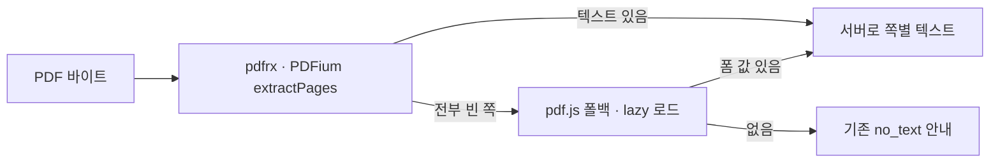

# 📝 폼 입력란 전용 PDF 텍스트 추출 폴백(pdf.js) 계획

> **작성일**: 2026-10-15 16:00 KST · **최종 수정**: 2026-10-15 16:00 KST
> **관련 문서**: [후속 기능 명세 (005)](005-follow-up-spec.md) · [검색 컬럼 계획 (010)](010-pdf-search-column.md) · [인수인계 (012)](012-session-handoff.md) · [ADR 003 (PDF 텍스트는 클라이언트 추출)](../adr/003-pdf-extract-on-client.md) · [research 025 (PDF 업로드)](../research/025-pdf-drag-drop-upload.md) · [UI polish 명세](../design/ui-polish/spec.md)
> **표기**: ✅ 확인(브라우저 하니스 재현 등) · ⚠️ 미확인/추정
> **상태**: 계획 (구현 전). **우선순위: 후순위 (P3)** — 폼 입력란에만 텍스트가 있는 PDF는 드뭅니다. 코드는 이 문서 작성 중 수정하지 않았습니다.

텍스트가 **AcroForm 입력란(위젯)에만** 들어 있는 PDF는 앱 엔진(PDFium)이 0자를 읽어 색인이 거절됩니다. 이때만 동작하는 **pdf.js 기반 폴백**을 추가하는 계획입니다.

---

## 1. 배경 (✅ 브라우저 하니스로 재현·확인)

### 1-1. 증상

| 항목 | 값 |
|---|---|
| 샘플 | `/Users/biyott/Documents/부산 여행 계획.pdf` (20,270 B) |
| 구조 | `/AcroForm` 1개, `/Widget` 객체, 텍스트 위젯 4개에만 텍스트. 본문 `/Contents`에는 텍스트 없음 ✅ |
| PyMuPDF | **537자** 읽음 ✅ |
| 앱 엔진 PDFium (pdfrx 2.6.5 / pdfrx_engine 0.6.1) | **0자** ✅ |
| 결과 | 색인 거절 `no_text`. 사용자 문구: "선택할 수 있는 텍스트를 찾지 못했어요. 스캔본이거나 텍스트가 입력란에만 있는 PDF일 수 있어요…" ✅ |

- pdfrx에는 **웹에서 폼 필드 값을 읽는 API가 없습니다**. `PdfAnnotation`은 링크 주석 메타만 제공합니다 ✅.

### 1-2. 대조군 (문제가 아닌 것)

| 파일 | 결과 | 비고 |
|---|---|---|
| `논문한글샘플양식.pdf` (한컴 PDF, Type3 폰트) | 엔진 초기화 후 **716자** 정상 추출 ✅ | 처음의 "Can't open this PDF"는 `pdfrxFlutterInitialize()` 호출 누락 때문이었음. 4차 배포에서 해결 ✅ |
| `부산 여행 계획 (텍스트).pdf` | PDFium **1,215자** ✅ | 본문 텍스트 |
| `Busan Weekend Trip Plan (text).pdf` | PDFium **2,594자** ✅ | 본문 텍스트 |

→ 엔진 자체는 정상이고, **"본문 텍스트가 없고 폼 값만 있는" 경우**만 비어 나옵니다.

### 1-3. 현재 코드 위치

- `app/pageblink_flutter/lib/features/documents/pdf_text.dart` — `ensurePdfEngine()`(= `pdfrxFlutterInitialize()`), `extractPages(bytes, name)`: 쪽마다 `loadStructuredText().fullText`를 모아 `PageText` 목록을 반환 ✅.
- `no_text` 판정은 서버 `document_endpoint.dart`의 `isNoTextFailure`(`_index`가 거절 시 `lastError: 'no_text'` 기록), 사용자 문구는 `app/pageblink_flutter/lib/app/l10n.dart` ✅.
- 아키텍처 원칙: **PDF 텍스트는 클라이언트에서 추출해 "텍스트만" 서버로** ([ADR 003](../adr/003-pdf-extract-on-client.md)).

---

## 2. 후보 비교 (이 용도 기준 순위)

| 순위 | 후보 | 라이선스 | 장점 | 단점·주의 | 판단 |
|---|---|---|---|---|---|
| 1 | **pdf.js** | Apache-2.0 | 견고·유지보수 활발. 폼 값과 쪽 텍스트 모두 | 더 무거움 (⚠️ 코어+워커 1 MB대, 미측정). 폴백 전용 lazy 로드라 부담 작음 | **채택 후보** |
| 2 | pdf-lib | MIT | 단일 UMD, 폼 API 단순 | ⚠️ 업데이트 정체, 특이 PDF에 약함 | 차선 |
| 3 | PDFium 함수 직접 (`FPDFAnnot_GetStringValue` 등) | – | 추가 번들 없음 | ⚠️ pdfrx 웹 빌드(WASM)가 해당 함수를 export하는지 미확인 | 확인되면 가장 가벼움 |
| – | `syncfusion_flutter_pdf` | 상용 커뮤니티 라이선스 | – | 라이선스 부담 | **비추** |
| – | 서버 추출 | – | – | 서버에 PDF 파서 없음. 원본(최대 50 MB) 업로드 필요, 메모리·타임아웃 영향. **"텍스트만 서버로" 아키텍처를 깸** | **비추** |

> 순위 3(PDFium 직접)은 export 여부만 확인되면 번들 증가가 없는 길입니다. 구현 착수 전 **짧은 스파이크**로 먼저 확인할 가치가 있습니다 (⚠️ 스파이크 결과 없음).

---

## 3. 구현 계획 (JS interop)

| # | 작업 | 위치·방법 |
|---|---|---|
| 1 | pdf.js 빌드를 **자체 호스팅** (CDN 금지) | `app/pageblink_flutter/web/vendor/pdfjs/` |
| 2 | 필요할 때만 동적 `import()` 로드하는 래퍼 | `lib/features/documents/pdfjs_forms.dart` — `dart:js_interop` + `package:web` |
| 3 | `getDocument({data})` → 쪽마다 `getAnnotations()` → `subtype == 'Widget' && fieldType == 'Tx'`의 `fieldValue`를 **쪽별 텍스트**로 | 같은 파일 |
| 4 | `pdf_text.dart`의 `extractPages`에서 **pdfrx 결과가 전부 빈 경우에만** 폴백 호출 | `pdf_text.dart` |
| 5 | 웹이 아닌 환경(테스트)은 조건부 import 스텁 | `pdfjs_forms_stub.dart` 등 |
| 6 | 라이선스 표기: pdf.js Apache-2.0 | ⚠️ 저장소 루트에 `NOTICE` 파일이 없음 — 새로 만들거나 README 라이선스 절에 표기 (확인 필요) |
| 7 | 서버 변경 **없음** | – |

세부 규칙:

- 폴백은 **텍스트 위젯(`Tx`)만** 대상. 체크박스·라디오는 제외 (값이 `Off`/`Yes` 등이라 검색·질의에 의미 없음).
- 값은 필드 이름이 아니라 **값만** 모아 쪽별 텍스트로 만듭니다 (필드 이름 포함 여부는 ⚠️ 구현 시 결정: "라벨: 값" 형태가 질의 품질에 유리할 수 있음).
- 폼 값은 쪽 번호(`pageNumber`)를 그대로 사용해 출처 인용이 쪽에 매핑되게 합니다.
- 폴백이 값을 못 찾으면 기존 `no_text` 안내를 그대로 표시합니다.

---

## 4. 수용 기준

| # | 기준 | 확인 방법 |
|---|---|---|
| A-1 | 샘플 `부산 여행 계획.pdf`가 색인되고(`ready`) 질문에 답함 | 라이브 또는 로컬 수동 + 하니스 |
| A-2 | **평소 PDF는 pdf.js를 내려받지 않음** | 브라우저 네트워크 탭에 `vendor/pdfjs` 요청 없음 |
| A-3 | 본문 텍스트 PDF 3종(`부산 여행 계획 (텍스트).pdf` 1,215자, `Busan Weekend Trip Plan (text).pdf` 2,594자, `논문한글샘플양식.pdf` 716자)의 추출 결과가 변하지 않음 | 하니스 회귀 |
| A-4 | 텍스트도 폼 값도 없는 PDF는 기존 `no_text` 안내를 유지 | 수동 |
| A-5 | 웹이 아닌 환경 테스트가 스텁으로 통과 | `flutter test` |
| A-6 | pdf.js 로드 실패(오프라인 등) 시 앱이 죽지 않고 `no_text` 안내로 귀결 | 수동 |

### 테스트 자산 (✅ 로컬 파일)

| 파일 | 용도 |
|---|---|
| `/Users/biyott/Documents/부산 여행 계획.pdf` | 폼 전용 — 폴백 대상 |
| `/Users/biyott/Documents/부산 여행 계획 (텍스트).pdf` | 본문 텍스트 — 폴백이 불리면 안 됨 (1,215자) |
| `/Users/biyott/Documents/Busan Weekend Trip Plan (text).pdf` | 본문 텍스트 (2,594자) |
| `/Users/biyott/Documents/논문한글샘플양식.pdf` | Type3 폰트 한컴 PDF (716자) |

> 위 경로는 사용자 로컬 파일이라 저장소에 없습니다. 다른 환경에서는 같은 구조의 PDF를 새로 만들어야 합니다 (⚠️ 샘플을 저장소에 둘지 미정, 개인 정보 포함 여부 확인 필요).

---

## 5. 위험과 열린 질문

| # | 항목 | 내용 | 상태 |
|---|---|---|---|
| R-1 | 워커 경로 | pdf.js는 `workerSrc` 경로가 필요. Flutter web의 base href·CDN 경로와 맞는지 | ⚠️ 미확인 |
| R-2 | ESM / CSP | 동적 `import()`로 ESM 빌드 로드 시 호스팅 MIME·CSP 헤더 | ⚠️ 미확인 |
| R-3 | 폼 값 ↔ 쪽 매핑 | 위젯의 소속 쪽을 `getAnnotations()` 호출 쪽 기준으로 삼아도 되는지 | ⚠️ 미확인 |
| R-4 | 서식 있는 필드 | `fieldValue`가 문자열이 아닌 배열·서식 문자열일 수 있음 (리치 텍스트 `/RV` 등) | ⚠️ 미확인 |
| R-5 | 체크박스·라디오 | 의미 없는 값 — 제외로 결정 | ✅ 결정 |
| R-6 | 번들 크기 | 코어+워커 1 MB대 추정. lazy라 첫 로드 무영향이지만 배포 산출물이 커짐 | ⚠️ 미측정 |
| R-7 | CDN 캐시 | 같은 URL의 작은 파일을 CDN이 `s-maxage 86400`으로 캐시한 경험 (FontManifest 지연). `vendor/pdfjs` 파일명에 버전을 넣어 갱신 문제 회피 | ✅ 경험 / 대응은 구현 시 |
| R-8 | 암호화된 폼 PDF | 비밀번호 PDF의 처리 | ⚠️ 미확인 |
| R-9 | PDFium 직접 호출 가능성 | §2 순위 3. 가능하면 번들 증가 없이 해결 | ⚠️ 스파이크 필요 |

---

## 6. 재현 방법 (브라우저 하니스)

PDF 추출 문제는 **브라우저 하니스**로 재현했습니다 ✅ (상세 구성은 [012 §2](012-session-handoff.md#2-작업-방식-하네스) (5)).

- 최소 Flutter 웹 앱(pdfrx 2.6.5)이 `pdfrxFlutterInitialize()` 전/후로 `PdfDocument.openData` + 쪽 텍스트를 `console.log`
- `node run.mjs`(playwright-core, 시스템 Chrome)가 headless로 로드
- 이전 세션 하니스 위치는 임시 scratchpad라 **사라졌을 수 있음 ⚠️** → 재구성 필요

폴백 구현 후에도 같은 하니스에서 A-1·A-3을 확인합니다.

---

## 7. 다음 할 일

1. (선택) PDFium 직접 호출 export 여부 스파이크 (R-9)
2. 스파이크가 불가하면 pdf.js 자체 호스팅 + `pdfjs_forms.dart` 구현 (§3)
3. 하니스 회귀 + 라이브 네트워크 탭 확인 (§4)
4. 결과를 devlog에 기록, 선택한 후보는 ADR로 남김 (ADR 003 보강 또는 신규)
