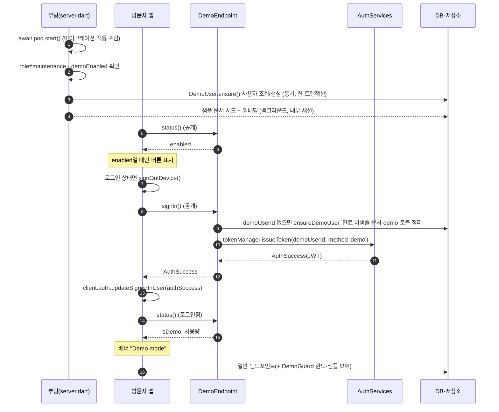

# 🎟️ 데모 체험 로그인(Demo account) 설계 명세

> **작성일**: 2026-10-16 09:06 KST · **최종 수정**: 2026-10-16 10:32 KST
> **관련 문서**: [ADR 020 (공유 demo 사용자)](../adr/020-demo-account-shared-user.md) · [research 026 (API 소스 검증)](../research/026-demo-account-api-verification.md) · [research 028 (언어별 demo 계정·SamplePack 조사)](../research/028-locale-samples.md) · [devlog 010 (구현·배포 기록)](../devlog/010-demo-account-implementation.md) · [첫 화면 기획 (007)](007-landing-sign-in.md) · [세션 인수인계 (012)](012-session-handoff.md) · [제품 범위 ADR 015](../adr/015-product-scope-notes-and-pdfs.md) · [ACL ADR 010](../adr/010-acl-in-query.md) · [`AGENTS.md`](../../AGENTS.md)
> **표기**: ✅ 코드·소스로 확인 · ⚠️ 미확인/구현 시 점검 필요
> **상태**: **배포 완료(8차, 2026-10-16, `c99822f`)** — 7차 `8445f02`(demo 계정) 뒤 샘플 노트·Ask 예시를 보강한 후속 배포 · 라이브 확인 ✅(§13), 브라우저 수동 확인(§12 체크리스트)만 ⚠️ 남음. §11 소스 검증 완료([research 026](../research/026-demo-account-api-verification.md)) · §10 값 확정(2026-10-16). 아래 §0~§10 본문은 구현 전 설계 시점의 서술이며, 배포 결과는 §8 하단(8차 구성)·§11 하단·§12·§13·§16에 기록합니다.
> **범위**: 서버 `app/pageblink_server`, 클라이언트 `app/pageblink_flutter`. 생성 코드(`lib/src/generated/`, `pageblink_client`)는 직접 수정하지 않습니다.

---

## 0. 한눈에 보기

| 항목 | 내용 |
|---|---|
| 한 줄 요약 | 로그인 카드의 `Try the demo`(KO `데모 체험하기`) 버튼 → 미리 만들어 둔 **demo 계정**으로 즉시 로그인 |
| 대상 | 로그인 전 방문자 — 주로 심사위원·첫 방문자 |
| 계정 성격 | **읽기 전용이 아님.** 일반 계정과 똑같이 동작(노트·PDF·Ask). 샘플 노트·PDF가 미리 들어 있을 뿐 |
| 만드는 한도 | 샘플을 제외한 문서 **최대 5개**(노트·PDF 합산) — §10 확정 |
| 켜는 법 | `demoEnabled` — **기본 꺼짐**. 운영 환경 설정으로 켠다. 꺼지면 시드·`signIn`·버튼이 모두 없음 |
| 프로비저닝 | **`await pod.start()` 뒤** 멱등 `DemoUser.ensure()` (사용자 동기, 샘플 시드 백그라운드) |
| 결정 근거 | [ADR 020](../adr/020-demo-account-shared-user.md) · 소스 검증 [research 026](../research/026-demo-account-api-verification.md) |
| 확정 현황 | §10 표의 값은 2026-10-16 확정(PM 위임). §11 체크리스트 8개는 검증 완료, 남은 ⚠️는 §11 하단 |
| 배포 현황 | ✅ 8차 배포 완료(`c99822f`: 데모 샘플 노트·Ask 예시 보강), 7차 `8445f02`(demo 계정 최초), 운영 플래그 켜짐, 라이브 확인 통과 — §13 · §13.3 · §16. ⚠️ 브라우저 수동 시나리오(U8)는 사용자 확인 대기 |

---

## 1. 목적 · 범위

방문자가 **가입 없이 5초 안에** 앱을 직접 써 보게 한다. 심사위원은 이메일 인증 코드를 받는 가입 절차를 건너뛰고 실제 노트 작성·PDF 질문·출처 이동을 확인할 수 있어야 한다.

| 구분 | 포함 | 제외 (이 문서에서 하지 않음) |
|---|---|---|
| 로그인 | 버튼 한 번으로 demo 계정 로그인, 이미 로그인된 경우 로그아웃 후 전환 | 방문자별 임시 계정(후속 후보, ADR 020 대안) |
| 콘텐츠 | 샘플 노트 2개(EN 1·KO 1) + PDF 1개 자동 시드 | 시드 본문 문구(구현 때 작성) |
| 제한 | 문서 생성 5개, 24시간 정리, 샘플 보호, Ask 일일 상한 | 결제·플랜·계정 승격(후속) |
| 표시 | 상단 `Demo mode` 배너, 한도 초과 시 가입 유도 | "읽기 전용" 문구(쓰지 않음 — 실제로 쓸 수 있으므로) |

원칙: 마케팅·안내 문구는 실제 동작과 일치해야 한다. demo 계정은 쓰기가 되므로 "읽기 전용"이라고 쓰지 않는다.

---

## 2. 알려진 한계 (공유 계정이라 생기는 일)

demo 계정은 **모든 방문자가 같은 하나의 계정**을 쓴다. 쓰기가 가능하므로 아래가 그대로 따라온다. 이 한계는 §10 확정의 전제다.

| # | 한계 | 영향 | 완화 |
|---|---|---|---|
| L1 | 다른 방문자가 만든 노트·PDF가 **서로 보인다** | 개인정보를 쓰면 노출 | 로그인 직후·배너에 "개인정보를 넣지 마세요" 안내, 24시간 정리 |
| L2 | 한도(문서 5개)가 **모든 방문자 합산** | 한 명이 슬롯을 채우면 다음 방문자가 못 만든다 | 비샘플 문서 24시간 후 삭제(§6.5) |
| L3 | 방문자가 서로의 문서를 지울 수 있다 | 시연 중 내 노트가 사라질 수 있음 | 샘플은 수정·삭제 불가, 사용자 문서는 24시간 수명을 안내 |
| L4 | Ask(LLM·임베딩) 비용이 한 계정에 몰린다 | 무료 모델 쿼터 소진 | demo 전체 일일 Ask 상한(§6.6) |
| L5 | Ask 카운터가 서버 메모리라 재시작·다중 인스턴스에서 어긋난다 | 상한이 느슨해질 수 있음 | 한계로 명시. 정확한 한도가 필요하면 후속으로 DB 카운터 |
| L6 | 로그인 엔드포인트가 공개(`requireLogin=false`)다 | 호출마다 토큰 발급 | 플래그 꺼짐 시 거부, 24시간 지난 demo 토큰 삭제(§6.5 · R1) |
| L7 | 공개된 인증 모듈 엔드포인트 `signOutAllDevices`로 한 방문자가 **모든 demo 세션을 끊을 수 있다** ⚠️ | 시연 중 로그아웃 | **허용 위험으로 기록**(R16). 막으려면 모듈 `StatusEndpoint` 확장 |

---

## 3. 사용자 흐름

```
[로그인 화면] ── status().enabled == true ──▶ 카드에 [Try the demo] 표시
      │                                        (false·호출 실패 → 버튼 숨김)
      ▼ 버튼 탭
[이미 로그인됨?] ── 예 ──▶ signOutDevice() 먼저
      │ 아니오
      ▼
DemoEndpoint.signIn() → JWT → updateSignedInUser → HomeShell 전환
      ▼
[홈] 상단 배너 "Demo mode" · 샘플 노트·PDF가 목록에 있음
      ▼ 노트·PDF 직접 만들기 / Ask 사용 (일반 계정과 동일)
      ▼ 6번째 문서 시도 또는 Ask 상한 초과 (DemoLimitException)
[안내] "가입하면 계속 쓸 수 있어요" + [가입하기] → 로그아웃 후 가입 폼
```

| 단계 | 사용자가 보는 것 | 서버가 하는 일 |
|---|---|---|
| 1. 진입 | 로그인 카드. 플래그가 켜진 경우에만 데모 버튼 | `status()`가 `enabled`를 돌려줌 |
| 2. 버튼 | 잠깐 로딩 후 홈 | `signIn()` → 사용자 보장 → 토큰 발급, 만료 문서·demo 토큰 정리 |
| 3. 사용 | 배너 + 일반 화면 | 일반 엔드포인트 + 한도 가드 |
| 4. 한도 | 안내 + 가입 버튼 | 가드가 `DemoLimitException`을 던짐 |
| 5. 전환 | 가입 폼 | 클라이언트가 로그아웃 |

---

## 4. 명칭

| 구분 | 이름 |
|---|---|
| UI 버튼 | EN `Try the demo` / KO `데모 체험하기` |
| 모드 배너 | EN `Demo mode` / KO `데모 모드` |
| 코드 | `DemoUser`, `demoUserId`, `DemoEndpoint`, `DemoStatus`, `DemoLimitException`, 토큰 method `'demo'`, 설정 `demoEnabled` |
| 시드 콘텐츠 | `sample` 접두 — 기존 `lib/src/sample/sample_note.dart`와 일관 (예: `sampleDemoNotes`). **노트 제목에는 `Sample · `/`샘플 · ` 접두를 쓰지 않음**(§8 D6) |
| 계정 이메일 | `demo@pageblink.invalid` — `.invalid`는 RFC 2606 예약 TLD라 메일이 도달하지 않음 |
| 쓰지 않는 말 | "test user" — QA 픽스처로 읽혀 공개 기능 이름으로 부적절 (ADR 020 대안 표) |

---

## 5. 구성요소와 변경 지점

경로는 2026-10-16 09:06 기준 저장소에서 확인했다(✅ 존재, 🆕 신규, ⚠️ 확인 못 함).

### 5.1 서버 (`app/pageblink_server`)

| 변경 | 파일 | 존재 | 내용 |
|---|---|---|---|
| 초기화 | `lib/server.dart` | ✅ | **`await pod.start();` 뒤**에 `bootDemo(pod)` 호출(던지지 않는 함수, `maintenance` 역할만 제외, 플래그 켜짐일 때만). 기존 `ServerpodCloudEmailIdpConfig(onAfterAccountCreated: seedSampleNote)`는 그대로 |
| 사용자 | `lib/src/demo/demo_user.dart` | 🆕 | `DemoUser.ensure()`(= `ensureDemoUser`), `demoUserId`(메모리), `isDemo(userId)` |
| 시드 | `lib/src/demo/sample_demo_content.dart` | 🆕 | 샘플 노트·PDF 정의, 표식 `contentHash` 목록. 기존 `sample/sample_note.dart`의 `sha256Hex`·`SampleNote` 패턴 재사용 |
| 샘플 PDF | `web/samples/pageblink-guide.pdf` | 🆕 | 커밋 대상. `web/`만 Dockerfile·`.scloudignore` 양쪽에서 포함 확인(research 026 §10) |
| 엔드포인트 | `lib/src/demo/demo_endpoint.dart` | 🆕 | `status()`, `signIn()` — 둘 다 `requireLogin => false` |
| 가드 | `lib/src/demo/demo_guard.dart` | 🆕 | 문서 한도(상수 하나)·샘플 보호·프로젝트 금지·Ask 상한 |
| 모델 | `lib/src/models/demo_status.spy.yaml` | 🆕 | `DemoStatus`(plain class). 필드 최종안은 구현 후 이 문서 갱신 |
| 예외 모델 | `lib/src/models/demo_limit_exception.spy.yaml`, `demo_limit_reason.spy.yaml` | 🆕 | `exception: DemoLimitException { reason, limit? }`, `enum: DemoLimitReason { noteLimit, askLimit, sampleLocked }` (§6.4) |
| 한도·샘플 보호 호출 | `lib/src/rag_endpoints/document_endpoint.dart` | ✅ | **4곳**: `_requireWrite`, `upload`(한도 + 재시도 경로), `saveNote` 신규(한도 + 표식 해시 본문 거부), `reindexFailed`(§6.4) |
| 프로젝트 금지 | `lib/src/rag_endpoints/project_endpoint.dart` | ✅ | `create`·`addMember`(대상이 demo)·`updateProject`·`deleteProject` |
| Ask 상한 | `lib/src/rag_endpoints/ask_endpoint.dart` | ✅ | `ask` 시작부 |
| 정리 | `lib/src/services/document_cleanup.dart` | ✅ | 기존 `deleteRows`·`deleteFiles` 재사용 + demo 리프레시 토큰 삭제 |

- **단일 관문 후보**: `Acl.requireUser`(`lib/src/services/acl.dart` ✅)는 `rag_endpoints/*`에서 호출이 많지만(ask 1 · document 9 · project 7 + 일부 `requireRole`) 읽기·쓰기를 가리지 않는다. 한도 가드는 `requireUser`를 바꾸지 말고 **쓰기 지점**에만 건다 — 읽기(목록·열람)는 그대로 열어 둔다.
- ⚠️ 엔드포인트 위치: 기존 엔드포인트가 `lib/src/auth/`, `lib/src/greetings/`, `lib/src/rag_endpoints/`에 흩어져 있어 `lib/src/demo/`에 둬도 생성기가 찾을 가능성이 높다. **`serverpod generate`로 최종 확인**(research 026 U5).
- 마이그레이션: `table:` 없는 모델(`answer_event`·`citation`·`page_text` 등)은 마이그레이션 대상이 아니라는 저장소 선례가 있어 `DemoStatus`·예외·enum도 불필요할 것(✅ 선례). ⚠️ `serverpod generate` 결과로 최종 확인.

### 5.2 클라이언트 (`app/pageblink_flutter`)

| 변경 | 파일 | 존재 | 내용 |
|---|---|---|---|
| 버튼 | `lib/screens/sign_in_screen.dart` | ✅ | `SignInCard`(폼 아래, 개인정보 안내 위) 또는 `_SignInScreenState`에서 `status()`를 한 번 호출, `enabled`일 때만 버튼. 이미 `client.auth.authInfoListenable`을 구독 중 ✅ |
| 배너 | `lib/main.dart` | ✅ | `HomeShell` 상단. 서버가 알려 준 `isDemo`로 표시(⚠️ 레이아웃은 구현 때 확인) |
| 문구 | `lib/app/l10n.dart` | ✅ | `_t('EN', 'KO')` 패턴으로 getter 추가 (§5.3) |
| 로그아웃 | `lib/main.dart`, `lib/features/settings/settings_screen.dart` | ✅ | 기존 `client.auth.signOutDevice()` 재사용 |
| 클라이언트 SDK | `pageblink_client` | ✅ | **자동 생성 — 수정 금지.** 엔드포인트 추가 후 `serverpod generate`로 갱신 |

- 클라이언트는 `assets/config.json`에서 `apiUrl`만 읽는다 ✅(`lib/client.dart`, 서버 `lib/src/web/routes/app_config_route.dart`가 `{'apiUrl': ...}`만 제공). 그래서 버튼 표시 여부는 설정 파일이 아니라 **공개 `DemoEndpoint.status()`** 로 받는다. 호출이 실패하면 버튼을 숨긴다(안전한 쪽).
- 로그인 직후 배너: 로컬 상태 대신 서버 응답을 쓰는 이유 — 새로고침·다른 탭에서도 같은 값이 나오고, 일반 계정으로는 절대 배너가 뜨지 않는다.
- 한도 예외 처리: 단발 호출은 `on DemoLimitException catch (e)`, `ask` 스트림은 `await for`의 오류로 같은 예외를 받는다(§6.4, §6.6).

### 5.3 추가할 문구 (제안)

버튼·배너는 확정, 나머지는 **제안**이다(⚠️ 검토).

| getter(안) | EN | KO | 확정 |
|---|---|---|---|
| `demoButton` | Try the demo | 데모 체험하기 | ✅ 확정 |
| `demoBanner` | Demo mode | 데모 모드 | ✅ 확정 |
| `demoBannerSignUp` | Sign up to keep your work | 가입하고 계속 쓰기 | 제안 |
| `demoPrivacyNote` | Everyone shares this account. Please don't enter personal information. Your items are removed after 24 hours. | 모두가 이 계정을 함께 써요. 개인정보는 넣지 마세요. 만든 항목은 24시간 뒤 삭제돼요. | 제안 |
| `demoLimitReached` | Sign up and keep going. | 가입하면 계속 쓸 수 있어요. | 한 줄 확정 문구 + 제안 |
| `demoAskLimitReached` | The demo's daily questions are used up. Sign up to keep asking. | 오늘 데모 질문 횟수를 다 썼어요. 가입하면 계속 물어볼 수 있어요. | 제안 |
| `demoSampleLocked` | Sample items can't be edited in demo mode. | 샘플 항목은 데모에서 수정할 수 없어요. | 제안 |

---

## 6. 서버 설계

### 6.1 활성화 플래그 `demoEnabled`

**기본 꺼짐.** 운영에서 환경 설정으로 켠다(사용자 요구: "우리 사이트는 env에서 켠다"). 꺼져 있으면:

| # | 꺼짐일 때 |
|---|---|
| ① | 사용자 생성·시드를 하지 않는다 |
| ② | `signIn()`을 거부한다 |
| ③ | `status().enabled == false` → **로그인 화면에 버튼이 보이지 않는다** |

플래그 출처 ([research 026 §5](../research/026-demo-account-api-verification.md)):

- ✅ 읽기 코드: `rag_services.dart`의 `_secret()`과 같은 순서(비밀번호 → 환경 변수). 부팅 때는 `pod.getPassword('demoEnabled') ?? Platform.environment['DEMO_ENABLED']`, 요청 처리 중에는 `session.passwords[...]`로 읽는다. `_secret`은 `private static`이라 새 헬퍼를 둔다(또는 공개로 바꿔 재사용). 값은 `'true'`·`'1'`을 받는다.
- ✅ **주입 방법은 둘 다 가능**(CLI `serverpod_cloud_cli-1.0.1` 소스 확인): 일반 환경 변수 `scloud variable set DEMO_ENABLED true`(비밀값이 아니므로 플래그에 자연스러움), 비밀번호 `scloud password set demoEnabled true`. 변수만 바꾸고 재시작은 `scloud deploy --redeploy`. 이전 문서의 "비밀값뿐"은 낡은 내용이었다.
- ⚠️ **Cloud 런타임에서의 주입 시점·방식은 확인하지 못했다**(`--redeploy`만으로 충분한지, 변수명 예약어 충돌). 사용자가 `scloud variable ...` 명령으로 확인한다(§11 항목 5).
- 로컬: `config/passwords.yaml`(git 제외 ✅) `development:` 아래 `demoEnabled: 'true'` — **따옴표 필수**(따옴표 없는 `true`는 `StateError`로 서버가 뜨지 않음 ✅).

### 6.2 `DemoUser.ensure()` — 멱등, 두 단계

**`await pod.start()` 뒤**에, 플래그가 켜져 있고 역할이 `maintenance`가 아닐 때만 호출한다(D1). 신규 DB의 마이그레이션 적용이 `start()` 안이라 앞에서 호출하면 `serverpod_auth_*` 테이블이 아직 없다(✅ research 026 §6.1). 두 단계로 나눈다.

| 단계 | 동작 | 방식 |
|---|---|---|
| A. 사용자 | 이메일 `demo@pageblink.invalid` 계정이 있으면 `authUserId` 재사용, 없으면 **한 트랜잭션**에서 `authUsers.create` + `createEmailAuthentication(password: null)` | **부팅 중 동기**(`pod.withSession`, 빠름). `demoUserId`를 메모리에 둠 |
| B. 샘플 시드 | 샘플 노트·PDF 삽입 + 임베딩 | **백그라운드**(`unawaited`, 부팅을 막지 않음). 세션은 **클로저 안에서** 열고 예외도 **안에서** 잡음(R12) |

- **역할 게이트**: `pod.config.role.name == 'maintenance'`만 제외한다. `monolith`·`serverless`는 요청을 받으므로 프로비저닝한다. Cloud가 어느 역할로 띄우는지는 ⚠️ 확인하지 못했다.
- **"이미 시드됨" 표식**: 시드 문서의 **특정 `contentHash`** 를 가진 문서가 demo 소유로 존재하는지 본다(`Document.contentHash`는 ✅ 기존 컬럼, 새 컬럼·테이블 없음). 문서별로 표식을 두어 일부만 빠졌을 때 빠진 것만 채운다.
- **중복·고아 방지**: AuthUser 생성과 이메일 계정 삽입을 한 트랜잭션에 넣어, 다중 인스턴스 동시 부팅에서 이메일 유니크 위반이 나면 AuthUser도 롤백한다(R13). 실패하면 **catch 후 재조회**한다. 문서 시드도 같은 `contentHash` 존재를 다시 확인한 뒤 삽입한다.
- **시드 방식 A (D4)**: 내부 세션에 `session.updateAuthenticated(AuthenticationInfo(demoId, {}, authId: 'demo-seed'))`로 demo 사용자 인증을 붙이고 기존 `DocumentEndpoint().saveNote(...)`·`upload(...)`를 호출한다. 색인·재시도 로직을 그대로 재사용하며 색인 핫패스(`_index`)를 건드리지 않는다. 시드 문서는 표식 해시라 한도 카운트에서 제외된다(⚠️ 테스트로 확인). 대안 B(`_index` 공용 클래스 추출)는 채택하지 않음.
- **재시도**: 시드 도중 서버가 종료되면 문서가 `indexing`으로 남고 `document.list`가 10분 뒤 `failed`로 바꾼다. 시드 루틴은 "표식 해시 행이 없으면 삽입+색인, 있는데 `ready`가 아니면 재색인"으로 멱등하게 쓴다. 방문자는 샘플을 재색인할 수 없으므로 서버 측 복구가 필요하다. ⚠️ 실제 재시도 동작은 서버 실행으로 확인하지 못함.
- `authUsers.create`로 만든 계정은 `onAfterAccountCreated: seedSampleNote` 훅을 **타지 않는다**(✅ 가입 이메일 경로 전용). 클라이언트가 앱 시작 시 부르는 `document.ensureSample`은 `seedHash`가 없으면 `null`을 돌려주고 끝나므로 demo에 영향이 없다(✅ 코드).
- `UserProfile`은 만들지 않는다(앱이 프로필 API를 쓰지 않음 ✅). ⚠️ 이후 프로필 화면을 붙이면 필요.
- ⚠️ `serverless` 역할로 뜨는 호스트라면 응답 뒤 백그라운드 시드가 CPU 제한을 받을 수 있다 — 그래서 `signIn`이 사용자 단계를 직접 보장한다(§6.3).

### 6.3 `DemoEndpoint`

```
DemoEndpoint (requireLogin => false)
├─ status()  → DemoStatus { enabled, isDemo, noteLimit, noteCount, ... }  (최종 필드는 구현 후 갱신)
└─ signIn()  → AuthSuccess
```

| 메서드 | 동작 |
|---|---|
| `status()` | 플래그와 (로그인돼 있으면) 현재 사용자가 demo인지, 사용량을 돌려줌. `enabled`는 `플래그 && (demoUserId != null \|\| 조회 성공)`으로 두어 사용자 생성이 실패한 환경에서는 버튼이 안 보이게 한다 |
| `signIn()` | ① 플래그 꺼짐 → 거부 ② **`demoUserId`가 없으면 재조회가 아니라 `ensureDemoUser`를 직접 호출**(멱등·경합 안전 — 부팅 헬퍼가 건너뛰거나 실패해도 데모가 죽지 않게, R11) ③ 만료된 비샘플 문서 + 24시간 지난 demo 리프레시 토큰 삭제 ④ `AuthServices.instance.tokenManager.issueToken(session, authUserId: demoUserId, method: 'demo', scopes: {})` |

- `issueToken`은 **이미 다른 사용자로 로그인된 호출자**가 다른 사용자의 토큰을 요청하면 `SignInWhileAuthenticatedException`을 던진다(✅ `serverpod_auth_core_server-4.0.4` `token_manager.dart`). 그래서 클라이언트가 먼저 `signOutDevice()`를 호출한다. `createToken`은 이 정책 검사를 건너뛰고 쿠키 모드에서 클라이언트가 `StateError`를 내므로 쓰지 않는다.
- 클라이언트는 받은 `AuthSuccess`를 `client.auth.updateSignedInUser(authSuccess)`로 세션에 등록한다(✅ 소스·컴파일 타입 검사 확인, research 026 §3. 앱에서의 실제 동작은 수동 시나리오 ⚠️).
- ✅ 쿠키 모드: 이 앱은 서버 `authCookie`가 주석 처리돼 있고 클라이언트 `cookieAuth`도 켜지 않아 항상 비쿠키다. 쿠키 모드가 켜져도 `issueToken` + `updateSignedInUser`가 정상 경로라 **설계 변경 없음**(research 026 §7).
- 참고 구현: 4.0.4에 내장된 `AnonymousIdp`가 같은 토큰 발급 형태를 쓴다.

### 6.4 쓰기 한도와 샘플 보호 (`DemoGuard`)

모두 `userId == demoUserId`일 때만 동작한다. 일반 계정은 영향을 받지 않는다. 한도 값은 **상수 하나**로 둔다(§10).

| 규칙 | 걸리는 곳 | 동작 |
|---|---|---|
| 문서 5개 한도 | `upload`, `saveNote`(`documentId == null`) | demo 소유 **비샘플** 문서 수가 한도 이상이면 `DemoLimitException(noteLimit, limit: 5)` |
| PDF도 같은 한도 | `upload` | 임베딩 비용 방어. 노트와 합산 |
| 샘플 수정·삭제·재색인 불가 | `_requireWrite`(`saveNote` 수정·`reindex`·`delete`·`pdfUploadDescription`·`confirmPdfUpload`가 거치는 기존 관문 ✅) | 문서의 `contentHash`가 샘플 표식이면 `DemoLimitException(sampleLocked)` |
| 프로젝트 불가 | `ProjectEndpoint.create`·`addMember`·`updateProject`·`deleteProject` | demo면 거부, `addMember` 대상이 demo여도 거부 |

**샘플 보호 4곳 (D3)** — `_requireWrite` 한 곳으로는 부족하다(research 026 §9.3):

| # | 곳 | 이유 |
|---|---|---|
| 1 | `_requireWrite` | 수정·재색인·삭제·PDF 업로드 확정 5개 호출자가 거치는 기존 관문 |
| 2 | `upload`의 **재시도 경로** | `existing`이 `failed`/`indexing`이면 방문자가 보낸 `pages`로 재색인한다 → 샘플 PDF가 `failed`일 때 덮어써질 수 있음(R-F). 시작부에서 표식 해시면 기존 행을 그대로 반환 |
| 3 | `saveNote` **신규**(`documentId == null`) | `_requireWrite`를 안 지남. 샘플과 같은 본문으로 만들면 `contentHash`가 표식과 같아 한도·정리를 피함(R-E). 표식 해시 본문이면 거부 + 한도 가드 |
| 4 | `reindexFailed` | `AccessDeniedException`만 잡으므로 새 예외가 호출 전체를 실패시킴. 목록에서 샘플을 제외하거나 새 예외도 잡는다 |

- "샘플인지"의 판별은 `contentHash ∈ 샘플 표식`이다(`bool isSample(String hash)`). 샘플은 수정할 수 없으므로 해시가 바뀌지 않는다.
- **한도 초과 예외 (D5)**: 기존 `AccessDeniedException`은 직렬화되지 않아 클라이언트가 HTTP 500만 본다. 그래서 새 직렬화 예외 `DemoLimitException`(reason: `noteLimit`/`askLimit`/`sampleLocked`, limit?)을 둔다. 서버가 `SerializableException`이면 HTTP 400 + 타입이 붙은 JSON으로 보내고, 클라이언트는 `on DemoLimitException catch (e)`로 받는다(✅ research 026 §11).
- 한도 검사와 삽입은 원자적이지 않아 동시 요청이면 1~2개 넘길 수 있다. 시연용으로 허용(⚠️ 필요 시 별도 판단).

### 6.5 정리 (24시간)

- 대상 1: demo 소유 **비샘플** 문서 중 `createdAt`이 24시간보다 오래된 것.
- 대상 2: **24시간 지난 demo 리프레시 토큰**(`method == 'demo'` & `createdAt < cutoff`). `signIn`마다 토큰 행이 쌓이고 만료 행은 자동 삭제되지 않기 때문이다(R14).
- 시점: **`signIn` 호출 시 + 서버 부팅 시.** Future Calls는 Growth 플랜이라 쓸 수 없다(✅ `README.md`: Future Calls "needs the Growth plan; the project is on Starter").
- 방법: 기존 `DocumentCleanup.deleteRows`(청크·페이지·문서)와 `deleteFiles`(저장된 PDF 원본)를 재사용 ✅. 삭제 대상이 많으면 한 트랜잭션으로 묶는다. 토큰은 `RefreshToken.db.deleteWhere`.
- 한계: 이미 로그인해 있는 방문자는 `signIn`을 다시 부르지 않으므로, 정리는 "다음 방문자가 들어올 때" 일어난다. 전역 토큰 수명(액세스 10분·리프레시 14일 슬라이딩)은 건드리지 않는다 — 일반 사용자에게 영향이 있고 demo만 따로 줄일 수 없다(✅ research 026 §8). 활성 방문자도 토큰 삭제 후 24시간 뒤 다음 리프레시에서 로그아웃된다(의도된 상한).

### 6.6 Ask 일일 상한

- demo 계정 **전체** 일일 **50회**(확정). 서버 메모리 카운터 — 재시작·인스턴스 분리 시 초기화되는 한계를 문서화한다(L5).
- 위치: `AskEndpoint.ask` 시작부. 초과 시 **같은 `DemoLimitException(askLimit)`을 스트림 오류로 전달**한다 → 클라이언트는 `await for`에서 한 종류로 처리하고 `demoAskLimitReached`와 가입 버튼을 보인다. ⚠️ 실제 스트림 오류 경로는 서버 실행으로 확인하지 못함(소스상 서버가 `SerializableException`을 스트림 오류 메시지로 보내고 클라이언트 스트림이 `addError` ✅).
- 기준 시각(UTC 자정인지 KST 자정인지)은 ⚠️ 구현 때 정한다.

---

## 7. 데이터 흐름



---

## 8. 시드 콘텐츠 구성

본문 문구는 이 문서에 쓰지 않는다(구현 때 작성). **구성만** 정한다(§10 확정).

| # | 종류 | 주제 | 언어 | 목적 |
|---|---|---|---|---|
| 1 | 노트 | PageBlink 사용 가이드 (자체 제작) | EN | 앱이 무엇인지·Ask 방법 |
| 2 | 노트 | PageBlink 사용 가이드 (자체 제작) | KO | 한국어 방문자용 |
| 3 | PDF | PageBlink 사용 가이드 (자체 제작) | EN, 한글 글꼴을 쓸 수 있으면 KO 병기 | PDF 질문·페이지 인용 체험 |

- 전부 **자체 제작 콘텐츠**라 저작권 문제가 없다.
- 노트 본문은 한 청크(900자) 안쪽으로 둔다 — 기존 `SampleNote`의 규칙 ✅(`sample_note.dart` 주석).
- **노트 제목에 `Sample · `/`샘플 · ` 접두를 쓰지 않는다 (D6)**: `lib/features/ask/ask_suggestions.dart`의 `sampleTitlePrefixes`로 질문 화면이 접두 제목 노트를 보면 "할 일 목록용 예시 질문"을 띄운다(✅ research 026 §9.4).
- **PDF 위치**: `app/pageblink_server/web/samples/pageblink-guide.pdf`(커밋). 공개 경로가 아니다(`/web`은 `web/static`만 마운트 ✅). 샘플 **텍스트**(페이지별)는 Dart 상수로 두고 PDF 바이너리는 뷰어용 원본이다 — 페이지 수·내용이 어긋나면 출처 칩의 페이지 번호가 틀어지므로 **같은 원본에서** 만든다.
- 원본 저장: `session.storage.storeFile(storageId: 'private', path: 'pdfs/<id>.pdf', ...)` 후 `storagePath`를 갱신(⚠️ 컴파일 확인 안 함). Cloud 빌드 이미지가 `web/samples/`를 포함하는지 ⚠️ 확인 못 함 — 대체: 시드를 **텍스트 전용**으로 두면 원본 뷰어가 없을 뿐 출처 칩은 동작한다.

### 8.1 8차 배포 후 실제 구성 (`c99822f`, 갱신)

위 표(§8)는 **구현 전 설계 기록**이라 그대로 둡니다. 8차에서 샘플 구성이 아래와 같이 바뀌었습니다. 본문 문구는 서버 `lib/src/demo/demo_samples.dart`가 정본입니다.

| # | 종류 | 제목 | 언어 | 비고 |
|---|---|---|---|---|
| 1 | 노트 | `PageBlink tour: try it in 5 minutes` | EN | 1청크 · 900자 미만 ✅ |
| 2 | 노트 | `Q4 launch plan` | EN | 1청크 · 900자 미만 ✅ |
| 3 | 노트 | `Weekly sync: week 3 of October` | EN | 1청크 · 900자 미만 ✅ |
| 4 | PDF | `PageBlink guide` | EN→KO 병기 | 7차와 동일(변경 없음) ✅ |

- 샘플은 노트 3개 + PDF 1개, 총 **4개**(§8 설계의 "노트 2개(EN 1·KO 1) + PDF 1개"에서 변경). 노트 구성은 KO 노트가 빠지고 영어 3개가 되었습니다.
- 7차의 옛 샘플 노트 2개(`Getting started with PageBlink`, `답변의 출처 따라가기`)는 `legacy` 해시 목록에 넣어 **시드 시 1회 정리**됩니다(라이브에서 삭제 확인 ✅).
- 데모 계정이면 Ask 예시 질문을 **데모 전용 4개만** 표시합니다(`demoSuggestions`, EN/KO). 일반 예시는 섞지 않습니다.
- 한도·보호 규칙(§10)은 바뀌지 않았습니다 ✅ (변경 9개 파일에 가드·설정 파일이 없음). 샘플은 계속 `contentHash` 표식으로 제외·잠금됩니다.
- ⚠️ 샘플 노트 본문에 연도가 없어, 한국어 질문(출시일·예산) 하나에서 모델이 노트에 없는 연도를 만들어 냈습니다(§13.3). 다음 샘플 변경 때 노트에 연도를 명시할 예정입니다.
- 언어별 demo 계정 분리·`SamplePack` 통합은 [research 028](../research/028-locale-samples.md)이 제안했고 구현 대기입니다(이 문서의 §0~§16에는 아직 반영하지 않음).

---

## 9. 에러 처리

| 상황 | 서버 | 클라이언트 |
|---|---|---|
| 플래그 꺼짐 | `status().enabled=false`, `signIn` 거부 | 버튼 숨김. 직접 호출·오래된 화면이면 일반 오류 안내 |
| `status()` 실패(네트워크 등) | – | 버튼 숨김(안전한 쪽) |
| 문서 한도(5개) 초과 | `DemoLimitException(noteLimit, limit: 5)` | `demoLimitReached` + [가입하기] |
| Ask 일일 상한 초과 | `DemoLimitException(askLimit)` 스트림 오류 | `demoAskLimitReached` + [가입하기] |
| 이미 다른 사용자로 로그인 | `SignInWhileAuthenticatedException`(✅) | 먼저 `signOutDevice()` 후 `signIn()` |
| demo 사용자 없음(시드 실패) | `signIn`이 `ensureDemoUser`를 직접 호출. 그래도 실패하면 오류 | 일반 오류 안내. 로그에 원인 |
| 샘플 수정·삭제 시도 | `DemoLimitException(sampleLocked)` | `demoSampleLocked` |
| 시드 임베딩 실패 | 문서 `failed` + 로그(클로저 안에서 잡음), 부팅은 계속 | 목록에서 실패 표시(기존 UI ✅), 다음 부팅·`signIn`에서 재시도 |

---

## 10. 확정 사항 (2026-10-16, PM 확정)

> **확정 경위**: 사용자가 "PM이 알아서 정하라"고 위임했고, 사용자에게 한 질문에 답이 없어 **PM(리드)이 추천 기본값으로 확정**했다. 사용자가 직접 고른 값이 아니므로, 바꾸고 싶으면 이 표를 고치고 상수를 바꾼다(한도는 상수 하나로 분리).

공유 계정이 쓰기 가능하다는 결과(§2)를 전제로 한다.

| # | 항목 | 확정 값 | 상태 |
|---|---|---|---|
| 1 | 5개 한도의 대상 | **샘플 제외 demo가 만든 문서** 수. **PDF 업로드 포함**(노트·PDF 합산). 값은 **상수 하나**로 분리. 초과 시 "가입하면 계속 쓸 수 있어요" | 확정 · 2026-10-16 |
| 2 | 한도의 성격 | **모든 방문자 합산**(공유 계정이라 불가피). 슬롯이 계속 차므로 정리 규칙(#3)이 필요 | 확정 · 2026-10-16 (#1에 포함) |
| 3 | 정리 | **샘플이 아닌 demo 문서는 생성 24시간 후 삭제** + **demo 리프레시 토큰 24시간 후 삭제**. `signIn` + 서버 부팅 시(Future Calls 불가 ✅) | 확정 · 2026-10-16 |
| 4 | 샘플 보호 | 샘플 **수정·삭제·재색인 불가** | 확정 · 2026-10-16 |
| 5 | 프로젝트 | demo는 **프로젝트 생성·초대 불가** | 확정 · 2026-10-16 |
| 6 | Ask 호출 | demo 전체 **일일 50회**, 서버 메모리 카운터(재시작 시 초기화). 초과 시 같은 `DemoLimitException`을 스트림 오류로 전달 | 확정 · 2026-10-16 |
| 7 | 시드 콘텐츠 | **노트 2개(EN 1·KO 1) + PDF 1개**(`web/samples/`에 커밋, 한글 글꼴을 쓸 수 없으면 영어 단독), 자체 제작 사용 가이드 | 확정 · 2026-10-16 |
| 8 | `status()` 반환 | `DemoStatus` (최종 필드는 구현 후 갱신) | 확정(타입) · 필드는 구현 후 |
| 9 | 노출 범위 | 다른 방문자 노트가 24시간 동안 서로 보임 → 개인정보 금지 안내문(§5.3 `demoPrivacyNote`는 제안 문구) | ⚠️ 확정 목록에 없음 — 문구 검토 |
| 10 | 대안(미채택, 후속 후보) | 방문자마다 임시 계정을 만드는 `AnonymousIdp`(✅ 4.0.4 내장). 한도·격리가 자연스럽지만 계정 누적과 정리 로직이 필요 | 후속 후보 |

구현 중 정리된 제안(확정 목록 밖): 한도 가드가 카운트 직전에 만료 문서를 먼저 정리할지는 ⚠️ 구현 때 판단한다. 시드 EN/KO 여부(#7)와 한도 거부 오류의 전달 형식(§6.4 `DemoLimitException`)은 위 확정으로 해소됐다.

---

## 11. 구현 첫 단계에서 확인한 것 (체크리스트)

검증 결과: [research 026](../research/026-demo-account-api-verification.md) (2026-10-16 09:22 KST, Serverpod 4.0.4 소스 읽기 + 순수 함수 실행 + 컴파일 타입 검사. **서버는 실행하지 않음**).

| # | 확인 | 결과 | 비고 · 남은 ⚠️ | 근거 |
|---|---|---|---|---|
| 1 | `createEmailAuthentication(password: null)` 계정이 비밀번호 로그인으로 뚫리지 않는가 | ✅ **안 뚫림** | 해시가 `''`로 저장되고 검증은 PHC 파싱 실패 → `false`(4케이스 실행 확인). "랜덤 긴 비밀번호" 대체안 불필요. 남은 경로(비밀번호 재설정)는 `.invalid`로 가서 방문자가 코드를 못 받음 | [026 §1](../research/026-demo-account-api-verification.md) |
| 2 | 이메일로 기존 `EmailAccount` 조회하는 모델·필드·getter | ✅ | `AuthServices.instance.emailIdp.admin.findAccount(session, email:)`, 모델 `EmailAccount`(`email`·`authUserId`·`passwordHash`). import는 `server.dart`가 이미 가짐 | [026 §2](../research/026-demo-account-api-verification.md) |
| 3 | 클라이언트에 `AuthSuccess`를 세션으로 주입하는 `client.auth` 메서드 | ✅ | `updateSignedInUser(AuthSuccess?)` — 소스·컴파일 타입 검사 확인. ⚠️ 앱에서의 실제 동작은 수동 시나리오에서 확인 | [026 §3](../research/026-demo-account-api-verification.md) |
| 4 | 이메일 검증이 `.invalid`를 받는가 | ✅ | 관리자 생성 경로는 형식 검증이 없고, 검증기도 `.invalid`를 통과(실행 확인). **`.invalid` 그대로 사용**. 단 ⚠️ 운영에서 `.invalid` 수신자에 대한 Cloud 이메일 API 처리는 확인 못 함 | [026 §4](../research/026-demo-account-api-verification.md) |
| 5 | `demoEnabled` 읽기 · 운영 주입 | ✅ 읽기 / ⚠️ Cloud 런타임 | `scloud variable set`(일반 변수)·`scloud password set`(비밀번호) 모두 CLI에 있음 ✅. **⚠️ 주입·반영 시점은 사용자 확인 필요**(`--redeploy`만으로 충분한지, 변수명 예약어 충돌) | [026 §5](../research/026-demo-account-api-verification.md) |
| 6 | 임베딩 시드가 부팅을 막지 않는가, 부팅 시점·세션 수명 | ✅ **plan과 다름(D1)** | `ensure()`는 `await pod.start()` **뒤**, `maintenance`만 제외. 백그라운드는 클로저 안에서 세션을 열고 예외를 잡음. `signIn`은 `ensureDemoUser`를 직접 호출. ⚠️ `serverless` 역할에서의 백그라운드 CPU 제한, Cloud 역할은 확인 못 함. ⚠️ 시드 도중 종료 후 재시도는 설계만 하고 실행 확인 못 함 | [026 §6](../research/026-demo-account-api-verification.md) |
| 7 | 웹 쿠키 모드에서 `issueToken` 응답이 가려지는가 | ✅ **설계 변경 없음** | 앱은 `authCookie` 주석 처리 + `cookieAuth` 미설정이라 항상 비쿠키. 쿠키가 켜져도 `issueToken`+`updateSignedInUser`가 정상 경로, `createToken`은 오히려 틀림 | [026 §7](../research/026-demo-account-api-verification.md) |
| 8 | JWT·리프레시 토큰 수명과 demo 세션의 적정 수명 | ✅ | 액세스 10분 · 리프레시 14일(슬라이딩), 기본값. demo만 따로 못 줄임. 만료 행 자동 삭제 없음 → **24시간 지난 demo 토큰 삭제**를 정리에 포함 | [026 §8](../research/026-demo-account-api-verification.md) |
| + | 샘플 문서 식별(새 컬럼 필요 여부) | ✅ 새 컬럼 불필요 | `contentHash` 표식. 단 빈틈 2곳 + `reindexFailed`(§6.4 D3) | [026 §9](../research/026-demo-account-api-verification.md) |
| + | 배포 번들 디렉터리 | ✅ `web/` / ⚠️ Cloud 빌드 | 저장소 Dockerfile이 런타임에 복사하는 폴더는 `config/`·`web/`·`migrations/`뿐. ⚠️ Cloud 빌드 이미지가 복사하는 폴더는 확인 못 함 | [026 §10](../research/026-demo-account-api-verification.md) |
| + | 직렬화 예외(`DemoLimitException`) | ✅ | `exception:` spy.yaml → `throw` → 클라이언트 `on X catch`. 저장소엔 선례 없음 | [026 §11](../research/026-demo-account-api-verification.md) |

### 구현·배포 중 확인 결과 (U 목록, 2026-10-16 갱신)

배포(7차, `8445f02`) 후 라이브 확인 결과를 반영했다. 근거 값은 릴리스 엔지니어 보고(§13).

| # | 항목 | 상태 | 결과 · 남은 일 |
|---|---|---|---|
| U1 | Cloud에서 일반 환경 변수(`scloud variable set`)의 **런타임 주입 시점·방식** | ✅ 해소 | `scloud variable set DEMO_ENABLED true` 후 **재배포로 반영**됨. 라이브 `status()`가 `enabled:true`. 변수만 바꿔서는 반영되지 않으므로 `scloud deploy --redeploy`가 필요 |
| U2 | **Cloud 빌드 이미지가 `web/samples/`를 포함하는지** | ✅ 해소 | `web/samples/pageblink-guide.pdf`가 번들에 포함됨. 시드 PDF가 `ready`(3쪽), Ask 인용이 PDF 3쪽을 가리킴 |
| U3 | `.invalid` 수신자로 **Cloud 이메일 API**를 호출했을 때의 서비스 쪽 처리 | ⚠️ 잔존 | 확인하지 못함. 방문자가 `startPasswordReset`을 호출할 때만 발생하며 발송 실패는 로그만 남고 예외 없음(✅ 소스) |
| U5 | 생성기가 `lib/src/demo/`를 찾는지 | ✅ 해소(간접) | 라이브에서 `status()`·`signIn()`이 응답하므로 생성된 엔드포인트가 배포됨 |
| U6 | 공개 `signOutAllDevices`로 한 방문자가 **모든 demo 세션을 끊을 수 있음** | ⚠️ 허용 위험(R16) | 그대로 둠. 막으려면 모듈 `StatusEndpoint` 확장 후 demo 사용자면 거부 |
| U7 | 한도 검사와 삽입이 원자적이지 않음 | ⚠️ 허용 | 시연용 허용. 동시 요청이면 한도를 1~2개 넘길 수 있음 |
| U8 | 서버를 실행한 통합 확인(로그인 → 홈 → Ask → 출처) | 🟡 일부 | **API 수준은 라이브로 ✅**(§13). **브라우저에서 버튼 탭·배너 등 수동 시나리오는 ⚠️ 사용자 확인 대기** — §12 수동 확인 체크리스트 |
| U9 | `askRemaining` 카운터가 **서버 메모리** — 재시작 시 초기화(L5) | ⚠️ 허용 | 문서화된 한계. 정확한 한도가 필요하면 DB 카운터(후속) |
| U10 | 다중 인스턴스 **동시 부팅** 시 샘플 문서 중복 가능성 | ⚠️ 잔존 | 서버 2회 부팅에서는 중복 없음 ✅. 동시 부팅 경합은 확인하지 못함 |
| U11 | 샘플 PDF 본문에 `5개`·`24시간`·`50회`가 **하드코딩** | ⚠️ 유지 필요 | 상수를 바꾸면 샘플 PDF를 다시 만들어야 함(§8: 텍스트와 PDF는 같은 원본) |

8차 배포(`c99822f`) 후 추가·갱신한 항목 (2026-10-16 10:32):

| # | 항목 | 상태 | 결과 · 남은 일 |
|---|---|---|---|
| U12 | **영어 노트에 대한 한국어 질문**이 올바른 문서를 찾는가(교차 언어 검색) | ✅ 해소 | 8차 라이브에서 확인: 영어 노트에 대한 한국어 질문이 올바른 문서를 찾음. 이 항목은 이전 U 목록에 행이 없었고 [research 028](../research/028-locale-samples.md)에서 ⚠️(검증 중)였던 것을 여기에 기록 |
| U13 | 생성 단계 환각: 한국어 질문(출시일·예산)에서 노트에 없는 연도 "2024"를 지어냄 | ⚠️ 잔존 | 검색·인용은 정상, 생성 단계 문제. 노트에 연도를 명시하면 줄일 수 있어 다음 샘플 변경 때 반영 예정. 발생 빈도는 질문 6회 중 1건만 확인(통계적 의미 없음) |

(U4 `start()` 앞 DB 접근의 실패 양상은 앞에 두지 않으므로 확인하지 않는다 — research 026.)

---

## 12. 테스트 계획

서버 테스트는 `app/pageblink_server`의 `dart test`(내장 PostgreSQL, Docker 불필요 — `app/AGENTS.md`). 기존 위치: `test/unit/`, `test/integration/` ✅.

| 구분 | 테스트 | 기대 |
|---|---|---|
| 서버 | `ensure()` 멱등: 두 번 호출 | 사용자 1명, 샘플 문서 중복 없음 |
| 서버 | 이메일 중복 동시 생성 흉내 | 실패를 잡고 재조회로 같은 `authUserId`, 고아 AuthUser 없음 |
| 서버 | 플래그 꺼짐 | `ensure()` 아무것도 안 함, `signIn` 거부, `status().enabled == false` |
| 서버 | 한도 가드 | 5개까지 성공, 6번째 `DemoLimitException`, 샘플은 카운트 제외, PDF도 합산 |
| 서버 | 샘플 보호 | 샘플의 수정·삭제·재색인 거부, 일반 계정은 영향 없음 |
| 서버 | 샘플 보호 빈틈(D3) | 샘플과 같은 본문의 `saveNote` 신규 거부, `failed` 샘플 PDF에 `upload` 재시도해도 덮어쓰지 않음, `reindexFailed`가 샘플로 전체 실패하지 않음 |
| 서버 | 프로젝트 금지 | demo의 `project.create` 등 거부 |
| 서버 | 정리 | 24시간 지난 비샘플 문서·demo 토큰만 삭제, 샘플 보존 |
| 서버 | Ask 상한 | 상한 도달 시 `DemoLimitException`, 일반 계정 무영향 |
| 수동 | 버튼 숨김 | 플래그 끄고 배포/로컬 → 로그인 카드에 버튼 없음 |
| 수동 | 버튼 표시 | 플래그 켜고 → 버튼 보임 → 탭 → 홈 + 배너 |
| 수동 | 전환 | 일반 계정으로 로그인한 상태에서 데모 진입(로그아웃 후) |
| 수동 | 한도 → 가입 | 6번째 문서 시도 → 안내 → 가입 폼 |

- 순수 로직(해시 표식 판별, 한도 계산, 24시간 판정)은 서버 `test/unit/`에 두어 DB 없이 돌린다 — 기존 `sample_note_test.dart`·`indexing_recovery_test.dart` 패턴 ✅.
- 클라이언트는 `flutter analyze` 이슈 0, 기존 `flutter test`(작성 시점 1,106개 통과 ✅, 012)가 그대로 통과.

### 12.1 실행 결과 (2026-10-16, 커밋 `8445f02`)

| 구분 | 명령 | 결과 |
|---|---|---|
| 클라이언트 | `flutter test` | ✅ 1,150개 통과(기존 1,106 + 신규 44) |
| 클라이언트 | `flutter analyze` | ✅ 이슈 0 |
| 서버 | `dart test` | ✅ 48개 통과 (외부 API 키 4종을 해제한 환경에서 실행) |
| 서버 | `dart analyze` | ✅ 이슈 0 |

8차(`c99822f`) 실행 결과:

| 구분 | 명령 | 결과 |
|---|---|---|
| 클라이언트 | `flutter test` | ✅ 1,152개 통과 |
| 클라이언트 | `flutter analyze` | ✅ 이슈 0 |
| 서버 | `dart test` | ✅ 50개 통과 (외부 API 키 4종을 해제한 환경에서 실행) |
| 서버 | `dart analyze` | ✅ 이슈 0 |

### 12.2 수동 확인 체크리스트 (클라이언트 · ⚠️ 사용자 확인 대기, U8)

브라우저(라이브 `https://pageblink.serverpod.space`)에서 직접 확인한다. 아래 11개는 아직 사람이 확인하지 않았다. (8차 이후 샘플은 4개 — 노트 3 + PDF 1이므로 #2의 "샘플 3개"는 4개로 읽는다. §8.1)

| # | 확인 | 기대 | 결과 |
|---|---|---|---|
| 1 | 로그인 화면에 `데모 체험하기` 표시 | 플래그를 끄면 **버튼만** 사라지고 나머지는 그대로 | ⚠️ |
| 2 | 홈 진입 · 배너 · 샘플 목록, 폰 폭 간격 | 배너 `데모 모드 · 새 항목 5/5개 남음`, 샘플 3개 표시, 폰 폭에서 간격 정상 | ⚠️ |
| 3 | (i) 개인정보 안내 | 안내 문구가 열림 | ⚠️ |
| 4 | 저장·PDF 추가·삭제 후 남은 수 갱신 | 배너의 남은 개수가 갱신됨 | ⚠️ |
| 5 | 5개를 채운 뒤 새 노트·PDF 올리기 | 안내 + `가입하기` | ⚠️ |
| 6 | 슬롯 0 상태에서 노트 저장 | 안내가 뜨고, 한 번 더 닫으면 편집기가 닫힘 | ⚠️ |
| 7 | 샘플 수정·삭제 시도 | 샘플 잠금 문구(`demoSampleLocked`) | ⚠️ |
| 8 | 프로젝트 만들기 시도 | 데모 불가 안내 | ⚠️ |
| 9 | 질문 한도 도달 | 오류 말풍선 | ⚠️ |
| 10 | 배너 `가입하기` | 로그아웃 후 가입 폼. 취소하면 데모 버튼이 다시 표시됨 | ⚠️ |
| 11 | 일반 계정 로그아웃 후 데모 진입 | `SignInWhileAuthenticatedException`이 사용자에게 보이지 않음 | ⚠️ |

구현 메모(클라이언트):

- 상태 `demoStatus`는 `boardRefresh` 시점에 갱신된다.
- 한도에 도달해 편집기를 닫으면 **입력한 텍스트는 버려진다**(단순화 선택).
- 샘플의 편집·삭제 버튼은 **비활성화하지 않고**, 눌렀을 때 서버 안내(`DemoLimitException(sampleLocked)`)만 쓴다.

---

## 13. 구현 순서

| 단계 | 내용 | 산출 |
|---|---|---|
| 0 | **§11 확인**(1~8) — ✅ 완료([research 026](../research/026-demo-account-api-verification.md)) | 결과를 §11에 기록 |
| 1 | 서버: 플래그 읽기, `DemoUser.ensure()`(사용자 단계, `pod.start()` 뒤), `DemoEndpoint.status/signIn`, 모델·예외 → `serverpod generate` | 로컬에서 로그인 가능 |
| 2 | 서버: `DemoGuard`(한도·샘플 보호 4곳·프로젝트·Ask), 정리(문서·토큰) | 서버 테스트 통과 |
| 3 | 클라이언트: 버튼·배너·문구, 한도 안내(`DemoLimitException`) | 수동 시나리오 통과 |
| 4 | 시드: 샘플 콘텐츠 작성(노트 EN·KO, PDF), 백그라운드 시드·재시도 | 샘플이 목록에 보이고 Ask가 샘플로 답함 |
| 5 | 배포: `scloud variable set DEMO_ENABLED true`(또는 비밀번호)로 `demoEnabled` 켜기 → 라이브 확인 | 버튼 표시·로그인 확인 |

**진행 상태 (2026-10-16 10:07 KST)**: 0~5단계 **완료**. 커밋 `8445f02`(`feat(app,server): try-the-demo sign-in with sample content (plan 014, ADR 020)`), push `74e1e44..8445f02`, 파일 49개. 남은 것은 §12.2 브라우저 수동 확인(⚠️ U8).

| 단계 | 상태 | 비고 |
|---|---|---|
| 0 §11 확인 | ✅ | [research 026](../research/026-demo-account-api-verification.md) |
| 1 서버 사용자·엔드포인트 | ✅ | `status()`·`signIn()` 라이브 응답 |
| 2 서버 가드·정리 | ✅ | 서버 `dart test` 48개 통과 |
| 3 클라이언트 | ✅ | `flutter test` 1,150개 통과. 브라우저 수동 확인은 ⚠️(§12.2) |
| 4 시드 | ✅ | 샘플 3개(노트 2 + PDF 1) 모두 `ready`, 부팅 2회에도 중복 없음 |
| 5 배포 | ✅ | 7차 배포, 아래 §13.1 · 8차 후속 배포(샘플 보강) §13.3 |

### 13.1 배포·라이브 확인 (7차)

| 항목 | 값 |
|---|---|
| 빌드 · 롤아웃 | 빌드 151초 · 롤아웃 70초 · **DB 마이그레이션 없음** |
| 운영 플래그 | `scloud variable set DEMO_ENABLED true` 후 **재배포로 반영**(U1 해소) |
| API 호스트 | ⚠️ 예상과 달랐음: `https://pageblink.api.serverpod.space`(웹 호스트 `pageblink.serverpod.space`와 다름), 호출은 `POST /<endpoint>/<method>`. `POST /demo {"method":...}` 형식은 405 |

라이브 확인 (✅ 모두 통과):

| # | 확인 | 결과 |
|---|---|---|
| 1 | 정적 파일 | 200 + 새 문자열 존재 |
| 2 | `status()` (비로그인) | `enabled:true, createLimit:5, askLimit:50` |
| 3 | `signIn()` | 토큰 수령 |
| 4 | 로그인 후 `status()` | `isDemo:true, createRemaining:5, askRemaining:50` |
| 5 | 문서 목록 | 샘플 3개(노트 2 + PDF 1) 모두 `ready` |
| 6 | 서버 2회 부팅 | 중복 없음 |
| 7 | Ask 1회 | 성공, `askRemaining` 50→49. 인용이 샘플 PDF 3쪽을 가리킴 |
| 8 | 로그인 화면 · `greeting/hello` | 200 |
| 9 | 인증 없는 `document/list` | 401 |

- 로그에 무료 모델 OpenRouter 429가 보이나 모델 로테이션으로 처리됨.

### 13.2 되돌리기

```bash
scloud variable set DEMO_ENABLED false
scloud deploy --redeploy    # 변수만 바꿔서는 반영되지 않음
```

- 꺼도 이미 만든 demo 사용자·문서 데이터는 남는다.
- 끈 뒤에도 **열려 있던 demo 세션**은 한도·보호가 계속 적용된다(PM 판단).

### 13.3 8차 배포·라이브 확인 (`c99822f`)

| 항목 | 값 |
|---|---|
| 커밋 | `c99822f` `feat(app,server): richer demo sample notes and demo-specific Ask examples`, push `925d363..c99822f`, 9개 파일 ✅ |
| 빌드 · 롤아웃 | 빌드 139초 · 롤아웃 82초 · **DB 마이그레이션 없음** |
| 변경 내용 | 샘플 노트를 영어 3개로 교체(§8.1), 옛 샘플 2개를 `legacy` 해시로 시드 시 1회 정리, 데모 계정의 Ask 예시를 데모 전용 4개(`demoSuggestions`, EN/KO)로 제한 |

라이브 확인:

| # | 확인 | 결과 |
|---|---|---|
| 1 | 샘플 문서 목록 | ✅ 정확히 4개(노트 3 + PDF 1), 모두 `ready` |
| 2 | 옛 샘플 2개 | ✅ 삭제됨 |
| 3 | 예시 질문 실제 질문 6개(EN 4 + KO 2) | ✅ 모두 올바른 문서를 인용. EN 질문 1·2는 `Q4 launch plan` + `Weekly sync` 2개 문서 인용 |
| 4 | 영어 노트에 대한 한국어 질문 | ✅ 올바른 문서를 찾음(교차 언어 검색, U12) |
| 5 | 생성 품질 | ⚠️ 한국어 질문 1건(출시일·예산)에서 노트에 없는 연도 "2024"를 지어냄(U13). 검색·인용은 정상 |
| 6 | Ask 일일 상한 | 질문 6회 후 50 중 **44 남음** |

배포·커밋 절차는 [012 §2](012-session-handoff.md)를 따른다(깨끗한 워크트리 검증 → 무접촉 커밋 → `scloud` 배포).

---

## 14. 위험

| # | 위험 | 가능성 | 영향 | 대응 |
|---|---|---|---|---|
| R1 | 공개 `signIn`을 반복 호출해 토큰(리프레시 토큰 행)이 누적 | 중 | DB 증가·부하 | 플래그 꺼짐 거부, 24시간 지난 demo 토큰 삭제(R14), 필요 시 `DatabaseRateLimiter`(⚠️ 미컴파일, 후속) |
| R2 | 방문자가 개인정보를 입력해 다른 방문자에게 노출 | 중 | 신뢰 | 안내문·24시간 정리·후속 `AnonymousIdp` |
| R3 | 슬롯이 계속 차 있어 새 방문자가 문서를 못 만듦 | 중 | 체험 저하 | 24시간 정리, 샘플은 항상 존재 |
| R4 | Ask 상한이 재시작·다중 인스턴스에서 풀림 | 중 | 무료 쿼터 소진 | 한계로 명시, 필요 시 DB 카운터 |
| R5 | `password: null` 계정이 비밀번호로 뚫림 | ✅ 확인됨: 안 뚫림 | – | research 026 §1. 구현 첫 단계 확인 완료 |
| R6 | 시드 임베딩 실패·지연으로 샘플이 `failed` | 중 | 첫인상 | 백그라운드·멱등 재시도·상태 표시 |
| R7 | 운영에서 플래그를 켜지 못함 | 낮음 | 기능 불가 | 일반 변수(`scloud variable set`)·비밀번호(`password set`) 두 경로 모두 읽음. ⚠️ 런타임 주입 시점은 U1 |
| R8 | `.invalid` 수신자에 대한 운영 Cloud 이메일 API 처리 ⚠️ (검증기 통과는 ✅ 확인) | 낮음 | 반송 집계 등 서비스 쪽 영향 미확인(U3) | 발송 실패는 로그만 남고 예외 없음(✅ 소스). 방문자가 `startPasswordReset`을 부를 때만 발생 |
| R9 | 샘플 보호의 `contentHash` 표식이 방문자 문서와 충돌 | 낮음 | 오탐 | 해시는 본문 SHA-256, 충돌 가능성 무시 가능. 같은 본문 노트는 R-E대로 거부 |
| R10 | 생성 코드를 손으로 고치는 실수 | 낮음 | 빌드 깨짐 | `serverpod generate`만 사용 |
| R11 | **(R-A)** 부팅 헬퍼가 조용히 건너뛰면(역할·플래그·예외) 버튼은 보이는데 `signIn`이 죽음. `start()` 앞에 두면 첫 배포(빈 DB)에서 실패 | 중 | 버튼은 있는데 로그인 불가 | `pod.start()` 뒤 호출(D1), **`signIn`이 `ensureDemoUser`를 직접 호출**하는 안전망, `status().enabled`에 사용자 존재 조건 |
| R12 | **(R-B)** `unawaited` 시드의 **미처리 예외가 프로세스를 종료**(`run()` 본문은 `runZonedGuarded` 밖) | 중 | 서버 다운 | 클로저 안에서 `pod.withSession` 열고 try/catch로 잡아 로그만 남김 |
| R13 | **(R-C)** 다중 인스턴스 동시 부팅 시 AuthUser만 만들어지고 이메일 계정 삽입이 실패 → 고아 사용자 | 낮음 | 쓰레기 행 | 두 호출을 **한 트랜잭션**에 넣고 실패 시 재조회 |
| R14 | **(R-D)** `signIn`마다 리프레시 토큰 행 누적, 만료 행은 자동 삭제 안 됨 | 중 | DB 증가 | `signIn`·부팅 때 **24시간 지난 demo 토큰 삭제** |
| R15 | **(R-G)** Cloud 빌드 이미지가 `web/` 밖 폴더를 복사하는지 로컬 확인 불가 | 중 | 샘플 PDF 원본 누락 | 샘플 PDF를 `web/samples/`에 둠. `--wet-run --show-files`·부팅 로그로 확인(U2). 대체: 텍스트 전용 시드 |
| R16 | 공개 `signOutAllDevices`로 한 방문자가 모든 demo 세션을 끊음 ⚠️ | 낮음~중 | 시연 중 로그아웃 | **허용 위험.** 필요 시 `StatusEndpoint` 확장 |
| R17 | **(R-E)** 방문자가 샘플과 같은 본문으로 노트를 만들어 한도·정리를 피함 | 낮음 | 한도 우회 | `saveNote` 신규·수정에서 표식 해시 본문 거부(D3) |
| R18 | **(R-F)** 샘플 PDF가 `failed`일 때 `upload` 재시도 경로가 방문자 텍스트로 샘플을 덮어씀 | 낮음 | 샘플 오염 | `upload` 시작부에서 표식 해시면 기존 행 반환(D3) |

---

## 15. 저장소 규칙 (한 줄)

생성 코드(`lib/src/generated/`, `pageblink_client`)는 직접 수정하지 말고 엔드포인트·모델을 추가한 뒤 `serverpod generate`로 갱신하며, `config/*.yaml`은 커밋하지 않고(비밀값은 `passwords.yaml`·Cloud 비밀값), 서버 실행은 사용자가 한다.

---

## 16. 수용 기준

검증 결과 (2026-10-16, `8445f02`). `[x]`는 완전히 확인, `[ ]`는 일부만 확인 또는 미확인이다.

- [ ] 플래그가 꺼진 환경에서 로그인 화면에 데모 버튼이 **없고**, `signIn`이 거부되며, demo 사용자·샘플이 만들어지지 않는다. — ⚠️ 서버 단위 테스트는 통과했으나 이 항목의 개별 케이스는 확인 필요. 라이브는 플래그가 켜져 있어 확인하지 않음. 버튼만 사라지는지는 §12.2 #1
- [ ] 플래그가 켜진 환경에서 버튼 한 번으로 로그인되어 홈에 `Demo mode` 배너와 샘플 노트·PDF가 보인다. — 🟡 API ✅(`signIn()` 토큰 수령, `status()` `isDemo:true`, 샘플 3개 `ready`). 버튼·배너 UI는 ⚠️ §12.2 #1·2
- [ ] 일반 계정으로 로그인해 있어도 로그아웃을 거쳐 데모로 들어가며 `SignInWhileAuthenticatedException`이 사용자에게 보이지 않는다. — ⚠️ §12.2 #11 (수동 확인 대기)
- [ ] 노트·PDF 합쳐 5개까지(샘플 제외) 만들 수 있고 6번째에서 가입 유도 안내가 나온다(`DemoLimitException`). 샘플은 수정·삭제·재색인할 수 없다. — 🟡 `createLimit:5`·`createRemaining:5` ✅, 서버 단위 테스트 통과(개별 케이스는 확인 필요). 안내 UI는 ⚠️ §12.2 #5·7
- [ ] 실제 Ask가 샘플 노트·PDF를 근거로 답하고 출처가 열린다. — 🟡 Ask 1회 성공(`askRemaining` 50→49), 인용이 샘플 PDF 3쪽을 가리킴 ✅. 출처 열기 UI는 ⚠️ 미확인
- [x] 서버를 두 번 이상 재시작해도 demo 사용자·샘플 문서가 중복되지 않는다. — ✅ 2회 부팅 후 중복 없음(동시 부팅 경합은 U10 ⚠️)
- [ ] 일반 계정의 동작(가입·로그인·한도 없음)은 그대로다. — 🟡 기존 클라이언트 테스트 1,106개 통과 ✅, 인증 없는 `document/list` 401 ✅. 라이브에서 일반 계정 가입·로그인은 ⚠️ 확인 필요
- [x] `flutter analyze`·`dart analyze` 이슈 0, 새 서버 테스트와 기존 테스트가 통과한다. — ✅ 클라이언트 1,150개·서버 48개 통과, 두 analyze 이슈 0 (§12.1)

---

## 변경 이력

| 일시 (KST) | 내용 |
|---|---|
| 2026-10-16 09:06 | 최초 작성 (구현 전 검토용 명세) |
| 2026-10-16 09:30 | [research 026](../research/026-demo-account-api-verification.md) 반영: §11 체크리스트 8개 결과 기록, 설계 변경 D1~D6(`ensure()`를 `pod.start()` 뒤로, 플래그를 일반 변수로도 주입, 샘플 보호 4곳, 시드 방식 A, `DemoLimitException`, 샘플 제목 접두 금지), §10을 PM 확정 값으로 갱신, §14 위험 R11~R18 추가(R5·R7·R8 갱신), §13 진행 상태 "서버 구현 중" |
| 2026-10-16 10:07 | 배포 결과 반영: 상태 "배포 완료(7차, `8445f02`)", §11 U 목록 해소·잔존 구분(U1·U2·U5 해소, U3·U6·U7 잔존, U9~U11 추가), §12.1 테스트 결과·§12.2 수동 확인 체크리스트 11개, §13 진행 상태·§13.1 배포·라이브 확인·§13.2 되돌리기, §16 수용 기준 확인 결과. 설계 본문(§0~§10)은 구현 전 서술 그대로 |
| 2026-10-16 10:32 | 8차 배포(`c99822f`) 반영: 상태·§0 배포 현황 갱신, §8.1 8차 실제 샘플 구성 표 추가(§8 설계 기록은 보존), §11 U12(교차 언어 검색 ✅ 해소)·U13(생성 환각 ⚠️) 추가, §12.1 8차 테스트 결과, §12.2 샘플 개수 주석, §13 진행 상태·§13.3 8차 배포·라이브 확인 추가. 관련 문서에 research 028 링크 |
