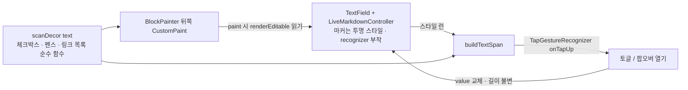

# 024 · 라이브 마크다운 에디터 노션식 시각 UI 3종: 체크박스 · 코드 블록 · 링크 팝오버 (접근 비교 · 실험 · 로드맵)

| 항목 | 값 |
|---|---|
| 조사일 | 2026-10-15 13:59 (KST) |
| 담당 | 서브에이전트 (general-purpose · 읽기 전용: 제품 코드 수정·커밋·서버 기동 없음. 실험용 임시 테스트 `test/zz_*` 4개를 만들고 모두 삭제) |
| 질문 | 저장 텍스트는 마크다운 그대로(왕복 100%)이고 한글 IME가 안전한 채로, 라이브 모드에서 (1) `- [ ]`/`- [x]`를 클릭 가능한 체크박스 UI로 (2) 코드 펜스를 블록 UI로 (3) 링크를 클릭 시 팝오버 UI로 보여 주는 방법은 무엇인가 |
| 결론 한 줄 | **WidgetSpan으로 마커를 바꾸는 방법(B)은 불가능**(실험으로 반증). 대신 **스타일만 바꾸는 방식 + 좌표 기반 페인터(A)**가 3가지를 모두 달성한다: 마커는 투명 처리(텍스트 불변), 체크박스·코드 블록 배경은 `TextField` 뒤에 깐 `CustomPaint`가 `RenderEditable.getBoxesForSelection`으로 그리고, **클릭은 `TextSpan.recognizer`로 받는다**(오버레이 히트 테스트 불필요 — 실험 확인). 링크는 기존 캐럿 기반 칩을 팝오버로 승격. 제품 약 1,000줄 + 테스트 약 600줄 ⚠️ 추정 |
| 반영 | 결정 대기 (§8). 선행: [017](017-flutter-ux-issues-investigation.md) §3 · [023](023-live-markdown-editor-defects-and-roadmap.md) |

> 표기: ✅ 소스를 읽고/실험으로 확인 · ⚠️ 미확인·추정. 구조 중심으로 서술하며 줄 번호는 쓰지 않습니다(다른 에이전트가 `markdown_live.dart`·`note_editor_screen.dart`·`selection_mini_bar.dart`를 동시에 수정 중). 경로 약칭: `ml` = `app/pageblink_flutter/lib/features/notes/markdown_live.dart`, `ed` = 같은 폴더 `note_editor_screen.dart`, `bar` = `selection_mini_bar.dart`. **실험은 전부 `flutter test`(플랫폼 android 기본 · macOS는 `debugDefaultTargetPlatformOverride`, 폰트 Ahem + Material 기본 글자 간격 0.5)에서 했으므로 실제 폰트(Inter/Noto) 치수·실기기 IME·웹 동작은 미확인.** Flutter 3.47.7(fvm), 소스는 `~/fvm/versions/3.47.7`.

---

## 1. 핵심 결론

| # | 결론 | 근거 |
|---|---|---|
| 1 | **B(WidgetSpan)는 마커를 대체할 수 없다.** 위젯 스팬은 글자 1개(`U+FFFC`)로 계산돼 `[ ]` 3글자를 바꾸면 컨트롤러 길이 10 → 렌더 길이 8, 이후 모든 오프셋이 2칸 어긋난다 | §3 T4 ✅ |
| 2 | **글자 색만 바꾸는 마커 숨김은 안전하다.** 투명 색은 레이아웃·박스·캐럿·조합 영역을 바꾸지 않는다(같은 좌표) | T3 ✅ |
| 3 | `RenderEditable.getBoxesForSelection`은 `expands:true`+내부 스크롤에서도 **스크롤이 이미 반영된 뷰포트 좌표**를 준다. 펜스의 줄 사각형들은 틈 없이 이어져 한 블록으로 합칠 수 있다 | T2 ✅ |
| 4 | `TextField` 뒤에 둔 `CustomPaint`가 **페인트 단계에서** `RenderEditable`을 읽으면 같은 프레임 좌표다(텍스트 변경·스크롤 후 1프레임 지연 없음). 후처리 콜백·ticker 불필요 | T10 ✅ |
| 5 | **히트 테스트는 `TextSpan.recognizer`로 해결된다.** 마커 스팬을 탭하면 recognizer만 발화하고 캐럿은 움직이지 않으며, 다른 곳 탭·마커에서 시작한 드래그 선택은 정상이다. 오버레이 위젯으로 탭을 가로채면 `TextFieldTapRegion` 없이는 포커스를 잃는다 | T9 ✅ · T5 ✅ |
| 6 | 비용은 작다: 마커 300개 박스 조회 1.9 ms, 펜스 100개 1.2 ms, 보이는 구간 오프셋 조회 0.14 ms (테스트 VM·Ahem 기준) | T6 ✅ (실기기 ⚠️) |
| 7 | 추천은 **A**: 3단계(체크박스 → 코드 블록 → 링크 팝오버). C(블록 위젯 목록)는 규모·위험이 커서 비추천, D(에디터 패키지)는 왕복 손실·전면 재작성 | §2, §6 |

---

## 2. 접근별 비교

(제품 코드 줄 수는 전부 ⚠️ 추정, 테스트 줄 수 별도)

| 기준 | A. 좌표 기반 페인터 + recognizer | B. 인라인 WidgetSpan | C. 라이브 렌더 전용 레이어(블록 위젯 목록) | D. 에디터 패키지 |
|---|---|---|---|---|
| 개요 | 마커는 투명·스타일 변경, 사각형은 `RenderEditable`에서 읽어 `CustomPaint`로 그림, 클릭은 span recognizer | `buildTextSpan`에 `WidgetSpan`을 넣어 마커 대체 | 커서 없는 블록은 `Text.rich`/위젯, 커서가 들어오면 원문 편집(Obsidian live preview) | `flutter_quill` · `appflowy_editor` · `super_editor` |
| 1 체크박스 | ✅ 박스는 페인터, 탭은 recognizer(T9) | ❌ 오프셋 어긋남(T4). 변형 ``를 텍스트에 넣으면 저장 마크다운이 바뀜 | ✅ 위젯 그대로 | ✅ 기본 제공 ⚠️(일반 지식) |
| 2 코드 블록 | ✅ 줄 박스 합집합 + 둥근 배경(T2). 언어 라벨·복사 버튼 가능 | ❌ 펜스는 여러 줄·전체 폭이라 인라인 스팬 부적합 | ✅ 진짜 블록 위젯 | ✅ 기본 제공 ⚠️ |
| 3 링크 팝오버 | ✅ 기존 `miniBarAnchors` + 팝오버 위젯(이미 칩이 있음) | – | ✅ | ✅ 기본 링크 메뉴 ⚠️ |
| 왕복 100% | ✅ 텍스트 불변 | ❌ (변형 시 깨짐) | ✅ 원문 유지가 설계 | ❌ 문서 모델 ↔ 마크다운 변환 손실 가능 ⚠️ 미실험 |
| IME·커서·선택 | 낮음: 스타일 전용(T3), 선택·조합은 `TextField`가 그대로 처리 | 높음: 오프셋 전부 오염(T4) | 매우 높음: 블록 경계 이동·선택·되돌리기·전체 선택·복사 재구현 | 중~높음: 패키지별 IME 이슈 ⚠️ 미확인 |
| 구현 규모 | 약 1,000줄 (기반+3단계) · 테스트 약 600줄 | – (불가) | 약 2,000줄 이상 ⚠️ | 에디터·툴바·미니바·소스 모드·저장 포맷 전면 재작성 |
| 유지보수 | 중: `RenderEditable` 공개 API(`getBoxesForSelection`·`getPositionForPoint`)만 사용, 내부 구현 비의존 | – | 높음 | 높음(의존성 업데이트·Dart SDK 제약) |
| 현재 SDK 호환 | 의존성 0 | – | 의존성 0 | 017 조사 기준 `flutter_quill` 11.6.0은 Dart ^3.12·Flutter ≥3.44 호환, `appflowy_editor` 6.2.0은 라이선스 태그 MPL/AGPL 혼재 ⚠️, `super_editor`는 안정판이 2024-06로 오래됨 (모두 pub.dev 제약 필드 기준, 빌드 미실행) |

**D 보충**: 이번에는 pub.dev를 다시 조회하지 않았습니다(웹 검색 제외 지시). 017의 2026-10-15 조회값을 그대로 인용했습니다. 체크박스·코드 블록·링크 UI가 각 패키지에 기본으로 있다는 점은 일반 지식(⚠️)이며 이 저장소에서 검증하지 않았습니다. 가장 큰 문제는 기능이 아니라 **저장 포맷이 마크다운 문자열이어야 하는 제약**(서버 색인·diff)입니다.

**추천 1개: A.** 이유 — 이미 있는 `TextField + buildTextSpan` 구조·마커 스타일·`miniBarAnchors`·`LinkOpenChip`을 그대로 쓰고, 의존성 0, 왕복 100%, 소스 모드는 스타일만 끄면 원문 그대로.

---

## 3. 실험 결과

모두 임시 파일 `app/pageblink_flutter/test/zz_*_test.dart`로 실행 후 삭제했습니다(`git status`에 `zz_` 없음 ✅). 입력은 `LiveMarkdownController`(실제 파서) 또는 최소 컨트롤러, 필드는 `TextField(expands: true, maxLines: null, scrollController)` 400×200.

| # | 가정 | 결과 | 판정 |
|---|---|---|---|
| T1 | `getBoxesForSelection`으로 `[ ]` 사각형이 합리적 | 첫 줄 `- [ ] todo`의 `[ ]`(오프셋 2..5): `L33.3 T5.4 R82.8 B21.4` = 폭 49.5(= 3×(16+0.5 글자 간격)), 높이 16(글리프 높이). 줄 높이는 27.2(캐럿 `T0 B27`). 헤딩 줄·한글 줄 뒤쪽의 `[ ]`도 정상 | ✅ |
| T1 보충 | 줄 전체 높이 박스는 `TextField(selectionHeightStyle: BoxHeightStyle.max)`로 얻는다 | `RenderEditable.getBoxesForSelection`은 자기 `selectionHeightStyle`을 쓰므로 T2는 이 설정에서 측정 | ✅ (부작용: 선택 하이라이트도 줄 전체 높이가 됨, 시각 영향 ⚠️) |
| T2 | 펜스 범위의 줄 사각형을 합쳐 블록 배경을 칠할 수 있다 | 6줄(빈 줄 · 25자 폭 넘는 60자 줄 → 줄바꿈 포함) 펜스에서 박스 18개(스타일 런마다 쪼개짐·0폭 박스 포함), **세로 틈 최대 0.0**, 합집합 `T26.8 B216.0`. 빈 줄도 올바른 top/bottom의 0폭 박스를 준다. 스크롤 40 후 합집합이 정확히 dy=-40 이동 → **스크롤 보정 불필요**(`_paintOffset` 포함) | ✅ |
| T3 | 마커를 투명 색으로 칠해도 선택·캐럿·IME 정상 | 투명/불투명의 `[ ]` 박스·뒤따르는 캐럿 사각형 **완전히 동일**, `buildTextSpan().toPlainText() == text`(길이 19), 한글 조합 범위(6..8) 지정 후에도 마커 박스 불변, 마커 범위 선택 끝점 정상. 색만 바뀌므로 오프셋·레이아웃은 구조상 불변이고 `runsToSpan`은 이미 "런을 이어 붙이면 원문"을 보장함 | ✅ (실기기 IME ⚠️) |
| T4 | `WidgetSpan`으로 `[ ]`를 대체 | `controller.text.length=10`, `RenderEditable.plainText.length=8`(`U+FFFC` 1개). `todo`는 컨트롤러 오프셋 6인데 plainText에서는 4. 오프셋 6..10의 박스가 실제 `todo`보다 오른쪽으로 어긋남(`L100.8` vs `L67.8`). 실제 `todo` 가운데를 클릭하면 `TextPosition 6`(텍스트 기준 약 8 기대) → 캐럿이 2칸 앞에 놓임 | ✅ 반증 |
| T5 | 체크박스 오버레이를 `TextField` 위에 얹고 히트 테스트가 충돌하지 않는다 | `GestureDetector(deferToChild)+CustomPaint.hitTest`(박스 사각형만 true): 박스 탭 → 콜백 발화·캐럿 불변, 일반 텍스트 탭 → 캐럿 정상 이동(offset 24). **`TextFieldTapRegion`으로 감싸지 않으면 박스 탭 때 포커스를 잃음**(macOS 마우스 기준 `hasFocus=false`), 감싸면 유지 | ✅ |
| T6 | 10,000자·체크박스 수백 개 성능 | 13,870자, 체크박스 300·펜스 100: 박스 조회 300회 1,926 µs(개당 6.4 µs), 펜스 100회 1,164 µs, 뷰포트 오프셋 범위 조회 136 µs | ✅ (JIT 디버그·Ahem, 실기기 ⚠️) |
| T7 | `RenderEditable.painter`를 직접 붙일 수 있다 | `EditableText`는 이 속성을 노출하지 않지만 `EditableTextState.renderEditable.painter = …`로 부착되고 재빌드·텍스트 변경 후에도 유지, paint 호출됨. 단 내장 페인터(선택 하이라이트) **뒤에** 그려져 반투명 배경이 선택을 덮음 | ✅ (대안으로만 기록) |
| T8 | 프로그램 토글(`[ ]`→`[x]`)이 되돌리기(Cmd+Z)에 들어간다 | `_body.value` 교체 후 Cmd+Z → `- [ ] todo` 복원 | ✅ |
| T9 | 마커 `TextSpan.recognizer`가 `TextField` 안에서 발화한다 | 탭 → `onTap` 1회·**캐럿 불변**·포커스 유지, 다른 곳 탭 → 캐럿 이동, 마커에서 시작한 드래그 → 선택 정상(`2..9`) | ✅ (마우스 커서 `mouseCursor` 반영은 ⚠️ 미확인) |
| T10 | 뒤쪽 페인터가 1프레임 지연 없이 최신 좌표를 읽는다 | 텍스트 4줄 삽입 후 1 pump, 스크롤 30 후 1 pump: 페인터가 기록한 사각형 == 그 시점의 `getBoxesForSelection` | ✅ |
| T11 | (선택) 마커를 `fontSize: 0.01`+투명으로 **접어** 폭을 없앤다 | 길이는 그대로(52/52), 숨긴 구간 폭 0.3 px로 접힘. 단 **캐럿이 접힌 구간 안에서 같은 x(148.7)로 멈춰** 보이고(화살표 키 수십 번), 캐럿이 들어와 펼 때 줄바꿈 재배치가 생김. 조합(IME) 입력은 정상 | ✅ 동작 / 비추천(§7) |

**실험 하네스 주의**: T5·T8은 테스트 종료 시 `debugDefaultTargetPlatformOverride` 해제 순서 때문에 하네스 경고(`foundation debug variable was changed`)가 났지만 측정값과 무관합니다. T5의 첫 실행은 내 프로브 버그(`late` 필드 접근)로 페인트 예외가 났고 수정해 재실행했습니다.

---

## 4. 현재 구조 (✅ 코드를 읽음)

- **스타일 계층**: `LiveMarkdownController.buildTextSpan` → `parseLiveRuns`(줄 단위, 펜스 상태기계 `_Fence`) → `runsToSpan`. 런 합집합 = 원문(왕복 100%). `LiveStyles`에 `todo`·`done`·`bullet`(체크 접두), `code`, `marker`, `link`가 이미 있음. `_Out.links`(내부 수집)와 `linkAt`·`safeLinkUri`가 링크 범위·허용 스킴을 이미 계산.
- **변환 함수(순수)**: `toggleCheck`(`- [ ] ` 접두 전환), `toggleBullet`·`toggleOrdered`(체크 항목도 변환), `toggleLink`(래핑 `[sel]()` / 해제 / 자동 링크 변환), `toggleCode`(여러 줄은 펜스), `continueList`(Enter 이어쓰기, `ListContinuationFormatter`).
- **편집기 UI**: `ed`의 본문 `TextField`는 `expands: true` + `scrollController: _bodyScroll`, 그 위를 `Stack`(`_stackKey`)이 덮고 `SelectionMiniBar`·`LinkOpenChip`을 올림. 위치 계산은 `bar`의 `miniBarAnchors`(`findEditableText` → `renderEditable.getEndpointsForSelection` → `TextSelectionToolbarAnchors.fromSelection` → `stack.globalToLocal`), 갱신은 `_syncBar`(post-frame 콜백 + `_body`·포커스·스크롤 리스너), IME 조합 중·포인터 누름 중에는 측정하지 않음.
- **현재 모양**: 체크 접두는 흐린 `- [ ] `(마커 색) 텍스트일 뿐, 코드 펜스 본문은 `LiveStyles.code`(고정폭·14pt·`backgroundColor` 7%)를 **글자 런마다** 적용 → 줄 끝에서 배경이 끊기고 줄 높이(14pt)가 본문(16pt)과 달라 들쭉날쭉(`height` 1.7이 폰트 크기에 곱해짐 ⚠️ 계산값, 실측 아님). 이것이 "코드 모양이 이상하다"의 원인으로 추정됩니다(⚠️ 실화면 미확인).

---

## 5. 추천 설계 (A, 구조 중심)

### 5.1 구성 요소



1. **`scanDecor(text)`** (순수 함수, 새 코드 ~120줄): 줄 단위로 한 번 훑어 `CheckItem(markerStart, boxStart, boxEnd, done)`, `FenceBlock(start, end, lang, closed)`, `LinkSpan(start, end, labelEnd, url)`을 만든다. 펜스는 기존 `_Fence`, 체크는 `_listRe` 그룹 4, 링크는 `_block`의 링크 수집을 재사용해 **칠하는 것과 같은 규칙**이 된다(`linkAt`과 동일 방침). 텍스트·스타일 키로 캐시(현재 런 캐시와 동일).
2. **마커 숨김 스타일**: `LiveStyles`에 `boxes`(체크박스를 페인터가 그리는지) 플래그. 켜져 있으면 `bullet`·`todo`·`done`을 투명으로(`color: transparent`, 글자 크기·굵기 불변 → 레이아웃 불변, T3). 플래그는 **페인터를 실제로 붙인 호스트가 켠다**(페인터 없이 투명만 켜지는 일을 막음). 소스 모드·테스트·`LiveStyles()` 기본값은 지금처럼 보임.
3. **`LiveDecorLayer` 위젯**(새 코드 ~250줄): `TextField`를 담은 `Stack`의 **첫 자식**(`TextField` 뒤)에 `Positioned.fill(CustomPaint(painter: …))`. `repaint: Listenable.merge([body, bodyScroll])`, 호스트가 `TextField`와 같은 `build`에서 만들어 레이아웃·글꼴 변화에도 같이 재빌드. `paint()` 안에서만 `findEditableText(...).renderEditable`를 읽는다(T10).
4. **보이는 구간만 그리기**: `getPositionForPoint(뷰포트 위·아래 모서리)`로 보이는 텍스트 오프셋 구간을 얻고(0.14 ms, T6) 그 안의 항목만 `getBoxesForSelection`.
5. **히트 테스트는 recognizer**: `LiveRun`에 `kind`(체크/링크)를 실어 `runsToSpan`이 `TextSpan(recognizer: …)`을 붙임. recognizer는 컨트롤러가 **종류당 1개**(`TapGestureRecognizer`, `onTapUp`의 좌표 → `renderEditable.getPositionForPoint` → 해당 항목) 소유하고 `dispose`에서 해제. `_overlay`(하이라이트·조합 밑줄)가 런을 쪼갤 때 `kind`를 복사해야 함.
6. **토글은 길이 불변 치환**: `toggleCheckAt(text, boxStart)`가 `[ ]`↔`[x]`(`[X]`→`[ ]`) 한 글자만 바꿈 → 선택·캐럿 오프셋 그대로(T8로 되돌리기 확인). `_apply`와 같은 경로(`_body.value = …`).

### 5.2 갱신·성능·좌표계

| 상황 | 처리 | 근거 |
|---|---|---|
| 텍스트 변경·IME 조합 | 컨트롤러 알림 → 페인터 `repaint` → 다음 프레임 paint에서 새 레이아웃을 읽음. 조합 중에도 그림(스타일만 바뀜). 미니바처럼 "조합 중 숨김"은 불필요 | T10 ✅ |
| 스크롤 | `repaint`에 `_bodyScroll` 포함. 좌표에 스크롤이 이미 반영됨 | T2 ✅ |
| 리사이즈·글자 크기·줄바꿈 | 같은 `Stack` 크기가 바뀌면 `RenderCustomPaint`가 다시 그림. 텍스트 레이아웃은 매번 `RenderEditable`에서 읽으므로 줄바꿈이 따라옴 | 구조상 ✅ (실제 창 크기 조절 ⚠️) |
| 글꼴 비동기 로딩 | 호스트 재빌드로 페인터가 새로 만들어져 재페인트(`shouldRepaint => true`) | ⚠️ 미확인 |
| 규모 | 보이는 항목만(수십 개) 그리므로 문서 길이와 거의 무관 | T6 ✅ |
| 좌표계 | 페인터는 `renderEditable.getTransformTo(stackRenderBox)`로 변환(콘텐츠 패딩·`Positioned` 음수 오프셋 모두 흡수). 블록 배경을 좌우 8px 넓히려면 `Stack(clipBehavior: Clip.none)`+페인터 안 `clipRect`(위·아래는 뷰포트로 자름) | ⚠️ 구현 시 확인 |
| 접근성 | 페인터의 `semanticsBuilder`로 항목마다 `checked`·라벨("완료"/"미완료")·`onTap` 노드 제공. `TextField` 자체 시맨틱스는 원문(`- [ ] todo`)을 읽음 | ⚠️ 스크린리더 미확인 |
| 마우스 커서·호버 | 마커 `TextSpan(mouseCursor: click)` + 페인터가 호버 상태를 `ValueNotifier`로 받아 박스 테두리 강조 | ⚠️ T9에서 커서 미확인 |

### 5.3 왜 위젯 오버레이가 아니라 페인터+recognizer인가

- 위젯 오버레이(체크박스를 `Positioned` 위젯으로)는 히트 영역이 `TextField` 위에서 탭을 가로채 **포커스를 잃고**(T5) `TextFieldTapRegion` 처리가 필요하며, 스크롤 때마다 위젯을 다시 배치해야 한다. 페인터는 위젯이 0개이고 탭은 텍스트 스팬이 받는다(T9).
- 체크박스 글리프 위치는 투명 `[ ]` 박스(`L33.3~R82.8`)의 왼쪽에 18px 박스를 정렬해 그린다. 프로포셔널 폰트에서 접두 `- [ ] `는 약 30~40px(⚠️ Inter 미측정)이므로 박스 18 + 간격 12 정도. 간격이 넓으면 마커 런의 `fontSize`/`letterSpacing`을 낮춰 폭을 조절한다(스타일 전용이라 안전, T11 같은 원리).

### 5.4 `RenderEditable.painter` 직접 부착(대안)

T7로 가능함을 확인했지만 선택 하이라이트 뒤에 그려져 반투명 배경이 선택을 덮고, `EditableTextState`/`RenderEditable`이 재생성될 때 재부착해야 한다. **형제 `CustomPaint`가 더 단순**하므로 보류합니다.

---

## 6. UX 설계

(노션·Obsidian·Typora의 동작은 일반 지식이며 이 조사에서 직접 확인하지 않았습니다 ⚠️)

### 6.1 체크박스

| 항목 | 제안 |
|---|---|
| 모양 | 18×18, 반경 4. 미완료: 1.5px `inkMuted` 테두리·배경 투명. 완료: `accent` 채움 + 흰 체크. 호버: 테두리 `accent`(데스크톱). 다크 테마도 토큰만 사용 |
| 텍스트 | 완료 시 기존 `checked` 스타일(취소선·흐림) 유지(이미 구현) |
| 클릭 영역 | 글리프 폭(`- `+`[ ]`+뒤 공백 런에 같은 recognizer → 약 45~100px) × 줄 높이(27.2). 세로 ≥28 근처, 터치 44는 줄 높이에 묶여 불가 ⚠️(인접 줄과 겹치지 않게 의도적으로 줄 높이로 제한) |
| 키보드 | 캐럿이 체크 줄에 있을 때 **Cmd/Ctrl+Enter = 토글**(`ed`의 `CallbackShortcuts`에 추가). Space는 텍스트 입력이라 불가. Enter 이어쓰기는 이미 있음(`continueList`) |
| 접근성 | 라벨 "완료"/"미완료"(l10n 2개), `checked` 시맨틱스 |
| 소스 모드 | 박스·투명 처리 없음, 원문 그대로 |
| 캐럿 이동 | 마커는 3~5개 글자라 화살표 키가 투명 구간에서 "멈춘 듯" 보임(T11과 같은 현상, 접지 않아도 발생). 완화: 선택 변경 후처리로 캐럿이 마커 내부(`- ` 뒤~`]` 앞)에 들어오면 경계로 스냅 ⚠️ 선택 피드백 루프 위험, 조합 중에는 건드리지 않음. 1단계는 스냅 없이 출시, 불만이 있으면 추가 |
| 접두 삭제 | `- [ ] ` 바로 뒤에서 Backspace 시 접두 통째 제거(`continueList`와 같은 입력 포매터 계열 ⚠️) — 없으면 `[ ]todo`처럼 깨지고 박스는 사라져(파서가 체크로 안 봄) 원문이 드러남(안전한 실패) |

### 6.2 미니바·툴바 연계

| 후보 | 동작 | 비고 |
|---|---|---|
| ① 체크 항목 전환/해제 | 기존 `toggleCheck`(툴바에 이미 있음)를 **미니바에도** 노출 | 아이콘 `AppIcons.checklist` 있음 |
| ② 완료/미완료 일괄 토글 | 선택된 체크 줄이 모두 `[x]`면 모두 `[ ]`, 아니면 모두 `[x]`. 체크가 아닌 줄은 건드리지 않음 | 새 순수 함수 `toggleDone`(~30줄). 선택에 체크 줄이 1개 이상일 때만 미니바에 표시(`AppIcons.check`) |
| ③ 목록 ↔ 체크리스트 | 이미 `toggleBullet`/`toggleCheck`이 서로 변환 | 추가 작업 없음 |
| ④ 현재 줄 토글 | 캐럿만 있을 때(미니바 없음) Cmd/Ctrl+Enter | §6.1 |

미니바는 선택 영역이 있을 때만 뜨므로 ①②만 추가하고 나머지는 단축키·클릭으로 둔다(미니바 항목 과밀 방지).

### 6.3 코드 블록

| 항목 | 제안 |
|---|---|
| 배경 | `onSurface` 알파 0.05 채움 + 1px `hairline`, 반경 8, 위·아래 안쪽 여백 4px(줄 간격 여유 안), 좌우 8px 바깥으로 확장(§5.2 클립 주의). 줄 박스 합집합 + 전체 폭(T2). 펜스 마커 줄(```` ``` ````)은 **흐린 마커 색 유지**하되 블록 안에 포함 |
| 본문 글자 | 고정폭 유지. **블록 줄에서는 `code`의 `backgroundColor`를 빼고**(인라인 코드만 유지) 블록 배경만 사용 → 줄 끝 끊김 해소 |
| 언어 라벨 | 여는 펜스의 info 첫 단어(` ```dart ` → `dart`)를 블록 오른쪽 위에 11px `inkMuted`로 페인터가 그림(여는 펜스 줄의 오른쪽 빈 공간) |
| 복사 버튼 | 호버 중이거나 캐럿이 블록 안일 때만 오른쪽 위에 아이콘 1개(`AppIcons.copy` → 1.2초 `AppIcons.check`). 블록당 위젯이 아니라 **현재 블록 하나**만 `Positioned`로 띄움. 복사 대상은 펜스 줄을 뺀 본문, `Clipboard.setData` |
| 긴 줄 | `TextField` 한계상 줄바꿈(가로 스크롤 불가). 블록 배경은 줄바꿈된 모든 시각 줄을 덮음(T2) |
| 접힘 | 없음 |
| 닫히지 않은 펜스 | 파서가 문서 끝까지 코드로 보므로 배경도 끝까지(일관). 라벨 옆 경고 없음 |
| 다크 테마 | 알파 기반이라 토큰만 사용 |

### 6.4 링크 팝오버

현재: 캐럿이 링크 안(`linkAt`)이고 허용 스킴이면 `LinkOpenChip`("열기 ↗")이 링크 위에 뜸. 선택이 있으면 미니바가 우선.

| 항목 | 제안 |
|---|---|
| 트리거 | 지금과 같음: 포인터 업 후, IME 조합 중 제외, 캐럿이 링크 내부(엄밀히 start<캐럿<end). 화살표 키로 들어와도 표시 ⚠️(노션은 클릭 시만으로 기억, 소음이 크면 키보드 진입은 제외). Esc로 해당 선택까지 숨김(이미 `_barDismissed`) |
| 위치 | 링크 **아래**(공간 없으면 위), 스택 경계 클램프. 기존 `_Floating`+`TextSelectionToolbarLayoutDelegate` 재사용, "아래 우선" 옵션만 추가. 줄바꿈된 링크는 시작 줄 기준(현 칩과 동일) |
| 보기 모드 | 한 줄 URL(말줄임, 툴팁에 전체) + 아이콘 [열기 `AppIcons.openLink`][복사 `AppIcons.copy`][편집 `AppIcons.edit`][해제 ⚠️ `LucideIcons.unlink` 존재 미확인, 없으면 `AppIcons.close`] |
| 위험 스킴 | `safeLinkUri`가 null(허용: `http`·`https`+호스트, `mailto`)이면 **팝오버는 표시**하되 [열기] 비활성 + "열 수 없는 주소" 경고 문구. 지금은 칩 자체가 안 뜸 → 사용자가 원인을 모름 |
| 편집 모드 | 텍스트·URL 입력 2개 + [확인][취소]. Enter=확인, Esc=취소. 확인 시 `[텍스트](URL)`로 범위 치환(텍스트의 `[`·`]`는 `\`로 이스케이프, URL에 공백·`)`가 있으면 `<…>`로 감쌈 — 파서 `_dest`가 읽음). 자동 링크(`https://…`·`<https://…>`)는 확인 시 `[텍스트](url)`로 승격 |
| 해제 | 기존 `toggleLink`의 "링크 구문 제거·텍스트 유지" 경로 재사용 |
| 칩과의 관계 | **대체**: 칩은 팝오버의 보기 모드가 됨(같은 앵커·같은 트리거). 칩 단독 코드(`LinkOpenChip`)와 `_link` 상태는 팝오버로 통합 |
| 미니바 링크 버튼 | 현재 `toggleLink`(래핑/해제). 제안: ① 선택이 링크가 아니면 `[선택]()`을 만들고 곧바로 팝오버 **편집 모드**(URL 입력 포커스) ② 캐럿/선택이 링크 안이면 편집 모드 ③ 취소(Esc) 시 방금 만든 `[]()`를 되돌림(적용 전 값 보관). 해제는 팝오버의 별도 아이콘 |
| 새 링크 URL 입력 | 클립보드가 `http(s)://…`이면 자동 채움 후 전체 선택(Enter로 바로 확정). `Clipboard.getData`는 웹에서 권한·사용자 제스처 제한 ⚠️ 미확인 |
| Cmd/Ctrl+클릭 | 링크 recognizer + 수정 키 확인으로 바로 열기(옵션) ⚠️ |
| 구조 변경점 | 편집 모드에서는 본문이 포커스를 잃으므로 현재 `_measureLink`의 "본문 포커스 필수" 조건과 충돌 → **팝오버 상태(`_linkEditing`)를 별도로 두고** 그동안은 포커스·`ExcludeFocus`를 풀어야 함 |

---

## 7. 단계별 로드맵

| 단계 | 내용 | 제품 코드 | 테스트 | 위험 |
|---|---|---|---|---|
| **0. 기반** | `scanDecor`, `LiveRun.kind`+`runsToSpan` recognizer 전달(`_overlay` 복사), `LiveDecorLayer`(뒤쪽 페인터·변환·보이는 구간) 골격 | ~250줄 | 파서 단위(펜스·체크·링크 범위가 칠한 것과 일치) ~120줄 | 낮음: 스타일·그리기만 추가 |
| **1. 체크박스** | 마커 투명(`boxes` 플래그) + 박스 그리기 + 탭 토글(`toggleCheckAt`) + Cmd/Ctrl+Enter + 미니바 ①② + l10n 4개 | ~220줄 | 위젯: 탭→텍스트 `[x]`·캐럿 불변·되돌리기, 조합 중 박스 위치 불변, 스크롤/줄바꿈 후 위치(이번 T1~T10을 정식 테스트로) ~180줄 | 낮음~중: 캐럿이 투명 구간에 멈춤(§6.1), recognizer 수명(`dispose`) |
| **2. 코드 블록** | 블록 배경·라벨·복사 버튼, 블록 줄의 `code` 배경 제거 | ~200줄 | 닫힌/안 닫힌/빈 줄/줄바꿈/스크롤, 복사 내용 ~120줄 | 낮음: 읽기 전용 그리기. `selectionHeightStyle: max` 부작용(선택 하이라이트 높이) 확인 필요 |
| **3. 링크 팝오버** | 칩→팝오버(보기/편집), 위험 스킴 경고, 미니바 링크 버튼 흐름, 클립보드 채움 | ~330줄 | 위젯: 열기·복사·편집 확정/취소·해제·허용 스킴·줄바꿈 링크·IME 입력 ~200줄 | 중: 포커스 이동(본문↔팝오버 입력), `_syncBar` 측정 조건 변경 |
| (선택) 4 | 캐럿 스냅, 마커 접기(T11), 펜스 마커 숨김 | 각 ~60~100줄 | – | 중~높음: 선택 후처리·재배치 |

합계: 제품 약 1,000줄 + 테스트 약 620줄(0단계 포함). 모든 코드량은 구현해 보지 않은 추정(⚠️)입니다.

**마커 접기(T11)를 추천하지 않는 이유**: 길이는 그대로지만 캐럿이 숨은 구간에서 멈추고, 캐럿이 들어올 때마다 줄바꿈이 다시 계산되어 글이 튄다. 캐럿 스냅·재배치 완화가 같이 필요해 1~3단계 범위를 넘는다.

---

## 8. 사용자가 결정해야 할 것

| # | 결정 | 선택지 | 제안 |
|---|---|---|---|
| 1 | 체크박스 옆 `-` 처리 | (a) `- `도 투명으로 숨김(노션식) (b) 마커 흐림 유지하고 `[ ]`만 박스 | (a). 023 문서의 "마커 흐림 유지(a)" 추천과 어긋나므로 확인 필요(체크 접두에 한해 예외로 둘지) |
| 2 | 위험 스킴 링크 | (a) 팝오버 표시 + 열기 비활성 + 경고 (b) 지금처럼 아무것도 안 띄움 | (a) |
| 3 | 링크 팝오버 트리거 | (a) 지금처럼 캐럿 진입 시(키보드 포함) (b) 클릭만 | (a)로 시작, 방해되면 (b) |
| 4 | 미니바 링크 버튼 | (a) 팝오버 편집 모드를 연다 (b) 지금처럼 즉시 토글 | (a) |
| 5 | 체크 일괄 완료 | 미니바에 ②를 넣을지 | 넣음(선택에 체크 줄이 있을 때만) |
| 6 | 단계 범위 | 해커톤 일정상 1단계만 / 1~2 / 1~3 | 1→2→3 순, 각 단계 독립 배포 가능 |
| 7 | 캐럿 스냅 | 1단계에 포함 / 보류 | 보류(불만 시 4단계) |

---

## 9. 미확인 · 리스크

- ⚠️ 실제 폰트(Inter·Noto Sans KR)에서의 박스·간격 치수, 박스와 텍스트 사이 간격(§5.3), 실기기·웹(CanvasKit/HTML)·모바일에서의 동작. 테스트는 Ahem + android 기본 플랫폼.
- ⚠️ 한글 IME 실입력(조합 중 박스/블록 깜빡임). T3·T11은 `updateEditingValue`로 조합 범위를 시뮬레이션한 것이며 실제 IME 후보 창·재변환은 미확인.
- ⚠️ `TextSpan.mouseCursor`·호버, `CustomPainter.semanticsBuilder`의 스크린리더 읽기, `LucideIcons.unlink` 존재.
- ⚠️ `Clipboard.getData` 웹 권한, Cmd/Ctrl+Enter가 플랫폼 기본 동작과 충돌하는지.
- ⚠️ `selectionHeightStyle: max`를 켜면 선택 하이라이트 모양이 바뀜(블록 줄 높이를 균일하게 얻기 위한 선택, 대안은 `getLocalRectForCaret`으로 줄별 사각형을 구성).
- ⚠️ D의 각 패키지 기능·IME·왕복 손실은 이번에 직접 실험하지 않음(017 인용).
- 다른 에이전트가 `ml`/`ed`/`bar`를 수정 중이므로 구현 시작 전 `LiveRun`·`_overlay`·`linkAt`의 현재 모양을 다시 읽을 것.

## 출처

- Flutter 3.47.7 소스(`~/fvm/versions/3.47.7/packages/flutter/lib/src`): `rendering/editable.dart`(`getBoxesForSelection`·`getEndpointsForSelection`·`getLocalRectForCaret`·`hitTestChildren`(span `HitTestTarget`)·`painter`/`foregroundPainter`·`plainText`), `widgets/editable_text.dart`(`buildTextSpan`·`_ScribblePlaceholder`·`_EditableTextTapOutsideAction`·`TextEditingController.buildTextSpan` 문서), `widgets/tap_region.dart`(`TextFieldTapRegion`)
- 저장소: `app/pageblink_flutter/lib/features/notes/{markdown_live,note_editor_screen,selection_mini_bar}.dart`, `lib/app/app_icons.dart`, `docs/research/017-flutter-ux-issues-investigation.md`(패키지 비교 §3), `docs/research/023-live-markdown-editor-defects-and-roadmap.md`
- 017이 인용한 pub.dev API: https://pub.dev/api/packages/flutter_quill · https://pub.dev/api/packages/appflowy_editor · https://pub.dev/api/packages/super_editor · https://pub.dev/api/packages/super_editor_markdown (2026-10-15 조회분, 이번 재조회 없음)
